# Quilt 设计文档

> Quilt：AI 原生的无限画布设计工具——用自然语言生成一个 APP 的多屏 HTML 设计稿，摆在无限画布上浏览、交互、迭代、串成可点击的原型；并通过 MCP 让本地编码 agent（Claude Code / Codex）双向接入。**v0.32 起为本地单用户版**：`npx quilt-canvas` 一条命令在用户自己的机器上跑起来，无账号、无鉴权、数据全在 `~/.quilt`；SaaS（多账号、OAuth、配额）整体推迟，涉及的 REQ 标「推迟」而非删除。
> 本文档是前端、后端、MCP server 共用的单一事实源。
> 功能域与里程碑对应：`CORE`=M1、`PROTO`=M2、`EDIT`=M3、`AGENT`=M4/M5、本地版=M10。

## 1. 元信息 / 变更记录

| 字段 | 值 |
| --- | --- |
| 状态 | 已批准（2026-09-09 Owner 逐项签字 ⚠ ADR-001/003/004/005/009/010/011 与 §7 数据模型、§8 契约；见变更记录 v0.2） |
| 项目画像 | 生产产品（全部核心节生效） |
| Owner | @bug |
| 评审人 | @bug（产品 / 架构） |
| 最后更新 | 2026-10-25（v1.43 回到旧版只把当前版指回那一版，不再多出一个新版本；v1.42 开发用 Postgres 的日志行带上时间、进程号与库名；v1.41 导出原型嵌在别的页面里时不写宿主页的历史、原型不在视口里时换屏不报错、字体服务连不上时不再整屏空白；v1.40 图表色换成预置色板「柔和」的描边加填充两档，按钮与输入框高 30、图标与文字间距 8，网站图标换成小尺寸版；v1.39 选元素时没有指针位置的点击按落点元素取；v1.38 草稿本选元素开着、一块没选时 Esc 关掉选元素；v1.37 选元素时滚动，悬停框跟到指针下的元素；v1.36 作业完成的 chip 收窄到正好包住文字；v1.35 MCP 的 GET 回 405、请求日志汇总带各路由的数；v1.34 选元素不再被全透明的遮罩挡住；v1.33 作业完成时 chip 转成「任务完成」，停 10 秒再淡出，可提前关掉；v1.32 同一项目或草稿本里的人互相看到光标、选中、视野与在改的东西；v1.31 画布缩放调慢一半，连线改成苹果式细线；v1.30 局域网 IP 用 http 打开不再白屏，复制退回旧接口；v1.29 连线只在一屏进入交互时画这一屏的、换成彩色端口画法，连线与组件引用按差量写，截图编码压缩档取 4，请求与慢查询记进本机日志；v1.28 逐级选改用 Shift+↑ / Shift+↓，用量看板不把导出算给模型，截图编码限 2 路，会话列表去重；v1.27 截图存无损 WebP、旧版本只留缩略图、回到旧版复用原版的文件；v1.27 的 sharp 依赖由 Owner 选定；v1.26 选元素时按住 Shift 多选、几块一次改完；v1.25 草稿本按 ⌘Z 回到上一版、逐级选不再被焦点按钮吃掉；v1.24 设置改成用量、模型、系统三节，用量看板，台账记下项目、任务类型与模型名，界面上「通道」改叫「模型」；v1.24 的台账快照列与 v1.22 的数据模型、接口与 ADR-035 已由 Owner 签字；v1.23 撤下批注、双击组件卡把镜头摆过去；v1.22 本机使用记录；v1.21 草稿里只改一块也能带参考图；v1.20 界面支持中文与英文；v1.19 缩小显示的屏改用 zoom；v1.18 草稿出新版原地换；v1.17 去掉对话记录、作业 chip、记录栏浮层、画框不能跨组件与页面；v1.16 输入框停靠与收起、草稿放大；v1.15 界面视觉换成苹果风；v1.14 草稿写回与参照；v1.13 与 v1.14 的数据模型、接口与 ADR-030～033 已由 Owner 签字） |
| 关联 | 契约 `api/openapi.yaml`（实现期建立） · 仓库 `github.com/Bearisbug/Quilt` · 安装 `npx quilt-canvas`（包 `apps/cli`） · 调研结论见会话记录 2026-09-07/08/09 |
| 链路层 | 部分 |

更早的版本（v0.4–v1.38）在 `docs/CHANGELOG.md`；下方两张表合计只留 v0.1–v0.3 与最近 5 版，再往前的随每次出版移过去。

变更记录：

| 日期 | 版本 | 涉及 ID | 一句话 | 类型 |
| --- | --- | --- | --- | --- |
| 2026-10-25 | v1.43 | REQ-CORE-007、API-CORE-015、ADR-039、FLOW-SKETCH、PAGE-SKETCH、PAGE-CANVAS | 回到旧版只把当前版指回那一版，不再多出一个新版本 | 功能 |
| 2026-10-24 | v1.42 | ADR-010 | 开发用 Postgres 的日志行带上时间、进程号与库名，分得清是哪个库的慢查询 | 功能 |
| 2026-10-24 | v1.41 | REQ-PROTO-004、API-PROTO-002 | 导出原型嵌在别的页面里时不写宿主页的历史，不在视口里换屏不报错，字体服务连不上也不再整屏空白 | 缺陷修复 |
| 2026-10-24 | v1.40 | REQ-CORE-008、PAGE-CANVAS、PAGE-FIRST、PAGE-SKETCH | 图表色换成预置色板「柔和」的描边加填充两档，按钮与输入框高 30，网站图标换成小尺寸版 | 界面 |
| 2026-10-22 | v1.39 | REQ-EDIT-001、PAGE-CANVAS | 选元素时键盘触发或脚本发出的点击按落点元素取，不再选成页面左上角 | 缺陷修复 |

变更记录（旧格式）：

| 日期 | 版本 | 改动 | 作者 |
| --- | --- | --- | --- |
| 2026-09-09 | v0.1 | 初稿：M1–M5 全范围数据模型、接口契约、状态机、流程、页面、ADR | @bug |
| 2026-09-09 | v0.2 | Owner 逐项签字批准；新增 `REQ-CORE-010` 设计系统可视化（M1 只读风格指南卡片 + 面板）；⚠ ADR 由 Proposed 转 Accepted；M0 spike 时间盒定 3 天；拍板 Google 登录推迟、金标准屏用内置模板库 | @bug |
| 2026-09-09 | v0.3 | M0 spike 结论回写（§26 出口达成；ADR-002/003/005 补实证与后果；§28 新增 4 条发现）；spike 代码在 `spike-m0/`（gitignore），不进生产 | @bug |

## L1. 链路总览

领域顺序：地基 → 项目 → 画布 → 生成 → 迭代 → 设计系统 → 原型 → 草稿本 → 接入 → 设置

### 角色：本机用户

| 链路 | 名称 | 领域 | 状态 | 涉及需求 |
| --- | --- | --- | --- | --- |
| FLOW-INSTALL | 安装与启动 | 地基 | 已实现 | REQ-CORE-017 |
| FLOW-SAAS | 多账号与远程派活 | 地基 | 设计中 | REQ-CORE-001、REQ-AGENT-004、REQ-AGENT-005 |
| FLOW-PROJECT | 建项目与切换 | 项目 | 已实现 | REQ-CORE-002、REQ-CORE-009、REQ-CORE-037 |
| FLOW-CANVAS | 浏览与排列画布 | 画布 | 已实现 | REQ-CORE-004、REQ-CORE-018、REQ-CORE-024 |
| FLOW-GENERATE | 造屏 | 生成 | 已实现 | REQ-CORE-003、REQ-CORE-012、REQ-CORE-014、REQ-CORE-016、REQ-CORE-022、REQ-CORE-025 |
| FLOW-EDIT | 改屏 | 迭代 | 已实现 | REQ-CORE-006、REQ-CORE-020、REQ-CORE-026 |
| FLOW-REVISION | 候选与修订 | 迭代 | 已实现 | REQ-CORE-007、REQ-CORE-015 |
| FLOW-ELEMENT | 元素直改与局部重生成 | 迭代 | 已实现 | REQ-EDIT-001、REQ-EDIT-002 |
| FLOW-CHAT | 聊天 | 迭代 | 已废弃 | REQ-CORE-023 |
| FLOW-ANNOTATE | 批注 | 迭代 | 已废弃 | REQ-EDIT-004 |
| FLOW-DESIGN-SYSTEM | 设计系统 | 设计系统 | 已实现 | REQ-CORE-010、REQ-CORE-019、REQ-CORE-021、REQ-CORE-036、REQ-EDIT-003、REQ-EDIT-005 |
| FLOW-COMPONENT | 共享组件 | 设计系统 | 已实现 | REQ-EDIT-006 |
| FLOW-BRAND-IMPORT | 导入品牌设计系统 | 设计系统 | 设计中 | REQ-CORE-038 |
| FLOW-PLAY | 原型播放 | 原型 | 已实现 | REQ-CORE-005、REQ-PROTO-001、REQ-PROTO-002、REQ-PROTO-003、REQ-PROTO-005 |
| FLOW-EXPORT | 导出原型 | 原型 | 已实现 | REQ-PROTO-004 |
| FLOW-SKETCH | 草稿本出稿 | 草稿本 | 设计中 | REQ-CORE-040、REQ-CORE-042 |
| FLOW-SKETCH-REFINE | 草稿里只改一块 | 草稿本 | 设计中 | REQ-CORE-045 |
| FLOW-SKETCH-FORK | 屏拿到草稿本改 | 草稿本 | 设计中 | REQ-CORE-043 |
| FLOW-SKETCH-COPY | 草稿写回项目 | 草稿本 | 设计中 | REQ-CORE-041、REQ-CORE-044 |
| FLOW-SETTINGS | 模型管理与外观 | 设置 | 已实现 | REQ-CORE-011、REQ-CORE-013、REQ-CORE-039 |
| FLOW-USAGE | 用量台账与看板 | 设置 | 已实现 | REQ-CORE-008 |
| FLOW-LOCALE | 界面语言 | 设置 | 设计中 | REQ-CORE-046 |
| FLOW-RECORD | 本机使用记录 | 设置 | 已实现 | REQ-CORE-047 |
| FLOW-COLLAB | 协作显示 | 画布 | 已实现 | REQ-CORE-048 |

### 角色：本机 agent

| 链路 | 名称 | 领域 | 状态 | 涉及需求 |
| --- | --- | --- | --- | --- |
| FLOW-MCP | agent 读写画布 | 接入 | 已实现 | REQ-AGENT-001、REQ-AGENT-002 |
| FLOW-AGENT-JOB | 会话接画布派的活 | 接入 | 已实现 | REQ-AGENT-003 |

界面外壳：Web｜apps/web/src/project/TopNav.tsx、apps/web/src/project/ProjectSwitcher.tsx、apps/web/src/canvas/CanvasToolbar.tsx、apps/web/src/styles.css

## L2. 链路卡

> 图例：现状待确认 = 实现已定、文档未写，等你确认是否定稿；无用例 = 这一行还没有测试用例；分支未与用户逐类核对 = 所列步骤的分支由 Agent 按文档与代码预填，还没和你逐类问过

### FLOW-SKETCH · 草稿本出稿

#### 概要

- **执行者**：本机用户
- **触发**：在项目切换器菜单里点「草稿本」（PAGE-SKETCH）
- **进入条件**：Quilt 已在本机启动，从任何项目的画布都能进
- **结果**：一句话出一张组件或页面草稿，改到满意就收起，接着出下一张
- **不管**：草稿串成原型、导出、零 token 直改、一次出多张

#### 主流程

1. S1 用户在项目切换器菜单里点「草稿本」 〔界面：Web 项目切换器｜apps/web/src/project/ProjectSwitcher.tsx〕
2. S2 打开草稿本页，取回草稿本（API-CORE-046） 〔界面：Web 草稿本｜apps/web/src/pages/Sketch.tsx〕
3. S3 看板为空，用户写一句话、选画框后发送（API-CORE-010） 〔界面：Web 草稿本输入框｜apps/web/src/sketch/SketchComposer.tsx〕
4. S4 后台按这句话的风格出一张草稿，按画框截图 〔无界面〕
5. S5 草稿按画框摆在看板正中，可点可滚 〔界面：Web 草稿看板｜apps/web/src/sketch/DraftStage.tsx〕
6. S6 用户再发一句，改这张草稿（API-CORE-010） 〔界面：Web 草稿本输入框｜apps/web/src/sketch/SketchComposer.tsx〕
7. S7 后台在这张草稿上改出新的一版 〔无界面〕
8. S8 用户点「收起」或按 Esc，看板清空 〔界面：Web 草稿看板｜apps/web/src/sketch/DraftStage.tsx〕
9. S9 用户点记录栏里的缩略图，草稿回到看板 〔界面：Web 记录栏｜apps/web/src/sketch/DraftRail.tsx〕

#### 分支

> 分支未与用户逐类核对：S1–S9

##### S2 取回草稿本

| 类型 | 分支 | 结果 | 依据 | 测试 |
| --- | --- | --- | --- | --- |
| 边界 | 第一次进来，还没有草稿本 | 建一个空草稿本，看板与记录栏都为空 | API-CORE-046 | TC-CORE-098、TC-CORE-099 |
| 并发 | 两个标签页同时第一次进来 | 只建出一个草稿本，两边拿到同一个 | 竞态「两个标签页同时第一次打开草稿本」；INV-CORE-001 | TC-CORE-098 |
| 边界 | 草稿本被删过 | 再建一个空的 | API-CORE-046 | TC-CORE-098 |

##### S3 发送一句话

| 类型 | 分支 | 结果 | 依据 | 测试 |
| --- | --- | --- | --- | --- |
| 失败 | 上一张新草稿还在生成 | 发送被挡住，字留在输入框〔提示：上一张草稿还在生成，等它落地再开下一张〕 | /errors/screen-busy；竞态「草稿本里同时开两张新草稿」 | TC-CORE-104、TC-CORE-105 |
| 失败 | 选了本机 agent 通道但没选会话 | 发送被挡住〔提示：先选一个会话〕 | /errors/validation；API-CORE-010 | TC-CORE-110 |
| 失败 | 一分钟内发得太多 | 429 /errors/rate-limited | /errors/rate-limited；API-CORE-010 | 无用例 |
| 失败 | 请求带了草稿本不收的参数 | 400 /errors/validation | /errors/validation；API-CORE-010 | TC-CORE-102 |
| 边界 | 草稿选了参照项目 | 按该项目的设计系统出稿与渲染 | ADR-033；字段 screens.ref_project_id | TC-CORE-113 |
| 边界 | 参照项目已被删 | 退回自由风格 | 字段 screens.ref_project_id | TC-CORE-113 |
| 边界 | 画框选「自动」 | 由模型在草稿上声明画框 | 字段 screens.frame | TC-CORE-100、TC-CORE-103 |

##### S4 后台出稿

| 类型 | 分支 | 结果 | 依据 | 测试 |
| --- | --- | --- | --- | --- |
| 失败 | 模型通道报错或超时 | 作业失败，没出内容的草稿删掉〔提示：生成失败的原因与下一步〕 | /errors/provider-unavailable；迁移 ENT-GenerationJob running→failed「生成失败」；API-CORE-006 | TC-CORE-104 |
| 失败 | 用户取消 | 作业取消，没出内容的草稿删掉 | 竞态「作业成功落库与用户取消同时到达」；API-CORE-009 | TC-CORE-104 |
| 边界 | 选的是本机 agent 通道 | 投递到会话，由会话写回并收口 | API-CORE-010 | TC-CORE-110 |
| 失败 | 会话 30 分钟没收口 | 作业判超时，已写回的草稿保留 | API-CORE-010 | 无用例 |
| 边界 | 截图失败 | 草稿照常能看，缩略图稍后补上 | ADR-002 | 无用例 |

##### S5 草稿摆上看板

| 类型 | 分支 | 结果 | 依据 | 测试 |
| --- | --- | --- | --- | --- |
| 边界 | 画框是组件 | 按根元素的实际大小居中 | 字段 screens.frame；API-CORE-016 | TC-CORE-100 |
| 边界 | 草稿比看板大 | 等比缩小到放得下，不裁切 | PAGE-SKETCH | TC-CORE-106 |
| 边界 | 用户这期间已打开别的草稿 | 不抢看板，新草稿只进记录栏 | PAGE-SKETCH | TC-CORE-106 |

##### S6 改这张草稿

| 类型 | 分支 | 结果 | 依据 | 测试 |
| --- | --- | --- | --- | --- |
| 失败 | 这张草稿上一轮还没改完 | 发送被挡住〔提示：「草稿名」正在改，等这一轮完事〕 | /errors/screen-busy | TC-CORE-105 |
| 并发 | 另一个标签页同时改同一张 | 后到的 409 /errors/screen-busy | 竞态「同一屏同时发起两次编辑作业」 | TC-CORE-104 |
| 失败 | 这张草稿已在别处被删 | 404 /errors/not-found，看板清空〔提示：这张草稿已被删除〕 | /errors/not-found；API-CORE-010 | TC-CORE-104、TC-CORE-106 |

##### S7 改出新一版

| 类型 | 分支 | 结果 | 依据 | 测试 |
| --- | --- | --- | --- | --- |
| 边界 | 补丁对不上当前内容 | 退回整张重写，仍只出一版 | ADR-007 | TC-CORE-102 |
| 边界 | 用户要回到之前某一版 | 在「版本」里点它，当前版指回它，不多出新版本 | API-CORE-015 | TC-CORE-100 |
| 失败 | 生成中点了回到旧版 | 409 /errors/screen-busy | 竞态「用户在生成中回溯旧版」 | TC-CORE-104 |
| 失败 | 版本列表过期时回到旧版 | 409 /errors/revision-conflict，刷新版本后重试 | /errors/revision-conflict；API-CORE-015 | TC-CORE-104 |
| 边界 | 用户按 ⌘Z | 当前版指回它的上一版，不多出新版本；连按一版版往回走 | API-CORE-015；PAGE-SKETCH | TC-CORE-150 |
| 边界 | 已是第一版时按 ⌘Z | 提示已经是第一版，不发请求 | PAGE-SKETCH | TC-CORE-150 |
| 失败 | 生成中按 ⌘Z | 提示正在改，不发请求 | 竞态「用户在生成中回溯旧版」 | TC-CORE-150 |

##### S8 收起

| 类型 | 分支 | 结果 | 依据 | 测试 |
| --- | --- | --- | --- | --- |
| 边界 | 草稿还在生成时收起 | 照常生成，记录栏里标「生成中」 | PAGE-SKETCH | TC-CORE-101 |
| 边界 | 输入框里有没发出的字时按 Esc | 先清掉字，再按一次才收起 | PAGE-SKETCH | TC-CORE-101 |

##### S9 重新打开

| 类型 | 分支 | 结果 | 依据 | 测试 |
| --- | --- | --- | --- | --- |
| 边界 | 地址里的草稿已被删 | 看板为空〔提示：这张草稿已被删除〕 | API-CORE-004 | TC-CORE-106 |
| 边界 | 用户在看板上删掉这张草稿 | 确认后删除，不可恢复，看板清空 | API-CORE-018 | TC-CORE-106 |
| 失败 | 删正在生成的草稿 | 409 /errors/screen-busy | /errors/screen-busy；API-CORE-018 | TC-CORE-104 |
| 边界 | 用户点「写回项目」 | 转入草稿写回项目 | API-CORE-047 | TC-CORE-109 |

#### 待决策

- **Q-SKETCH-1 · 画框选「自动」时，由模型定还是先问用户？**
  - 现状：未实现
  - 建议：由模型在草稿根元素上声明，看板上随时可改
  - 何时换：实测模型选错的比例超过五分之一
  - 代价：选错时用户要手动改一次画框
  - 不可逆：否
  - 何时定：设计文档确认时
  - 谁定：产品
  - 卡住：不卡
- **Q-SKETCH-2 · 每改一轮都留一版、可回到任一版吗？**
  - 现状：未实现
  - 建议：留，复用屏的修订，「版本」里按缩略图回到某一版
  - 何时换：用户觉得版本列表多余
  - 代价：不新增数据结构，只多一个弹层
  - 不可逆：否
  - 何时定：设计文档确认时
  - 谁定：产品
  - 卡住：不卡
- **Q-SKETCH-3 · 收起用 Esc，还是另设快捷键？**
  - 现状：未实现
  - 建议：用 Esc，输入框有字时第一下先清字
  - 何时换：用户常误按 Esc 收起正在看的草稿
  - 代价：Esc 在输入框里有两种作用，要按两次
  - 不可逆：否
  - 何时定：设计文档确认时
  - 谁定：产品
  - 卡住：不卡

另见：ADR-030；ADR-031；API-CORE-046；API-CORE-047

#### 关联

- **契约锚点**：API-CORE-046；API-CORE-010；API-CORE-004；API-CORE-012；API-CORE-015；API-CORE-018；API-CORE-030；ADR-030；ADR-033；字段 projects.kind；字段 screens.frame；字段 screens.ref_project_id
- **上游**：FLOW-PROJECT、FLOW-SKETCH-FORK
- **下游**：FLOW-SKETCH-COPY、FLOW-SKETCH-REFINE
- **守住的不变量**：INV-CORE-001、INV-CORE-002、INV-CORE-003

| 步骤 | 位置 |
| --- | --- |
| S1 | `apps/web/src/project/ProjectSwitcher.tsx#ProjectSwitcher` |
| S2 | `apps/web/src/pages/Sketch.tsx#SketchRoute`；`apps/api/src/services/sketchbook.ts#ensureSketchbook` |
| S3 | `apps/web/src/sketch/SketchComposer.tsx#SketchComposer`；`apps/api/src/http/routes/projects.ts#createMessage` |
| S4 | `apps/api/src/worker/pipeline.ts#runGenerate`；`packages/core/src/contract.ts#sketchSystemPrompt` |
| S5 | `apps/web/src/sketch/DraftStage.tsx#DraftStage` |
| S6–S7 | `apps/api/src/worker/pipeline.ts#runEditScreens`；`apps/api/src/worker/agentDelivery.ts#buildPrompt` |
| S8 | `apps/web/src/sketch/DraftStage.tsx#DraftStage` |
| S9 | `apps/web/src/sketch/DraftRail.tsx#DraftRail` |

### FLOW-SKETCH-REFINE · 草稿里只改选中的几块

#### 概要

- **执行者**：本机用户
- **触发**：在草稿上方的工具条打开「选元素」（PAGE-SKETCH）
- **进入条件**：看板上打开着一张有内容的草稿
- **结果**：只改点中的那一块或几块，草稿多出一版，其余原样
- **不管**：零 token 直改

#### 主流程

1. S1 用户打开「选元素」 〔界面：Web 草稿看板｜apps/web/src/sketch/DraftStage.tsx〕
2. S2 用户点中草稿里的元素，它被框出；按住 Shift 再点可加选或减选 〔界面：Web 草稿看板｜apps/web/src/sketch/DraftStage.tsx〕
3. S3 在输入框写一句 〔界面：Web 草稿本输入框｜apps/web/src/sketch/SketchComposer.tsx〕
4. S4 用户发送（API-CORE-006） 〔界面：Web 草稿本输入框｜apps/web/src/sketch/SketchComposer.tsx〕
5. S5 后台一次调用只改选中的几块，落成草稿的新一版 〔无界面〕
6. S6 看板换成新版，选中清掉 〔界面：Web 草稿看板｜apps/web/src/sketch/DraftStage.tsx〕

#### 分支

> 分支未与用户逐类核对：S1、S3–S6

##### S2 点选

| 类型 | 分支 | 结果 | 依据 | 测试 |
| --- | --- | --- | --- | --- |
| 边界 | 按住 Shift 点已选中的元素 | 把它从选中里去掉 | PAGE-SKETCH | TC-EDIT-041 |
| 边界 | 加选的元素与已选的互相包含 | 只留外面那一块，提示已合并到外层 | PAGE-SKETCH | TC-EDIT-041 |
| 边界 | 已选满 8 块再加选 | 不加，提示最多 8 块 | PAGE-SKETCH；API-CORE-006 | TC-EDIT-041 |

##### S4 发送

| 类型 | 分支 | 结果 | 依据 | 测试 |
| --- | --- | --- | --- | --- |
| 边界 | 点选的是草稿根 | 等同改整张 | API-CORE-006 | 无用例 |
| 边界 | 输入框里带了参考图 | 图跟这一块的模型调用一起发出，与改整张时一样 | API-CORE-006；REQ-CORE-012 | TC-CORE-138 |
| 失败 | 这张草稿上一轮还没改完 | 409 /errors/screen-busy | /errors/screen-busy；竞态「同一屏同时发起两次编辑作业」 | 无用例 |
| 并发 | 点选之后这张草稿已出了新一版 | 409 /errors/revision-conflict，重新点选 | /errors/revision-conflict；API-CORE-006 | TC-CORE-117 |
| 失败 | 一分钟内发得太多 | 429 /errors/rate-limited | /errors/rate-limited；API-CORE-006 | 无用例 |
| 失败 | 元素在别处的改动里已被换掉 | 作业失败，提示重新点选〔提示：这一块已经变了，重新点一下〕 | 迁移 ENT-GenerationJob running→failed「生成失败」；API-CORE-006 | 无用例 |
| 失败 | 模型回来的块对不上选中的几块 | 补问一轮；仍对不上则作业失败，草稿不变 | 迁移 ENT-GenerationJob running→failed「生成失败」；API-CORE-006 | TC-EDIT-041 |

#### 待决策

无。

另见：ADR-033

#### 关联

- **契约锚点**：API-CORE-006；API-CORE-010
- **上游**：FLOW-SKETCH
- **下游**：—
- **守住的不变量**：INV-CORE-003

| 步骤 | 位置 |
| --- | --- |
| S1–S4 | `apps/web/src/sketch/DraftStage.tsx#DraftStage` |
| S5 | `apps/api/src/worker/pipeline.ts#runRegenerateSubtree` |

### FLOW-SKETCH-COPY · 草稿写回项目

#### 概要

- **执行者**：本机用户
- **触发**：在草稿上方的工具条点「写回项目…」（PAGE-SKETCH）
- **进入条件**：这张草稿至少有一版内容
- **结果**：草稿当前版成为项目里的新屏、组件，或覆盖已有的一屏或一块
- **不管**：写回之后两边同步、一次写到多个屏

#### 主流程

1. S1 用户在草稿工具条点「写回项目…」 〔界面：Web 写回弹层｜apps/web/src/sketch/CopyDialog.tsx〕
2. S2 弹层按草稿的写回目标或参照项目选好缺省值 〔界面：Web 写回弹层｜apps/web/src/sketch/CopyDialog.tsx〕
3. S3 用户选方式：新屏、共享组件、覆盖整屏或换一块 〔界面：Web 写回弹层｜apps/web/src/sketch/CopyDialog.tsx〕
4. S4 覆盖时选目标屏，换一块时在目标屏上点选元素 〔界面：Web 写回弹层｜apps/web/src/sketch/CopyDialog.tsx、apps/web/src/sketch/TargetPicker.tsx〕
5. S5 用户确认，弹层写明能回到覆盖前的哪一版 〔界面：Web 写回弹层｜apps/web/src/sketch/CopyDialog.tsx〕
6. S6 后台写入目标项目（API-CORE-047） 〔无界面〕
7. S7 草稿记下这次的写回目标 〔无界面〕
8. S8 提示条写「已写回」，带「去看看」 〔界面：Web 写回弹层｜apps/web/src/sketch/CopyDialog.tsx〕

#### 分支

> 分支未与用户逐类核对：S1–S8

##### S2 缺省值

| 类型 | 分支 | 结果 | 依据 | 测试 |
| --- | --- | --- | --- | --- |
| 边界 | 草稿有写回目标 | 缺省覆盖那一屏，有元素就换那一块 | 字段 screens.target_screen_id；字段 screens.target_qid | TC-CORE-120、TC-CORE-121 |
| 边界 | 没有写回目标但有参照项目 | 缺省写进参照项目、方式为新屏 | 字段 screens.ref_project_id | TC-CORE-120 |
| 边界 | 两样都没有 | 缺省上次打开的项目、方式为新屏 | API-CORE-047 | TC-CORE-109 |
| 边界 | 写回目标那一屏已被删 | 退回选项目〔提示：原来那一屏已经不在了〕 | API-CORE-047 | TC-CORE-120 |

##### S3 选方式

| 类型 | 分支 | 结果 | 依据 | 测试 |
| --- | --- | --- | --- | --- |
| 边界 | 新屏或组件，草稿没参照目标项目 | 缺省勾选按目标项目改写 | ADR-031 | TC-CORE-107 |
| 边界 | 覆盖整屏或换一块 | 原样写入，不提供改写 | ADR-032 | TC-CORE-114 |
| 失败 | 落成组件但草稿带脚本或样式表 | 400 /errors/validation | /errors/validation；API-CORE-047 | TC-CORE-108 |
| 失败 | 落成组件但项目里已有同名组件 | 409 /errors/component-name-taken | /errors/component-name-taken；API-CORE-047 | TC-CORE-108 |

##### S4 选目标

| 类型 | 分支 | 结果 | 依据 | 测试 |
| --- | --- | --- | --- | --- |
| 边界 | 画框与项目设备形态不符 | 就地提示，照样能写回 | API-CORE-047 | TC-CORE-109 |
| 失败 | 点选的元素在共享组件实例里 | 不能选〔提示：这是共享组件，去改组件〕 | /errors/component-locked；API-CORE-047 | TC-CORE-116、TC-CORE-121 |

##### S6 写入

| 类型 | 分支 | 结果 | 依据 | 测试 |
| --- | --- | --- | --- | --- |
| 并发 | 目标屏正被作业改 | 409 /errors/screen-busy〔提示：「屏名」正在改，等这一轮完事〕 | 竞态「写回时目标屏正在改」 | TC-CORE-116 |
| 并发 | 确认前目标屏已被别处改过 | 409 /errors/revision-conflict，弹层刷新目标 | 竞态「写回时目标屏已被别处改过」 | TC-CORE-116 |
| 失败 | 要换的元素已不在目标屏上 | 404 /errors/element-not-found | /errors/element-not-found；API-CORE-047 | TC-CORE-116 |
| 失败 | 写入后整页超过上限 | 400 /errors/validation〔提示：写回后这一屏超过 256 KB〕 | /errors/validation；API-CORE-047 | TC-CORE-116 |
| 失败 | 目标项目不存在或就是草稿本 | 404 /errors/not-found | /errors/not-found；API-CORE-047 | TC-CORE-108 |
| 失败 | 新屏或组件的改写作业建不出来 | 撤掉刚建的屏或组件，原样返回错误 | API-CORE-047 | 无用例 |
| 失败 | 一分钟内写回得太多 | 429 /errors/rate-limited | /errors/rate-limited；API-CORE-047 | 无用例 |

##### S7 记下目标

| 类型 | 分支 | 结果 | 依据 | 测试 |
| --- | --- | --- | --- | --- |
| 边界 | 换一块之后 | 换进去的根沿用原元素的编号，写回目标不变 | 字段 screens.target_qid | TC-CORE-115 |
| 边界 | 落成的是组件 | 写回目标不变 | API-CORE-047 | TC-CORE-114 |

#### 待决策

无。

另见：ADR-032；ADR-033；API-CORE-047；API-CORE-048

#### 关联

- **契约锚点**：API-CORE-047；API-CORE-048；ADR-031；ADR-032；字段 screens.target_screen_id；字段 screens.target_qid
- **上游**：FLOW-SKETCH
- **下游**：—
- **守住的不变量**：INV-CORE-004、INV-CORE-005

| 步骤 | 位置 |
| --- | --- |
| S1–S5 | `apps/web/src/sketch/CopyDialog.tsx#CopyDialog`；`apps/web/src/sketch/TargetPicker.tsx#TargetPicker` |
| S6–S7 | `apps/api/src/services/sketchbook.ts#copyDraft` |
| S8 | `apps/web/src/sketch/CopyDialog.tsx#CopyDialog` |

### FLOW-RECORD · 本机使用记录

#### 概要

- **执行者**：本机用户
- **触发**：在设置「系统」一节打开「使用记录」
- **进入条件**：无
- **结果**：之后的操作、输入与模型调用都留在本机，删掉的留归档
- **不管**：分析报告、上传到外部、自动清理

#### 主流程

1. S1 用户在设置「系统」里打开「使用记录」（API-CORE-050） 〔界面：Web 设置弹层｜apps/web/src/settings/RecordSection.tsx〕
2. S2 用户照常在画布与草稿本里操作和输入 〔界面：Web 画布｜apps/web/src/pages/Canvas.tsx、apps/web/src/pages/Sketch.tsx〕
3. S3 浏览器把攒下的事件成批写进本机库（API-CORE-051） 〔无界面〕
4. S4 后台每调一次模型，存下完整提示词与原始回复 〔无界面〕
5. S5 外部 agent 每调一次 MCP 工具，服务端记一条 〔无界面〕
6. S6 删屏、删项目、清掉没发出的图之前，先拷进归档 〔无界面〕
7. S7 用户在设置「系统」里看已记的条数、占用与存放位置（API-CORE-049） 〔界面：Web 设置弹层｜apps/web/src/settings/RecordSection.tsx〕

#### 分支

##### S1 打开记录

| 类型 | 分支 | 结果 | 依据 | 测试 |
| --- | --- | --- | --- | --- |
| 边界 | 关掉开关 | 之后不再记，已记的留着 | API-CORE-050；INV-CORE-007 | TC-CORE-144 |
| 失败 | 请求来源不在本机名单 | 403 /errors/forbidden，开关不变 | /errors/forbidden；API-CORE-050 | TC-CORE-144 |

##### S3 成批写进本机库

| 类型 | 分支 | 结果 | 依据 | 测试 |
| --- | --- | --- | --- | --- |
| 并发 | 开关已关，别的标签页还在发 | 整批丢弃，不写库 | 竞态「关掉记录时别的标签页还在发事件」；API-CORE-051 | TC-CORE-145 |
| 失败 | 一批超过 200 条或单条过大 | 400 /errors/validation，整批不写 | /errors/validation；API-CORE-051 | TC-CORE-145 |
| 失败 | 请求来源不在本机名单 | 403 /errors/forbidden，整批不写 | /errors/forbidden；API-CORE-051 | TC-CORE-145 |
| 失败 | 本机服务连不上 | 事件留在浏览器里下次再发 | §15 本机使用记录；API-CORE-051 | TC-CORE-146 |
| 边界 | 密码框与通道密钥框 | 不记它们的内容 | 字段 record_events.data；INV-CORE-006 | TC-CORE-146 |
| 边界 | 同一批重发了一次 | 重复的条目跳过 | API-CORE-051 | TC-CORE-145 |

##### S4 记模型调用

| 类型 | 分支 | 结果 | 依据 | 测试 |
| --- | --- | --- | --- | --- |
| 失败 | 模型报错或超时 | 照样记一条，带错误与重试次数 | /errors/provider-unavailable；字段 model_calls.error | TC-CORE-147 |
| 失败 | 记录写不进去 | 作业照常完成，只在服务日志记一行 | §15 本机使用记录；ADR-035 | TC-CORE-147 |
| 边界 | 作业交给本机会话 | 只记投递出去的那段指令 | 字段 model_calls.purpose | TC-CORE-147 |

##### S5 记 MCP 调用

| 类型 | 分支 | 结果 | 依据 | 测试 |
| --- | --- | --- | --- | --- |
| 边界 | 参数里带整屏 HTML | 超过 2000 字的字段只记长度 | 字段 record_events.data | TC-CORE-148 |

##### S6 先拷进归档

| 类型 | 分支 | 结果 | 依据 | 测试 |
| --- | --- | --- | --- | --- |
| 边界 | 开关关着 | 照旧直接删，不留归档 | API-CORE-018；INV-CORE-007 | TC-CORE-149 |
| 失败 | 拷贝失败 | 照常删除，服务日志记一行 | §15 本机使用记录；ADR-035 | TC-CORE-149 |
| 边界 | 新草稿失败或取消后删掉的空草稿 | 同样留归档 | API-CORE-018 | TC-CORE-149 |

##### S7 看已记的情况

| 类型 | 分支 | 结果 | 依据 | 测试 |
| --- | --- | --- | --- | --- |
| 失败 | 请求来源不在本机名单 | 403 /errors/forbidden，这一节不显示数字 | /errors/forbidden；API-CORE-049 | TC-CORE-144 |
| 边界 | 对象存储不在本机 | 存放位置不显示 | API-CORE-049 | 无用例 |

#### 待决策

- **Q-RECORD-1 · 记录一直留着，还是按天数自动清理？**
  - 现状：未实现
  - 建议：一直留着，设置里显示占用，不自动清
  - 何时换：占用超过 2 GB 还想继续记
  - 代价：磁盘随使用一直涨，约每天 5 MB
  - 不可逆：否
  - 何时定：占用第一次超过 1 GB 时
  - 谁定：产品
  - 卡住：不卡

另见：无

#### 关联

- **契约锚点**：API-CORE-049；API-CORE-050；API-CORE-051；API-CORE-018；ADR-035
- **上游**：—
- **下游**：—
- **守住的不变量**：INV-CORE-006、INV-CORE-007

| 步骤 | 位置 |
| --- | --- |
| S1、S7 | `apps/web/src/settings/RecordSection.tsx#RecordSection` |
| S2–S3 | `apps/web/src/lib/recorder.ts#startRecorder`；`apps/api/src/http/routes/record.ts#recordRoutes` |
| S4 | `apps/api/src/worker/pipeline.ts#llmCall`；`apps/api/src/services/record.ts#recordModelCall` |
| S5 | `apps/api/src/mcp/ctx.ts#wrap` |
| S6 | `apps/api/src/services/record.ts#archiveScreen`；`apps/api/src/services/record.ts#archiveProject`；`apps/api/src/worker/index.ts#sweepStorage` |

### FLOW-USAGE · 用量台账与看板

#### 概要

- **执行者**：本机用户
- **触发**：打开设置（缺省落在「用量」），或切换统计范围
- **进入条件**：无
- **结果**：看到近 90 天的活动，以及所选范围里按天、模型、项目与任务类型的用量
- **不管**：预算与上限、换算成钱、导出

#### 主流程

1. S1 作业结束时记一条台账，带上项目、任务类型与模型名（ADR-036） 〔无界面〕
2. S2 用户打开设置「用量」，先看到近 90 天的活动日历（API-CORE-052） 〔界面：Web 设置弹层｜apps/web/src/settings/UsageSection.tsx〕
3. S3 用户切换统计范围，看板、柱图与排行跟着换（API-CORE-052） 〔界面：Web 设置弹层｜apps/web/src/settings/UsageSection.tsx〕
4. S4 用户悬停柱子、日历格或排行行，看各模型的数与占比 〔界面：Web 设置弹层｜apps/web/src/settings/UsageSection.tsx〕

#### 分支

##### S1 记一条台账

| 类型 | 分支 | 结果 | 依据 | 测试 |
| --- | --- | --- | --- | --- |
| 边界 | 作业交给本机 agent | 不记台账 | API-CORE-017 | TC-CORE-140 |
| 边界 | 作业中途取消 | 照样记已花的 token | 场景「取消作业仍记台账」 | TC-CORE-017 |
| 边界 | 之后项目或模型被删 | 台账里留着当时的名字 | ADR-036 | TC-CORE-140 |

##### S2 打开看板

| 类型 | 分支 | 结果 | 依据 | 测试 |
| --- | --- | --- | --- | --- |
| 失败 | 读取失败或来源不在本机名单 | 这一节写错误并给「重试」，别的节照常 | /errors/forbidden；API-CORE-052 | TC-CORE-141 |
| 边界 | 还没有任何用量 | 日历全灰，图表与排行写「还没有用量」 | API-CORE-052 | TC-CORE-141 |

##### S3 切换范围

| 类型 | 分支 | 结果 | 依据 | 测试 |
| --- | --- | --- | --- | --- |
| 边界 | 这段时间没有用量 | 看板写 0，图表区写「这段时间没有用量」 | API-CORE-052 | TC-CORE-141 |
| 边界 | 「全部」跨度超过 60 天 | 每日 Token 改按周汇总，横轴写日期范围 | API-CORE-052 | TC-CORE-140 |
| 失败 | 范围或时区参数不对 | 400 /errors/validation | /errors/validation；API-CORE-052 | TC-CORE-140 |

##### S4 看占比

| 类型 | 分支 | 结果 | 依据 | 测试 |
| --- | --- | --- | --- | --- |
| 边界 | 模型已删除 | 灰色，名字旁标「已删除」，照样计入 | API-CORE-052；ADR-036 | TC-CORE-140、TC-CORE-141 |
| 边界 | 项目已删除 | 用删除前的名字，标「已删除」 | API-CORE-052；ADR-036 | TC-CORE-140 |
| 边界 | 迁移前就查不到项目的记录 | 归「已删除的项目」，任务类型算「其他」 | ADR-036 | TC-CORE-140 |
| 边界 | 模型或项目改过名 | 显示现在的名字 | API-CORE-052 | TC-CORE-140 |

#### 待决策

无。

另见：FLOW-SETTINGS

#### 关联

- **契约锚点**：API-CORE-017；API-CORE-052；ADR-036
- **上游**：—
- **下游**：—
- **守住的不变量**：—

| 步骤 | 位置 |
| --- | --- |
| S1 | `apps/api/src/services/usage.ts#recordUsage` |
| S2–S4 | `apps/web/src/settings/UsageSection.tsx#UsageSection`；`apps/api/src/services/usage.ts#usageStats` |

## L3. 业务规则

无。

## L4. 不变量

| ID | 不变量 | 由什么保证 | 验证 |
| --- | --- | --- | --- |
| INV-CORE-001 | 每个用户至多有一个草稿本 | 竞态「两个标签页同时第一次打开草稿本」；ADR-030 | TC-CORE-098 |
| INV-CORE-002 | 草稿本不出现在项目列表与入口落点里 | API-CORE-005 | TC-CORE-099 |
| INV-CORE-003 | 草稿本里的造与改只出一屏一版 | API-CORE-010；API-AGENT-002 | TC-CORE-102、TC-CORE-110 |
| INV-CORE-004 | 项目里的屏与组件从不引用草稿 | ADR-031；API-CORE-047 | TC-CORE-107、TC-CORE-108 |
| INV-CORE-005 | 写回覆盖只给目标屏加一条新修订，不改它已有的修订 | API-CORE-047；ADR-032 | TC-CORE-114 |
| INV-CORE-006 | 密码、通道密钥与签名地址从不进使用记录 | ADR-035；API-CORE-051 | TC-CORE-145、TC-CORE-146 |
| INV-CORE-007 | 记录开关关着时不写事件、模型调用与归档 | API-CORE-050；ADR-035 | TC-CORE-145、TC-CORE-149 |

## 2. 背景 / 目标 / 非目标

- 背景：Google Stitch 证明了「一句话 → 多屏 UI 设计稿」的需求真实存在，但它的屏幕彼此孤立（链接全是 `href="#"`）、画布只是缩略图墙、agent 只能单向拉取、生成的 HTML 硬编码色值导致多屏漂移。
  设计师和独立开发者需要一个能把整个 APP **串起来**、能**直接点着走**、能被自己的编码 agent **双向驱动**的画布。
- 目标：① 从需求描述生成整套风格一致的多屏设计稿并摆在无限画布上；② 屏幕可直接交互、可沿路由穿行成完整原型；③ 多轮对话迭代与元素级编辑，且任何一版可回溯；④ 设计系统可改可回刷；⑤ MCP 让本地 agent 既能读写画布，又能被画布派活；⑥（v0.32）一条命令装好、在本机跑起来，不装 Docker、不注册账号。⑦ 不属于任何项目的草稿本：一句话出单张组件或页面，收起再出下一张，满意的放进项目。⑧（v1.22）本机使用记录：打开后把自己的使用过程留在本机，日后用来分析与改进流程，不上传。
- 非目标：① 多人实时协作（单用户项目，不做 CRDT）；② 生成生产级 React 工程代码（导出仅为可交互 HTML 原型，代码实现交给接入的 agent）；③ React Native / 原生端渲染；④ 计费与支付（本地版只记用量台账，无上限）；⑤ 跨用户的分支合并（v0.31 起修订链允许分支与候选，但只在单用户项目内，不做合并 / 冲突解决）；⑥ 平板设备形态（只做手机与桌面）；⑦ 国内市场合规与中转（面向海外）；⑧（v0.32 推迟）多账号 SaaS——登录、OAuth、配额、远程派活通道整体推迟，数据模型不为它让路也不为它删字段。

规模画像：

| 维度 | 估算 | 依据 / 假设 |
| --- | --- | --- |
| 用户量 | 上线 6 个月内注册 < 1000，DAU < 100，峰值并发 < 50 | 显式假设（用户拍板「海外小规模起步」）；注册超 3000 或并发超 150 需重估 |
| 请求量 | 生成类写请求峰值 < 1 QPS（每次生成 = 1 个作业）；画布读请求 < 20 QPS；预览域 HTML 读 < 30 QPS | 按并发 50 × 每人每分钟 ≤ 1 次生成、每次生成 3–6 屏估；超 5 倍需重估 |
| 数据量 | 12 个月：项目 < 5000、屏幕 < 10 万、修订 < 50 万（HTML ≈ 10 KB/版 → 5 GB）、截图 < 50 万（≈ 100 KB/张 → 50 GB） | 按 1000 用户 × 5 项目 × 20 屏 × 5 版估；对象存储超 200 GB 需重估保留策略。本地版单机：几十个项目、几千版、`~/.quilt` 几百 MB |
| 分布与形态 | v0.32：每个用户自己机器上一个进程（`npx quilt-canvas`），无服务端；SaaS 阶段再单区域部署 | 用户拍板本地优先 |
| LLM 调用 | 每屏生成 ≈ 8–15K token 输入 / 4–8K 输出；峰值并发 LLM 调用 ≤ 20 | 按上下文预算 5–10K + 屏幕输出估；超 20 并发需申请额度 |

## 3. 成功指标 / 验收阈值

| 指标 | 定义 | 当前 | 目标 | 由哪些事件算 |
| --- | --- | --- | --- | --- |
| 生成成功率 | 完成的生成作业 / 发起的生成作业（排除用户取消） | — | ≥ 95% | `EVT:generation_requested` / `EVT:generation_completed` |
| 首批屏可用时间 P50 | 从发起到首批 5 屏全部截图就绪的耗时中位数 | — | ≤ 90 s | `EVT:generation_completed`（`duration_ms`） |
| 一致性一次通过率 | 生成的屏幕首次 lint 即通过的比例 | — | ≥ 90% | `EVT:generation_completed`（`lint_pass_first_try`） |
| 迭代深度 P50 | 每个有 ≥ 3 屏的项目的对话消息数中位数 | — | ≥ 5 | `EVT:message_sent` |
| 原型播放使用率（M2） | 发生过链接跳转的项目 / 有 ≥ 3 屏的项目 | — | ≥ 50% | `EVT:prototype_link_clicked` / `EVT:project_created` |
| 派活完成率（M4 / M10） | `runner=agent` 作业 succeeded / 创建的 `runner=agent` 作业 | — | ≥ 80% | `EVT:agent_job_created` / `EVT:agent_job_completed` |

（作业系统失败率、预览加载错误率是接口可用性 SLI，放 §21，不入本表。「对标 Stitch」是人工评审门，放 §19 与 §26 出口条件，不是埋点指标。）

## 4. 术语表 / 统一语言

| 术语 | 定义 | 代码/字段标识 | 对应实体 |
| --- | --- | --- | --- |
| 账号 | v0.32 本地版 = 一行默认用户 `local@quilt.local`，所有项目归它；SaaS 阶段 = 登录用户 | `user` | `ENT-User` |
| 项目 | 一个 APP 的设计工作区：一张画布 + 一份设计系统 + 一条对话 | `project` | `ENT-Project` |
| 设备形态 | 项目级屏幕尺寸口径：手机 390×844 或桌面 1280×800 | `deviceType` | `ENT-Project`（字段） |
| 设计系统 | 项目的视觉契约：结构化 token + DESIGN.md 散文 + 组件片段库 | `design_system` | `ENT-DesignSystem` |
| 设计契约 | 设计系统的机器可判定投影（token、组件白名单、禁用清单），供 lint 与 agent 使用 | `designContract` | `ENT-DesignSystem`（派生视图） |
| 样例页 | 由 token 确定性渲染的一张页面（v0.85 `REQ-CORE-036`）：设计系统的全部基础值与基础组件的全部状态排在一起，不含业务内容、不经模型；画布上的「样例卡」是它的概览视图，完整页另开。规格见 SPEC v1.2（「标准组件样例页」，brand-design 仓 `references/specimen-spec.md`） | `specimen` | `ENT-DesignSystem`（派生视图） |
| 状态层 | 悬停 / 聚焦 / 按下 / 拖动时叠在元素上的一层当前色，透明度来自 token（`state.hover` 等）；样例页与真实屏共用 prelude 里同一个 `.state-layer` 工具类（v0.85 `ADR-025`） | `state` / `.state-layer` | `ENT-DesignSystem`（`tokens.state`） |
| 项目语言 | 项目级设置（v0.85 `REQ-CORE-037`）：决定屏文档的 `<html lang>` 与模型写界面文案用的语言；中文排版覆盖（`:lang(zh)` 下的行高、字距、字体族）只在它为中文时对真实屏生效 | `language` | `ENT-Project`（字段） |
| 界面语言 | Quilt 自己的界面与服务端提示用的语言（v1.20 `REQ-CORE-046`），中文或英文；记在本机浏览器里，网页端每个请求经请求头带给服务端，生成内容在请求没说语言时也跟着它。与项目语言无关：项目语言属于用户设计的产品，界面语言属于看画布的人 | `locale`（`zh` / `en`）、`X-Quilt-Locale` | 前端状态（`localStorage` 的 `quilt:locale`）、`ENT-GenerationJob`（`input.locale`） |
| 屏幕 | 画布上的一张卡片，代表 APP 的一个页面；有位置、路由、当前修订 | `screen` | `ENT-Screen` |
| 修订 | 屏幕的一个不可变版本：HTML + 截图 + 来源；带父修订指针，修订链成树（v0.31） | `revision` | `ENT-ScreenRevision` |
| 候选 | 同一作业为同一屏产出的 N 条兄弟修订（同 `jobId`、`candidateIndex` 0..N−1），采用前 current 默认第 1 版；采用 = 把 current 指向所选修订并结清该批 | `candidate` | `ENT-ScreenRevision`（字段） |
| 锚点 | 双击画布空白处放下的「新屏落点」，随下一次「造」消费；它是输入框的一种目标标签 | `anchor` | 前端状态（作业输入 `anchor{x,y}`） |
| 应用简介 | 项目级的 3–5 句话：这是什么 APP、给谁用、调性；首轮规划器扩写，面板可编辑，每次生成都带 | `brief` | `ENT-Project`（字段） |
| 样板屏 | 用户钦定的风格锚点屏，生成 / 修改时作为参考屏带入上下文；默认首轮第 1 屏 | `exemplarScreenId` | `ENT-Project`（字段） |
| 约定 | DESIGN.md 的 `## 约定` 节：跨屏生效的绝对规则清单（≤ 20 条），只经提炼 + 预览确认写入 | `conventions` | `ENT-DesignSystem`（`design_md` 内） |
| 前置样式 | 服务端拼进每版 HTML `<head>` 的 token CSS 变量与运行时脚本，模型不生成 | `prelude` | `ENT-ScreenRevision`（拼装规则见 §18 ADR-005） |
| 元素 ID | 服务端注入到每个元素上的稳定标识 `data-qid` | `qid` | `ENT-ScreenRevision`（HTML 内） |
| 作业 | 一次异步的生成/编辑/回刷/导出任务，含流式进度 | `job` | `ENT-GenerationJob` |
| 对话 | 项目内的多轮消息流；每条助手消息关联一个作业与受影响屏幕 | `thread` / `message` | `ENT-Message` |
| 聊天 | 输入框的第三种动词（v0.45；v1.17 起界面不再提供，接口的聊天作业保留）：一句话交给住在 Quilt 进程里的助手（Agent SDK 回路 + Quilt MCP），范围由它定、可以只回答不改；一个项目一条会话，逐轮 `resume` | `mode=chat` / `kind=chat` / `chatSessionId` | `ENT-GenerationJob`（`kind`）、`ENT-Project`（字段） |
| 共享组件 | 项目级的一段 HTML（导航栏、顶栏、侧栏、页脚…），画布上与屏并列的一等对象（v0.46）；屏引用它、不复制代码，改它一次所有用它的屏零 LLM 同步 | `component` | `ENT-Component` |
| 实例 | 屏里放共享组件的位置：写入前是占位根元素 `<tag data-component="名字">`，展开后是组件正式 HTML、根元素仍带 `data-component` 标记；实例里的元素锁定直改，只能「改组件」或「脱离共享」 | `data-component` | `ENT-ScreenRevision`（HTML 内） |
| 槽位 | 组件正式 HTML 里标 `data-slot="name"` 的元素：随屏变的内容（如顶栏标题）由实例按名填入 | `data-slot` | `ENT-Component`（`html` 内） |
| 脱离共享 | 摘掉某屏某实例根的 `data-component`：这一屏的这份从此归屏自己管、不再跟着组件变；唯一允许落在实例上的直改（`API-EDIT-001` 的 `detach` 操作） | `detach` | `ENT-ScreenRevision`（`source_kind=manual`） |
| 链接 | 从某屏某元素指向某路由的跳转关系；目标屏可能不存在（断链） | `link` | `ENT-Link` |
| 应用地图 | 项目内全部链接与屏幕路由构成的图；从 HTML 派生，不手工维护 | `appMap` | `ENT-Link`（派生视图） |
| 聚焦 | 画布上某屏由截图态切换为活 iframe 态 | `focus` | 前端状态 |
| 原型播放 | 在聚焦的屏内点链接沿应用地图跳转 | `play` | 前端状态 |
| 派活 | 把一个作业交给本机 agent 去做（v0.32：就是 `runner=agent` 的作业本身，没有单独的任务单据） | `runner=agent` | `ENT-GenerationJob` |
| 用量台账 | 每次作业消耗的 token 与屏数的只增记录，v1.24 起带上当时的项目、任务类型与模型名 | `usage_ledger` | `ENT-UsageEntry` |
| 通道 | 一份能出屏的模型配置（类型、模型、端点、密钥）；界面上叫「模型」（v1.24），文档与代码沿用「通道 / channel」 | `channel` | `ENT-Channel` |
| 硬上限 | （v0.32 删除）本地版不设上限，台账只记不拦 | — | — |
| 本机 agent | `runner=agent` 作业的执行者：本机正在运行的一个 Claude Code 交互式会话（v0.34：作业经它的 inbox socket 投递进去，由它经 MCP 回写并收口；v0.32 的无头 `claude -p` 子进程与更早的伴侣进程都已删除） | `agentDelivery` | `ENT-GenerationJob`（`runner` 字段、`input.runner.sessionId`） |
| QUILT_HOME | 本地版的全部数据目录，默认 `~/.quilt`：`db/`（PGlite）、`objects/`、`config.env`、`agent/`（子进程工作目录）、`quilt.log` | `QUILT_HOME` | — |
| 草稿本 | 全局只有一个、不属于任何项目的自由画板：一整页只放一张草稿，风格只听用户那句话，不套设计系统；数据上是一个不进项目列表的项目（`ADR-030`） | `sketchbook` | `ENT-Project`（`kind=sketchbook`） |
| 草稿 | 草稿本里的一张组件或页面；每改一轮留一版，可回到任一版 | `draft` | `ENT-Screen`（草稿本里的屏） |
| 画框 | 草稿在看板上怎么摆：组件按根元素自身大小居中，手机页给 390×844 视口，桌面页给 1280×800 视口 | `frame` | `ENT-Screen`（字段） |
| 写回项目 | 把草稿当前这一版写进某个项目：新建一屏或一个共享组件（可再按该项目的设计系统改写一轮），或覆盖已有的一屏、屏里的一块（原样写入，成为那一屏的新修订、可回溯）；一次性快照，之后两边各改各的（`ADR-031`、`ADR-032`） | `copyDraft` | `ENT-Screen` / `ENT-Component` |
| 参照项目 | 草稿可选的一个项目：之后每一轮出稿、改稿都按它的设计系统写、按它的样式渲染，写回它时不必再改写；不选就是自由风格（`ADR-033`） | `refProjectId` | `ENT-Screen`（字段） |
| 写回目标 | 草稿记着的项目位置（一屏，或屏里的一块）：从屏拿来的草稿记来源，覆盖写回过的记上一次写到哪；写回弹层以它为缺省 | `targetScreenId` / `targetQid` | `ENT-Screen`（字段） |

## 5. 功能清单与需求 ID

| ID | 功能 | 对应目标 | 优先级 / 里程碑 |
| --- | --- | --- | --- |
| REQ-CORE-001 | 邮箱 magic link 登录/注册，会话 30 天（**v0.32 推迟**：本地版无账号，所有请求解析为默认用户 `local@quilt.local`；SaaS 阶段加回） | 地基 | 推迟 |
| REQ-CORE-002 | 创建项目：只填项目名与设备形态，自动生成初始设计系统（种子色取默认值算色板，生成后可在设计系统面板改；v0.40 起可选一个设计预设开局，见 `REQ-CORE-021`；v0.92 起不选预设时按 `ADR-028` 开局：中性色板、sharp 圆角档、按设备的组件配方与 DESIGN.md）；重命名项目（v0.40）：切换器行内重命名键 → 名字就地变输入框 → 回车 / 失焦保存、`Esc` 放弃（`API-CORE-013`；项目名不要求唯一；v0.78：改名期间指针移过列表里别的行不抢走输入焦点，`Enter` 只提交改名、不切项目；v1.04 起列表里高亮的那一行按 `F2` 进入改名，列表顶部写「F2 改名 · Delete 删除」，键盘也能改名）；删除项目（v0.34）：项目切换器行内垃圾桶 → 确认 → 级联删除，有进行中作业时拒 | 目标 ① | P0 / M1 · v0.34 改写 |
| REQ-CORE-003 | **造**（v0.31 统一为一种 `generate` 作业）：输入框无目标标签 + 发送即造；屏数档位 `1 / 2 / 3 / 4 / 自动`（非空项目默认 1，空项目默认自动 = 规划器定 4–6 屏主流程），> 1 或自动时规划器规划一组并互相连线，规划器拿到屏注册表（route + purpose）避免撞路由；版数 1–4 = 每张新屏 N 版候选（`REQ-CORE-015`）；流式落到画布；**目标为空时**造完自动选中新屏（用户已手动设过目标 = 明确意图，后台这一批落地不接管，否则正在写的指令被改投到刚造出来的屏上） | 目标 ① | P0 / M1 · M9 改写 |
| REQ-CORE-004 | 无限画布：截图平铺、平移缩放、拖动摆放、位置持久化；**多选批量移动**（v0.47）：按住已选中的任一卡片拖动，选中的屏与共享组件整组等量位移，松手逐张落库，`⌘Z` 整组还原；**键盘可达**（v0.80）：卡片可用键盘逐张到达、选中与进入交互，`Esc` 由近及远逐层关闭；**大项目不掉帧**（v1.02，`ADR-029`）：卡片截图按缩放分级取图、连线画在视口 canvas 上，68 屏桌面截图加 700 条连线时缩放与拖卡的阈值见 §15 | 目标 ① | P0 / M1 · v0.47 / v0.80 补充 |
| REQ-CORE-005 | 聚焦交互：双击某屏切换为活 iframe（独立预览域），可点按滚动输入，Esc 退出 | 目标 ② | P0 / M1 |
| REQ-CORE-006 | **改**：输入框有目标标签 + 发送即改（`edit_screens`；v1.05 起模型只回改动的补丁，对不上当前 HTML 时退回整屏重写，`ADR-007` v1.05 修订），版数 > 1 时每个目标各得 N 版候选；目标标签只被「点屏（替换 / 加选）/ 标签 × / 目标区「清空」」改变，点空白只清画布高亮不清标签，输入框内 `Esc` 有草稿清草稿（`⌘Z` 可撤销，v0.74）、无草稿失焦、都不清标签；目标区始终显示动词行「造 1 屏 × 3 版 · 此处」/「改 3 屏」/「改全部 12 屏 × 2 版 = 24 次调用」；`⌘A` + 发送 = 普通改全部；消息记录受影响屏；模型看得到每个目标屏此前已生效的用户指令（最近 18 条，取法见 `ADR-012` v0.87 修订） | 目标 ③ | P0 / M1 · M9 改写 · v0.87 补充 |
| REQ-CORE-007 | 屏幕修订树：每次生成或编辑记一版，可回到任意一版 | 目标 ③ | P0 / M1 · M9 改写 |
| REQ-CORE-008 | 每个作业结束记一条用量，设置「用量」按天、模型、项目与任务类型展开 | 非目标 ④ 的最小替代 | P0 / M1 · M10 · v1.24 改写 |
| REQ-CORE-015 | **选（候选）**：候选 = 同一作业产出的兄弟修订（`jobId` + `candidateIndex`），current 默认第 1 版、不选也不阻塞连线 / 导出 / agent 读屏；卡片挂「N 版 · 展开」角标、后面叠错位底板；点角标**在画布上就地展开**（v0.34）：第 1 版留在卡片原位，其余版横向排成一行铺到右边，每格与卡片同尺寸、随画布缩放，里面是该版的**活 iframe**（可滚动 / 悬停 / 填表）；动作收进每格上方右缘对齐的浮层胶囊（屏幕尺寸的图标按钮）：「第 k 版 / 当前」标签、「就用这一版」、「采用这一组（N 屏）」，第 1 格带「收起」，`Esc` 收起（焦点在候选 iframe 里时也算）；采用即结清该批并自动收起。整组采用按服务端逐屏的成败分三种反馈：全采用、部分跳过、全跳过；**一屏都没采用时不刷新也不收起**，展开层留给用户重试或逐屏采用 | 目标 ③ | P0 / M9 · v0.34 改写 |
| REQ-CORE-016 | **持久记忆**：应用简介（首轮规划器把用户那句话扩写成 3–5 句落到 `projects.brief`，设计系统面板可编辑，每次调用都带）；样板屏（`projects.exemplarScreenId`，工具栏「设为样板」，默认首轮第 1 屏，永远取其 current 作参考屏）；屏注册表（`screens.purpose` 由规划器落库，进每次调用的稳定前缀） | 目标 ①④ | P0 / M9 |
| REQ-CORE-009 | 项目持久化与恢复：刷新/重登后画布、对话、修订完整恢复 | 地基 | P0 / M1 |
| REQ-CORE-010 | 设计系统可视化：画布上一张只读**样例卡**（v0.85 改写：样例页 `REQ-CORE-036` 的概览视图，服务端由 token 确定性渲染、在预览域 iframe 里活渲染，永远同步；此前是画布用 React 内联样式画的「风格指南卡片」，不走 prelude 与 Tailwind，证明不了屏上实际渲染的是什么）+ 侧面板查看 DESIGN.md；编辑与回刷见 `REQ-EDIT-003` | 目标 ④ | P1 / M1 · v0.85 改写（P2 落地） |
| REQ-PROTO-001 | 原型播放：聚焦屏内点链接（`<a href>`）、提交表单（`<form action>`）或点带 `data-href` 的按钮 → iframe 内换 DOM 跳目标屏，状态保持、转场、导航栈后退；没有对应屏的导航写 `href="#"`，点击只给提示、不跳转；聚焦屏内的触控板捏合作用于画布缩放、不触发浏览器整页缩放 | 目标 ② | P0 / M2 |
| REQ-PROTO-002 | 应用地图从屏的 HTML 派生，交互时画出连线，断链标红，可一键接上跳转 | 目标 ② | P0 / M2 |
| REQ-PROTO-003 | 懒生成：点到不存在的路由 → 一键生成该屏（v0.31 起为 `generate` 作业的一种输入：`route` 与 `name` 钉死、跳过规划器、来源屏作为参考） | 目标 ② | P1 / M2 · M9 改写 |
| REQ-PROTO-004 | 导出单文件可交互原型（全部屏 + hash 路由） | 目标 ② | P1 / M2 |
| REQ-PROTO-005 | **叠层屏**（v0.63）：屏的呈现方式 `presentation = push \| overlay`（默认 push）。播放时跳到 overlay 屏不换 DOM，而是压在当前屏上（暗遮罩 + 该屏根元素），点遮罩或后退关掉；跳到 push 屏先清掉全部叠层；导出原型同构（起始屏取第一张整屏；直接打开叠层的 hash 时先把起始屏垫在底下）。生成侧规划器 / 懒生成 / MCP 都能指定；叠层屏的提示词只写弹层本身、根透明、不画遮罩。呈现是元数据：改它不重烤修订，预览域与截图按它临时注入透明背景（截图带 alpha，改了就重拍），画布卡片铺在暗底上并标「叠层」；默认屏与它的变体呈现方式一致。入口：工具栏「设为叠层 / 设为整屏」、`API-CORE-012 presentation`、MCP | 目标 ② | P1 / v0.63 |
| REQ-EDIT-001 | 选中屏内元素，零 token 改文案、样式与跳转，落为新修订 | 目标 ③ | P0 / M3 |
| REQ-EDIT-002 | 选中一块或几块，用 AI 一次只重写它们 | 目标 ③ | P0 / M3 |
| REQ-EDIT-003 | 设计系统面板改色板、字体、圆角与约定，回刷所有屏（见 `PAGE-CANVAS`） | 目标 ④ | P0 / M3 · M9 改写 · v0.44 扩写 |
| REQ-EDIT-004 | 已废弃：批注整体撤下，改一块用选元素加输入框 | 目标 ③ | P0 / M6 |
| REQ-EDIT-005 | **品牌色板**（v0.35）：设计系统可挂一份显式色板逐键覆盖种子派生值，亮 / 暗各一套，`colorMode` 选当前生效的那套（切换 = 换一套 token 再按原路回刷）；用途是把外部品牌规范的精确色值原样搬进来——种子派生只能算出邻近色（`#284CCA` 派生出 `#3052d0`），品牌规范要的是原值；token 色键新增 `success / onSuccess / warning / onWarning`，无覆盖时由种子按固定色相派生，保证任何项目都有语义色可用；面板逐键标「派生 / 品牌」，可整份清空回到纯派生。**未覆盖键的派生值随模式走**：`colorMode=dark` 时底座取 Material 暗色方案、语义色明度切到 80/20（与 `error`/`onError` 同规则），否则暗色项目会得到一套亮色派生值（`text-on-surface-variant` 压在 `bg-surface-variant` 上只有 1.39:1）。暗色色板被撤掉时 `colorMode` 回落 `light`，`dark:{}` 等同于没有暗色色板 | 目标 ④ | P1 / v0.35 |
| REQ-EDIT-006 | **共享组件**（v0.46）：项目级的一段 HTML 作为画布上的一等对象——有名字、活渲染、可拖、可点选 / 框选、可当输入框目标。屏**引用**它：屏 HTML 里只放占位根元素 `<nav data-component="TabBar"></nav>`，每次写入屏时（生成 / 改屏 / 子树重生成 / agent 经 MCP 写入 / 组件改动后的回刷）在注入阶段确定性展开成正式 HTML，改组件一次所有用它的屏零 LLM 同步（新修订 `source_kind=component`）。三条来路：检查器选中元素「记为共享组件」（同时把其他屏里对应的元素换成它——同标签、同深度、类名最相近）、工具栏「新建组件」建空组件再在输入框描述、agent 经 MCP `create_component`。改法三种：只框选 1 个组件发「改」→ `edit_component` 作业（1 次模型调用 + 确定性回刷；模型看得到这个组件此前改成功的用户指令，v0.87 `ADR-012`；通道选本机会话时投递到会话，由会话经 MCP `quilt.update_component` 写回，v0.99）；`PATCH` 直改 HTML / 名字（乐观锁 `version`）；屏 + 组件一起框选 / 造屏时框选组件 → 完整 HTML 进上下文。上下文分级：每个组件永远进稳定前缀一张卡（名字 + 确定性一行摘要 + 占位写法，约 30 token），完整 HTML 只在框选了它或目标屏本来就用它时附上。参数克制：导航型组件的激活项按屏路由自动算（href 等于当前屏路由的链接加 `activeClass` / 去 `inactiveClass`、置 `aria-current="page"`）；随屏变的文字用 `data-slot` 槽位。实例里的元素锁定直改（`409 /errors/component-locked`），出口是「改组件」或「脱离共享」；删组件不动屏（已展开的 HTML 留在屏里、只是不再跟着变）。不支持组件套组件；组件里不能有 `<script>` / `<style>` | 目标 ①③④ | P1 / M11 · v0.87 补充 |
| REQ-CORE-012 | 参考图输入：输入框可贴 / 拖 / 选图片，随消息作为参考进模型（照着这个感觉做，不是复刻成屏）；至多 4 张、单张 ≤ 5 MB。一次贴 / 拖 / 选入几张就同时出几张缩略图（各自「上传中…」）、并行上传；4 张上限按输入框里已有的张数（含还在上传的）算，超出部分当场提示「一条消息最多 4 张参考图」并跳过（v0.74） | 目标 ①④ | P1 / M6 |
| REQ-CORE-014 | 画布空白处放锚点：双击空白 / 工具栏「新建屏幕」`⌥G` 在该点放一个锚点并聚焦输入框，目标区显示「新屏 · 此处」（可移除）；下一次「造」把屏（一组屏按流程顺序排成一行，包围盒与既有屏相交则整行下移）摆在锚点，无锚点接在最右一屏右侧；规划器声明「既有屏 X 进入新组」时对 X 跑一次现成的「接上跳转」固定指令（指令里把新组路由标为「本次新增」），产生一条可回溯修订，回执列出实际改动的链接；新屏不强制与既有屏连线（`links` 可为空） | 目标 ①④ | P1 / M8 · M9 改写 |
| REQ-CORE-013 | 在设置「模型」里增删改并验证自己的模型，验证通过的才进输入框下拉 | 目标 ①③⑤ | P1 / M7 · M10 · v1.24 改写 |
| REQ-CORE-011 | 在输入框里选这一次由哪个模型或本机 agent 来做，凭据只在服务端 | 目标 ①③⑤ | P1 / M6 · M10 · v1.24 改写 |
| REQ-CORE-017 | **一键安装与本地运行**（v0.32）：`npx quilt-canvas` 首次运行即初始化 `~/.quilt`（PGlite 数据库、对象存储、`config.env` 密钥；v1.03 起目录 0700、`config.env` 0600，每次启动对已有的目录与文件补一次 chmod）、跑迁移、起服务（API + 静态前端同端口，预览域另一端口，只绑 `127.0.0.1`）、自动打开浏览器；第二次启动秒开；截图优先用本机已装的 Chrome / Edge，都没有时提示 `npx playwright install chromium`；`DATABASE_URL` 留空即用内置 PGlite，设了就连外部 Postgres（开发 / 将来 SaaS 用）；不需要 Docker、不需要手写 `.env`；API 与 MCP 只受理本机画布与本机客户端发来的请求（`Host` / `Origin` 校验，v0.75，见 §15） | 目标 ⑥ | P0 / M10 · v0.75 补充 |
| REQ-CORE-018 | **多选排列**（v0.34）：选中 ≥ 2 屏、未聚焦、未在就地展开候选时，画布顶部出现排列条（在可用区内居中、右端避让侧面板）：左对齐 / 水平居中 / 右对齐 / 上对齐 / 垂直居中 / 下对齐（按选中集合的外接框算），横向等距 / 纵向等距（≥ 3 屏；保住首尾两屏，中间按间隙均分）；点即生效、只动位置变了的屏，落库走 `API-CORE-012` 的位置 PATCH，**等全部 PATCH 有结果再决定**：任一失败就点名哪几屏没排上并重取（成功的那几屏不回滚，它们已经落库） ；**可撤销**（v0.41）：拖动与对齐 / 等距都压进画布的位置撤销栈，`⌘Z` 逐步还原、至多 20 步；**排成一行 / 排成一列**（v0.52，≥ 2 屏）：按固定 80 px 间距把选中的屏排成同一行（同 y）或同一列（同 x），顺序取当前位置（行按 x、列按 y 升序，相同再按另一轴），起点取外接框左上角；落库与撤销同上，撤销标签「排列」 | 目标 ③ | P1 / v0.34 · v0.52 补充 |
| REQ-CORE-019 | **项目素材库**（v0.35）：项目级素材（logo / 插图 / 模板）上传即有稳定 URL——`SVG / PNG / JPEG / WebP`（类型按文件正文认定，不信客户端给的 `Content-Type`：浏览器按扩展名给，改名的 webp 会以 `image/png` 下发、屏里永远渲染不出来），单个 ≤ 5 MB、每项目 ≤ 50 个；设计系统面板里管理（上传 / 删除 / 复制引用地址），URL 走预览域 `/a/{projectId}/{assetId}`，随项目删除一并清理；素材清单（名字 + URL + 像素尺寸）进每次生成的 prompt，模型用 `` 引用真实素材，不再拿纯色块占位 | 目标 ④ | P1 / v0.35 |
| REQ-CORE-020 | 多个作业可同时在跑，只有真冲突时才挡住发送（见 `PAGE-CANVAS`） | 目标 ①③ | P0 / v0.36 |
| REQ-CORE-021 | **设计预设**（v0.40）：把一个项目的设计系统存成账号级预设,供别的项目复用——同一品牌的 App 与 Web 两个项目共用一套视觉。预设内容 = 种子色 / 字体 / 圆角 / 品牌色板 / 色板模式 / DESIGN.md / 组件配方 + **素材副本**（logo 等，按值复制，`≤ 50` 个）；存的是输入而非算好的 tokens，套用时按当时的引擎重算。入口两处：新建项目弹窗的「设计预设」下拉（默认「不用预设」）、设计系统面板的预设区（存为预设 / 套用 / 删除；套用后问一次「回刷所有屏？」）。预设与项目解耦：存完之后改哪边都不影响另一边 | 目标 ④ | P1 / v0.40 |
| REQ-CORE-022 | **屏可以用外部开源库**（v0.43）：屏内允许 `<script>` 与任意 `https:` CDN（Chart.js、ECharts、自写组件库等），预览域与导出产物的 CSP 相应放开；token 与组件配方仍然是默认词汇表，但不再是唯一可写的东西。代价写进逐屏偏离报告：外部库在离线或 CDN 失效时退化，硬编码颜色不随主题变 | 目标 ④ | P1 / v0.43 |
| REQ-CORE-023 | 已废弃：界面不再有聊天模式，接口的聊天作业保留 | 目标 ①③④ | P1 / v0.45 |
| REQ-CORE-024 | **找屏与总览**（v0.61）：`⌘K` 跳屏（按名字 / 路由 / 用途模糊匹配屏与共享组件，列出全部命中项、列表内滚动，Enter 把镜头摆到那张卡、选中它）；屏列表面板（`⌥S`，画布阅读顺序，筛选片「断链 / 待选候选 / 有偏离 / 正在改」带计数，变体缩进跟在默认屏后）；小地图（顶栏下方左侧，画屏 / 组件 / 风格指南卡与视口框，点即平移、框可拖，聚焦屏或组件时隐藏，工具栏可开关、本机记忆）。零 token 纯前端 | 目标 ① | P1 / v0.61 |
| REQ-CORE-025 | **状态变体**（v0.62）：同路由下的具名兄弟屏（`variantOf` + `variantName`，只有一层，删默认屏级联删变体）。应用地图、导航目标、屏注册表、导出只认默认屏；变体发出的链接照常入图。造变体 = 钉死路由的 `generate`（`variantOf + variantName`，跳过规划器、默认屏作第一个参考屏且超预算时最后被丢、落在默认屏那一行最右——这一行 = 与默认屏纵向范围相交的全部屏，变体排在它们右侧、与默认屏同 y，不压住已有的屏，v0.82），之后是普通屏（改 / 直改 / 候选 / 回溯都一样），只是 `route` 不可改、`variantName` 可改。画布：变体卡标「变体」、默认屏标「N 个变体」；聚焦时家族 ≥ 2 在卡内顶部中央出状态胶囊，点即同 iframe 换成该变体（不动镜头、不进导航栈）。入口：工具栏「出变体」、MCP `generate_screens` | 目标 ①② | P1 / v0.62 |
| REQ-CORE-026 | 作业失败时，失败的作业 chip 能原样重试一轮 | 目标 ③ | P1 / v0.72 |
| REQ-CORE-036 | **样例页**（v0.85）：按 SPEC v1.2（「标准组件样例页」，brand-design 仓 `references/specimen-spec.md`）把设计系统的全部基础值与基础组件的全部状态排在一页上，用来定稿、评审、做真实屏的对照基准。① **内容**：SPEC §4 的 18 节（字阶、正文行内元素、颜色、间距、圆角与层级、焦点与状态层、图标、按钮、表单、列表卡片表格、导航、反馈与叠层、动效、数据可视化、本系统不用、参考小屏、压力测试、项目自有组件）；SPEC §2 的每个类别在页面上必须是「有值 / 不适用（写理由）/ 缺（写原因）」之一，缺的不许用字面值补。Quilt 项目固定标「不适用」：z-index（弹层是叠层屏、由播放器叠放，`REQ-PROTO-005`）与断点（一个项目一种设备）；宣传展示字阶与材质在 `token_ext` 里没给时标「不适用」；数据可视化在有图表色键之前标「缺」（类别键与判定同 §9 `tokens.categories`）。② **确定性**：服务端由 `designSystem.tokens` 与项目共享组件渲染，零 LLM，同一份输入逐字节同一份输出；设计系统或组件一变，URL 里的版本随之变、画布卡片重载。③ **两个视图**：画布上的样例卡 = 概览视图（颜色角色、UI 字阶、四层表面、按钮一行六态，宽度等于设备宽度），取代原风格指南卡（`REQ-CORE-010`）；完整页 = 全部章节、1440 宽，从样例卡标签与设计系统面板的「打开完整样例页」新开标签页。④ **硬约束**（SPEC §3 的 Quilt 口径）：C1 样式由渲染器的带类型规则表生成，单测遍历规则表——白名单属性的值只能是 `var(--…)` 或登记过的字面量；C2 每个样本旁由页内脚本读 `getComputedStyle` 写出「token 名 + 计算值」；C3 状态格的选择器与真实伪类成对（`.is-hover, :hover`），状态样式只由状态层 token 推出，工具类与屏的 prelude 共用同一份（`ADR-025`）；C4 只有颜色一节亮暗并排（`data-theme`），没挂暗色色板的项目暗色栏标「派生，未启用」；C5 每档字阶中英各一行，样本自带 `lang`；C6 单文件导出（P3）除字体外零外网，字体按来源处理——`google` 用 css2 接口的 `text=` 取子集后 base64 内联，`url` 回落 `system-ui` 并标注，`system` 不内联；C7 每节稳定 `id`，1440×900 下每节不超过一屏，放不下拆成带独立 `id` 的子节；C8「本系统不用」清单（`tokens.notUsed`）同时驱动样例页自检与屏的 lint 偏离；C9 按节截图固定 DPR 2，元数据记系统、浏览器版本与每节实际渲染字体，环境不同的两组标「不可比」、不拒截图。⑤ **按节截图**（P3）：`capture_specimen` 作业产出 390 / 1440 × 亮 / 暗的按节截图与元数据，另在 1440 下各一次 `prefers-contrast: more` 与 `forced-colors: active` | 目标 ④ | P1 / v0.85 登记（P2 骨架与核心章节、P3 其余章节 / 导出 / 截图） |
| REQ-CORE-037 | **项目语言**（v0.85）：项目级 `language` = `zh-CN` / `en`。新建项目弹窗里选，缺省 `en`，存量项目也迁移为 `en`，都与改动前的行为一致；设计系统面板「应用简介」一节可改。它决定三件事：① 屏文档、组件预览文档、导出产物与样例页外壳的 `<html lang>`——写入与回刷时按当前值拼装，所以改语言后发一次回刷（零 LLM）就能让存量屏的 `lang` 跟上；② 模型写界面文案用的语言，从下一次生成 / 改屏起生效；存量屏的文案不自动翻译，要换语言就发一轮「把文案改成中文」；③ prelude 输出的中文排版覆盖（`:lang(zh)` 下字阶逐档的行高、字距、字体族，`ADR-025`）只在中文文档里命中。样例页的样本自带 `lang`，不受项目语言影响 | 目标 ④ | P1 / v0.85 登记（P1 落地） |
| REQ-CORE-038 | **导入品牌设计系统**（v0.85 登记）：从 brand-design 产出的 `brand/` 目录把一套设计系统导进项目或设计预设。输入格式是 theme-extract 的 profile-2（`meta.spec = "DTCG-1.0 + design-extract/profile-2"`，规范在 theme-extract `references/tokens-schema.md` §10，满深度示例在同目录 `profile2-example/`）；其他 `meta.spec` 拒绝并点名。① **只读 resolved 快照**：`tokens.resolved.json`（`meta.resolvedMode` 标明默认模式）与每个非默认模式的 `tokens.resolved.<mode>.json`，已去别名、已叠模式，Quilt 不自己解析别名；不读 `tokens.css`。② **角色 → Quilt 键**（`meta.roles` 的 33 个固定角色，SPEC §6 的机器可读版）：`text.primary / secondary / tertiary` → `onSurface / onSurfaceVariant / outline`，`surface.sunken / default / raised / overlay` → `surfaceSunken / surface / surfaceRaised / surfaceOverlay`，`accent / onAccent` → `primary / onPrimary`，`selection` → `secondaryContainer`，`divider` → `outlineVariant`，`feedback.*` → `success / warning / error`；`elevation.*` → `elevation.<level>.shadow`；`state.*` 与 `focusRing.*` → `state`；`space.withinGroup / betweenGroups / section` → `spacing.rhythm` 同名键；`radius.pill / innerMin` → `radius.full / innerMin`；`hairline` → `hairline`。这些色值写进 `palette` 的对应键；角色为 `{status: missing / notApplicable}` 的键不写，保持种子派生并在样例页标出。M3 里没有角色对应的键（`tertiary*`、`*Container` 等）同样走种子派生，种子色取 `accent`。③ **字阶**：`semantic.typography.*` 进 `scale`，`semantic.typographyDisplay.*` 进 `display`，每档 `langOverrides.zh` 进 `zh`；字重集合取 `primitive.fontWeight.*`。④ **其余**：`meta.categories`（14 类）原样存进 `tokens.categories`，但 `breakpoint` 与 `zIndex` 在 Quilt 里一律显示「不适用」并注明导入值未采用（`ADR-025` ⑧）；`meta.notUsed` 原样带入；`meta.languages` 的第一项作为新建项目 `language` 的初值；`semantic.motion.duration.* / easing.*` 按名字最接近的 `fast / base / slow` 与 `standard / emphasized / exit` 落位，对不上的在导入报告里列出。导入后按原路回刷。`brand/fonts/` 里的字体文件怎么托管待定（现有字体来源 `google` / `system` / `url` 都不接本地文件，见 §28） | 目标 ④ | P2 / v0.85 登记（P5） |
| REQ-CORE-039 | 工具外壳有浅色与深色两套，设置里三选一，缺省跟随系统（§13.1） | 目标 ① | P2 / v1.08 |
| REQ-CORE-040 | 草稿本：一句话出组件或页面，改到满意收起再出下一张 | 目标 ⑦ | P1 / 草稿本 |
| REQ-CORE-041 | 把草稿放进某个项目，落成屏或共享组件，可按其设计系统改写 | 目标 ⑦ | P1 / 草稿本 |
| REQ-CORE-042 | 草稿可选参照某个项目的视觉系统出稿与改稿 | 目标 ⑦ | P1 / 草稿本 |
| REQ-CORE-043 | 从项目的一屏或其中一块建草稿，带上它的当前内容 | 目标 ⑦ | P1 / 草稿本 |
| REQ-CORE-044 | 草稿写回时覆盖已有的一屏或屏里的一块，可回溯 | 目标 ⑦ | P1 / 草稿本 |
| REQ-CORE-045 | 在草稿里点选元素，只改那一块 | 目标 ⑦ | P1 / 草稿本 |
| REQ-CORE-046 | 界面支持中文与英文，缺省跟浏览器语言、可在设置里切换 | 目标 ① | P1 |
| REQ-CORE-047 | 设置里打开后，在本机记下界面操作、输入过程与每次模型调用 | 目标 ⑧ | P1 |
| REQ-CORE-048 | 同一项目里的人互相看到光标、选中、视野与在改的东西 | 目标 ① | P1 |
| REQ-AGENT-001 | MCP server（Streamable HTTP，`http://127.0.0.1:3100/mcp`）+ 高层工具（生成/编辑/列表/取屏/截图）。**v0.32：本地版免鉴权**——服务只绑回环地址，不校验凭据；v0.75 起 `/mcp` 先过来源校验（`Host` 须是本机地址，带 `Origin` 时须在名单里，见 §15「本地服务」），本机 MCP 客户端不带 `Origin`、照常接入；OAuth 2.1 接入推迟到 SaaS | 目标 ⑤ | P0 / M4 · M10 改写 · v0.75 补充 |
| REQ-AGENT-002 | MCP 工具覆盖画布能做的事，只有通道的增删改留在设置页 | 目标 ⑤ | P0 / M4 |
| REQ-AGENT-003 | **本机 agent 执行作业**（v0.34 改写）：通道选「交给本机 Claude Code」并在会话下拉里选定一个本机正在运行的 Claude Code 交互式会话后，发送建的是 `runner=agent` 的 `generate` / `edit_screens` / `edit_component`（v0.99）作业（`input.runner = { kind:"agent", tool:"claude-code", sessionId }`），由 Quilt 进程的 `agentDelivery` 立即把提示词（项目、指令、目标屏与各自的 `expectedRevisionId`、各目标屏此前已生效的用户指令（v0.87 `ADR-012`）、作业 id、MCP 地址与接入命令、收口要求；改组件时目标是组件：它的 `componentId` 与 `expectedVersion`、用在哪几屏、这个组件此前的指令与组件写法，v0.99）**投递到该会话的 inbox socket**，作业随即 `running`（`output.delivery = { sessionId, name, deliveredAt }`）；会话在自己的终端窗口里做，经本机 MCP 回写（带 `jobId` 的 `quilt.update_screen` 必须传 `expectedRevisionId`，不一致 409；改组件用带 `jobId` 的 `quilt.update_component`，回刷到的屏记在该作业名下，v0.99），做完调 `quilt.finish_job { jobId, status, summary }` 收口 → `succeeded`（`output.screenIds` = 该作业名下修订所在屏）或 `failed errorClass=agent`；投递失败（会话已关、socket 拒绝）→ `failed errorClass=agent`；30 分钟没收口 → `failed errorClass=timeout`；取消作业 = 标 `cancelled`，之后该 jobId 的回写与收口都被拒（会话那边的活由用户自己叫停）；作业运行期间持屏锁（与云端作业同一条索引）；agent 通道固定 1 版。**会话列表**（`API-AGENT-010`）：读 Claude Code 登记处 `~/.claude/sessions/*.json`，只取 `kind=interactive`、`peerProtocol=1`、socket 250 ms 探活通过的，按最近活跃排序、列全机；有名字（`nameSource=user`）显示名字，派生名显示会话 UUID，另带目录名与 idle / busy。**选择跨会话记忆**，同通道选择一样不必每条重选；记住的会话已关闭时不自动换人，下拉回到「选择会话」、发送被挡并说明。agent 面板 = `runner=agent` 的作业列表（投递到谁、状态、收口摘要），靠**轮询** `API-CORE-029` 推进、不订阅作业事件流（各开一条会撞满浏览器同源 6 条的连接额度，见 §16 连接预算）。无头 `claude -p` / `codex exec` 拉起路径删除；派活队列、租约、长轮询领取仍不存在。**Codex（v0.68，`ADR-020`）**：通道「交给本机 Codex」（`input.runner = { kind:"agent", tool:"codex", sessionId: <线程 UUID> }`），会话下拉列 Codex 线程库 `$CODEX_HOME/state_5.sqlite`（只读）里用户自己开的线程（`thread_source=user`、来源为桌面版 / VS Code / 终端，排除无头 `exec`、子 agent 与审查线程，未归档，按最近活跃排序、取前 50），每项带标题、目录名、在哪个应用（桌面版 / VS Code / 终端）与「已打开 / 未打开」（`$CODEX_HOME/thread-writer-locks/<id>.lock` 此刻被某个进程占着即已打开，用 `lsof` 查；只看文件在不在会误判——Codex 进程被杀后锁文件会留下，实测）；投递 = 执行 `codex queue --thread <id> --message <提示词>`，线程在任何 Codex 窗口里打开着就由那个窗口取走执行（排在当前这一轮之后，不打断）；线程未打开时再执行 `open codex://threads/<id>` 让桌面版打开它（会把桌面版切到前台）、取走排队的消息；打开失败（只装了 CLI / VS Code 插件、没有桌面版）不算投递失败——消息已经在队列里，线程之后在哪个窗口打开就由哪个窗口执行：作业保持 `running`、照常 30 分钟计时，`delivery.opened=false` 并记 `openError`，助手消息与 agent 面板提示用户在 Codex 里打开这个线程（v0.79；此前标成「投递失败」，消息之后照样执行，回写与收口全被 `409 job-finished` 挡掉）；`output.delivery` 另记 `tool` 与 `opened`；收口、计时、屏锁、取消与 Claude Code 完全一致。只能投给已有线程：桌面版没有带提示词新开会话的入口。Codex 默认每次调 MCP 工具都要用户批准，要让投来的作业自己跑完，`[mcp_servers.quilt]` 须设 `default_tools_approval_mode = "approve"`（设置页与安装提示写明）；不设时由用户在 Codex 窗口里逐个批准 | 目标 ⑤ | P0 / M4 · M10 · v0.34 改写 · v0.87 补充 |
| REQ-AGENT-004 | Deeplink 派活：零安装，把任务预填进本机 Claude Code / Codex（**v0.32 推迟**：本机直接拉起后无此需要） | 目标 ⑤ | 推迟 |
| REQ-AGENT-005 | 本地伴侣进程 `quilt connect`（**v0.32 删除实现并推迟**：它解决的是「云端连不到本机」，本地版不存在这个问题；SaaS 阶段若需要再按 `ADR-009` 重做） | 目标 ⑤ | 推迟 |

## 6. 总体架构

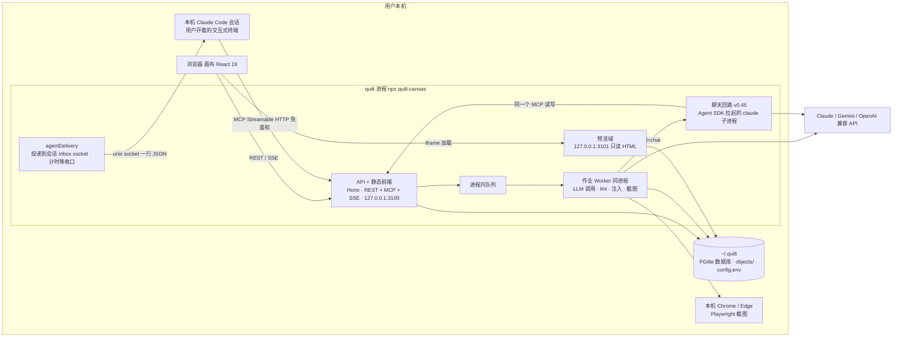

边界与数据流：画布只与 API 服务和预览域通信；所有生成走同进程的 Worker（队列在进程内，作业表是事实源，重启后 `queued` 作业自动补入队）；预览域与主站是不同 origin，AI 生成的脚本拿不到主站 storage（本地版无 cookie）；MCP 与 REST 共用同一服务层（MCP 工具是 REST 的投影，见 §8 `API-AGENT-002`）；本机 agent 是用户开着的 Claude Code 会话，作业由 `agentDelivery` 投递进去，它通过同一个 MCP 回写并收口；聊天（`kind=chat`，v0.45）由 worker 拉起 Agent SDK 子进程，它像本机会话一样经同一个 MCP 读写，区别只是住在 Quilt 进程里、由 Quilt 起停、会话 id 记在项目上。
`DATABASE_URL` 设了则连外部 Postgres（开发用 docker、将来 SaaS 用托管库），`STORAGE_DRIVER=s3` 则对象存储走 S3——这两处是保留给 SaaS 的插口，本地版默认都不用。
外部依赖与 §17 一一对应。

仓库布局（v0.60）：

| 路径 | 放什么 | 规则 |
| --- | --- | --- |
| `packages/core/src` | 三端共用的纯逻辑：schema、契约提示词、lint、注入、组件展开、大纲、token、导出、预览运行时、作业失败文案 | 不依赖 Node 或浏览器专有 API；纯函数由 `tests/unit/core` 直接覆盖。两个出口（v1.06）：`@quilt/core` 全部模块，服务端与 MCP 用；`@quilt/core/browser` 只含浏览器要用的（schema 与 DTO、token、字体、设备、消息协议、契约提示词与历史指令、补丁、组件的名字规则与占位写法、失败文案），前端只从它引——解析 HTML 的 linkedom 一系、预览运行时与 prelude 不进前端包，误引时类型检查报错，`tests/unit/api/bundle.test.ts` 守着 |
| `apps/api/src` | `http/routes`（REST）、`mcp`（`ctx.ts` 共用件 + `tools/<域>.ts` + `resources.ts`）、`services`（REST 与 MCP 共用的服务层）、`worker`（作业管线、聊天、投递）、`db`、`lib` | MCP 工具只调 services；每个工具的说明、入参、处理各自成行，不写成一行 |
| `apps/web/src` | `pages`（路由页）、`canvas`（画布视图、排列、位置、弹层、作业文案、找屏面板、小地图；v1.07 起画布视图 `CanvasView` 只做组合，镜头在 `useViewport`、聚焦屏的 iframe 在 `useFocusedFrame`、卡片在 `cards`（memo 化，拖一张卡只重渲染被拖的那几张）、镜头与框选的算式在 `geometry`、两类 iframe 的选中与按键在 `frameMessages`）、`composer`（输入框、作业 chip、通道 / 停靠与收起偏好）、`panels`（右侧面板与设计系统分区）、`project`（顶栏、切换器、新建）、`sketch`（草稿本页的看板、输入框、记录栏与「放进项目」弹层）、`settings`（设置、通道管理）、`ui`（无业务的基元：按钮、弹层基建、下拉、图标）、`lib`（API 客户端、toast、外观模式）、`i18n`（v1.20 界面语言：初始化与切换、`locales/<命名空间>.ts` 每个文件一个命名空间，`ADR-034`） | 跨目录一律 `@/` 绝对引用；`ui` 不 import 业务目录；一个文件超过约 600 行就按域再拆。hooks 的规则与依赖数组由 `pnpm --filter @quilt/web lint` 检查（v1.07，oxlint 只开 `rules-of-hooks` 与 `exhaustive-deps`：仓库用的 TypeScript 7 没有旧版编译器 API，typescript-eslint 的解析器跑不起来）；有意不列依赖的地方写 `eslint-disable` 并注明理由 |
| `apps/web/src/brand` | 界面视觉系统的运行文件副本（v1.09，§13.1）：`tokens.css`、`tokens.tailwind.css`、`state-layer.css`、`fonts/fonts.css` 与 Space Grotesk 字体，取自本机的 `brand/`（visual-system 开发交接：规范、`tokens.json` 与 `modes/`、生成文件、图标、样例页、检查脚本、品牌包，只在本机、不进仓库） | 不手改：改值改 `brand/tokens.json` / `modes/`，按 `brand/DESIGN.md` 重跑生成与检查后 `node scripts/sync-brand.mjs` 同步过来；`--check` 比对副本与 `brand/`（本机没有 `brand/` 时跳过），`tests/unit/web/brand` 会跑它；`apps/web` 只经 `styles.css` 的三条 `@import` 用它 |
| `tests/unit` | `node:test` 单测，按来源分 `core` / `web`；`pnpm test` | 只测纯函数，不起库、不起浏览器；HTML 断言用 `lib.ts` 的 `norm` 抹平属性顺序 |
| `tests/e2e` | Playwright / MCP 脚本，执行 `docs/TEST.md` 的用例 | 只对 `quilt_test` 跑（`assertTestApi`） |
| `docs` | `DESIGN.md`（事实源）、`TEST.md`（用例与台账）、`CHANGELOG.md`（两份文档的历史变更）、`test-runs/`（证据） | 两份文档的变更记录只留最近 5 版 |

## 7. 数据模型 / 领域实体

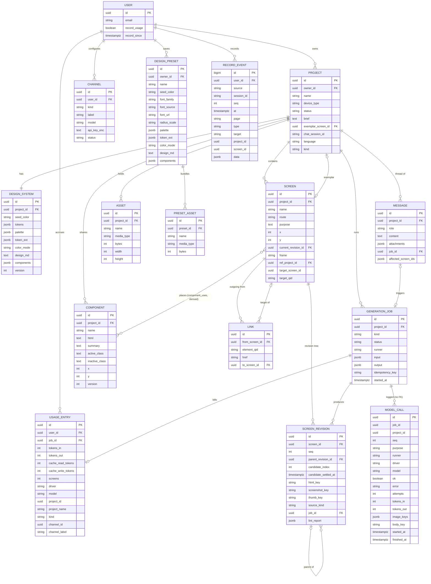

实体 ID：`ENT-User`（v0.32 起本地版恒为一行默认用户，`email=local@quilt.local`，启动时不存在则创建；保留这一层是为了 `owner_id` / `created_by` 在 SaaS 阶段直接可用）、`ENT-Project`、`ENT-DesignSystem`、`ENT-Screen`、`ENT-ScreenRevision`、`ENT-Message`、`ENT-GenerationJob`、`ENT-Link`、`ENT-UsageEntry`、`ENT-Channel`（M7，用户自配的生成通道：类型、厂商、端点、加密后的密钥、模型、验证状态）、`ENT-Asset`（v0.35，项目素材：logo / 插图 / 模板等二进制资源，正文在对象存储，行里只记名字、类型、字节数与像素尺寸）、`ENT-DesignPreset` 与 `ENT-PresetAsset`（v0.40，账号级的设计预设及其素材副本：预设存的是设计系统的**输入**，套用时按当时的 token 引擎重算）、`ENT-Component`（v0.46，共享组件：项目级一段正式 HTML、名字项目内唯一、导航型的激活 / 未激活两套类、画布位置与乐观锁版本；哪些屏放着它由派生表 `component_uses(project_id, screen_id, name)` 记录——与 `links` 一样在 `deriveLinks` 时按每屏当前修订全量重算，不手工维护）。
v0.32 删除的实体：`ENT-AgentTask`、`ENT-OAuthGrant`、`ENT-OAuthClient`、`ENT-OAuthCode`、`ENT-DeviceToken`、magic link 与会话（都是鉴权与远程派活的机制，不是领域模型；SaaS 阶段按当时的方案重建，不保留空表）。
v1.23 删除的实体：`ENT-Annotation`（元素批注；批注整体撤下，迁移 `0020` 删表）。
字段权威定义见 §9。
修订链为树（v0.31）：`SCREEN_REVISION.seq` 在同一屏内单调递增（创建时对屏行 `select … for update` 再取号，并行落候选不撞唯一键），`parent_revision_id` 记录它由哪一版派生（生成时的 current，首版为空），`SCREEN.current_revision_id` 指向当前版；同一作业为同一屏产出的多版是**候选**：同 `job_id`、`candidate_index` 0..N−1，`candidate_settled_at` 为空表示尚待采用；回溯与采用候选都只改 current 指针、不建新修订（`API-CORE-015` v1.43、`API-CORE-025`）；v1.43 之前回溯建出的修订（`source_kind=restore`）照旧留在树里。
`PROJECT.exemplar_screen_id` 是样板屏（不建外键，屏删除时由服务层清空并回落）。
`PROJECT.language` 是项目语言（v0.85 `REQ-CORE-037`）。
`DESIGN_SYSTEM.token_ext` 与 `DESIGN_PRESET.token_ext` 是 token 扩展的**输入**（v0.85 `ADR-025`：字阶逐档参数、间距三级、圆角精确值、层级阴影、状态层、动效、发丝线、「本系统不用」清单），与 `palette` 同一个道理——`tokens` 每次改设计系统都由种子色重算，只写进 `tokens` 的字段下一次保存就丢，所以输入单独落列、贯穿 `tokensFromSeed`；`null` = 全部取默认。
HTML 与截图正文存对象存储，表内只存 key。**变体**（v0.62 `REQ-CORE-025`）：`SCREEN.variant_of` 指向同项目的默认屏（外键、级联删除）、`variant_name` 是状态名；有 `variant_of` 的屏与默认屏共用 `route`，`screens_project_route_uq` 因此改为只对 `variant_of IS NULL` 的行生效；变体只有一层（服务端拒绝给变体再出变体）。**呈现方式**（v0.63 `REQ-PROTO-005`）：`SCREEN.presentation` 取 `push` / `overlay`，是元数据，不进修订。
**草稿本**（`REQ-CORE-040`，`ADR-030`）：`PROJECT.kind` 取 `app` / `sketchbook`，每个用户至多一行 `sketchbook`（部分唯一索引 `projects_sketchbook_uq (owner_id) WHERE kind = 'sketchbook'`）。
草稿就是草稿本的屏，每改一轮是屏的一条修订；`SCREEN.frame` 记画框，只在草稿上有值。
`SCREEN.ref_project_id` 是草稿的参照项目（外键，项目删除时置空，`ADR-033`）；`SCREEN.target_screen_id` / `target_qid` 是写回目标（不建外键，那一屏删了就当没有目标），三者都只在草稿上有值。
草稿本照常有一行设计系统（按 `ADR-028` 开局），只为 prelude 提供 Tailwind、图标与基础字体，不进草稿的提示词；路由由服务端取 `/draft-<n>`，界面不显示。
**本机使用记录**（v1.22 `REQ-CORE-047`，`ADR-035`）：`USER.record_usage` 是开关（缺省关），`record_since` 是最近一次打开的时间。
`ENT-RecordEvent`（`record_events`）一行是一条事件：浏览器里的操作与输入（`source=web`）或外部 agent 的一次 MCP 工具调用（`source=mcp`）；`(session_id, seq)` 唯一，重发的批次靠它去重。
`ENT-ModelCall`（`model_calls`）一行是作业里的一次模型调用，完整提示词与原始回复存在对象存储 `records/model-calls/<日期>/<id>.json`，行里只存 `body_key`。
两张表都不对项目、屏、作业建外键：删了项目与作业，记录还在；归档放在对象存储 `records/archive/` 下，`storage.gc` 不扫 `records/`。
**用量台账的快照**（v1.24 `ADR-036`）：`USAGE_ENTRY` 记账时一并写下作业的项目 id 与项目名、任务类型、通道 id 与通道显示名；这几列不建外键，项目、作业与通道删掉之后台账照样能按它们归类。

## 8. 接口契约 (API-first)

契约权威文件：`api/openapi.yaml`（OpenAPI 3.1，实现期建立并冻结；本节为摘要）。
全部 REST 端点前缀 `/v1`。**鉴权（v0.32）**：本地版无鉴权——服务只绑 `127.0.0.1`，中间件把每个请求解析为默认用户；`/v1/objects/*`、`/v1/uploads/*`、`/v1/attachments/*` 仍按签名校验（URL 会被贴进预览页与对象链接）。**来源校验（v0.75）**：`/v1/*`（含上面三类签名端点与 `/health`）与 `/mcp` 在一切处理之前先看 `Host` 与 `Origin`，不在本机名单里 `403 /errors/forbidden`，规则见 §15「本地服务」。
SaaS 阶段的会话 cookie 与 MCP Bearer 推迟。
统一错误信封见 §14。
除注明外，写端点接受 `Idempotency-Key` 头，24 小时内同键同参返回首次结果。
**界面语言（v1.20，`REQ-CORE-046`，`ADR-034`）**：网页端每个请求带 `X-Quilt-Locale: zh | en`（界面当前的语言；项目事件流 `API-CORE-030` 用 `EventSource`，带不了自定义头，它的事件里也没有服务端写给人看的文案）。服务端对每个请求（`/v1/*` 与 `/mcp`）定一个语言：`X-Quilt-Locale` 是 `zh` / `en` 就用它（不分大小写，别的值当没有这个头）；没有时看 `Accept-Language` 里优先级最高的一项，以 `zh` 开头为中文、其余英文，只有 `*`（Node 的 `fetch` 缺省就带它）视同没有；两者都没有时中文，现有调用方（MCP、脚本）拿到的文案不变。
按这个语言给的是服务端写给人看的文字：problem 的 `title` 与 `errors[].message`、`detail`（§14），以及请求处理当中写下的提示（如作业取消时助手消息的「已取消」、投递到本机会话时的占位）；`type`、字段名、枚举值不随语言变。
生成内容的语言见 `API-CORE-006`「界面语言」。

### CORE（M1）

- **`API-CORE-001` / `API-CORE-002`** magic link 登录 — **v0.32 推迟**（编号保留；本地版无这两个端点）
- **`API-CORE-028` getConfig** — 实现 `REQ-CORE-017`（M10）
  - `GET /config`；响应 `200 { previewOrigin, version, local: true, home, secretsConfigured }`；前端启动时取一次，`previewOrigin` 用于 iframe 的 postMessage origin 校验（打包后由运行时决定，不再在构建时写死）；`secretsConfigured`（v0.78）= 服务端配了 `QUILT_SECRETS_KEY`，为 `false` 时通道管理器顶部说明并禁用需要 API Key 的通道的保存（服务端存密钥时照旧 `400` 点名该变量，这一项只让界面提前说）；`no-store`
- **`API-CORE-029` listJobs** — 实现 `REQ-AGENT-003`（M10）
  - `GET /projects/{projectId}/jobs?runner=agent|model&limit=`；响应 `200 { items: JobDto[] }`（按创建时间倒序，默认 50 条；`JobDto.output.agentLog` 为本机 agent 进程输出的尾部 ≤ 4 KB）；agent 面板据此列出本机 agent 的作业；`no-store`
  - v0.38：面板**靠轮询这一条推进**（有 `queued` / `running` 作业时每 1.5 s 一次，全部终态即停；`document.hidden` 跳过该拍、回到前台立刻补一拍；重取失败就停下并锁存错误横幅，叠在已加载的列表上方给「重试」，不自动重触发）。
    1.5 s 是按投递窗口定的：作业先转 `running`，中间隔着最长 250 ms 的会话 socket 探活才落 `output.delivery`，这段窗口内卡片显示「正在投递…」
- **`API-CORE-003` createProject** — 实现 `REQ-CORE-002`
  - `POST /projects`，请求 `{ name, deviceType, seedColor? }`（`$ref ENT-Project`）；响应 `201 { project, designSystem }`——服务端按种子色用 Material HCT 算法生成 token，写入默认 DESIGN.md 与组件片段库
  - v0.85（`REQ-CORE-037`）：请求增可选 `language`（`zh-CN` / `en`，缺省 `en`）；按预设开局时语言仍取请求值——语言属于项目，不属于设计系统，预设里没有它
  - 错误：`400 /errors/validation`
- **`API-CORE-004` getProject** — 实现 `REQ-CORE-009`、`REQ-CORE-004`、`REQ-CORE-010`（v0.85 前风格指南卡片由响应中的 `designSystem` 在前端渲染；v0.85 起样例卡是 `API-CORE-045` 的文档，URL 随本响应下发）
  - `GET /projects/{projectId}`；响应 `200 { project, designSystem, screens[] (含 currentRevision 摘要与截图 URL；v1.02 起另带缩略图地址 `thumbUrl`，还没生成时为 `null`), links[], activeJobs[], assets[], components[] }`（`assets` 见 `REQ-CORE-019`，v0.35：风格指南卡片与设计系统面板共用这一份，不再各取各的；`components` 见 `API-EDIT-004`，v0.46：每项 `{ id, name, summary, html, slots[], nav, x, y, version, previewUrl, usedBy: screenId[] }`，`usedBy` 取自派生表 `component_uses`）
  - v0.85：`project` 增 `language`；`designSystem.tokens` 按 `ADR-025` 的扩展形状下发（旧行由启动回填补齐，见 §25）；`designSystem` 增 `specimenUrl`（样例卡概览视图的签名 URL，`API-CORE-045`，版本随设计系统 `version` 与组件版本变化）
  - 草稿本（`REQ-CORE-040`）：`project` 增 `kind`（`app` / `sketchbook`），`screens[]` 每项增 `frame`（非草稿为 `null`）；草稿本页用本接口取草稿、版本以外的全部数据
  - 草稿（`REQ-CORE-042`、`REQ-CORE-044`）：`screens[]` 每项另增 `refProjectId`、`targetScreenId`、`targetQid`，非草稿为 `null`；另有服务端派生的 `target { projectId, projectName, screenName }`，是写回目标那一屏所在的项目与屏名，草稿本页的「来自」与写回弹层的缺省值用它；那一屏已被删时 `targetScreenId` 还在、`target` 为 `null`
  - 缓存：`Cache-Control: private, no-store`（画布是编辑面，写后即读）；FE 超时 10 s，自动重试 1 次
- **`API-CORE-005` listProjects**：`GET /projects?cursor=`，游标分页，`no-store`；不列草稿本（`kind=sketchbook`，`INV-CORE-002`），入口 `/` 的「最近更新的项目」因此也落不到它
- **`API-CORE-006` createJob** — 实现 `REQ-CORE-003`、`REQ-CORE-014`、`REQ-PROTO-003`、`REQ-PROTO-004`、`REQ-EDIT-002`、`REQ-EDIT-003`
  - `POST /projects/{projectId}/jobs`，请求 `{ kind, input, attachmentIds?[] }`，`kind` 枚举见 §9；`attachmentIds` 见下「参考图」；`input` 按 kind：
    - `generate{ prompt, count?: 1|2|3|4|"auto" = 1, versions?: 1–4 = 1, anchor?: {x,y}, route?, fromScreenId?, runner?, imageKeys?, variantOf?, variantName?, presentation? }`（v0.31 三合一；v0.62 `variantOf + variantName` 二者同给 = 造变体：钉死默认屏的路由、`count` 按 1 算、跳过规划器、默认屏作参考屏，`variantOf` 不是本项目的默认屏 → `422 /errors/validation`（建作业时就查，v0.77；此前放在 worker 里判，先回 202、作业随后以英文原因失败，还短暂占着项目级 `generate` 锁）；v0.63 `presentation` 只在懒生成 / 造变体时生效，整组规划由规划器逐屏给）：`count` 为屏数档位——`1` 走单屏规划（`planOneScreen`，路由不得与现有撞车、`links` 只指向现有路由且以空为常态），`2–4` 与 `auto` 走整组规划（`auto` = 空项目 4–6 屏主流程 / 非空项目 2–6 屏子流程；规划器同时给出 `entryFrom`：既有哪一屏进入新组）；`route` 钉死时是懒生成（跳过规划器，`fromScreenId` 作来源屏参考）；`versions` = 每张新屏的候选版数；`anchor` 为画布世界坐标（一组屏按流程顺序自锚点向右排成一行，与既有屏相交则整行下移），缺省接在最右一屏右侧。
      空项目首轮且 `brief` 为空时规划器顺手扩写应用简介落库；样板屏为空时以本次第 1 屏钦定。
      按 `count × versions` 屏计费
    - `edit_screens{ prompt, screenIds[1..20], versions?: 1–4 = 1, runner?, imageKeys?, componentIds?[0..10] }`（`componentIds` 与 `generate` 同名字段，v0.46 `REQ-EDIT-006`：画布上一起框选的共享组件，它们的完整 HTML 进这一轮的上下文；目标屏本来就放着的组件不必列、服务端自己会附上。）；`regenerate_subtree{ screenId, qid, qids?[2..8], prompt, expectedRevisionId, runner?, imageKeys? }`（`runner` 同 `edit_screens`，v0.34；`kind:"agent"` 时该作业也投递到会话；`imageKeys` 见下「参考图」。`qids`（v1.26）是一起改的几块，要含 `qid`、不重复、互不包含，否则 `400 /errors/validation`；一次模型调用拿到这几块的原 HTML，每块回一段 `<quilt-block qid="…">…</quilt-block>`，块数或 qid 对不上补问一轮，仍不对作业失败；只换这几块，屏多一版）；`apply_design_system{ screenIds[] | all }`；`propose_design_system{ instruction, screenId?, runner? }`（`REQ-EDIT-003`：输出 `output.proposal = { summary, conventions[], tokens?{ seedColor?, fontFamily?, radiusScale? }, regenerate }`，不改任何东西，由 `API-EDIT-002` 确认写入）；`export_prototype{}`
    - `chat{ prompt, screenIds?[0..20], runner?, imageKeys? }`（v0.45 `REQ-CORE-023`）：`screenIds` 是「用户此刻选中的屏」这一条上下文提示，不是目标锁；`runner` 必须解析为 `agent-sdk` 通道（缺省取第一条已验证的 `agent-sdk` 通道），否则 `400 /errors/validation`（`path: runner`）；项目级同时只有一个 `chat` 在跑，撞上 `409 /errors/screen-busy`；成功时 `output.reply` = 助手最后一段文字、`output.screenIds` = 本作业名下修订所在屏
    - `edit_component{ componentId, prompt, runner?, imageKeys? }`（v0.46 `REQ-EDIT-006`）：改一个共享组件——worker 用 `componentSystemPrompt`（只产出组件自己的单根元素；保留 `data-slot`；导航型标恰好一条 `aria-current="page"`）+ `componentUserPrompt`（当前 HTML + 用在哪几屏 + 这个组件的历史指令，v0.87 `ADR-012`）调**一次**模型，校验（单根、无 `<script>` / `<style>`、不套组件）→ 重算 `activeClass` / `inactiveClass` 与 `summary` → 组件 `version+1` → 对所有放着它的屏做确定性回刷（`progress{ stage:"component_synced", screens: N }`，逐屏 `screen_html_ready` + 截图；有在跑作业的屏跳过并点名）；`estimateJob` = 1 次调用（超时 3 + 1 分钟）；成功时 `output.screenIds` = 回刷到的屏、`output.componentId`；一次一个组件；模型产出不合法 → `failed errorClass=validation`，组件不变。
      `runner.kind=agent`（v0.99）时不调模型：投递到本机会话，由会话经 `quilt.update_component { jobId }` 写回，回刷同一条路，收口见 `REQ-AGENT-003`
  - 目标屏（v0.77）：`edit_screens.screenIds` 里有屏不属于本项目或已被删除 → `404 /errors/not-found`，不建作业（此前照建，worker 过滤掉找不到的屏后「成功」更新 0 屏，回执「已更新 0 屏：」）；建成之后、开跑之前目标屏全被删掉的，worker 判 `failed errorClass=validation`，不再报成功；原因按实际情况说（v0.82）：一屏都不在了是「目标屏都已被删除」，屏还在但还没有当前修订（它的造屏作业还没落第一版）是「目标屏还没有生成出内容」，两种都有是「目标屏有的已被删除，其余还没有生成出内容」
  - `regenerate_subtree.screenId` 不属于建作业的项目同样 `404 /errors/not-found`：草稿本里的「只改一块」靠这一条保证目标是草稿（`REQ-CORE-045`）
  - 参考图（v1.21 `REQ-CORE-045`）：`attachmentIds` 是 `API-CORE-019` 传完图拿到的 id，至多 4 个，服务端按 `API-CORE-010` 同一套解析成 `input.imageKeys`，也挂在这一轮的用户消息上；有 id 取不到正文（没传完或已过期）→ `400 /errors/validation`（`path: attachmentIds`）；这种作业的输入没有 `imageKeys`（`apply_design_system`、`propose_design_system`、`export_prototype`、`ingest_screen`）→ 同样的 `400`。
    `regenerate_subtree` 带图时，图跟这一块的那一次模型调用走，参考图说明与改整张相同：草稿本里可以照着取色，普通项目只取版式与密度、颜色仍用设计系统的 token。
  - 界面语言（v1.20 `REQ-CORE-046`）：带 `X-Quilt-Locale` 的请求建作业时，服务端把它记进 `input.locale`，每种作业都记，worker 写进助手消息的回执、进度与失败文案按它（发消息 `API-CORE-010`、重试 `API-CORE-034`、写回改写 `API-CORE-047` 都经同一处建作业）。
    请求没带这个头时作业不记 `input.locale`：请求体里自带的 `locale` 不认，重试以重试请求的头为准，不沿用旧作业的值。
    `generate` / `edit_screens` / `edit_component` / `regenerate_subtree` 这四种写屏上文字的作业还据此给提示词加语言要求，草稿本的新稿与改稿也是这几种：worker 给它们的每次模型调用在系统提示末尾加一句「请求里没有明确要求语言时，屏上所有可见文字用 English / Simplified Chinese」，并写明它优先于提示词里「跟着请求的语言写」的规则；投递到本机会话的指令末尾加同一句。
    不带这个头建的作业（MCP、脚本）不加这一句，文案语言照旧跟着提示词。
  - 响应 `202 { job }`（状态 `queued`）；作业事件经 `API-CORE-008` 流式推送
  - 错误：`404 /errors/not-found`（目标屏，见上）、`409 /errors/screen-busy`、`409 /errors/revision-conflict`、`400 /errors/validation`、`422 /errors/validation`（`variantOf`）、`429 /errors/rate-limited`（每分钟 10 次）
  - 入口校验（v1.06）：本接口、`API-CORE-010` 发消息、`API-CORE-034` 重试与 MCP 的建作业工具共用同一份——输入按作业种类过 `jobInputSchemas`（重试拼回去的旧输入也过，不合格 `400 /errors/validation` 并点名字段）；`runner` 是账号自建通道时要属于本人（否则 `404 /errors/not-found`）；带参考图时通道要支持视觉（否则 `400`）。
    worker 领取作业时按种类再校验一遍输入，不合格的以 `failed(validation)`「作业输入不合法：<字段> <原因>」收尾、不进流水线；服务端读作业输入用 core 的 `inputOf(job, kind)`，schema 改字段时编译期能找到每个读点
  - 幂等：`Idempotency-Key` 必填（MCP 侧同）。
    同一个键的两个请求并发到达时，后到的那个会撞上首个作业（屏锁预检或唯一索引），此时首个已经提交——按 `(projectId, Idempotency-Key)` 重查一次，命中就返回首次作业（`200`，同串行重试），查不到才是真的屏忙（v0.77；此前后到的一律 `409 screen-busy`，连不占屏的导出作业也报「目标屏有进行中的作业」）
  - `runner=agent` 的作业（`REQ-AGENT-003` v0.34）：不入队列，由 `agentDelivery` 立即投递到 `input.runner.sessionId` 指定的本机 Claude Code 会话；缺 `sessionId`、或该会话不在 `API-AGENT-010` 的活会话里（已关闭、socket 探活失败）时建作业前就返回 `400 /errors/validation`（`path: runner.sessionId`，消息「会话已关闭或不存在，重新选一个」）。
    `tool=codex`（v0.68）：`sessionId` 须是 Codex 线程库里的未归档用户线程（打开与否都行，未打开的投递时由桌面版打开），否则同一个 400；`codex` 不在 PATH 上时 400 并给安装步骤
- **`API-CORE-007` getJob**：`GET /jobs/{jobId}`；响应 `200 { job }`；`no-store`
- **`API-CORE-008` jobEvents** — 实现 `REQ-CORE-003`
  - `GET /jobs/{jobId}/events`（SSE），事件类型 `screen_planned | screen_html_ready | screen_screenshot_ready | progress | succeeded | failed | cancelled`，每个事件带 `seq` 供断线用 `Last-Event-ID` 续传；FE 断线自动重连（幂等）
  - v0.37 起**画布不再逐作业订阅这条流**（每个作业一条长连接会撞满浏览器同源 6 条的上限，多标签页共用同一份额度），改为从 `API-CORE-030` 的 `job_changed` 拿同样的信息；v0.38 起本机 agent 面板也不订阅它（改为轮询 `API-CORE-029`，同一个额度问题：5 个 agent 作业同时跑就占满）。
    本接口保留给外部消费者与 MCP 侧，语义不变
- **`API-CORE-009` cancelJob**：`POST /jobs/{jobId}/cancel`；响应 `200 { job }`；已终态返回 `409 /errors/job-finished`
- **`API-CORE-010` createMessage** — 实现 `REQ-CORE-003`、`REQ-CORE-006`
  - `POST /projects/{projectId}/messages`，请求 `{ content, mode?: "chat", targetScreenIds?[], targetComponentIds?[0..10], count?, versions?, anchor?, runner?, attachmentIds?[] }`（`mode="chat"` 见下，v0.45；`targetComponentIds` 见下，v0.46）（`attachmentIds` 见 `REQ-CORE-012`：`API-CORE-019` 传完图拿到的 id，至多 4 个，作为参考图随这一轮进模型；通道的视觉能力见 `/v1/runners` 的 `vision`，选了不支持的通道时返回 `400 /errors/validation` 并点名（当前全部通道都支持，护栏为将来驱动保留），不静默丢图。
    `runner` 见 `REQ-CORE-011`：`{ kind:"model", driver, model }` 指定云端驱动与模型、`{ kind:"channel", channelId }` 账号自建通道，或 `{ kind:"agent", tool:"claude-code", sessionId }` 把这一轮投递到本机某个 Claude Code 会话（v0.34）；缺省取用户在设置页的默认值）。**动词由目标决定（v0.31）**：`targetScreenIds` 非空 → `kind=edit_screens`（`versions` 透传）；为空 → `kind=generate`（`count` / `versions` / `anchor` 透传；`count` 缺省时空项目取 `auto`、非空项目取 1）。
    `runner.kind=agent` 时同样建作业（`runner=agent`），由 `agentDelivery` 立即投递到该会话（v0.34），助手消息占位写「已投递到本机 Claude Code 会话「<名字或 UUID>」…」。**`mode="chat"`（v0.45 `REQ-CORE-023`）**：不看目标——建 `kind=chat` 作业，`targetScreenIds` 转成 `input.screenIds`（上下文提示），`count` / `versions` / `anchor` 忽略；`runner` 必须解析为 `agent-sdk` 通道，缺省取第一条已验证的，一条都没有 `400 /errors/validation`（`path: runner`，消息点名去设置页加「本机 Claude 订阅」）；助手消息在作业成功时回填为助手的最后一段文字。**`targetComponentIds`（v0.46 `REQ-EDIT-006`）**：画布上框选的共享组件——只有组件、既没有 `targetScreenIds` 也没有 `anchor` 时是**改组件**：必须恰好 1 个（≥ 2 个 `400 /errors/validation`，`path: targetComponentIds`，消息「一次只能改一个组件」），建 `kind=edit_component`；`runner` 是本机会话（`kind=agent`）时同样建它并投递到会话（v0.99，`REQ-AGENT-003`）；与 `targetScreenIds` 同在 → 透传为 `edit_screens.input.componentIds`；有 `anchor`（造）→ `generate.input.componentIds`（造出来的屏用这些组件）；不属于本项目的组件 id → `400`；`mode="chat"` 忽略它。**「修改」还原的隐藏参数（v0.74 `REQ-CORE-026`）**：`variantOf` + `variantName`（二者同给）→ `generate` 出变体，`content` 就是提示词，为空时用「The <状态名> state」；`route`（+ 可选 `fromScreenId`）→ 钉死路由的懒生成，提示词 = `Screen for route <route>`；`preset: "link_repair" | "conventions"`（须带 `targetScreenIds`）→ `edit_screens`，提示词 = 补链 / 按新约定重生成的固定指令（与 `API-CORE-006` 系统代发时逐字相同）。
    后三种 `content` 可空，非空时作为附加要求接在固定提示词之后（`\n\nADDITIONAL REQUIREMENTS FROM THE USER: <content>`）；带了这几个字段时 `count` / `anchor` 忽略、不走改组件；用户消息正文按 `API-CORE-006` 的口径写成描述（「出「Loading」状态变体：…」「生成缺失的页面 /settings：…」「接上跳转：把 N 屏的按钮 / 表单连上路由。
    附加要求：…」（v1.04 起与工具栏同名，此前叫「补链」）「按新约定重生成 N 屏。
    附加要求：…」），「修改」据作业输入反解出附加要求填回。
    `variantOf` 或 `route` 与 `targetScreenIds` 同给、`variantOf` 与 `route` 同给、`preset` 不带 `targetScreenIds`、`content` 为空又不带这几个字段 → `400 /errors/validation`；`mode="chat"` 时忽略它们。**`targetScreenIds` 里有屏不属于本项目或已被删除 → `404 /errors/not-found`**（v0.77，与 `API-CORE-006` 同一道检查；另一个标签页或本机 agent 删了屏、这边还选着它发改动时，此前界面报成功、什么也没改）；`mode="chat"` 的 `targetScreenIds` 只是上下文提示，不查。
    服务端创建用户消息 + 作业 + 关联的助手消息占位；响应 `202 { userMessage, assistantMessage, job }`
  - 草稿本（`REQ-CORE-040`，`INV-CORE-003`）：项目是草稿本时只受理造与改。
    没有 `targetScreenIds` = 新草稿（`generate`，屏数与版数固定 1，跳过规划器；可带 `refProjectId`，新草稿从第一版起就参照那个项目、草稿记下它；得是本人的普通项目，否则 `404 /errors/not-found`；普通项目的消息或改稿带它 `400 /errors/validation`，改稿的参照在草稿上设，见 `API-CORE-012`）；`targetScreenIds` 恰好一张草稿 = 改它（`edit_screens`，版数固定 1）。
    可带 `frame`（`auto` / `component` / `mobile` / `desktop`，缺省 `auto`），只对新草稿生效；非草稿本的项目带 `frame` 一律 `400 /errors/validation`。
    `mode="chat"`、`targetComponentIds`、`anchor`、`count` 或 `versions` 大于 1、`variantOf`、`route`、`preset`、`targetScreenIds` 多于 1 张，都是 `400 /errors/validation` 并点名字段；`API-CORE-006` 与 MCP 的建作业工具走同一份校验。
    worker 换用草稿提示词：风格只听用户这句话，可写任意色值、`<style>` 与脚本，不带设计系统、屏注册表、参考屏与素材清单；界面文案用这句话的语言（作业带界面语言时，这句话没说语言就用界面语言，见 `API-CORE-006`）；链接一律 `href="#"`。
    新草稿的名字取这句话的第一行、前 20 个字，路由服务端取 `/draft-<n>`；草稿不做设计契约 lint（`lintReport` 记空），也不钉样板屏、不跑反向连线。
    `frame=auto` 时提示词要求模型在根元素上写 `data-frame="component|mobile|desktop"`，第一版落库时据此写 `screens.frame`，缺失或取值不认识按 `component`；用户选定了画框时提示词直接给定，`screens.frame` 建屏时就写好。
    截图按画框：`mobile` / `desktop` 用对应视口拍首屏，`component` 在 1280×800 视口里拍根元素的框（同样 DPR 2，缩略图照常生成）。
    草稿有参照项目时（`REQ-CORE-042`，`ADR-033`）：提示词改带该项目的 DESIGN.md、token 类、组件配方与路由表（链接可写它的路由），落库时按它的 prelude 拼装；参照项目被删后退回自由风格。
    只改一块（`REQ-CORE-045`）：草稿本里同样受理 `regenerate_subtree`（`API-CORE-006`，目标是草稿、`qid` 是点选的元素），提示词换成草稿规则与参照项目，落库不做 lint。
    `runner.kind=agent` 时照常投递到会话，提示词换成草稿规则：新草稿用带 `jobId` 的 `quilt.create_screen` 写进草稿本（`route` 可省），改草稿用带 `jobId` 与 `expectedRevisionId` 的 `quilt.patch_screen` / `quilt.update_screen`，不读设计契约。
  - 错误：同 `API-CORE-006`
- **`API-CORE-019` createAttachmentUpload** — 实现 `REQ-CORE-012`
  - `POST /projects/{projectId}/attachments`，请求 `{ mediaType, bytes }`；校验类型在 `image/png|jpeg|webp` 内、`bytes ≤ 5 MB`，返回 `201 { attachmentId, putUrl, expiresAt }`（签名 PUT，10 分钟，复用 `API-AGENT-009` 同一套对象签名）
  - `PUT /attachments/{attachmentId}?exp=&sig=`：直传图片正文；服务端按签名校验、按 `Content-Type` 复核类型与大小，返回 `204`
  - 未被任何消息引用的附件是孤儿，由对象存储生命周期清理；本契约不保证立即回收
  - 错误：`422 /errors/validation`（类型或大小不合规、空文件；签发请求体不合 schema 同样 422——它的字段只有类型与大小）、`403 /errors/preview-token-invalid`（签名过期或不符）
- **`API-CORE-025` adoptCandidate** — 实现 `REQ-CORE-015`（M9；编号沿用 v0.29 空出的位）
  - `POST /screens/{screenId}/revisions/{revisionId}/adopt`：该修订必须是候选（`candidateIndex` 非空）且 current 仍属同一批（否则 `409 /errors/revision-conflict`——用户已在某一版上继续改，采用会顶掉他的改动）；「同批」在事务里先 `select … for update` 锁住屏行、按锁到的 current 判（v0.77：此前拿事务外读的屏行判、`UPDATE` 不带条件，回溯 / 直改 / 回写在它读完之后提交的话，两边都成功、current 被改回候选）；把 current 指向它、结清该批（同批全部 `candidateSettledAt = now`）、重派生应用地图；不建新修订、不计额度；响应 `200 { screen }`
  - `POST /jobs/{jobId}/candidates/adopt`，请求 `{ index }`：对该作业产出候选的每一屏做同样的事，**按屏独立成败**——某屏没有该 index、current 已不属同批（用户在某一版上继续改过）、或该屏有进行中作业，都只是跳过并在响应里列出；响应 `200 { adopted: screenId[], skipped: screenId[] }`（整体不会因为部分失败变成 4xx，所以调用方必须按 `adopted` / `skipped` 说话，不能把 200 当全部成功；FE 的三种反馈见 §13。
    `skipped` 只有 screenId、不带原因，前端只能把「改过」与「正在生成」并列陈述）
  - 错误：`404 /errors/not-found`、`409 /errors/revision-conflict`、`409 /errors/screen-busy`
- **`API-CORE-026` listCandidates** — 实现 `REQ-CORE-015`
  - `GET /jobs/{jobId}/candidates` → `200 { jobId, versions, screens:[{ screenId, name, route, currentRevisionId, settled, revisions:[{ id, index, seq, screenshotUrl, thumbUrl, htmlUrl, previewUrl }] }] }`（`thumbUrl` v1.03）；`previewUrl` 是该版在预览域的签名地址（项目级 token），就地展开层据此挂活 iframe；`no-store`
- **`API-CORE-027` updateProject** — 实现 `REQ-CORE-016`
  - `PATCH /projects/{projectId}`，请求 `{ name?, brief?, exemplarScreenId?, language? }`（`brief` ≤ 2 KB；`exemplarScreenId` 必须是本项目的屏，传 `null` 回落默认；`language` 见 `REQ-CORE-037`，v0.85：只改项目字段，存量屏的 `<html lang>` 由 FE 随后发的 `API-CORE-006 kind=apply_design_system` 回刷跟上，文案不翻译）；响应 `200 { project }`
  - 错误：`400 /errors/validation`、`404 /errors/not-found`
- **`API-CORE-020` listChannels / createChannel** — 实现 `REQ-CORE-013`
  - `GET /channels` → `200 { items: ChannelDto[] }`，只含用户自己配的通道（本机 agent 见 `API-CORE-023`）
  - `POST /channels`，请求 `{ kind: "anthropic"|"gemini"|"openai"|"agent-sdk"|"codex", vendor?, label, endpoint?, model, apiKey? }`（`agent-sdk` / `codex` 两类本机订阅不收 Key，其余必填）；`kind=openai` 时 `endpoint` 必填（OpenAI 兼容基址，如 `https://api.deepseek.com/v1`），原生两家可缺省用官方端点；响应 `201 ChannelDto`（`status=unverified`）
  - `ChannelDto = { id, kind, vendor, label, endpoint, model, apiKeyHint, status: "unverified"|"verified"|"failed", lastProbeAt, lastError, createdAt }`。**任何响应不含 `apiKey` 明文**，`apiKeyHint` 只有末 4 位
  - 错误：`400 /errors/validation`（字段不合规；服务端未配置 `QUILT_SECRETS_KEY` 时也在这里报，点名该变量）
- **`API-CORE-021` updateChannel / deleteChannel**
  - `PATCH /channels/{id}`，请求 `{ label?, endpoint?, model?, apiKey? }`；`apiKey` 缺省或空串 = 不改；改了 `endpoint` / `model` / `apiKey` 任一项即把 `status` 重置为 `unverified`；响应 `200 ChannelDto`
  - `DELETE /channels/{id}` → `204`；已在排队 / 运行中的作业若引用该通道，运行时以 `errorClass=validation` 失败并说明「通道已删除」；删之前把用量台账里这个通道的快照名刷成它现在的显示名（v1.24 `ADR-036`）
- **`API-CORE-022` probeRunner** — 实现 `REQ-CORE-013` 的「验证」
  - `POST /runners/{runnerId}/probe`，`runnerId` 为 `API-CORE-023` 目录里的 id（`channel:<uuid>` / `model:<driver>:<model>` / `agent:<tool>`）；对模型类通道实际发一次最小请求（系统提示「只回复 OK」，`maxTokens` 8；超时按驱动分档：API 类 20 s、本机 Claude 订阅 60 s、本机 Codex 订阅 90 s——后两者每次都拉起本机 CLI 子进程；前端为这个接口等 100 s，见 §8「缓存与超时」）；对 `agent:*` 在 PATH 上找命令并取 `--version`（v0.32）
  - 响应 `200 { ok, latencyMs?, detail?, error? }`；`channel:*` 的结果落库更新 `status` / `lastProbeAt` / `lastError`，其余不持久化
- **`API-CORE-023` listRunners（原 `/v1/runners` 扩展）**
  - `GET /runners` → `{ items: RunnerOptionDto[], default }`，统一目录（v0.34 起没有「系统预置」——开源自用，云端通道都由用户自己在设置页配）：**用户自己配的通道**（`source=channel`，可用 = `status=verified`；`default` 取第一条可用的）+ **本机 agent**（`source=builtin`：`claude-code` 可用 = `PATH` 上找得到 `claude`，`hint` 为 `--version` 输出，不可用时 `unavailableReason` 与 `setupHint` 给出安装步骤）。
    没带通道的 LLM 作业（MCP 建的、辅助作业）建作业时填上 `default` 那条通道，一条都没有才回落到 `.env` 的 `LLM_DRIVER`
  - `RunnerOptionDto` 增 `source`、`vendor`、`status`、`setupHint?`、`channelId?`；`runner` 增第三种形态 `{ kind:"channel", channelId }`，作业输入原样记录，worker 运行时解密凭据、按（驱动、端点、凭据）装配驱动
  - 输入框下拉只渲染 `available=true` 的项并在尾部给「管理通道…」入口；设置页渲染全部项
- **`API-CORE-024` hideRunner / unhideRunner** — **v0.34 删除**，编号保留不复用。
  v0.27 为多账号共用一份 `.env` 预置而做的「按账号隐藏、可恢复」，本地单用户版没有「其他账号」这个前提：要增删预置通道直接改 `QUILT_RUNNERS` 重启；`users.hidden_runners` 列随迁移 `0009` 删除
  - v0.32：`agent:claude-code` / `agent:codex` 的 `available` = 对应命令在 PATH 上（`claude` / `codex`），`API-CORE-022` 对它们的探测 = 找命令并取版本；不可用时 `setupHint` 给安装命令（Claude Code：`npm i -g @anthropic-ai/claude-code` 后运行 `claude` 登录；Codex：`npm i -g @openai/codex` 后运行 `codex` 登录）。
    v0.68 起目录里真有 `agent:codex`（「交给本机 Codex」），`setupHint` 另给 `codex mcp add quilt --url http://127.0.0.1:3100/mcp` 与 `[mcp_servers.quilt] default_tools_approval_mode = "approve"`；「本机 Codex 订阅」通道的探测 = 经 `codex exec` 真发一次最小请求（超时 90 s：每次冷启动一个 `codex` 进程、带约 2 万 token 的 Codex 自带提示与工具定义，实测 15～27 s）
- **`API-CORE-011` listMessages**：`GET /projects/{projectId}/messages?cursor=`；`no-store`
- **`API-CORE-034` retryMessage** — 实现 `REQ-CORE-026`（v0.72）
  - `POST /projects/{projectId}/messages/{messageId}/retry`，请求 `{ runner? }`；`messageId` 必须是本项目里一条带作业的用户消息，否则 `404`；作业种类不在 `generate` / `edit_screens` / `edit_component` / `chat` 之内 → `400 /errors/validation`（`path: messageId`）；原作业仍在排队或在跑 → `409 /errors/job-not-finished`
  - 新作业的输入 = 原作业输入原样复制、只把 `runner` 换成请求里给的（缺省沿用原来的），因此系统代发的轮次（补链、按新约定重生成）也按原提示词重跑；新的用户消息沿用原消息的正文与参考图（参考图按 id 复用，正文已不在存储里时同 `API-CORE-010` 报 `400`）；其余校验、冲突与限流与 `API-CORE-010` 相同（目标屏不属本项目或已删 → `404`；原作业的组件目标或上下文组件已删 → `400 /errors/validation`、`path: targetComponentIds`，与发消息同一句；`variantOf` 指向的默认屏已删 → `422`；撞上在跑作业 → `409 /errors/screen-busy`）——v0.77 起这些都在建作业之前复核，此前原样复制旧输入直接建，删了屏的重试「成功」更新 0 屏、删了组件的重试以英文原因失败；带 `Idempotency-Key`
  - 响应 `202 { userMessage, assistantMessage, job }`，与 `API-CORE-010` 同形；MCP 不另设工具——agent 重跑一轮就是再调一次原来的工具
- **`API-CORE-012` updateScreen** — 实现 `REQ-CORE-004`
  - `PATCH /screens/{screenId}`，请求 `{ x?, y?, name?, route?, variantName?, presentation? }`；响应 `200 { screen }`；`route` 变更会重新派生应用地图；`presentation`（v0.63）改的是元数据，不建修订；它属于整个家族（v0.66）：默认屏改了变体跟着改，家族里每屏当前修订的截图作废并重拍（截图按呈现方式拍：整屏不透明、叠层透明底），画布卡片与预览域下一次取到时按新值呈现
  - 错误：`409 /errors/route-taken`；`422 /errors/validation`：变体改 `route` 或 `presentation`（都属于默认屏，v0.62 / v0.66）、默认屏给 `variantName`（v0.62）
  - 草稿本（`REQ-CORE-040`）：请求增 `frame`（`component` / `mobile` / `desktop`），只对草稿有效、对其他屏 `422 /errors/validation`；组件与页面之间不能互换（`component` 改成 `mobile` / `desktop` 或反过来 `422 /errors/validation`，v1.17：组件按自身大小、页面按视口排，换过去显示就乱），只有 `mobile` 与 `desktop` 之间能改；改的是元数据、不建修订，当前修订的截图作废并按新画框重拍
  - 参照项目（`REQ-CORE-042`）：请求增 `refProjectId`（本人的普通项目 id，或 `null` 回到自由风格；MCP 不提供设参照，agent 经 `quilt.create_draft` 拿到的草稿自带来源项目作参照），只对草稿有效、对其他屏 `422 /errors/validation`，项目不存在或是草稿本 `404 /errors/not-found`；不建修订，从下一轮出稿、改稿起生效
- **`API-CORE-013` listRevisions** — 实现 `REQ-CORE-007`：`GET /screens/{screenId}/revisions`，倒序，`no-store`；每条另带缩略图地址 `thumbUrl`（v1.03，没生成时为 `null`，面板缩略图用它）；每条含 `parentRevisionId`、`candidateIndex`、`candidateSettledAt`（v0.31），面板据此把同批候选折成一组、标出未选用
- **`API-CORE-014` getRevision**：`GET /screens/{screenId}/revisions/{revisionId}`；响应含 `htmlUrl`（对象存储签名 URL，5 分钟；v0.75 起以附件下发，浏览器里打开是下载而不是渲染，见 §15「对象下发」）、`screenshotUrl`、`lintReport`；修订不可变，`Cache-Control: private, max-age=300`
- **`API-CORE-015` restoreRevision** — 实现 `REQ-CORE-007`
  - `POST /screens/{screenId}/revisions/{revisionId}/restore`，请求 `{ expectedRevisionId }`；把屏的 current 指回该版，不建新修订（v1.43 `ADR-039`）；该版就是 current 时什么都不改；重派生应用地图；响应 `200 { revision }`（就是该版）
  - 该版的整屏截图三条都成立才直接用：截图还在（没被 `screenshot.prune` 清掉）、截图键的呈现方式（整屏 / 叠层）与这一屏现在的一致、像素尺寸是这一屏现在的设备或画框应拍的尺寸；截图已清掉的入队重拍；按别的呈现方式或画框拍的，先作废这一版的截图与缩略图（同改画框，`API-CORE-012`）再重拍
  - 错误：`409 /errors/revision-conflict`、`409 /errors/screen-busy`
- **`API-CORE-016` getPreviewDocument** — 实现 `REQ-CORE-005`、`REQ-PROTO-001`、`REQ-PROTO-005`（v0.63：`presentation=overlay` 的屏下发时在 `</head>` 前注入 `<style data-quilt-overlay>html,body{background:transparent}</style>`，运行时协议增 `quilt:overlay { html, route }`（压一层：45% 暗遮罩 + 该 body 的根元素，遮罩点击回 `quilt:overlay-dismiss`）、`quilt:overlay-close`（关最上一层）；`quilt:swap` 先清掉全部叠层）
  - 预览域：`GET https://{preview-host}/p/{projectId}/{screenId}?rev={revisionId}&t={signedToken}`；返回该修订 HTML（已含前置样式与运行时脚本；v0.34 起下发时把存的运行时换成当前版本，见 `ADR-003`）；`t` 为 HMAC 签名（含 projectId、过期 10 分钟；v0.34 起过期时间对齐到 30 分钟窗口，同窗口内 URL 稳定——截图 / 修订 HTML 的对象签名同理，否则画布每次刷新都让全部卡片重新请求截图），由 `API-CORE-004` 随屏幕下发
  - 缓存：`Cache-Control: no-cache`（v0.49 起）。
    修订不可变，但这份**响应**不是——运行时每次下发都换成当前版本，标成 `immutable` 的 10 分钟里浏览器连条件请求都不发，运行时修复到不了已经开着的会话；而 iframe 是聚焦那一刻才建的，刷新页面（含硬刷新）也绕不过这层缓存。
    本地形态下重取一份 30 KB HTML 没有成本
  - 无 cookie、无登录；错误 `403 /errors/preview-token-invalid`
  - 共享组件预览（v0.46 `REQ-EDIT-006`）：`GET https://{preview-host}/c/{projectId}/{componentId}?v={version}&t={signedToken}`；返回只含这一个组件的文档（同一份 prelude + 组件正式 HTML 作为 body 里唯一的根，根元素带 `data-component`），加载完成（`load`）后向父页 `postMessage { type:"quilt:component-size", componentId, x, y, w, h }` 报根元素在视口里的框（`getBoundingClientRect`，x / y 向下取整、w / h 向上取整），之后用 `ResizeObserver` 盯着根元素、尺寸变了再报（v0.76：交互态里组件自身状态改变了高度，卡片跟着变）——画布卡片按它定大小、按 x / y 对齐裁切，不写死。
    父页始终按设备整屏给这个文档视口（见 §13「共享组件」），视口不随卡片变，持续上报才不会自我反馈；组件文档里关掉背景模糊（`backdrop-filter: none`，v0.73）：组件卡在画布缩放不是 100% 时也可交互，浏览器对缩放过的 iframe 只重画悬停处那一小块时，这一块里的背景模糊会取到块外的透明像素，画出一片往外渐暗的灰影（用户实测：交互态悬停底栏的 tab，100% 不出现、其余缩放都出现）。
    关的范围是**根元素与在文档流里的后代**（v0.76 收窄）：它们背后是根元素或卡片的纯色底，关掉画面不变；组件内部带 `absolute` / `fixed` / `sticky` 的层连同其子树**不关**——这类层压在组件自己的内容（图片、渐变）上，关掉就与屏里的实际渲染不一致（v0.73 一律关掉时，压在组件图片上的毛玻璃说明条在卡片里是清晰的、在屏里是模糊的）。
    取舍：这类层在非 100% 缩放的交互态悬停时仍可能出现那片灰影，现象只在有头浏览器里出现、无头截图复现不了。
    屏不受影响——屏进交互态时镜头推到 1:1；`t` 同上；`Cache-Control` 同上（`v` 随版本变，改完即换 URL）；由 `API-CORE-004` 的 `components[].previewUrl` 下发
  - 草稿（`REQ-CORE-040`）：`frame=component` 或画框还没定的草稿，下发时在 `</body>` 前附测量脚本，`load` 后向父页 `postMessage { type:"quilt:draft-size", screenId, w, h }` 报草稿根的框（向上取整），之后用 `ResizeObserver` 盯着、尺寸变了再报，与共享组件预览同一机制；`mobile` / `desktop` 不报，父页按画框尺寸给视口
    草稿根 = body 里第一个不是 `script` / `style` / `link` / `meta` / `template` / `noscript` 的元素：提示词允许字体样式表与 `<style>`，模型会把它们放在根前面；读 `data-frame`、截图、测量三处同一个取法
    组件画框的草稿另注入透明背景（同叠层屏），截图也拍成透明底：看板上组件四周露出的是看板底色，不是草稿本设计系统的背景色
    组件四周再留一圈 64 px 的透明边（body 内边距，够 Tailwind 最大一档阴影 shadow-2xl）：根的阴影、外发光不被视口裁成硬边；截图连这圈边一起拍
    看板上的 iframe 第一次收到上报前按桌面视口渲染，之后视口等于上报的框加四周那圈边；草稿根要贴着文档左上角（提示词要求组件根不带外边距），带外边距的根会被裁掉一截
- **`API-CORE-045` getSpecimenDocument** — 实现 `REQ-CORE-036`、`REQ-CORE-010`（v0.85 登记，P2 落地）
  - 预览域：`GET https://{preview-host}/s/{projectId}?v={dsVersion}.{componentsHash}&view=card|full&t={signedToken}`；返回由 `renderSpecimen(tokens, components, { view, device, language })` 确定性生成的整页 HTML（`packages/core`，零 LLM）。
    `view=card` 是画布样例卡的概览视图，宽度等于设备宽度，加载完成后向父页 `postMessage { type:"quilt:specimen-size", w, h }`，画布卡片按它定大小（与组件卡同一机制）；`view=full` 是完整页，1440 宽，各节 `id` 见 SPEC §4
  - 文档外壳：`<html lang>` 取项目语言（`REQ-CORE-037`），每个文本样本自带 `lang`；页内样式只来自渲染器的规则表与 prelude 的同一套变量生成函数（`ADR-025`），不加载 Tailwind CDN；§4.18 嵌入的共享组件取它们展开后的正式 HTML，这一节需要 Tailwind，放在同源的独立 iframe 里（`/c/…` 组件预览文档），不污染样例页自己的样式表
  - `t` 同 `API-CORE-016`；`Cache-Control: no-cache`；`v` 随设计系统版本与组件版本变，改完即换 URL；`view=card` 的 URL 由 `API-CORE-004` 的 `designSystem.specimenUrl` 下发，`view=full` 由 FE 用同一签名换参数拼出
  - 无 cookie、无登录；错误 `403 /errors/preview-token-invalid`、`404 /errors/not-found`
  - 按节截图（P3）：作业 `kind=capture_specimen`（`API-CORE-006`，`input { widths?: [390,1440], modes?: ["light","dark"], contrast?: boolean }`），产出 `output { shots:[{ section, width, mode, media, key, url }], environment:{ os, browser, fonts:{ <section>: string[] } } }`；截图固定 DPR 2，`fonts` 由 CDP `CSS.getPlatformFontsForNode` 按节读出；不计模型额度
- **`API-CORE-017` getUsage** — 实现 `REQ-CORE-008`：`GET /me/usage`；响应 `{ month, screens, tokensIn, tokensOut, byDriver:[{ driver, model, screens, tokensIn, tokensOut }], inflight:{ calls, screens } }`——`inflight` 由 queued / running 作业的 payload 按 `estimateJob` 派生（`runner=agent` 的作业计 0），不落库；v0.32 起无 `quota`、不拦截；`no-store`
  - 台账只记 `runner=model` 的作业：交给本机 agent 的作业花的是会话自己的额度，不进台账；v1.24 起设置里的看板改用 `API-CORE-052`，本接口留给脚本与用例
  - 错误：`403 /errors/forbidden`（来源校验，同全部 `/v1/*`）
  - `estimateJob` 是发送前动词行的预计调用数、作业超时与 `inflight` 共用的预估函数（v1.03）：造屏 = 屏数 × 版数 + 规划 1 次 + 入口屏补链至多 1 次，钉死路由的懒生成不规划、补链至多 1 次，造变体两样都没有；改屏 = 屏数 × 版数；重生成一块、改组件各 1 次（v0.43 起没有修复轮）
- **`API-CORE-018` deleteScreen** — 实现 `REQ-CORE-004`：`DELETE /screens/{screenId}`；`204`；进行中作业占用时 `409 /errors/screen-busy`；删除后重新派生应用地图
  - 使用记录开着时（v1.22 `ADR-035`）先归档再删：这一屏（含变体）的行、全部修订行写成清单，连同修订 HTML、截图拷到 `records/archive/<日期>/screen-<id>/`；草稿本里新草稿失败或取消后自动删掉的空草稿同样归档；拷贝失败不挡删除，服务日志记一行

- **`API-CORE-030` projectEvents** — 实现 `REQ-CORE-005` / `REQ-AGENT-003`（v0.34）：`GET /projects/{projectId}/events`，SSE。
  事件 `screen_changed { screenId, revisionId, jobId?, screenshot? }`（MCP 回写落修订、截图就绪）与 `job_changed { jobId, type, seq, data? }`（任何作业事件的项目级投影，含别处建的作业与投递到本机会话的作业；`data` 是 `API-CORE-008` 同名事件负载的**裁剪版**，只留画布要用的字段——`progress{stage,attempt,step}`（`step` 是 `kind=chat` 作业每调一次工具的一句话进度，v0.45）、`screen_planned{name}`、`screen_html_ready{screenId,revisionId,lintPassed}`、`screen_screenshot_ready{screenId}`、终态 `{errorClass,message,screenIds}`；`succeeded` 原始负载带全量屏 DTO，直接透传会超出 `pg_notify` 的 8000 字节上限，所以只送屏 id，要完整产出的场景（如设计系统提案）由画布另取 `API-CORE-007`。
  整条通知超 7 KB 时丢掉 `data` 只留 `{jobId,type,seq}`，画布回落到整体重取）；`ping` 每 15 s。
  协作显示（v1.32 `REQ-CORE-048`）：事件 `presence { clientId, person, state, at }` 与 `presence_left { clientId }`（见 `API-CORE-053`）走进程内广播、不经 `pg_notify`；开流后先给这个项目此刻在线的每个人各发一条 `presence`。事件流有事件就写，不再每 250 ms 攒一批（光标按批推会一顿一顿的）。
  不落表、不续传——事件只是「有变化」的提示，画布收到就整体重取 `API-CORE-004`（防抖 250 ms，聚焦中的屏走热更新），开流后先写一行 SSE 注释（`: open`，v0.76）：经 Vite 代理时响应头要等第一次写才发出，不写的话 `EventSource` 的 `open` 要等第一个 `ping`（实测 15.1 s）。
  断线（v0.76）：网络错误时 EventSource 自己重连；代理在 API 重启期间回 `502` 这类非 200 响应会让 EventSource 永久关闭（规范行为），画布见 `readyState=CLOSED` 就按 1 / 2 / 5 / 10 / 30 s 退避自己重建，连续 20 次失败后停下、顶栏给「重连」；**除第一次外每次 `open` 都重取 `API-CORE-004` 与消息列表**，补上断线期间丢掉的变化（事件不续传）；断开超过 3 s 时顶栏写「实时更新已断开 · 重连中」，恢复即撤；**假死**（v0.88）：经 Vite 代理时 API 重启（`kill -9` 或崩溃），代理不关浏览器这一侧，EventSource 一直停在 `open`、再也收不到任何事件（连 `ping` 都没有），画布据此看不出断线——画布 35 s（两个 `ping` 加余量）里什么都没收到就关掉这条流重建，按断线处理（重取详情与消息）；项目不存在（详情 `404`，含加载后被删）时画布不连、已开的关掉，也就不写这一句（v0.83）。
  实现：`pg_notify('quilt_project_events')`，与作业事件同一套 LISTEN 基建；服务端这一侧的 LISTEN 连接断了会自己重连，重连后推 `screen_changed{reason:"reconnected"}`（v0.79，见 §16 一致性承诺）
  - **不落修订的写入也发**（v0.77）：此前只有回写落修订、截图就绪与作业事件会通知，经 MCP 或另一个标签页删屏、挪屏、改项目名，已打开的画布一直留着旧样子（删掉的屏还能被选中、当成目标发出去）。
    服务端在每条会改变画布所见的写路径上发一条 `screen_changed { reason, screenId?, revisionId? }`——复用这个类型是因为画布对它的处理就是防抖后整体重取，`reason` 只供排障与将来细分：`deleted`（删屏）、`updated`（改屏的位置 / 名字 / 路由 / 呈现方式，含 MCP `move_screens` / `link_screens`）、`revision`（回溯、元素直改、采用候选；落在单屏上的带 `screenId` / `revisionId`，整组采用只带 `reason`）、`project`（改名 / 简介 / 样板屏）、`design_system`（改设计系统、套预设）、`components`（建 / 改 / 挪 / 删组件）、`assets`（增删素材）
  - **项目被删**：删完发 `screen_changed { reason: "project_deleted" }`，事件流写完这一条就结束；EventSource 随后重连拿到 `404`、不再重连，画布重取详情得 `404`，由画布的加载错误态接手（v0.77；此前流一直开着、只有 15 s 一次的 ping，其他标签页停在已删除的项目上，之后每个操作都 404）
  - 草稿本（`REQ-CORE-040`）：`job_changed` 的 `screen_planned` 裁剪版另带 `screenId`，草稿本页据此把本页发出的新草稿摆上看板；本机会话写出的新草稿靠带同一 `jobId` 的 `screen_changed` 认领
- **`API-CORE-031` deleteProject** — 实现 `REQ-CORE-002`（v0.34）：`DELETE /projects/{projectId}`；行级联删掉屏 / 修订 / 作业 / 消息 / 连线 / 设计系统，对象存储按前缀 `projects/{id}/` 清掉修订 HTML、截图与导出；有 `queued` / `running` 作业时 `409 /errors/project-busy`（worker 还在往里写）；删完给还开着这个项目的画布发 `project_deleted` 并关掉它们的事件流（`API-CORE-030`，v0.77）；响应 `204`
  - 删之前把用量台账里这个项目的快照名刷成它现在的名字（v1.24 `ADR-036`），删掉后看板照样按最后的名字显示
  - 使用记录开着时（v1.22 `ADR-035`）先归档再删：项目、设计系统、屏、修订、消息、作业与作业事件、组件、素材的行写成清单，连同 `projects/{id}/` 下的全部对象拷到 `records/archive/<日期>/project-<id>/`；拷贝失败不挡删除，服务日志记一行

- **`API-CORE-046` getSketchbook** — 实现 `REQ-CORE-040`（Owner 2026-10-20 签字，`ADR-030`）
  - `GET /sketchbook`；响应 `200 { projectId }`；`no-store`
  - 第一次调用时建出草稿本（项目行 + 设计系统行，`kind=sketchbook`，名字按这次请求的界面语言取「草稿本」或「Sketchbook」（v1.20 `REQ-CORE-046`），设备形态 `mobile` 只为满足非空约束），之后返回同一个
  - 名字跟着界面语言（v1.20）：存下的那个名字不读——接口与 MCP 返回草稿本（项目详情、`get_project`）时按这次请求的界面语言给「草稿本」或「Sketchbook」；草稿的 `previewUrl` 带上请求的界面语言（`lang=zh|en`），预览域下发草稿时把文档 `<title>` 重写成「<草稿本名> · <草稿名>」，没带 `lang` 时按 `Accept-Language`、再缺省中文；界面上写草稿本的地方照旧取语言资源
  - 两个请求同时第一次到达：后到的撞上部分唯一索引后按 `owner_id` 重查，两边返回同一个 `projectId`（`INV-CORE-001`）
  - 草稿本被删（`API-CORE-031` / `quilt.delete_project`）后，下次调用再建一个空的
  - 错误：`403 /errors/forbidden`（来源校验，同全部 `/v1/*`）
  - 草稿与版本的读写全部复用项目接口：`API-CORE-004`、`API-CORE-030`、`API-CORE-010`、`API-CORE-012`、`API-CORE-013`、`API-CORE-015`、`API-CORE-018`
- **`API-CORE-047` copyDraft** — 实现 `REQ-CORE-041`、`REQ-CORE-044`（Owner 2026-10-20 签字，`ADR-031`、`ADR-032`）
  - `POST /sketchbook/drafts/{screenId}/copy`，请求 `{ projectId, as: "screen" | "component" | "overwrite", screenId?, qid?, expectedRevisionId?, name?, restyle?, runner? }`；`name` 缺省取草稿名；`runner` 同 `API-CORE-010`，缺省取用户默认通道
  - `restyle` 缺省：草稿的参照项目就是目标项目时 `false`，否则 `true`；`as="overwrite"` 不改写，带 `restyle: true` 时 `400 /errors/validation`
  - `as="screen"`：在目标项目建一张屏，路由由名字转 kebab-case 并在项目内去重，摆在最右一屏右侧；第一版是草稿当前这一版的 body 按目标项目的 prelude 重拼（`source_kind=sketch`），照常 lint 与截图，视口取目标项目的设备形态
  - 写进目标项目的 body 一律按目标项目的共享组件展开（新屏与覆盖都是）：从屏拿来的草稿带着来源项目的组件实例，写回时被目标项目的组件正式版盖回（`ADR-032`）
  - `as="component"`：草稿 body 按组件正式 HTML 校验（恰好一个根、无 `<script>` / `<style>`、不套组件、≤ 64 KB）后建组件，位置与名字规则同 `API-EDIT-004`
  - `restyle=true`：再对新屏建一个 `edit_screens` 作业、对新组件建一个 `edit_component` 作业，指令为固定的「按本项目设计系统改写，保留布局、内容与交互」；作业不写进目标项目的对话
  - `as="overwrite"`（`ADR-032`）：`screenId` 是目标项目里的一屏，`expectedRevisionId` 必填，是确认那一刻它的当前修订。没有 `qid` 时整个 body 换成草稿的 body；有 `qid` 时只把那个元素连同子树换成草稿根，其余原样（同子树重生成的替换法）。
    写成那一屏的一条新修订（`source_kind=sketch`，父修订是原来的当前版），共享组件占位照常展开、照常 lint 与截图、重派生应用地图；之后能用 `API-CORE-015` 回到覆盖前那一版（`INV-CORE-005`）。
    响应 `201 { screen, revisionId, previousRevisionId }`
  - 写回目标（`REQ-CORE-044`）：落成新屏或覆盖成功后，草稿的 `targetScreenId` 记成那一屏；换一块时换进去的根沿用被换元素的 `data-qid`（与子树重生成同一个替换法），`targetQid` 就是请求里的 `qid`，整屏时为 `null`；落成组件不改它
  - 响应 `201 { screen?, component?, job? }`；目标项目开着的画布经 `API-CORE-030` 收到 `screen_changed` 与 `job_changed`
  - 一次性快照：之后改草稿不动项目里那份，反之亦然（`INV-CORE-004`）；读的是请求到达那一刻的当前版，草稿正在改也不等、不挡
  - 改写作业建不出来（限流、会话已关等）时先撤掉刚建的屏或组件，再原样返回那个错误：用户重试不会多出一份复制
  - 幂等：同一个 `Idempotency-Key` 24 小时内返回首次结果（`200`）；记在进程内，进程重启后失效
  - 错误：`404 /errors/not-found`（草稿不在草稿本里、目标项目不存在或就是草稿本、目标屏不在目标项目里）、`404 /errors/element-not-found`（`qid` 不在目标屏的当前版里）、`400 /errors/validation`（草稿还没有内容、名字不合规、覆盖时缺 `screenId` 或 `expectedRevisionId`、覆盖带了 `restyle: true`、写入后整页超过 256 KB；落成组件时草稿带脚本或样式表，消息「草稿里有脚本或样式表，组件放不下，放成屏」）、`409 /errors/revision-conflict`（目标屏的当前版已不是 `expectedRevisionId`）、`409 /errors/screen-busy`（目标屏有在跑的作业）、`409 /errors/component-locked`（`qid` 在共享组件实例里）、`409 /errors/component-name-taken`、`429 /errors/rate-limited`（只在建改写作业时由作业限流给出）
- **`API-CORE-048` createDraft** — 实现 `REQ-CORE-043`（Owner 2026-10-20 签字，`ADR-032`）
  - `POST /sketchbook/drafts`，请求 `{ fromScreenId, qid? }`；响应 `201 { screen }`（新草稿的 DTO）；接受 `Idempotency-Key`
  - 来源屏必须是本人普通项目里有当前修订的屏；有 `qid` 时取那个元素连同子树，没有时取整个 body；去掉 `data-qid` 后作为草稿的第一版（`source_kind=fork`），按来源项目的 prelude 拼装，不做 lint，照常截图
  - 新草稿：名字取来源屏名（有 `qid` 时接「 · 」与那一块的可见文字前 10 个字），画框有 `qid` 时是 `component`、没有时取来源项目的设备形态，参照项目是来源项目，写回目标是来源屏与 `qid`
  - 来源屏里的共享组件实例原样带进草稿；草稿本没有这些组件，它们在草稿里就是普通 HTML，写回时由目标项目的组件正式版展开盖回（`ADR-032`）
  - 不占来源屏的屏锁：来源屏之后被改，草稿不受影响；写回时由 `expectedRevisionId` 挡住覆盖掉别人的新改动
  - 错误：`404 /errors/not-found`（来源屏不存在或不属于本人、在草稿本里）、`404 /errors/element-not-found`、`400 /errors/validation`（来源屏还没有内容）
- **`API-CORE-049` getRecording** — 实现 `REQ-CORE-047`（`ADR-035`）
  - `GET /record`；响应 `200 { enabled, since, events, modelCalls, archived, bytes, dir }`；`no-store`
  - `since` 是最近一次打开的时间，没开过为 `null`；三个计数是全部已记的条数，关掉后不清零
  - `bytes` 是对象存储 `records/` 前缀的合计字节；`dir` 是它在本机的绝对路径，对象存储不是本地 fs 时为 `null`
  - 带 `brief=1` 时只回 `{ enabled, since }`，不数条数、不统计占用：浏览器每 60 s 重取开关用它
  - 错误：`403 /errors/forbidden`（来源校验，同全部 `/v1/*`）
- **`API-CORE-050` updateRecording** — 实现 `REQ-CORE-047`
  - `PATCH /record`，请求 `{ enabled: boolean }`；响应 `200`，体同 `API-CORE-049`
  - 从关到开时 `since` 置为当前时间；关掉或重复设同一个值不改 `since`；打开与关掉各写一条 `type=record` 的事件（关掉那条是最后一条）
  - 改完的那个标签页当场开始或停止采集；别的标签页每 60 s 重取一次开关，期间发来的批次由服务端按开关丢弃
  - 错误：`400 /errors/validation`（`enabled` 不是布尔）、`403 /errors/forbidden`
- **`API-CORE-052` getUsageStats** — 实现 `REQ-CORE-008`（v1.24，`ADR-036`）
  - `GET /me/usage/stats?range=7d|30d|all&utcOffset=<分钟>`；`no-store`
  - 响应 `200 { range, from, to, unit, totals, models[], buckets[], projects[], kinds[], activity, inflight }`
  - 自然日按 `utcOffset` 切（浏览器的 `-getTimezoneOffset()`，−840～840，缺省 0）；`7d` / `30d` 是含今天的 7 / 30 个自然日，`all` 从第一条台账那天到今天
  - `unit` 是 `day` 或 `week`：`all` 跨度超过 60 天按周（周一起）汇总，其余按天；`buckets` 每项 `{ from, to, jobs, tokens: { <模型键>: n } }`，没有用量的日子也给一项
  - `totals` 是 `{ jobs, tokensIn, tokensOut, screens, sketchScreens, maxJobTokens }`，`sketchScreens` 是草稿本里出的屏，`maxJobTokens` 是 Token 最多的那一次作业
  - `models` 列出全部时间里出现过的模型，按全部时间的 Token 降序（界面按这个顺序取颜色，换范围不变色）；每项 `{ key, label, modelId, driver, deleted, tokensIn, tokensOut, jobs, lastAt }`，数是所选范围内的
  - 模型键：台账有通道 id 时就是它；没有时（作业走的是服务端缺省驱动），恰有一个通道与它同驱动同模型就归到那个通道，否则是 `driver:model`；`label` 优先通道现在的显示名，通道删了用快照，没有快照用模型 ID；`deleted` = 通道表里已没有这个 id（没有通道 id 的，看有没有同驱动同模型的通道）
  - `projects` 每项 `{ id, name, deleted, sketchbook, tokens, screens, byModel: { <模型键>: n } }`，按 Token 降序；项目还在用现在的名字，删了用快照；没有项目快照的旧记录合成一项 `{ id: null, name: null, deleted: true }`，界面写「已删除的项目」
  - `kinds` 每项 `{ kind, jobs, byModel: { <模型键>: 次数 } }`，按次数降序；没有快照的旧记录 `kind` 为 `other`
  - 没调过模型的作业（台账 `driver` 为空；v1.28 之前记成缺省驱动的导出与套用设计系统一样按 `kind` 认出来）计入作业次数、任务类型与活动日历，不归任何模型：不进 `models`、各 `byModel` 与 `topModel`；界面上这类任务类型的条画成中性灰
  - `activity` 固定是含今天的近 90 天，与 `range` 无关：`{ from, to, days: [{ date, jobs }], topModel, topShare }`，`topModel` 是这 90 天 Token 最多的模型键、`topShare` 是它占这 90 天 Token 的比例（0～1），没有用量时都为 `null`
  - `inflight` 同 `API-CORE-017`
  - 错误：`400 /errors/validation`（`range` 不在枚举里、`utcOffset` 不是 −840～840 的整数）、`403 /errors/forbidden`
- **`API-CORE-053` updatePresence** — 实现 `REQ-CORE-048`（v1.32，`ADR-038`）
  - `POST /projects/{projectId}/presence`，请求 `{ clientId, person: { id, name, color }, state }` 或 `{ clientId, left: true }`；响应 `204`；不落库，只存在服务进程的内存里
  - `clientId` 每个标签页一个，打开页面时生成；`person` 是这个浏览器的协作者身份（`PAGE-CANVAS`「协作者」）：`id` 是 UUID，`name` 1–24 字，`color` 是协作者色的序号 1–8
  - `state` 各项都可以缺省，缺省就是没有：`cursor { x, y }` 是指针位置（画布上是世界坐标，草稿本里是草稿画框的原始尺寸坐标）；`view { x, y, w, h }` 是视口在世界坐标里的框，草稿本不发；`selected` 是选中的屏与组件 id，至多 200 个；`focus { id, kind, mode, route? }` 是正在交互或选元素的那张卡，`kind` 取 `screen` / `component`，`mode` 取 `interact` / `inspect`；`drag [{ id, x, y }]` 是拖动中各卡的位置，至多 200 张；`jobs` 是这个标签页发出、还在跑的作业 id，至多 20 个；`draft` 是草稿本里正看的草稿 id；`blocks` 是草稿里选中的块 qid，至多 8 个；`following { id, since }` 是这个标签页正在跟随的人（`person.id`）与开始跟随的时刻（毫秒时间戳），用来顺着跟随链找人、在跟随连成一圈时决定谁停下（`PAGE-CANVAS`「协作者」）
  - 浏览器在状态变了时发，每秒至多 15 次；没变化时每 5 s 发一次同样的内容当心跳；关页面（`pagehide`）时用 `keepalive` 发 `left`
  - 标签页转到后台（`document.hidden`）时发 `left`、不再发心跳，回到前台再发一次当前状态：浏览器会把后台标签页的计时器压到一分钟一次，比 15 s 的过期时间长，照常发的话他会每分钟消失又出现一次
  - 服务端收到后经 `API-CORE-030` 把 `presence { clientId, person, state, at }` 推给这个项目的其他连接；收到 `left`、或 15 s 没收到某个 `clientId` 的消息，推 `presence_left { clientId }`
  - 错误：`400 /errors/validation`（字段不合约束）、`403 /errors/forbidden`（来源校验，同全部 `/v1/*`）、`404 /errors/not-found`（项目不存在）
- **`API-CORE-051` recordEvents** — 实现 `REQ-CORE-047`
  - `POST /record/events`，请求 `{ sessionId, events: [{ seq, at, page, path?, type, target?, projectId?, screenId?, data? }] }`；1–200 条，单条序列化后 ≤ 16 KB；响应 `204`
  - 开关关着时整批丢弃，照样 `204`（`INV-CORE-007`）；开着时整批写进 `record_events`，服务端补 `source=web` 与 `user_id`，`at` 用浏览器给的
  - `(session_id, seq)` 撞了的行跳过：浏览器重发同一批不会写两遍，所以不要 `Idempotency-Key`
  - `type` 与各类型的 `data` 见 §9；`path` 存进 `data.path`；`sessionId` 每打开一次页面一个，`seq` 在这个页面里从 1 递增
  - 浏览器端攒满 50 条或过 5 s 发一次，页面隐藏或关闭时用 `keepalive` 发出剩下的；发失败的留在缓冲里下次再发，缓冲最多 2000 条，再多丢最旧的
  - 错误：`400 /errors/validation`（条数、单条大小、`type` 不在枚举里）、`403 /errors/forbidden`

### PROTO（M2）

- **`API-CORE-032` assets** — 实现 `REQ-CORE-019`（v0.35）
  - `POST /projects/{projectId}/assets`：`multipart/form-data`（字段 `file`，可选 `name`）；类型限 `image/svg+xml | image/png | image/jpeg | image/webp`，单个 ≤ 5 MB，每项目 ≤ 50 个；服务端读出像素尺寸（SVG 取 `viewBox` / `width`·`height`，位图读文件头）→ `201 { asset }`，`asset = { id, name, mediaType, bytes, width, height, url, createdAt }`
  - v0.38 三条守卫：① **`mediaType` 由正文魔数认定**（RIFF/WEBP、PNG 签名、JPEG SOI、前 4 KB 出现 `<svg>`），认不出即拒——客户端给的 `Content-Type` 来自浏览器按扩展名的猜测，`.png` 改名的 webp 会被原样记下并以 `image/png` 下发（预览域带 `nosniff`，那张图永远渲染不出来）；② 尺寸经 `Number.isFinite && > 0` 与 `MAX_DIM = 100000` 夹取后再落库，读不出记 0（`int4` 直插 NaN 或天文数字会 500，夹取值保留「这文件不对」的可见信号）；③ 「数 + 插」在同一事务里做且先 `select … for update` 锁项目行，否则并发直传能绕过 50 个上限
  - `GET /projects/{projectId}/assets` → `200 { items:[asset] }`（按创建时间升序）；`no-store`
  - `DELETE /assets/{assetId}` → `204`；同时删对象。已经被某版屏引用的素材照删不误——修订是不可变快照，删掉只会让那张图裂开，这是用户的选择，不为它建引用计数
  - `url` 是预览域的稳定地址 `/a/{projectId}/{assetId}`，不带签名、不过期（`ADR-017`）：它要被烤进修订 HTML 里长期可用，签名 URL 做不到
  - 错误：`422 /errors/validation`（类型 / 大小 / 数量超限）、`404 /errors/not-found`
- **`API-CORE-033` designPresets** — 实现 `REQ-CORE-021`（v0.40）
  - `POST /design-presets`，请求 `{ projectId, name, includeAssets?=true }`：把该项目设计系统的**输入**快照成预设（`seedColor / fontFamily / fontSource / fontUrl / radiusScale / palette / colorMode / designMd / components`），`includeAssets` 时把项目素材按值复制一份到预设名下（`presets/{presetId}/assets/…`，上限同项目的 50 个）→ `201 { preset }`，`preset = { id, name, seedColor, fontFamily, fontSource, fontUrl, radiusScale, palette, colorMode, designMd, assetCount, createdAt }`
  - `GET /design-presets` → `200 { items:[preset] }`（按创建时间倒序）；`no-store`
  - `DELETE /design-presets/{presetId}` → `204`；同时删预设素材的对象。已经套用过它的项目不受影响——套用是按值复制，两边此后各改各的
  - `POST /projects/{projectId}/design-preset`，请求 `{ presetId, expectedVersion }`：把预设写进该项目的设计系统（tokens 按当时的引擎重算）并把预设素材复制成项目素材（重名不合并，直接新增；超 50 个时只复制到上限并在响应里点名）→ `200 { designSystem, assetsCopied }`（`version+1`）；FE 随后问一次「回刷所有屏？」，走 `API-CORE-006 kind=apply_design_system`
  - `POST /projects` 增可选 `presetId`：建项目时直接按预设初始化设计系统与素材，省掉「建完再套」这一步
  - v0.85（`ADR-025`）：快照与 `preset` 增 `tokenExt`，套用时与其余输入一起写入项目设计系统
  - 错误：`404 /errors/not-found`（预设不存在或不属于当前账号）、`409 /errors/version-conflict`、`422 /errors/validation`（名字为空 / 超长）
- **`API-PROTO-001` getAppMap** — 实现 `REQ-PROTO-002`：`GET /projects/{projectId}/app-map`；响应 `{ nodes:[{screenId, route}], edges:[{fromScreenId, qid, href, toScreenId|null}] }`（`toScreenId=null` 即断链）；`no-store`
- **`API-PROTO-002` downloadExport** — 实现 `REQ-PROTO-004`（v0.62 起只导出默认屏；v0.63 `template[data-presentation=overlay]` 由导出运行时压层呈现）：`GET /jobs/{jobId}/export`；作业 `kind=export_prototype` 成功后可下载单文件 HTML（`Content-Disposition: attachment`）；文件名是 `<项目名> - Prototype.html`（v1.01），取下载那一刻的项目名，`/ \ : * ? " < > |` 与控制字符换成 `_`，完整名放 `filename*=UTF-8''<百分号编码>`，`filename=` 是把非 ASCII 字符换成 `_` 的兜底；`?inline=1` 时 `302` 到签名对象地址，该地址 v0.75 起同样以附件下发（§15「对象下发」），导出原型要下载后在本地打开；未完成 `409 /errors/job-not-finished`；导出文件超过 24 小时已被 `storage.gc` 清掉时 `404 /errors/not-found`，`detail` 写「导出文件已清理（超过 24 小时），重新导出一次」（v1.03）
  - 导出件的运行时（v1.41）：换屏用 `document.startViewTransition`，转场被浏览器跳过不算错误，不留未处理的 promise 拒绝。
    原型不在视口里时浏览器不给它出帧，转场排着等，下一次换屏会把它挤掉
  - 嵌在别的页面里（iframe，`window.top` 不是自己）时不写浏览器历史：iframe 与宿主页共用一条会话历史，写进去的每一屏都要读者在宿主页多按一次后退。
    这时跳转直接换屏，点叠层的遮罩回到导出件自己路由栈里的上一屏；单独打开时照旧写 hash，可后退、可分享
  - 字体样式表不阻塞渲染：先按 `media="print"` 加载、到了切成 `all`，另附 `<noscript>` 版。
    连不上字体服务又不报错时（被墙、弱网），先用回退字体显示，不会停在这张样式表上整屏空白；屏文档的 prelude 仍是阻塞写法

### EDIT（M3）

- **`API-EDIT-001` applyElementEdit** — 实现 `REQ-EDIT-001`
  - `POST /screens/{screenId}/elements/{qid}`，请求 `{ ops:[{type:"text"|"classes"|"style"|"link"|"remove"|"detach", value?}], expectedRevisionId }`；服务端对当前修订 HTML 做确定性 DOM 变换、跑 lint、生成新修订（`source_kind=manual`）并异步重截图，随后重派生应用地图；响应 `201 { revision }`；不消耗 LLM 额度
  - `link` 操作：`value` 为应用路由（`/…`）或 `null`（不跳转）；目标是 `<a>` 时写 `href`，`null` 落为 `href="#"`（保留链接样式，点击给「未设计」提示）；其他元素写/删 `data-href`（`<form>` 为 `action`）；运行时按 `REQ-PROTO-001` 劫持；非 `/` 开头且非 `#` 的值按 lint `internal-links-only` 拒绝
  - 共享组件锁（v0.46 `REQ-EDIT-006`）：`qid` 在某个组件实例里（自身或祖先带 `data-component`，且该名字存在于项目）时 `409 /errors/component-locked`，体带 `component: <名字>`——这一屏的这份是组件正式 HTML 的展开，改了下次写入也会被盖回去；唯一放行的是 `detach` 操作（`ops` 只含它）：摘掉实例根的 `data-component`，落一版 `manual` 修订，此后这一屏的这份归屏自己管、不再跟着组件变。
    组件被删后实例名字不再存在，直改照常放行
  - 错误：`404 /errors/element-not-found`、`409 /errors/revision-conflict`、`409 /errors/component-locked`（v0.43 起不再因 lint 被拒：违规只进 `lintReport`，照样落修订）
- **`API-EDIT-002` updateDesignSystem** — 实现 `REQ-EDIT-003`
  - `PUT /projects/{projectId}/design-system`，请求 `{ seedColor?, fontFamily?, fontSource?, fontUrl?, radiusScale?, palette?, colorMode?, designMd?, conventions?: string[], expectedVersion }`；字体三件（v0.44）：`fontFamily` 是族名（`^-?[\p{L}\p{N}][\p{L}\p{N} _-]{0,79}$`），`fontSource` = `google|system|url`，`fontUrl` 只在 `url` 来源下生效（https、≤ 500 字符、不含引号与尖括号），合并后来源为 `url` 却没有链接 → `400 /errors/validation`（`path=fontUrl`）；`system` 来源的 prelude 不发任何外链、用本机字体栈；`palette`（v0.35 `REQ-EDIT-005`）= `{ light:{ <tokenKey>:"#RRGGBB" }, dark?:{…} } | null`，键取自 26 个 token 色键、逐键覆盖种子派生值，`null` 清空回到纯派生；`colorMode` = `light|dark`，选当前生效的那套；未覆盖键的派生值按它取 Material 对应方案（`REQ-EDIT-005`）。
    三条口径（v0.38）：**400 只在请求显式带 `colorMode:"dark"` 且合并后没有暗色色板时报**（清空色板这类请求没碰 `colorMode`，不该被存量模式连带拒掉）；这次请求把暗色色板撤掉时 `colorMode` 自动回落 `light`；`dark:{}`（零个覆盖键）归一为「没有暗色色板」——面板在暗色下把 dark 的键逐个删完就会提交这个形状，拒了用户存不下去、卡在面板里。
    `conventions` 整体替换 DESIGN.md 的 `## 约定` 节（≤ 20 条、每条一行；没有该节则追加），是「记为约定」预览确认后的唯一写入口；响应 `200 { designSystem }`（`version+1`）；乐观锁是条件更新 `WHERE version = expectedVersion`，影响 0 行即 `409 /errors/version-conflict`（v0.77：此前先读版本、比对后按 id 更新，同一 `expectedVersion` 并发 6 个请求全部 200 并返回同一个新版本号，后写的静默覆盖先写的——画布面板保存与 agent 的 `update_design_system` 同时发生时一方改动丢失、双方都显示成功）；回刷屏幕由 FE 随后调 `API-CORE-006 kind=apply_design_system`（只改 token）或 `kind=edit_screens screenIds=全部 + 固定指令「按更新后的约定重做」`（改了约定）
  - v0.85（`ADR-025`，P1 接口先行、面板编辑 P4）：请求增 `tokenExt?`，形状见 §9「token 扩展输入」。**按顶层键合并**：带了的顶层键（`typography` / `spacing` / `radius` / `elevation` / `state` / `motion` / `hairline` / `notUsed`）整体替换该键，某键给 `null` 回到默认，整个 `tokenExt: null` 全部回到默认；`palette` 的可覆盖键从 26 个增到 29 个（加 `surfaceSunken / surfaceRaised / surfaceOverlay`）。
    校验：字阶 `key` 须匹配 `^[a-z][a-z0-9-]{0,23}$` 且不重复、至少 1 档至多 16 档，`size` 8–128 px、`lineHeight` ≥ `size`，`weight` 须在 `typography.weights` 集合里；`state` 各透明度 0–1；`notUsed` 只收 §9 列出的词；不合法 → `400 /errors/validation`（`path` 指到具体字段，如 `tokenExt.typography.scale.3.lineHeight`）
  - 错误：`409 /errors/version-conflict`、`400 /errors/validation`

- **`API-EDIT-003` annotations** — 已删除（v1.23，`REQ-EDIT-004` 废弃）：批注的读写与发送接口、MCP 的 4 个批注工具一并删除，`annotations` 表由迁移 `0020` 删掉；这几个路径回 `404 /errors/not-found`
- **`API-EDIT-004` components** — 实现 `REQ-EDIT-006`（v0.46）
  - `POST /projects/{projectId}/components`，两种请求体：**提取** `{ name, fromScreenId, qid, applyToScreens?: true }`——取该元素去 `qid` 的 outerHTML 做正式 HTML（元素在别的组件里、或自己包着组件 → `400 /errors/validation`）；导航型判定：≥ 2 条 `/` 开头的链接且能认出激活项（带 `aria-current="page"` 或 `href` 等于本屏路由）时，激活项独有的类 = `activeClass`、其余链接共有而它没有的 = `inactiveClass`，正式 HTML 里给激活项标 `aria-current`（两者都空 = 非导航型，`nav=false`）；来源屏当场换成实例并展开 → 新修订 `component`；`applyToScreens` 时对其他每一屏找「对应元素」：同标签、同深度（离 body 根的层数）、不在组件里——唯一候选直接取，多个按类名 Jaccard 相似度取最高且 ≥ 0.3；找到就换成占位再展开 → 该屏新修订；找不到、或该屏有在跑作业 → 跳过并点名。**直建** `{ name, html }`（MCP / 工具栏「新建组件」的空组件）：`html` 须单根、无 `<script>` / `<style>`、不套组件、≤ 64 KB。
    `name`：`^[\p{L}\p{N}][\p{L}\p{N} _-]{0,39}$`，项目内唯一；每项目 ≤ 30 个。
    新组件的画布位置由服务端给：与风格指南卡同一列（`x = −500`），`y = 760 + 已有组件数 × 400`。
    响应 `201 { component, applied: screenId[], skipped: [{ screenId, name, reason }] }`
  - `PATCH /components/{componentId}`，请求 `{ name?, html?, x?, y?, expectedVersion? }`：改 `html` / `name` 必带 `expectedVersion`（`409 /errors/version-conflict`），改完对所有放着它的屏做确定性回刷（改名时旧名实例当新名处理；有在跑作业的屏跳过并点名），`version+1`；只挪 `x` / `y` 不回刷、不升版。
    响应 `200 { component, applied, skipped }`
  - `DELETE /components/{componentId}` → `204`；**屏不动**：已展开的 HTML 留在每一屏里、只是不再跟着变（展开时不认识的名字原样保留，等于全部脱离）；`component_uses` 在下一次派生时自然消失
  - 错误：`400 /errors/validation`、`404 /errors/not-found` / `/errors/element-not-found`、`409 /errors/component-name-taken`、`409 /errors/version-conflict`、`409 /errors/screen-busy`（来源屏被在跑作业占着）；不消耗 LLM 额度（提取、直改、回刷都是确定性的）

### AGENT（M4 / M5 · v0.32 本地化）

- **`API-EDIT-005` applyComponentElementEdit** — 实现 `REQ-EDIT-006`（v0.57）：`POST /components/{componentId}/elements/{qid}`，请求 `{ ops, expectedVersion }`。
  op 与 `API-EDIT-001` 同一套（`text` / `classes` / `style` / `link` / `remove`），**不含 `detach`**——脱离共享是把某一屏里的实例摘出来，对组件本体不成立。
  乐观并发用组件版本号（组件没有修订）：版本对不上 `409 /errors/version-conflict`，qid 不在组件里 `404 /errors/element-not-found`，改完不再是单根或带 script `422`。
  成功后与 `PATCH /components/{id}` 同构：组件升版 + 确定性回刷所有用它的屏，响应 `{ component, applied, skipped }`
- **`API-AGENT-001` oauth** — **v0.32 推迟**（编号保留）。本地版 MCP 免鉴权：服务只绑 `127.0.0.1`，`/mcp` 不校验任何凭据；SaaS 阶段按 OAuth 2.1 + PKCE 重建
- **`API-AGENT-002` mcp** — 实现 `REQ-AGENT-001`、`REQ-AGENT-002`
  - `POST /mcp`（MCP Streamable HTTP，协议版本 `2025-06-18` 主 + `2026-07-28` 分支）；无鉴权（v0.32）；来源校验同 §8（v0.75：`Host` 不是本机地址、或带了不在名单里的 `Origin` 即 `403`，transport 另开 SDK 的 `enableDnsRebindingProtection`，名单同一份）。
    无状态：每个请求现建一个 server 实例，没有会话，也推不了服务端主动发的消息，所以 `GET /mcp` 与 `DELETE /mcp` 一律 `405`（带 `Allow: POST`），按协议告诉客户端这里不开 SSE 流（v1.35；此前 GET 回 `200` 的 SSE 流、随即关掉，SDK 客户端把它当成断线，每秒重连一次）。
    接入方式：`claude mcp add --transport http quilt http://127.0.0.1:3100/mcp`，Codex 为 `codex mcp add quilt --url http://127.0.0.1:3100/mcp`（v0.68；Codex 线程在打开时加载 MCP 配置，接入后新开或重开线程；让投来的作业不必逐个批准要在 `[mcp_servers.quilt]` 下设 `default_tools_approval_mode = "approve"`；两条命令都在设置弹层「生成通道」一节可复制）。
    使用记录开着时（v1.22 `REQ-CORE-047`）每次工具调用写一条 `record_events`（`source=mcp`、`type=tool`、`target`=工具名），`data` 带参数、成败、错误类型与耗时；参数里超过 2000 字的字符串只记长度
    工具、资源、提示词均为服务层投影，与 REST 同源：

| MCP 工具 | 层 | 投影到 | 说明 |
| --- | --- | --- | --- |
| `quilt.list_projects` / `quilt.get_project` | 高层 | `API-CORE-005` / `API-CORE-004` | |
| `quilt.generate_screens` | 高层 | `API-CORE-006 kind=generate`（`count` 缺省 `auto`；v0.62 `variantOf + variantName` 造变体；v0.63 `presentation`） | 走 Quilt 服务端模型与用户额度；返回作业句柄，agent 轮询 `quilt.get_job`；工具名保留为公开契约。v0.51 补齐与 REST 同义的全部选项：`anchor`、懒生成 `route + name + fromScreenId`、`runner`（id 经 `quilt.list_runners` 取，`channel` 须属当前账号、`agent` 须是活会话，同 REST 校验）、`attachmentIds`（先经 `resolveForMessage` 换成 `imageKeys`，取不到 `400 /errors/validation`；通道不支持视觉同样 `400`）、`componentIds` |
| `quilt.update_design_system` | 高层 | `API-EDIT-002`（+ 可选 `API-CORE-006 kind=apply_design_system`） | v0.42。改种子色 / 字体（族名 + 来源 + 链接，v0.44）/ 圆角 / 品牌色板 / 色板模式 / DESIGN.md，带 `expectedVersion` 乐观锁；`applyToScreens=true` 时顺带发一次回刷作业并返回 `jobId`。**这是 agent 让画布对齐真机视觉的唯一途径**——此前只能读契约。v0.51 增 `conventions`（整体替换「## 约定」节，`quilt.propose_design_system` 产出的 `output.proposal.conventions` 由 agent 确认后从这里写回）。v0.85 增 `tokenExt`（同 REST 的顶层键合并与校验） |
| `quilt.update_project` | 高层 | `API-CORE-027` | v0.42。改项目名与应用简介（`brief` 进每次生成的 prompt，建完项目才发现写错时此前无从修改）。v0.51 增 `exemplarScreenId`（须是本项目的屏，`null` 回落默认）。v0.85 增 `language`（`REQ-CORE-037`；改完要让存量屏的 `lang` 跟上，再调 `update_design_system` 的 `applyToScreens` 或发回刷作业） |
| `quilt.edit_screens` | 高层 | `API-CORE-006 kind=edit_screens` | v0.51 补齐 `runner` / `attachmentIds` / `componentIds`，校验同 `generate_screens` |
| `quilt.list_revisions` | 高层 | `API-CORE-013` | 含候选标记（`candidateIndex`），agent 不会在第 1 版上继续改而把其余候选变成孤儿 |
| `quilt.get_job` | 高层 | `API-CORE-007` | |
| `quilt.get_project` | 高层 | `API-CORE-004` 的 agent 投影 | v0.65 起为紧凑投影：`project`（id / name / deviceType / brief / exemplarScreenId；v0.85 加 language）、`designSystem`（version / seedColor / colorMode）、`screens[]`（id / name / route / currentRevisionId / presentation / variantOf? / variantName? / deviations / pendingCandidates? / danglingLinks? / x / y）、`components[]`（id / name / version / nav / usedBy / x / y）、`activeJobs[]`（id / kind / status / runner）；不带签名 URL、链接、素材与 DESIGN.md（分别见 `get_app_map`、`get_design_contract`） |
| `quilt.get_screen` | 高层 | `API-CORE-014` | 返回当前修订的 body（带 data-qid，不含 prelude——v0.64 起；prelude 每次写入由服务端重拼，agent 回写只需 body） |
| `quilt.patch_screen` | 底层 | 服务层 `ingestScreen`（同 `update_screen`） | v0.64。`{ screenId, expectedRevisionId, edits:[{ find, replace, all? }] (1–50), jobId? }`：在当前 body 上按原文锚点依次替换，只传改动——整屏重发会让单条模型响应长到流式中断。入参不合 schema（条数、长度）是 MCP 协议层参数错误（-32602）；`find` 按字面匹配（含 data-qid 属性原文），找不到或匹配多处且未给 `all` 时 `422 /errors/validation`，`errors[].path = edits.<i>.find` 并带匹配数，整批不落库；`409 /errors/revision-conflict` / `screen-busy` 同 `update_screen`；返回同 `update_screen`（`screenId` / `revisionId` / `lintReport`） |
| `quilt.get_screenshot` | 高层 | `API-CORE-014` | 直接返回 image content block，不返回 URL |
| `quilt.get_outline` | 高层 | 服务层（`outlineBody`，纯函数，无 REST 对应） | v0.45。`{ projectId, screenIds? }` → 每屏 `{ screenId, name, route, purpose, currentRevisionId, outline }`：当前修订 body 的结构摘要——根与其直接子元素、地标（header / nav / main / section / form…）、标题、链接、按钮、表单控件、图片，每行带 `qid` 与首句文字，列表只展开前 2 项，每屏 ≤ 40 行。聊天助手先看它再决定读哪张整屏（`ADR-018`）；本机会话同样可用。v0.46：共享组件实例根那行标 `[shared component: <名字>]`，读大纲的人一眼知道这一块不归屏管 |
| `quilt.get_design_contract` | 底层 | `API-CORE-004`（设计系统投影） | JSON：token、颜色类清单、组件配方、默认约定（v0.43 起是建议而非闸门，唯一硬性项是单根结构）、布局栅格；v0.46 增 `sharedComponents:[{ id, name, summary, tag, slots, placement, html, version, usedBy }]` 与一条规则——屏里用占位根元素放组件、不要手写它的副本（副本下次写入会被盖回）。v0.85（`ADR-025`）增：字阶表（每档类名、角色、字号 / 行高 / 字距 / 字重，另列中文覆盖）、字重集合、间距三级类名、四层表面与阴影类名、状态层与焦点环的用法（`.state-layer`、选中用 `bg-secondary-container`）、动效类名、`notUsed` 清单，以及项目语言与「界面文案用 <语言> 写」。v0.91（`ADR-027`）：`rules` 增一条做工规则（`craftRules`，按项目设备取，与出屏提示词同一段），图片规则同出屏提示词（picsum 是随机照片，头像用首字母，logo 只用项目素材）。v0.92（`ADR-028`）：那条规则的内容换成美学基线；logo 没有素材时只写应用名（文字标，不加首字母方块） |
| `quilt.get_specimen` | 高层 | `API-CORE-045`（+ P3 `API-CORE-006 kind=capture_specimen`） | v0.85 登记，P2 落地。`{ projectId, view?: "card"\|"full" }` → `{ url, sections:[{ id, title, status }] }`，`status` 为该节类别的「有值 / 不适用 / 缺」及理由；P3 起可带 `capture: true` 发按节截图作业并返回 `jobId` |
| `quilt.create_component` / `quilt.update_component` | 底层 | `API-EDIT-004`（直建 / `PATCH`） | v0.46。`create { projectId, name, html }`；`update { componentId, html?, name?, expectedVersion }`（`expectedVersion` 取自契约的 `sharedComponents[].version`，过期 `409 /errors/version-conflict`）；两者都同步执行、返回 `{ component, applied, skipped }`——`applied` 是这次确定性回刷到的屏。`update` 可带 `jobId`（v0.99）：投递到本机会话的改组件作业由会话带上它写回，须是本项目 `running` 的 `runner=agent`、`kind=edit_component` 且 `componentId` 相同的作业，否则 `400 /errors/validation`（`path: jobId`），作业已结束 `409 /errors/job-finished`；带上后回刷出的修订记在该作业名下，收口时 `output.screenIds` 就是同步到的屏，`output.component` 记组件名。**这是 agent 改导航这类跨屏元素的正路**：逐屏 `update_screen` 改副本会被展开盖回 |
| `quilt.validate_screen` | 底层 | 服务层 lint（无 REST 对应，纯函数） | 返回偏离清单，建议性、不阻断写入；不落库、不计额度 |
| `quilt.create_screen` | 底层 | 服务层 `ingestScreen`（同步：去旧 qid → 注入 → lint 记账 → 修订 → 入 `screenshot.render` 队列；不经作业） | agent 自带 HTML 推进画布；偏离随修订记录、不拒绝写入（v0.43）；路由占用 `409 /errors/route-taken`；可带 `jobId`（`agentRunner` 写进提示词的作业 id），修订即算该工单产出 |
| `quilt.update_screen` | 底层 | 同上（带 `screenId`、`expectedRevisionId`） | 带 `jobId` 时 `expectedRevisionId` **必填**（取自任务载荷 `screens[].revisionId`），不一致 `409 /errors/revision-conflict`，agent 应 `get_screen` 重取后重做（v0.31：防止租约过期期间用户已改过的屏被旧基线顶掉）。v0.51：`name` / `route` 可选，缺省沿用该屏当前值——只换 HTML 不必重传它们。v0.77：给了 `route` 就与 `create_screen` / `link_screens` 同一个格式校验（`/` 开头的小写路径），不合格是协议层参数错误（-32602）——此前是任意字符串，`Not A Route!`、漏了斜杠的 `settings` 都照写，其他屏指向原路由的链接全断 |
| `quilt.create_project` | 高层 | `API-CORE-003` | v0.51 增 `presetId`（按设计预设开局，同 REST）。v0.85 增 `language`（缺省 `en`） |
| `quilt.append_upload` | 底层 | 对象存储 `uploads/{uploadId}.html` | v0.64。`{ uploadId, offset, chunk }`（`chunk` 1–16,000 字符；`offset` = 已上传字符数，v0.65 起必填，对不上 `409 /errors/upload-offset` 并回 `chars`，累计超过单屏上限 `422`；上传位被写入口用掉即删）：往 `create_upload_url`（`text/html`）给的上传位追加一段，返回 `{ uploadId, chars }`（累计字符数）；传完把 `uploadId` 交给 `create_screen` / `update_screen`。给 agent 拆分大屏用——每段一次调用，单条响应保持在 8 KB 上下。`uploadId` 须是 16–64 位 base64url——入参不合 schema 时是 MCP 协议层的参数错误（JSON-RPC -32602），不走 `/errors/*`。v0.77：① 上传位要签发过——`create_upload_url`（`text/html`）与 `API-AGENT-003` 签发时建一个空上传位，没签发过或已被写入口用掉的 `uploadId` → `404 /errors/not-found`（此前任意 id 都能写，打错一位就悄悄开一个新空位）；签发了没用的空上传位由 `upload.gc` 回收（v0.82，见下）；② 同一上传位的追加在进程内串行执行，「读长度 → 比 `offset` → 写回」之间插不进另一段（此前同 `offset` 并发 5 段有 4 段返回成功、文件里只剩一段，调用方无从得知自己那段丢了）。上传位**不按签发时刻过期**：分块写一张大屏的 agent 每段都是一轮模型输出，按签发时刻过期会让写到一半的屏断掉；按最后一次写入算，闲置 10 分钟（与签名 PUT 地址同一时长）由 `upload.gc` 删掉，之后再追加或拿它写屏都是 `404`（v0.82；此前签发了没用的空位永久留下 0 字节文件） |
| `quilt.create_upload_url` | 底层 | `API-AGENT-003` / `API-CORE-019` | HTML 超 64 KB 时改走上传；v0.60 起也是参考图的直传口：`mediaType` 缺省 `text/html` → `{ uploadId, putUrl }`，`image/png \| jpeg \| webp`（`bytes` 必填，缺则 `400 /errors/validation`）→ `{ attachmentId, putUrl, expiresAt }`。原 `create_attachment_upload_url` 并入 |
| `quilt.link_screens` | 底层 | `API-CORE-012`（改 `route`）+ 应用地图派生 | 把 `href` 解析为目标屏 |
| `quilt.get_app_map` | 底层 | `API-PROTO-001` | |
| `quilt.finish_job` | 底层 | 服务层 `finishAgentJob`（v0.34） | 投递到本机会话的作业由会话自己收口：`{ jobId, status?: "succeeded"|"failed" = succeeded, summary? }`；`output.screenIds` = 该作业名下修订所在屏，`summary` 进 `output.summary` 与助手回执（改组件作业写「本机 agent 已更新组件「X」，同步 N 屏」，会话没写组件时写「没有改组件」，v0.99）；作业不是 `running` 的 `runner=agent` 作业时 `409 /errors/job-finished` |
| `quilt.delete_screen` / `quilt.delete_component` / `quilt.delete_project` | 底层 | `API-CORE-018` / `API-EDIT-004 DELETE` / `API-CORE-031` | v0.51。删屏有在跑作业 `409 /errors/screen-busy`，删后重派生应用地图、样板屏指针跟着清；删组件屏不动（已展开的 HTML 留在屏里、不再跟着变）；删项目级联且不可逆、有在跑作业 `409 /errors/project-busy`——MCP 侧没有二次确认，工具说明里写明 |
| `quilt.get_revision` / `quilt.restore_revision` / `quilt.adopt_candidate` / `quilt.list_candidates` | 底层 | `API-CORE-014` / `API-CORE-015` / `API-CORE-025`（单屏 / 整组）/ `API-CORE-026` | v0.51。`get_revision { screenId, revisionId }` 直接返回该版 HTML 文本与元数据（不是签名 URL——agent 拿到就能重推）；`restore_revision` 带 `expectedRevisionId`，与 REST 一样只把 current 指回那一版、截图用不了时重拍（v1.43）；`adopt_candidate { jobId, index, screenId? }`（v0.60 单屏与整批合并）：按作业 + 版号寻址，`screenId` 缺省 = 该作业出过候选的每一屏；逐屏成败，返回 `{ adopted: id[], skipped: [{ screenId, error }] }`，`error` 是 `/errors/not-found`（没有那一版）/ `revision-conflict` / `screen-busy`；`screenId` 不在该作业候选里 `404 /errors/not-found` |
| `quilt.move_screens` | 底层 | `API-CORE-012`（`x` / `y`）+ `API-EDIT-004 PATCH`（组件只挪位置，不升版不回刷） | v0.51。`{ screens?: [{ id, x, y }], components?: [{ id, x, y }] }` 逐张写、逐张成败，返回 `{ moved: { screens, components }, failed: [{ id, error }] }`；与画布多选批量移动（`REQ-CORE-004` v0.47）落的是同一条路径 |
| `quilt.edit_element` | 底层 | `API-EDIT-001` | v0.51。零 token 直改：`{ screenId, qid, ops, expectedRevisionId }`，`ops` 同 REST（`text` / `classes` / `style` / `link` / `remove` / `detach`），`409 /errors/component-locked` 同样适用 |
| `quilt.regenerate_subtree` / `quilt.edit_component` / `quilt.propose_design_system` / `quilt.export_prototype` | 高层 | `API-CORE-006` 对应四种 kind | v0.51。都返回作业句柄。`propose_design_system` 的产出在 `output.proposal`，画布侧的「预览确认」在这里就是 agent 自己的判断，确认后经 `quilt.update_design_system` 的 `conventions` / token 字段写回；`edit_component` 不接 `runner.kind=agent`：调用方本身就是会话，自己用 `quilt.update_component` 写（REST 发消息从 v0.99 起可以把改组件投递到本机会话）；`regenerate_subtree` 收 `qids`（v1.26，一次改几块）；`regenerate_subtree` 与 `edit_component` 收 `attachmentIds`（参考图，同 `quilt.generate_screens`，v1.21）；`export_prototype` 无输入、无模型调用 |
| `quilt.get_export` | 底层 | `API-PROTO-002` | v0.51。`{ jobId }` → `{ url, bytes }`，`url` 是 5 分钟签名对象地址（curl 即可下载）；作业未完成 `409 /errors/job-not-finished` |
| `quilt.list_runners` | 高层 | `API-CORE-023` | v0.51。给 `runner` 字段取 id（响应与 REST 同 DTO，不含密钥）；参考图直传见 `quilt.create_upload_url` |
| `quilt.list_jobs` / `quilt.cancel_job` / `quilt.get_job_events` | 高层 | `API-CORE-029` / `API-CORE-009` / `API-CORE-008` | v0.51。`get_job_events { jobId, after? }` 是拉取式：返回 `seq > after` 的事件列表，不是 SSE |
| `quilt.list_assets` / `quilt.create_asset` / `quilt.delete_asset` | 底层 | `API-CORE-032` | v0.51。`create_asset { projectId, path, name? }` 读**服务端本机**的文件（MCP 与 Quilt 同机是本地版前提，`ADR-016`）——不走 multipart 也不收 base64，几百 KB 的 logo 经模型回显 base64 是浪费；`name` 缺省取文件名；类型仍按魔数认定、大小与数量上限同 REST，文件不存在 `404 /errors/not-found`；v1.06 起读之前先 `stat`：不是普通文件（目录、设备、`/dev/zero`、管道）或超过 5 MB 直接 `400 /errors/validation`，不打开它（`ADR-016` v1.06 修订） |
| `quilt.list_design_presets` / `quilt.create_design_preset` / `quilt.apply_design_preset` / `quilt.delete_design_preset` | 高层 | `API-CORE-033` | v0.51。`apply_design_preset { projectId, presetId, expectedVersion, applyToScreens? }`，`applyToScreens=true` 时顺带发回刷作业并返回 `job`（同 `update_design_system`） |
| `quilt.list_messages` | 高层 | `API-CORE-011` | v0.51。游标分页，同 REST DTO；`cursor` 须是上一页的 `nextCursor`（ISO 时间），不合格是协议层参数错误（v0.77，此前 500） |
| `quilt.get_sketchbook` / `quilt.copy_draft` / `quilt.create_draft` | 高层 | `API-CORE-046` / `API-CORE-047` / `API-CORE-048` | 草稿本（`REQ-CORE-040`、`REQ-CORE-041`）。`get_sketchbook {}` → `{ projectId }`，之后用 `get_project`、`generate_screens`、`edit_screens` 读写草稿，校验同 `API-CORE-010` 的草稿本规则（`generate_screens` 可带 `frame`）；`quilt.list_projects` 不列草稿本。`copy_draft { screenId, projectId, as, targetScreenId?, qid?, expectedRevisionId?, name?, restyle?, runner? }` 同 REST（`targetScreenId` 对应 REST 的 `screenId`：MCP 里 `screenId` 已是草稿）；`create_draft { fromScreenId, qid? }` 同 REST。目标是草稿本时 `quilt.create_screen` 的 `route` 可省（服务端取 `/draft-<n>`），画框按根元素的 `data-frame` 定，不做设计契约 lint；同一个造草稿作业只能写出一张草稿，带同一 `jobId` 第二次 `create_screen` 返回 `400 /errors/validation`（`INV-CORE-003`） |

  - v0.32 删除的工具：`quilt.await_task` / `complete_task` / `fail_task` / `heartbeat_task`（派活队列不存在了）；v0.34 起本机 agent 是被投递的会话，收口只剩 `quilt.finish_job` 一个工具
  - resources：`quilt://projects/{id}/design.md`、`.../tokens.json`、`.../app-map.json`、`.../golden`（样板屏）、`.../screens/{screenId}/html`、`.../screens/{screenId}/screenshot`（blob）、`.../attachments/{id}`；变更走 `notifications/resources/list_changed`（2025-06-18）或 `subscriptions/listen`（2026-07-28）
  - prompts：`quilt.new-screen`、`quilt.sync-from-canvas`、`quilt.audit-drift`
- **`API-AGENT-003` createUploadUrl** — 实现 `REQ-AGENT-002`：`POST /projects/{projectId}/uploads`；响应 `{ uploadId, putUrl }`（签名 PUT，10 分钟，≤ 2 MB）；签发时建一个空上传位，`quilt.append_upload` 只认签发过的（v0.77）；最后一次写入后闲置 10 分钟没被写入口用掉的上传位由 `upload.gc` 删掉（v0.82）
- **`API-AGENT-004`～`API-AGENT-009`**（派活任务的创建 / 领取 / 回执 / 取消、deeplink、伴侣 socket）— **v0.32 删除**，编号保留不复用。
- **`API-AGENT-010` listAgentSessions** — 实现 `REQ-AGENT-003`（v0.34）：`GET /agent/sessions?tool=claude-code|codex`（缺省 `claude-code`，v0.68）；响应 `{ items: [{ tool, sessionId, name, named, cwd, status: "idle"|"busy"|"unknown", open, app?, updatedAt, unverifiedVersion? }] }`，按 `updatedAt` 倒序；同一 `sessionId` 被多个进程登记时只列 `updatedAt` 最新的那份（v1.28）。
  `tool=codex`：读 `$QUILT_CODEX_HOME`（缺省 `$CODEX_HOME`，再缺省 `~/.codex`）下的 `state_5.sqlite`（只读，`node:sqlite`；Node < 22.13 读不了时返回空数组）——`sessionId` = 线程 UUID，`name` = 用户起的名字，没有就取标题（首条消息），`named` = 有用户起的名字，`status` 恒 `unknown`，`open` = 写锁文件此刻被进程占着（`lsof`；本机没有 `lsof` 时退回「文件在即打开」），`app` = `desktop` / `vscode` / `cli`；登记处不存在时返回空数组。
  `tool=claude-code` 的每项 `open=true`、无 `app`。
  来源是 Claude Code 登记处 `$QUILT_CLAUDE_SESSIONS_DIR`（默认 `~/.claude/sessions`）下的 `*.json`：只取 `kind=interactive` ∧ `peerProtocol=1` ∧ `messagingSocketPath` 250 ms 内可连接的；`named = nameSource === "user"`（派生名不算名字，前端显示 UUID）；`unverifiedVersion`（v1.06）= 登记里的 `version` 不在「用真实会话跑通过 `TC-AGENT-010` 的版本」清单里时给出该版本（登记没写版本给空串），清单在 `apps/api/src/lib/claudeSessions.ts`、与 TEST §7 的登记一致，人工跑通一个版本加一个——这类会话照常列出、照常投递，会话下拉在状态旁标「此版本未验证 · <版本>」；登记处不存在或不可读时返回空数组不报错。
  结果缓存 2 s（下拉打开与建作业校验共用）
  - 本机 agent 的生命周期就是作业的生命周期（`API-CORE-006/007/009`）：
  - 投递：`agentDelivery` 把提示词（项目、指令、目标屏与 `expectedRevisionId`、作业 id、MCP 地址与接入命令、收口要求；改组件是目标组件与 `expectedVersion`，v0.99）作为一行 `{"type":"user","message":{"role":"user","content":<提示词>}}\n` 写进该会话的 `messagingSocketPath`（Claude Code 会话间消息的 inbox 通道，写成功即视为已投递——收件方的权限门可能要用户在终端确认一次）；作业 `running`，`output.delivery = { sessionId, name, deliveredAt }`，事件 `progress{stage:"delivered", session}`
  - 进度：没有进程输出可转发；屏一被回写就走聚焦态热更新 / 卡片刷新，面板只显示状态
  - 结束：会话调 `quilt.finish_job` → `succeeded` / `failed errorClass=agent`（`message` = summary）；投递写入失败 → `failed errorClass=agent`（`message` 含 socket 错误）；超过 `agentJobTimeoutMs`（30 分钟）没收口 → `failed errorClass=timeout`；`API-CORE-009` 取消 → `cancelled`，之后带该 jobId 的 `update_screen` / `finish_job` 分别 `409 screen-busy` / `409 job-finished`。
    进程重启时 `running` 的 agent 作业按 `startedAt` 重新计时，不标失败（会话还在外面干活）
  - 回写守卫不变：agent 通过 `quilt.update_screen(jobId, expectedRevisionId)` 回写，旧基线 `409 /errors/revision-conflict`；改组件经 `quilt.update_component(jobId, expectedVersion)`，过期 `409 /errors/version-conflict`（v0.99）

演进与弃用：契约随 `api/openapi.yaml` SemVer 版本化，当前 `0.1.0`（草稿，M1 冻结为 `1.0.0`）；弃用期 ≥ 90 天；兼容承诺对象：Web 前端、MCP 客户端（Claude Code / Codex / Cursor）；MCP 工具名与参数视同公开契约；v0.32 deprecated：`quilt.await_task` / `complete_task` / `fail_task` / `heartbeat_task`（已移除）。

缓存与超时：读端点除修订（不可变、可缓存）外一律 `no-store`（编辑面写后即读，依 §2 规模画像读 QPS < 20 无缓存收益）；预览域 HTML 自 v0.49 起 `no-cache`——它每次下发都换成当前运行时，不是不可变响应（`API-CORE-016`），也因此不再走 CDN。
FE 请求超时：普通 15 s，通道验证（`API-CORE-022`）100 s（v0.69：服务端按驱动最长等 90 s，共用 15 s 时 Codex 订阅的验证在服务端成功了、面板却报「保存失败」），SSE 长连接无超时（心跳 15 s）；仅幂等 GET 自动重试 1 次，写操作靠 `Idempotency-Key` 支持用户手动重试。

## 9. 数据字典

| 字段 | API 名 | DB 名 | 类型 | 必填 | 枚举/约束 | 单位/精度 | PII |
| --- | --- | --- | --- | --- | --- | --- | --- |
| 邮箱 | `email` | `email` | string(email) | 是 | 唯一，小写归一；v0.32 本地版恒为 `local@quilt.local` | — | **是** |
| 设备形态 | `deviceType` | `device_type` | enum | 是 | `mobile`(390×844) / `desktop`(1280×800)；创建后不可改；未知值 FE 按 mobile 渲染 | px | 否 |
| 项目状态 | `status` | `status` | enum | 是 | `active` / `archived`（极简运营态：Owner 单向归档/恢复，无多步流程，不建状态机） | — | 否 |
| 种子色 | `seedColor` | `seed_color` | string | 是 | `#RRGGBB` | — | 否 |
| token | `tokens` | `tokens` | jsonb | 是 | 由种子色、`palette`、字体、圆角档与 `token_ext` 算出的成品，读的人不必知道来源。v0.85（`ADR-025`）形状：`colors{29 键}`（26 键 + `surfaceSunken / surfaceRaised / surfaceOverlay`，派生值取中性色调色板：亮 94 / 100 / 100、暗 4 / 17 / 22；现有 `surface` 亮 99、暗 10 不变）/ `typography{fontFamily, fontSource: google\|system\|url, fontUrl?, weights: number[], scale: Step[], display: Step[]}`（`Step = {key, role, size, lineHeight, tracking, weight?, zh?:{lineHeight?, tracking?, fontFamily?}}`，`size` / `lineHeight` 单位 px、`tracking` 单位 em；默认 `scale` = Tailwind 默认 7 档 xs 12/16、sm 14/20、base 16/24、lg 18/28、xl 20/28、2xl 24/32、3xl 30/36，字距 0、不写字重；默认 `display = []`；默认 `weights = [400,500,600,700]`）/ `spacing{base: 4, rhythm{withinGroup: 8, betweenGroups: 16, section: 32}}`（px，组内 / 组间 / 区块，键名与 profile-2 的 `space.*` 角色一致）/ `radius{sm, md, lg, full, innerMin}`（`innerMin` 默认 4px）/ `elevation{sunken, default, raised, overlay: {surface: 色键, shadow}}`（阴影默认 `none`）/ `state{hover: 0.08, focus: 0.10, pressed: 0.10, dragged: 0.16, disabled: 0.38, focusRing{width: 2px, offset: 2px, color: primary}}` / `motion{duration{fast: 150, base: 250, slow: 400}（ms）, ease{standard, emphasized, exit}}` / `hairline: 1px\|0.5px`（默认 1px）/ `notUsed: [{id, note?, css?:{property?, valuePattern?}}]`（形状同 profile-2 的 `meta.notUsed`；Quilt 内置七个 `id` 有现成的类名级 lint：`gradient` / `text-shadow` / `glow` / `colored-shadow` / `backdrop-blur` / `nested-card` / `shadow`，其余带 `css` 的条目按属性名（忽略厂商前缀，`-webkit-backdrop-filter` 算 `backdrop-filter`）与值模式（不区分大小写）查内联 `style` 与任意值类，口径同 profile-2 §10.3）/ `categories{typography, fontWeight, color, space, radius, elevation, state, motion, hairline, typographyDisplay, breakpoint, zIndex, material, dataViz}`（14 类，每类 `{status: present|notApplicable|missing, reason?}`，键与判定同 profile-2 `meta.categories`；样例页显示为「有值 / 不适用 / 缺」。种子派生的设计系统：`breakpoint` 与 `zIndex` 为 notApplicable（`ADR-025` ⑧），`typographyDisplay` 与 `material` 未在 `token_ext` 里给出时为 notApplicable，`dataViz` 为 missing，其余 present）；v0.85 前的行没有这些字段，由启动回填按行里存着的输入重算补齐（§25）；按 Google DESIGN.md 规范 front matter | px / em / ms | 否 |
| token 扩展输入 | `tokenExt` | `token_ext` | jsonb | 否 | v0.85（`ADR-025`）：上一行扩展字段的**输入**，顶层键 `typography{weights?, scale?, display?}` / `spacing{rhythm}` / `radius`（精确值，给了就覆盖圆角档）/ `elevation` / `state` / `motion` / `hairline` / `notUsed`，省略的键取默认；`notUsed` 形状见上一行；`null` = 全部默认。设计系统与设计预设各一列 | — | 否 |
| 品牌色板 | `palette` | `palette` | jsonb | 否 | `{light:{<tokenKey>:#RRGGBB}, dark?:{…}}`；键取自 token 色键（v0.85 起 29 个），逐键覆盖种子派生值；`null` = 纯派生（v0.35 `REQ-EDIT-005`） | — | 否 |
| 色板模式 | `colorMode` | `color_mode` | enum | 是 | `light` / `dark`；`palette` 的哪一套生效，默认 `light`（v0.35） | — | 否 |
| DESIGN.md | `designMd` | `design_md` | text | 是 | ≤ 20 KB；按 google-labs-code/design.md spec 8 章节 | — | 否 |
| 组件片段库 | `components` | `components` | jsonb | 是 | `[{name, html, slots[]}]`，名称即白名单 | — | 否 |
| 设计系统版本 | `version` | `version` | int | 是 | 乐观锁；每次 `API-EDIT-002` +1 | — | 否 |
| 素材名 | `name` | `name` | string | 是 | ≤ 80 字符，项目内不要求唯一；默认取上传文件名（v0.35 `ENT-Asset`） | — | 否 |
| 预设名 | `name` | `name` | string | 是 | ≤ 80 字符，账号内不要求唯一（v0.40 `ENT-DesignPreset`） | — | 否 |
| 预设素材数 | `assetCount` | —（由 `preset_assets` 计数） | int | 是 | 0–50；`includeAssets=false` 存的预设为 0 | — | 否 |
| 素材类型 | `mediaType` | `media_type` | string | 是 | `image/svg+xml` / `image/png` / `image/jpeg` / `image/webp` | — | 否 |
| 素材大小 | `bytes` | `bytes` | int | 是 | ≤ 5 MB | byte | 否 |
| 素材尺寸 | `width` / `height` | `width` / `height` | int | 是 | 像素；SVG 取 `viewBox`，读不出记 0（只用于面板显示与 prompt 提示） | px | 否 |
| 应用简介 | `brief` | `brief` | text | 是 | ≤ 2 KB；空串 = 未扩写；首轮规划器写入、面板可改 | `''` | 否 |
| 项目语言 | `language` | `language` | enum | 是 | `zh-CN` / `en`（v0.85 `REQ-CORE-037`）；新建缺省 `en`，存量行迁移为 `en`；决定 `<html lang>` 与界面文案语言 | — | 否 |
| 项目类型 | `kind` | `kind` | enum | 是 | `app` / `sketchbook`；每个用户至多一行 `sketchbook`（`ADR-030`）；创建后不可改，`API-CORE-003` 只建 `app` | `app` | 否 |
| 样板屏 | `exemplarScreenId` | `exemplar_screen_id` | uuid | 否 | 本项目的整屏默认屏；空 = 回落到最早一张整屏默认屏；造屏时为空就钉本次第一张整屏默认屏（变体与叠层不钉） | — | 否 |
| 聊天会话 | —（不进 DTO） | `chat_session_id` | text | 否 | Agent SDK 的会话 id（v0.45 `REQ-CORE-023`）；空 = 还没聊过；`resume` 失败时换成新开的会话 id | — | 否 |
| 组件名 | `name` | `name` | string | 是 | `^[\p{L}\p{N}][\p{L}\p{N} _-]{0,39}$`（会进 `data-component` 属性值与提示词，不收引号、尖括号），项目内唯一（v0.46 `ENT-Component`）；每项目 ≤ 30 个组件 | — | 否 |
| 组件正式 HTML | `html` | `html` | text | 是 | 恰好一个根元素、无 `<script>` / `<style>`、不套别的组件、≤ 64 KB、不含 `data-qid`；屏里的实例由它展开 | — | 否 |
| 组件摘要 | `summary` | `summary` | text | 是 | 从 `html` 确定性派生的一行：根标签 · `links: 文案→href…` · `buttons: …` · `N inputs` · `heading: …` · `slots: …`；进每次生成的稳定前缀 | — | 否 |
| 组件激活类 | `nav`（DTO 只给布尔） | `active_class` / `inactive_class` | text / text | 否 | 提取时分出的激活 / 未激活两套类（空格分隔）；二者都空 = 非导航型，展开时不算激活态 | — | 否 |
| 组件槽位 | `slots` | —（由 `html` 派生） | string[] | 是 | 正式 HTML 里 `data-slot` 的去重值 | `[]` | 否 |
| 组件位置 | `x` / `y` | `x` / `y` | int | 是 | 画布世界坐标（左上角）；新建时服务端给 `(−500, 760 + n×400)` | px | 否 |
| 组件版本 | `version` | `version` | int | 是 | 乐观锁，从 1 起；改 `html` / `name` +1，只挪位置不变 | — | 否 |
| 组件被用于 | `usedBy` | —（派生表 `component_uses(project_id, screen_id, name)`） | uuid[] | 是 | 当前修订里放着该组件的屏；与 `links` 同批在 `deriveLinks` 全量重算 | `[]` | 否 |
| 屏幕名 | `name` | `name` | string | 是 | ≤ 80 字符 | — | 否 |
| 路由 | `route` | `route` | string | 是 | 以 `/` 开头、项目内唯一、kebab-case | — | 否 |
| 屏用途 | `purpose` | `purpose` | text | 是 | 一句话，由规划器落库；进屏注册表 | `''` | 否 |
| 画布位置 | `x` / `y` | `x` / `y` | int | 是 | 画布坐标（世界坐标，左上角） | px | 否 |
| 变体所属 | `variantOf` | `variant_of` | uuid | 否 | 指向同项目的默认屏（外键、级联删除）；空 = 默认屏。有值时与默认屏同 `route`，路由唯一约束只对默认屏生效（v0.62） | — | 否 |
| 变体名 | `variantName` | `variant_name` | string | 否 | 状态名（≤ 20 字符，如「空态」「未登录」）；只在 `variant_of` 非空时有值 | — | 否 |
| 呈现方式 | `presentation` | `presentation` | enum | 是 | `push`（整屏换）/ `overlay`（压在当前屏上：弹层、底部抽屉）；元数据，不进修订（v0.63） | `push` | 否 |
| 画框 | `frame` | `frame` | enum | 否 | `component` / `mobile` / `desktop`；只在草稿本的屏上有值，`null` = 还没定（新草稿第一版落库前）；改它不建修订、截图重拍 | — | 否 |
| 参照项目 | `refProjectId` | `ref_project_id` | uuid | 否 | 本人的普通项目；外键，项目删除时置空；只在草稿上有值（`ADR-033`） | — | 否 |
| 写回目标屏 | `targetScreenId` | `target_screen_id` | uuid | 否 | 普通项目里的一屏；不建外键，那一屏删了就当没有；只在草稿上有值 | — | 否 |
| 写回目标元素 | `targetQid` | `target_qid` | string | 否 | 写回目标屏里的一个 `data-qid`；空 = 整屏；只在有写回目标屏时有值 | — | 否 |
| 当前修订 | `currentRevisionId` | `current_revision_id` | uuid | 否 | 生成中可为空 | — | 否 |
| 修订序号 | `seq` | `seq` | int | 是 | 同屏唯一、单调递增 | — | 否 |
| 父修订 | `parentRevisionId` | `parent_revision_id` | uuid | 否 | 派生自哪一版：一般是创建时的 current，候选批是这批的基线，回溯建的修订是被回溯到的那一版（v0.87）；首版为空 | — | 否 |
| 候选序号 | `candidateIndex` | `candidate_index` | int | 否 | 同作业同屏多版时 0..N−1；单版为空 | — | 否 |
| 候选结清 | `candidateSettledAt` | `candidate_settled_at` | date-time | 否 | 采用后同批一起写；为空 = 待采用 | UTC | 否 |
| HTML 对象键 | `htmlUrl`（响应为签名 URL） | `html_key` | string | 是 | 对象存储 key | — | 否 |
| 截图对象键 | `screenshotUrl` | `screenshot_key` | string | 否 | 截图异步生成，未就绪为空；v1.27 起是无损 WebP（`ADR-037`）；不是当前版、不是待采用候选、建出来超过 24 小时的修订由 `screenshot.prune` 删掉截图并置空，只留缩略图；回到旧版建的修订可以与源修订共用同一个键 | — | 否 |
| 缩略图对象键 | `thumbUrl` | `thumb_key` | string | 否 | v1.02（`ADR-029`）：截图缩到 1/4 的 WebP（桌面 640×400、手机 195×422），与截图同一次写回；截图作废时一并清空；存量修订由 `screenshot.retry` 补，各屏的当前修订优先、再补历史修订（v1.03 起修订面板与候选展开也用它） | — | 否 |
| 修订来源 | `sourceKind` | `source_kind` | enum | 是 | `generate` / `edit` / `subtree` / `manual` / `restore` / `apply_ds` / `agent_ingest` / `component`（v0.46：共享组件的提取、同步到其他屏、改组件后的确定性回刷；`sketch`：草稿写回项目时建的修订，`API-CORE-047`；`fork`：从项目的屏建草稿时草稿的第一版，`API-CORE-048`；记录型枚举，非生命周期，不建状态机） | — | 否 |
| lint 报告 | `lintReport` | `lint_report` | jsonb | 是 | `{passed, firstTry, violations:[{rule, qid?, message}]}` | — | 否 |
| 消息角色 | `role` | `role` | enum | 是 | `user` / `assistant` | — | 否 |
| 消息内容 | `content` | `content` | text | 是 | ≤ 8 KB；助手消息在作业完成时回填 | — | 否 |
| 受影响屏 | `affectedScreenIds` | `affected_screen_ids` | uuid[] | 是 | 作业成功时写入 | — | 否 |
| 消息附件 | `attachments` | `attachments` | jsonb | 是 | `REQ-CORE-012` 参考图，`[{id, key, mediaType, bytes}]`；至多 4 项，正文存对象存储、表内只存 key | `[]` | 否 |
| 通道类型 | `kind` | `kind` | enum | 是 | `anthropic` / `gemini` / `openai`（OpenAI 兼容端点）/ `agent-sdk`（本机 Claude 订阅）/ `codex`（本机 Codex 订阅，v0.68）；本机 agent（投递到会话）不入表 | — | 否 |
| 通道厂商 | `vendor` | `vendor` | text | 是 | 只用于图标与端点预设：`anthropic` / `claude-subscription` / `codex-subscription`（v0.68）/ `google` / `openai` / `deepseek` / `qwen` / `moonshot` / `zhipu` / `openrouter` / `ollama` / `siliconflow` / `custom` | 随 kind | 否 |
| 通道端点 | `endpoint` | `endpoint` | text | 否 | 基址，无尾斜杠；`kind=openai` 必填 | — | 否 |
| 通道模型 | `model` | `model` | text | 是 | ≤ 80 字符 | — | 否 |
| 通道密钥 | `apiKeyEnc` | `api_key_enc` | text | 否 | `enc:v1:<iv>:<tag>:<ct>`，AES-256-GCM，密钥由 `QUILT_SECRETS_KEY` 派生（`ADR-013`）；**接口永不返回** | — | 否 |
| 密钥提示 | `apiKeyHint` | `api_key_hint` | text | 否 | 明文末 4 位，供用户辨认 | — | 否 |
| 通道状态 | `status` | `status` | enum | 是 | `unverified` / `verified` / `failed`（记录型，改端点 / 模型 / 密钥即回 `unverified`） | `unverified` | 否 |
| 最近探测 | `lastProbeAt` / `lastError` | `last_probe_at` / `last_error` | timestamptz / text | 否 | 探测结果；`lastError` 截断 200 字符、不含请求体 | — | 否 |
| 作业类型 | `kind` | `kind` | enum | 是 | `generate`（v0.31 三合一：整组 / 单屏 / 懒生成）/ `edit_screens` / `regenerate_subtree` / `apply_design_system` / `propose_design_system` / `export_prototype` / `ingest_screen` / `chat`（v0.45）/ `edit_component`（v0.46）/ `capture_specimen`（v0.85 登记，P3：样例页按节截图，`API-CORE-045`，不调模型）；历史行里的 `generate_screens` / `generate_screen` / `generate_missing_screen` 只读保留 | — | 否 |
| 界面语言 | `input.locale` | `input->>'locale'` | enum | 否 | `zh` / `en`（v1.20 `REQ-CORE-046`）：只在带 `X-Quilt-Locale` 的请求建的作业里有（每种作业都记），取自那个请求头，不看请求体；服务端写进助手消息的回执、进度与失败文案按它，没有时中文；`generate` / `edit_screens` / `edit_component` / `regenerate_subtree` 还据此给提示词加语言要求（`API-CORE-006`） | — | 否 |
| 作业执行者 | `runner` | `runner` | enum | 是 | `model`（worker 跑云端 / 自建通道）/ `agent`（投递到本机 Claude Code 会话，不入队列） | `model` | 否 |
| 作业状态 | `status` | `status` | enum | 是 | `queued` / `running` / `succeeded` / `failed` / `cancelled`（状态机见 §11） | — | 否 |
| 作业失败类别 | `output.errorClass` | `output->>'errorClass'` | enum | 失败时 | `provider` / `lint` / `timeout` / `validation` / `system` / `agent`（本机 agent 进程非 0 退出） | — | 否 |
| agent 输出 | `output.agentLog` | `output->>'agentLog'` | text | `runner=agent` 时 | 进程 stdout + stderr 尾部 ≤ 4 KB | — | 否 |
| 幂等键 | `Idempotency-Key`（头） | `idempotency_key` | string | 是 | `(project_id, key)` 唯一，24 h | — | 否 |
| 链接元素 | `qid` | `element_qid` | string | 是 | 注入的 `data-qid` 值 | — | 否 |
| 链接目标 | `href` / `toScreenId` | `href` / `to_screen_id` | string / uuid | 是 / 否 | `to_screen_id` 空 = 断链（派生态：由 route 匹配算出，不建状态机） | — | 否 |
| 用量 | `tokensIn` / `tokensOut` / `screens` / `driver` / `model` | 同名 snake | int / int / int / text / text | 是（`driver` / `model` 否） | 只增；按作业一条；本地版无上限；没调过模型的作业（导出、套用设计系统、第一次调用前就取消或失败的）`driver` / `model` 为空（v1.28） | token / 屏 | 否 |
| 缓存读写 | —（只在库里，v1.05） | `cache_read_tokens` / `cache_write_tokens` | int / int | 是 | 这一作业各次调用里读缓存、写缓存的输入 token 合计，已含在 `tokens_in` 里；Anthropic 与订阅驱动按响应的 `usage` 填，其余驱动记 0（`ADR-012` v1.05 修订） | `0` | 否 |
| 台账项目 | —（只在库里，v1.24） | `usage_entries.project_id` / `project_name` | uuid / text | 否 | 记账时作业所在的项目与它当时的名字；不建外键（`ADR-036`）；迁移前就找不到作业的旧记录为空 | — | 否 |
| 台账任务类型 | —（只在库里，v1.24） | `usage_entries.kind` | text | 否 | 记账时作业的 `kind`（`JOB_KINDS`）；旧记录为空，看板算「其他」 | — | 否 |
| 台账模型 | —（只在库里，v1.24） | `usage_entries.channel_id` / `channel_label` | uuid / text | 否 | 作业选的通道与它当时的显示名；作业没指定通道（走服务端缺省）时为空；不建外键 | — | 否 |
| 运行时配置 | `previewOrigin` / `version` / `local` / `home` / `secretsConfigured` | —（`API-CORE-028`，不落库） | string / string / bool / string / bool | 是 | `home` = `$QUILT_HOME`（默认 `~/.quilt`）；`secretsConfigured`（v0.78）= 配了 `QUILT_SECRETS_KEY` | — | 否 |
| 记录开关 | `enabled` | `users.record_usage` | boolean | 是 | 缺省 `false`（v1.22 `REQ-CORE-047`）；开着时才写事件、模型调用与归档 | — | 否 |
| 记录起点 | `since` | `users.record_since` | timestamptz | 否 | 最近一次从关到开的时间；没开过为空 | — | 否 |
| 记录来源 | — | `record_events.source` | enum | 是 | `web`（浏览器发来的事件）/ `mcp`（服务端记的工具调用） | — | 否 |
| 页面会话 | `sessionId` | `record_events.session_id` | string | 是 | 浏览器每打开一次页面生成一个 uuid；MCP 无状态、没有会话，服务端为每个 HTTP 请求另生成一个 `mcp:<uuid>`（不用客户端能指定的 `X-Request-Id`，固定发同一个的客户端会撞键丢记录）；与 `seq` 合起来唯一 | — | 否 |
| 事件类型 | `type` | `record_events.type` | enum | 是 | `view` 进入页面或换路由 / `click` 按下可点的元素 / `key` 快捷键 / `input` 文本框内容快照 / `change` 下拉、单选、开关取值 / `attach` 参考图加删与上传结果 / `drag` 拖完（停靠、摆放、框选、面板宽度） / `viewport` 画布平移缩放停下 / `select` 画布选中变化 / `preview` 屏与草稿里的点选和跳转 / `toast` 出现的提示条 / `job` 界面上作业出现与结束 / `record` 开关开关 / `tool` MCP 工具调用 | — | 否 |
| 事件目标 | `target` | `record_events.target` | string | 否 | 元素的 `data-testid`，没有取 `aria-label`，再没有取「标签名:可见文字前 40 字」；`tool` 是工具名 | — | 否 |
| 事件附加 | `data` | `record_events.data` | jsonb | 否 | 按类型：`input` 是文本框全文（停 1.5 s、失焦、发送时各一次）；`key` 是键名与修饰键；`viewport` 是镜头位置与倍率；`tool` 是参数、成败与耗时；超过 2000 字的字符串只记长度；密码框与通道密钥框的值不记（`INV-CORE-006`） | — | **是** |
| 调用用途 | — | `model_calls.purpose` | enum | 是 | `plan` 规划 / `screen` 出屏或新草稿 / `edit` 改屏 / `subtree` 改一块 / `component` 改组件 / `propose` 提炼约定 / `chat` 聊天 / `warmup` 预热 / `agent` 投递给本机会话的指令 | — | 否 |
| 调用结果 | — | `model_calls.ok` / `error` / `attempts` | boolean / string / int | 是 / 否 / 是 | 最后一次尝试的成败与错误原文、连同重试一共试了几次 | — | 否 |
| 调用正文 | — | `model_calls.body_key` | string | 是 | 对象存储里 `{ system, prompt, imageKeys, response, attempts[] }` 的键；不含通道密钥与端点 | — | **是** |

v0.32 删除的字段（随表删除）：派活任务全部字段（`kind` / `status` / `payload` / `claimed_by` / `lease_*` / `expires_at` / `attempts` / `once_token`）、OAuth 全部字段（scope / 客户端 / 授权码 / 访问与刷新 token）、伴侣设备 token、magic link、会话、`quota_*`。

建机前扫描：取值 ≥ 2 的 status/生命周期枚举有 `GenerationJob.status`（建机）、`Project.status`（免建：③ 极简运营态，`active→archived`/`archived→active` 由 Owner 单向开关，两个目标态各只由一条转移产生）、`Link` 断链态（免建：① 纯派生态，由路由匹配算出）、`ScreenRevision.source_kind`（记录型枚举，非生命周期）。`Project.kind` 与 `Screen.frame` 是记录型枚举：前者创建后不变，后者只由用户或第一版落库时写一次，没有流程，不建状态机。

## 10. 权限与角色

v0.32 本地版只有一个主体：**本机用户**（`ROLE-Owner`，默认用户 `local@quilt.local`）。
浏览器、MCP 客户端、收到投递的本机 Claude Code 会话三者都以它的身份访问。
服务只绑 `127.0.0.1`，但本机浏览器会替任意网页往回环地址发请求，所以 v0.75 起 `/v1/*` 与 `/mcp` 另按 `Host` / `Origin` 只受理本机画布与本机客户端（§15「本地服务」、`ADR-016` v0.75 修订）。
下表是 SaaS 阶段的矩阵，本地版全部按 `ROLE-Owner` 一列生效；`ROLE-Agent` / `ROLE-Companion` / `ROLE-Anon` 三列随 OAuth 与伴侣一起推迟。

| 端点 | ROLE-Owner | ROLE-Agent（scope） | ROLE-Companion | ROLE-Anon |
| --- | --- | --- | --- | --- |
| `API-CORE-001` requestMagicLink | — | — | — | ✓ |
| `API-CORE-002` verifyMagicLink | — | — | — | ✓ |
| `API-CORE-003` createProject | ✓ | ✓ `projects:write` | ✗ | ✗ |
| `API-CORE-004` getProject | ✓ 本人项目 | ✓ `projects:read` | ✗ | ✗ |
| `API-CORE-005` listProjects | ✓ 仅本人 | ✓ `projects:read` 仅授权账号 | ✗ | ✗ |
| `API-CORE-006` createJob | ✓ | ✓ `projects:write` | ✗ | ✗ |
| `API-CORE-007` getJob | ✓ | ✓ `projects:read` | ✗ | ✗ |
| `API-CORE-008` jobEvents | ✓ | ✗（agent 用 `API-CORE-007` 轮询） | ✗ | ✗ |
| `API-CORE-009` cancelJob | ✓ | ✓ `projects:write` 仅自己创建的作业 | ✗ | ✗ |
| `API-CORE-010` createMessage | ✓ | ✓ `projects:write` | ✗ | ✗ |
| `API-CORE-034` retryMessage | ✓ | ✗（agent 重调原工具） | ✗ | ✗ |
| `API-CORE-020` listChannels / createChannel | ✓ | ✗ | ✗ | ✗ |
| `API-CORE-021` updateChannel / deleteChannel | ✓ | ✗ | ✗ | ✗ |
| `API-CORE-022` probeRunner | ✓ | ✗ | ✗ | ✗ |
| `API-CORE-023` listRunners | ✓ | ✓ `projects:read` | ✗ | ✗ |
| `API-CORE-025` adoptCandidate | ✓ | ✓ `projects:write` | ✗ | ✗ |
| `API-CORE-026` listCandidates | ✓ | ✓ `projects:read` | ✗ | ✗ |
| `API-CORE-027` updateProject | ✓ | ✓ `projects:write` | ✗ | ✗ |
| `API-CORE-011` listMessages | ✓ | ✓ `projects:read` | ✗ | ✗ |
| `API-CORE-012` updateScreen | ✓ | ✓ `projects:write` | ✗ | ✗ |
| `API-CORE-013` listRevisions | ✓ | ✓ `projects:read` | ✗ | ✗ |
| `API-CORE-014` getRevision | ✓ | ✓ `projects:read` | ✗ | ✗ |
| `API-CORE-015` restoreRevision | ✓ | ✓ `projects:write` | ✗ | ✗ |
| `API-CORE-016` getPreviewDocument | 免列：预览域端点，鉴权 = URL 内 HMAC 签名 token（含 projectId、10 分钟过期），非登录主体，不参与面向人的矩阵 | | | |
| `API-CORE-045` getSpecimenDocument | 免列：同 `API-CORE-016`（v0.85） | | | |
| `API-CORE-017` getUsage | ✓ | ✓ `projects:read` | ✗ | ✗ |
| `API-CORE-018` deleteScreen | ✓ | ✓ `projects:write` | ✗ | ✗ |
| `API-CORE-046` getSketchbook | ✓ | ✓ `projects:read` | ✗ | ✗ |
| `API-CORE-047` copyDraft | ✓ | ✓ `projects:write` | ✗ | ✗ |
| `API-CORE-048` createDraft | ✓ | ✓ `projects:write` | ✗ | ✗ |
| `API-PROTO-001` getAppMap | ✓ | ✓ `projects:read` | ✗ | ✗ |
| `API-PROTO-002` downloadExport | ✓ | ✓ `projects:read` | ✗ | ✗ |
| `API-CORE-032` assets | ✓ | ✓ `projects:write`（读为 `projects:read`） | ✗ | ✗ |
| `API-CORE-033` designPresets | ✓ | ✓ `projects:write`（读为 `projects:read`） | ✗ | ✗ |
| `API-EDIT-001` applyElementEdit | ✓ | ✓ `projects:write` | ✗ | ✗ |
| `API-EDIT-002` updateDesignSystem | ✓ | ✓ `projects:write` | ✗ | ✗ |
| `API-AGENT-001` oauth | 推迟（v0.32 本地版无此端点） | | | |
| `API-CORE-028` getConfig / `API-CORE-029` listJobs | ✓ | — | — | — |
| `API-AGENT-002` mcp | ✗（Web 不用） | ✓ 无 scope 区分（v0.32 免鉴权，工具映射到的 REST 端点全部可用） | ✗ | ✗ |
| `API-AGENT-003` createUploadUrl | ✓ | ✓ | ✗ | ✗ |
| `API-AGENT-004`~`009`（派活任务、deeplink、伴侣 socket、设备 token） | 删除（v0.32，`ADR-016`） | | | |

行级可见性：所有项目级资源以 `project.owner_id = 默认用户` 过滤（v0.32 只有这一行用户，过滤条件保留是为了 SaaS 阶段直接换回会话用户）；MCP 调用与 Web 请求是同一主体，`API-CORE-009` 对两者一视同仁。FE 据本矩阵做显隐，BE 在服务层强制。

## 11. 状态机

### GenerationJob（`ENT-GenerationJob.status`）

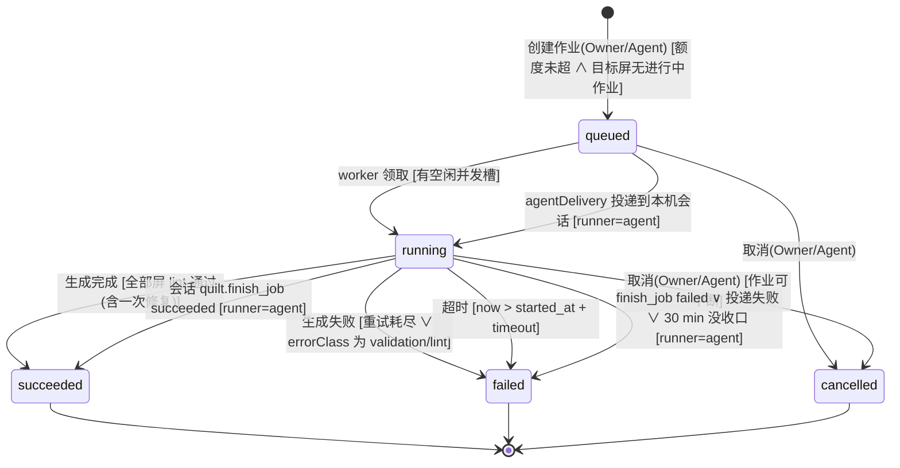

`runner=agent` 的作业（v0.34）不入队列，由 `agentDelivery` 在建作业后立即投递到本机 Claude Code 会话，状态由会话经 `quilt.finish_job` 收口（下表末三行）；`job.timeout` 不扫它，超时由 `agentDelivery` 自己计时（`agentJobTimeoutMs` 30 分钟）；进程重启时 `running` 的 agent 作业按 `startedAt` 重新计时（会话还在外面干活，不标失败），`queued` 的 agent 作业（建作业之后、投递抢占之前进程退出）立即补投；投递在抢占之前出错（如数据库抖动）时作业同样停在 `queued`，由 `job.timeout` 那一分钟的定时器补投排队超过 1 分钟的——`deliverAgentJob` 自己校验会话，会话不在就收成 `failed`，不再有停在 `queued`、一直占着屏锁的 agent 作业（v0.79）。

`kind=chat` 的作业（v0.45）走 `runner=model` 的常规路径：worker 领取后拉起 Agent SDK 子进程（`runChat`），子进程经本机 MCP 回写的修订带本作业 `jobId`；`running → succeeded` 的动作多一步「把助手最后一段文字回填成助手消息、记下 SDK 会话 id」；超时按 `estimateJob(chat)` = 8 次调用伸缩（11 分钟）；取消 = 中止子进程，已落库的修订保留。

`kind=edit_component` 的作业（v0.46）在 `runner=model` 时同样走常规路径，但产出不是屏而是组件：一次模型调用得到新的正式 HTML → 校验 → 组件 `version+1` → 对所有放着它的屏做确定性回刷（`sourceKind=component`，与 `apply_design_system` 同一条路，逐屏 `screen_html_ready` + 截图）；`running → succeeded` 的动作多一步「组件行更新 + 回填『已更新组件「X」，同步 N 屏』」；模型产出不合法（多根 / 带脚本 / 套组件）→ `failed errorClass=validation`，组件行不动；作业无 `target_screen_id`，回刷时有在跑作业的屏跳过并在回执点名（那屏的作业落修订前一刻重读组件再展开，用的就是最新组件，v0.79）。
取消只在组件行升版之前生效：模型回来后、写组件行之前复核取消信号，已取消就不写；组件一旦升版，回刷照做完（屏里的实例要与组件一致），作业仍收成 `cancelled`（v0.79）。
`runner=agent` 时（v0.99）不调模型：投递到本机会话，组件由会话经 `quilt.update_component(jobId)` 写回，回刷是同一条确定性路径、修订记在该作业名下，收口走下表末三行。

迁移表（与状态图 1:1，纯终态不列）：

| 源 → 目标 | 事件 | 守卫(纯布尔) | 动作(副作用) | 谁触发 | 接口/事件 |
| --- | --- | --- | --- | --- | --- |
| [*] → queued | 创建作业 | 本月用量 < 硬上限 ∧ 目标屏无 queued/running 作业 | 落库 job、绑定幂等键、（消息驱动时）建占位助手消息、记 `EVT:generation_requested` | Owner / Agent | `API-CORE-006` / `API-CORE-010` |
| queued → running | worker 领取 | 运行中作业数 < 并发槽（默认 20） | 置 started_at、加载上下文（DESIGN.md + token + 应用地图 + 金标准屏 + 目标屏） | 系统 worker | 内部任务 `job.claim`（无对外 API） |
| queued → cancelled | 取消 | — | 释放幂等键、助手消息标「已取消」 | Owner / Agent | `API-CORE-009` |
| running → succeeded | 生成完成 | 全部产出屏 lint 通过（允许一次自动修复回合） | 写修订、置屏当前版、派生应用地图、回填助手消息与受影响屏、追加用量台账、入队 `screenshot.render`、SSE `succeeded`、记 `EVT:generation_completed` | 系统 worker | 内部（无对外 API） |
| running → failed | 生成失败 | 重试次数 ≥ 2 ∨ errorClass ∈ {validation, lint} | 写 output.errorClass、助手消息回填失败原因（「已保留 N 屏」按屏计）、SSE `failed`、记 `EVT:generation_failed`；已产出的屏保留——候选批（`versions>1`）无论成败都让 current 指向已落的第 1 版，造屏与改屏一样（改屏只在 current 仍是这批的基线时接管，v0.79） | 系统 worker | 内部（无对外 API） |
| running → failed | 超时 | now > started_at + timeout（3 min + 每次预估模型调用 1 min + 每屏确定性回刷 5 s，封顶 30 min；回刷的屏数加进来是 v0.79。基数 3 min 可用 `QUILT_JOB_TIMEOUT_BASE_MS` 改、整个时限可用 `QUILT_JOB_TIMEOUT_TOTAL_MS`（v1.03）定死，都只在 `LLM_DRIVER=stub` 时生效——给超时路径的自动化用例，真实安装里设了也不认，v0.82） | 同上，errorClass=timeout；回收并发槽。**v1.03**：作业计划的修订（造屏 = 规划出的屏 × 版数、改屏 = 目标屏 × 版数、重生成一块 = 1）已经全部落库时中止不判失败、按成功收尾——这时多半卡在截图或入口屏补链上，修订已经生效，判失败会引导用户再花几分钟重做一遍；改屏的时限再加上按目标屏正文长度估的输出时间（每 240 字符 1 s，约 2.4 字符 / token × 100 token / s 的保守值），桌面大屏改屏单次调用实测 91–292 s。超时中止后还没轮到的屏在并发池里直接跳过、不抛错，所以中止本身就判 timeout，不能等异常——否则作业带着一半没做的活报 `succeeded`（v0.79） | 系统定时器 | 内部任务 `job.timeout`（无对外 API） |
| running → cancelled | 取消 | 作业未进入落库阶段 | 先中止在跑的调用（重试退避中的也醒来不再发下一次），再回填助手消息；丢弃未落库产出——每处写修订 / 组件行之前复核取消信号（v0.79）；SSE `cancelled`、已消耗 token 仍记台账 | Owner / Agent | `API-CORE-009` |
| queued → running | agentDelivery 投递 | runner=agent ∧ 会话在活会话列表里 | 置 started_at、组提示词、写一行 JSON 进会话 inbox socket、`output.delivery`、SSE `progress{stage:"delivered"}`、开始 30 min 计时 | 系统（建作业后立即） | 内部（无对外 API） |
| running → succeeded | 会话 `quilt.finish_job` | status 缺省或 succeeded | `output.screenIds` = 本作业名下修订所在屏、`output.summary`、派生应用地图、回填助手消息「本机 agent 已完成…」（改组件作业写「本机 agent 已更新组件「X」，同步 N 屏」，会话没写组件时写「没有改组件」，v0.99）、SSE `succeeded`（无 LLM 台账） | 本机会话（MCP） | `quilt.finish_job` |
| running → succeeded | 聊天回合结束（v0.45，`kind=chat`） | SDK 返回 `result{subtype:"success"}` | `output.reply` = 助手最后一段文字并回填助手消息、`output.screenIds` = 本作业名下修订所在屏（助手经 MCP 回写时带了 `jobId`）、`projects.chat_session_id` = 本轮会话 id、按 SDK 报的 usage 记台账、SSE `succeeded` | 系统 worker | 内部（无对外 API） |
| running → succeeded | 改组件完成（v0.46，`kind=edit_component`） | 模型产出通过校验（单根、无脚本样式、不套组件） | 组件 `html` / `summary` / 激活类更新且 `version+1`；对 `component_uses` 里该组件的每一屏建 `sourceKind=component` 修订（有在跑作业的屏跳过）、派生应用地图、SSE `progress{stage:"component_synced"}` 与逐屏 `screen_html_ready`、入队截图、回填助手消息「已更新组件「X」，同步 N 屏」、追加用量台账、记 `EVT:component_updated{via:"job"}` | 系统 worker | 内部（无对外 API） |
| running → failed | `finish_job failed` ∨ 投递写入失败 ∨ 30 min 没收口 | — | `errorClass=agent`（message = summary / socket 错误）或 `timeout`、助手消息回填原因、SSE `failed`。投递写入失败只算「没投出去」：Codex 的 `codex queue` 失败算，排进队列之后打开线程失败不算（作业保持 `running`，v0.79） | 本机会话 / 系统定时器 | `quilt.finish_job` / 内部 |

v0.32 删除了 `AgentTask` 状态机：派活任务、租约、长轮询领取随伴侣进程一起移除（`REQ-AGENT-003` 改写）。

跨机一致性：`GenerationJob` 的「目标屏无进行中作业」守卫由 `generation_jobs` 部分唯一索引保证（见 §16）；取消作业（`API-CORE-009`）对 `runner=agent` 的作业 = 杀掉子进程再置 `cancelled`。

## 12. 关键流程时序

### 时序 1：对话生成多屏（M1，`REQ-CORE-003` / `REQ-CORE-006`）

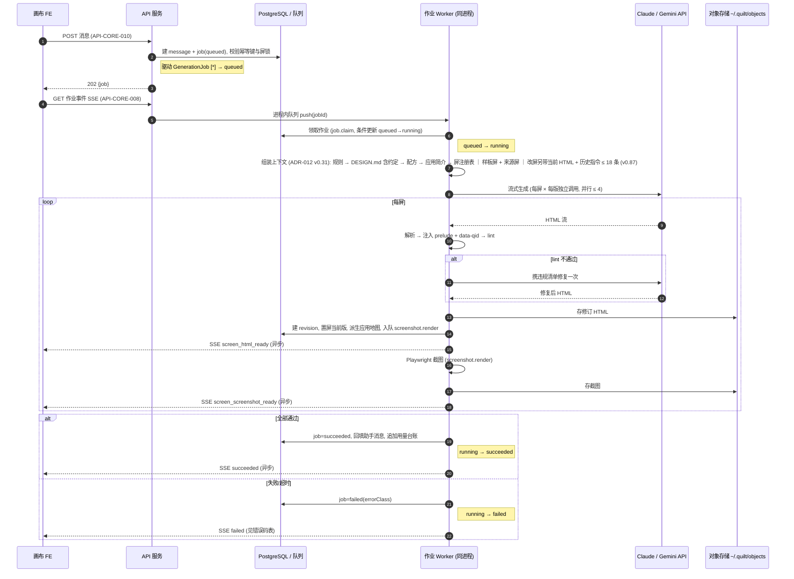

### 时序 2：聚焦与原型播放（M1 聚焦 / M2 播放，`REQ-CORE-005` / `REQ-PROTO-001` / `REQ-PROTO-003`）

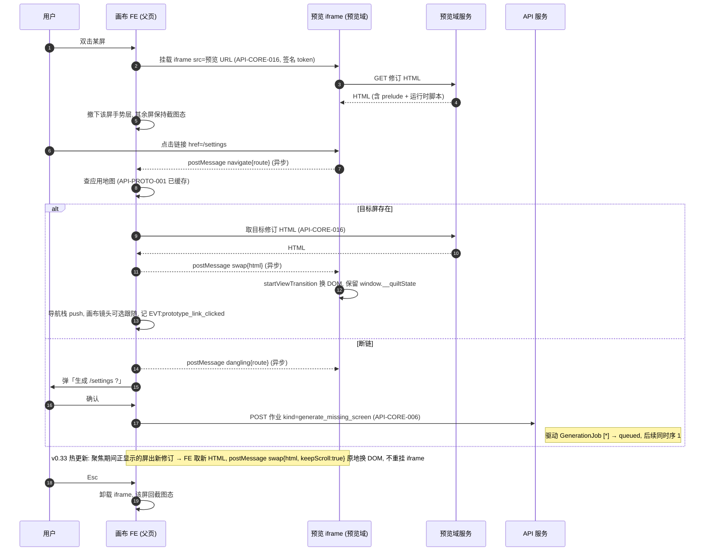

### 时序 3：agent 自带模型推屏进画布（M4，`REQ-AGENT-001` / `REQ-AGENT-002`；v0.32 免鉴权）

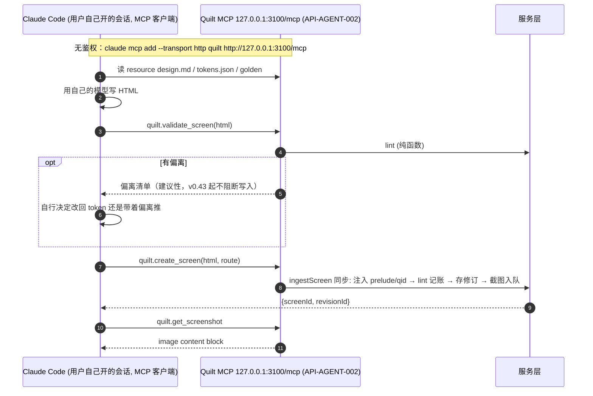

### 时序 4：画布把作业交给本机 agent（M10，`REQ-AGENT-003`）

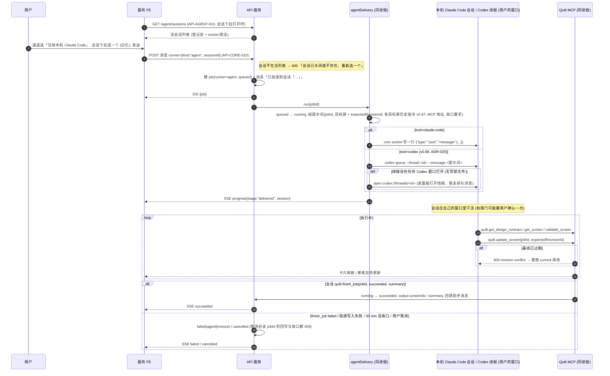

### 时序 5：聊天回合（v0.45，`REQ-CORE-023`）

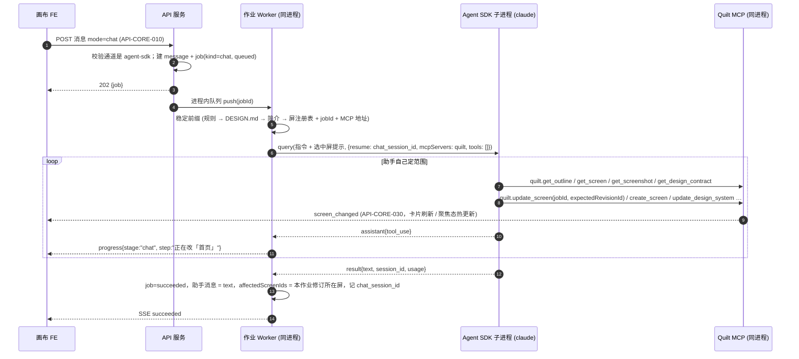

只回答不改的一轮走的是同一条路，只是循环里没有写入；助手回写的屏与本机会话推屏一样经 `ingestScreen` 落修订、派生地图、入截图队列，画布不必区分「谁写的」。

### 时序 6：共享组件的提取、同步与改组件（v0.46，`REQ-EDIT-006`）

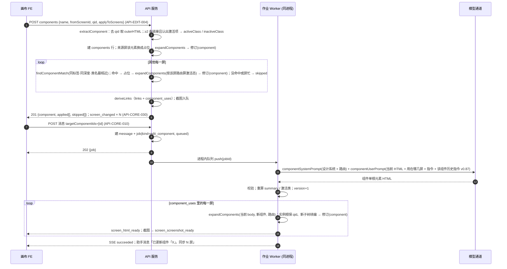

展开只在写入路径上跑（生成 / 改屏 / 子树重生成 / `ingestScreen` / 回刷），预览下发与 `get_screen` 读的是已展开的修订，所以预览域、截图、导出、大纲、lint 都不知道「组件」这回事，只有实例根上留着的 `data-component` 标记。
回刷跳过有在跑作业的屏不会漏更新：那屏的作业在落修订前一刻重读组件再展开，拿到的就是最新组件（v0.79；用作业开跑时读的组件快照不行——模型一跑几分钟，这期间改的组件会被写回旧版，而回刷已经跳过了这屏，事后也没有补刷）。
重读到落修订之间还有几十毫秒，组件恰好在这段时间里改的，这屏仍停在旧版，下次改这屏或改组件时追平。

时序 1 中 `screenshot.render` 与作业在同一 worker 进程内串行于该屏之后，若截图失败不影响作业成功（修订已落库；拍失败的修订入 `screenshot.render` 队列重试 2 次、拍成后推 `screen_changed{screenshot:true}`，仍失败的由 `screenshot.retry` 补扫，见 §17；v0.79 之前只打日志、等 5 分钟一次的补扫）。

### 时序 7：草稿本出稿与写回项目（`REQ-CORE-040` / `REQ-CORE-041`）

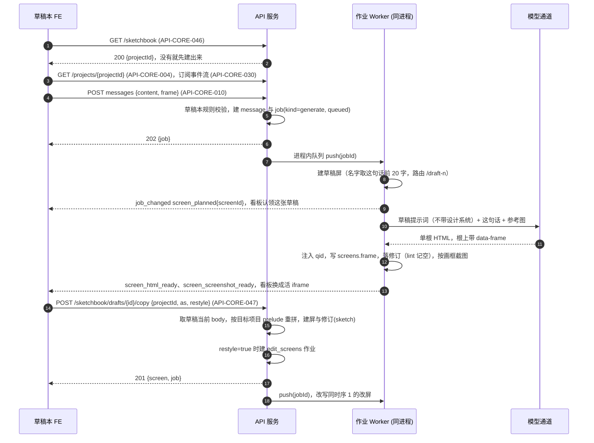

本机会话通道（`runner.kind=agent`）不经 worker：作业投递到会话，会话用带 `jobId` 的 `quilt.create_screen` 写出新草稿，草稿本页靠带同一 `jobId` 的 `screen_changed` 认领它，收口同时序 4。
### 时序 8：屏拿到草稿本改，再覆盖回去（`REQ-CORE-043` / `REQ-CORE-044`）

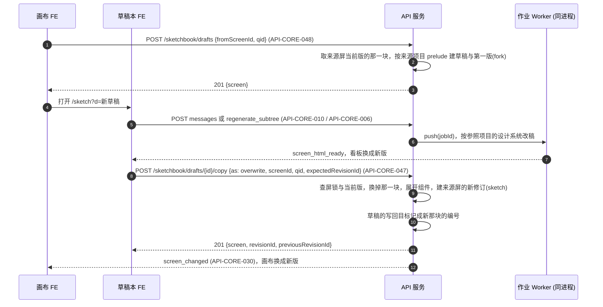
### 时序 9：本机使用记录（`REQ-CORE-047`）

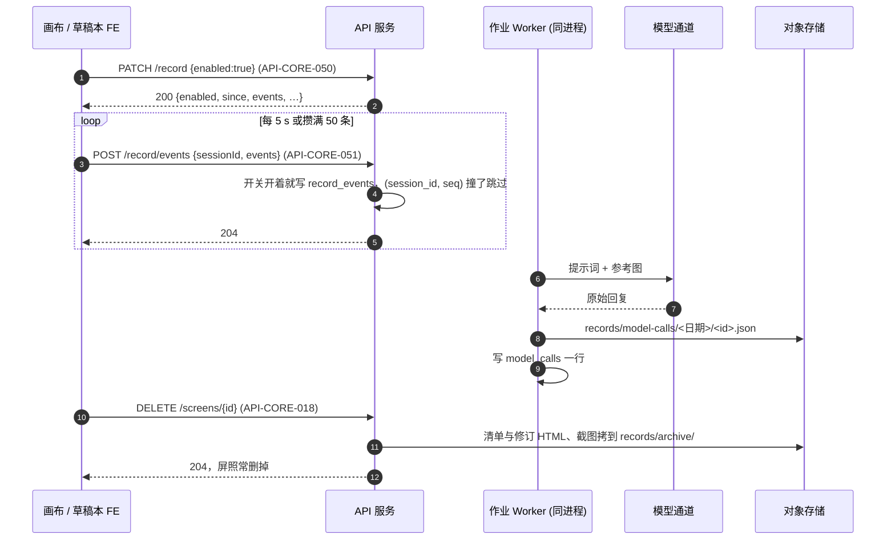

### 时序 10：协作显示（`REQ-CORE-048`）

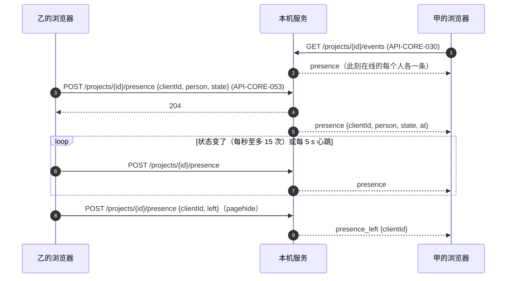

## 13. 页面与跳转地图

```mermaid
flowchart LR
  LAUNCH((npx quilt-canvas 自动打开浏览器)) --> ROOT[/ 入口]
  ROOT -->|有项目：跳最近更新的 API-CORE-005| PAGE_CANVAS[画布 /p/:projectId]
  ROOT -->|无项目| PAGE_FIRST[首个项目 /：品牌符号 + 新建弹窗]
  PAGE_FIRST -->|新建 API-CORE-003| PAGE_CANVAS
  PAGE_CANVAS -->|顶栏项目切换器 API-CORE-005| PAGE_CANVAS
  PAGE_CANVAS -->|切换器底部 新建 API-CORE-003| PAGE_CANVAS
  PAGE_CANVAS -->|双击屏 / Enter API-CORE-016| PAGE_CANVAS_FOCUS[画布·聚焦态]
  PAGE_CANVAS_FOCUS -->|Esc| PAGE_CANVAS
  PAGE_CANVAS_FOCUS -->|点链接 API-PROTO-001| PAGE_CANVAS_FOCUS
  PAGE_CANVAS -->|双击空白 / 工具栏 新建屏幕：放锚点并聚焦输入框| PAGE_CANVAS
  PAGE_CANVAS -->|点卡片候选角标 API-CORE-026| PAGE_CANVAS_PICK[画布·候选就地展开 M9 / v0.34]
  PAGE_CANVAS_PICK -->|采用 API-CORE-025| PAGE_CANVAS
  PAGE_CANVAS -->|历史面板 API-CORE-013| PAGE_CANVAS_HISTORY[画布·修订面板]
  PAGE_CANVAS_HISTORY -->|回溯 API-CORE-015| PAGE_CANVAS
  PAGE_CANVAS -->|点样例卡 API-CORE-004| PAGE_CANVAS_DS[画布·设计系统面板 M1 只读 / M3 可编辑]
  PAGE_CANVAS -->|双击样例卡 API-CORE-045 view=card| PAGE_CANVAS_FOCUS
  PAGE_CANVAS_DS -->|打开完整样例页 新标签页 API-CORE-045 view=full| PAGE_SPECIMEN[样例页完整视图 预览域 /s/:projectId]
  PAGE_CANVAS_DS -->|保存 API-EDIT-002| PAGE_CANVAS_DS
  PAGE_CANVAS_DS -->|回刷 API-CORE-006| PAGE_CANVAS
  PAGE_CANVAS -->|选元素 API-EDIT-001| PAGE_CANVAS_INSPECT[画布·元素检查器 M3]
  PAGE_CANVAS_INSPECT -->|关闭| PAGE_CANVAS
  PAGE_CANVAS_INSPECT -->|记为共享组件 API-EDIT-004| PAGE_CANVAS
  PAGE_CANVAS -->|工具栏 新建组件 ⌥C API-EDIT-004| PAGE_CANVAS
  PAGE_CANVAS -->|框选组件 + 发送 API-CORE-010 targetComponentIds| PAGE_CANVAS
  PAGE_CANVAS -->|导出 API-PROTO-002| PAGE_CANVAS
  PAGE_CANVAS -->|删除屏 API-CORE-018| PAGE_CANVAS
  PAGE_CANVAS -->|⌥T| PAGE_CANVAS_AGENT[画布·本机 agent 面板 M10 API-CORE-029]
  PAGE_CANVAS_AGENT -->|取消 API-CORE-009| PAGE_CANVAS_AGENT
  PAGE_CANVAS -->|顶栏 设置 ?settings=usage| PAGE_CANVAS_SETTINGS[画布·设置弹层]
  PAGE_CANVAS_SETTINGS -->|用量 API-CORE-017| PAGE_CANVAS_SETTINGS
  PAGE_CANVAS_SETTINGS -->|通道管理 API-CORE-020~024| PAGE_CANVAS_SETTINGS
  PAGE_CANVAS -->|切换器菜单 草稿本 API-CORE-046| PAGE_SKETCH[草稿本 /sketch]
  PAGE_CANVAS -->|地址是草稿本的 id：重定向| PAGE_SKETCH
  PAGE_SKETCH -->|发送 API-CORE-010| PAGE_SKETCH
  PAGE_SKETCH -->|点记录栏缩略图 ?d=草稿 id| PAGE_SKETCH
  PAGE_SKETCH -->|写回项目 API-CORE-047| PAGE_SKETCH
  PAGE_CANVAS -->|到草稿本里改 API-CORE-048| PAGE_SKETCH
  PAGE_SKETCH -->|切换器选项目 API-CORE-005| PAGE_CANVAS
```

页面与角色/接口：`PAGE-CANVAS`（含聚焦态、修订面板、设计系统面板、元素检查器、本机 agent 面板、候选就地展开、设置弹层七个子态，同一路由）、`PAGE-SPECIMEN`（v0.85 `REQ-CORE-036`：样例页完整视图，预览域上的独立文档、新标签页打开，只读、无登录；左侧节目录按 SPEC §4 的节 `id` 锚点跳转，每节标题旁标该节类别的「有值 / 不适用 / 缺」）、`PAGE-FIRST`（无项目时的入口：`npx quilt-canvas` 首次打开看到的第一屏，居中放 96 px 的完整品牌符号——产品里唯一放得下它的地方，见 §13.1——与不可关闭的新建弹窗）。
v0.32 本地版没有登录页与授权同意页（`PAGE-LOGIN`、`PAGE-AGENT-CONSENT` 随 `REQ-CORE-001` / `REQ-AGENT-001` 推迟）；`/` 直接进最近更新的项目，旧路径 `/projects` → `/`、`/settings` → 最近项目 + `?settings=usage`；其余地址 =「没有这个页面」，各路由出错共用一个中文错误页（v0.83，见 `PAGE-CANVAS`「加载、失败与数据新鲜度」）。

`PAGE-SKETCH`（`REQ-CORE-040`，路由 `/sketch`，`?d=<草稿 id>` 是看板上正打开的那张）：沉浸式的一整页，没有画布、工具栏与小地图。
入口：各项目画布的项目切换器菜单顶部固定一条「草稿本」；本页左上角是同一枚切换器 chip，写「草稿本」，菜单里列项目（选一个回到它的画布）与「新建项目…」。
打开 `/p/<草稿本 id>` 重定向到 `/sketch`；浏览器标签页标题「草稿本 · Quilt」。
**看板**（v1.16，v1.17）：顶部那一行以下的整块区域；输入框、收起后的胶囊与记录栏都浮在看板上面，停在哪、开没开、收没收起都不改看板（可能压住草稿的一角，挪开或收起即可）。打开的草稿是预览域的活 iframe（可点可滚，链接惰性），在看板里居中，按画框放到能放下的最大、最大 1:1——组件按 `quilt:draft-size` 报的大小，手机页 390×844、桌面页 1280×800 的视口；放不下时等比缩小、不裁切，缩小用 `zoom`、不用缩放变换（理由见 `PAGE-CANVAS`「聚焦屏不走缩放变换」，v1.19）；不提供缩放（与预览页一样按真实尺寸看）。打开着的草稿出了新的一版（改一轮、改一块、回到旧版、本机会话回写）时原地换（v1.18）：父页取新版 HTML 经 `quilt:swap`（`keepScroll`）送进 iframe，与画布的聚焦态热更新同一通道，iframe 不重载、不出骨架与「加载中…」，滚动位置留着，组件按新报的大小重排；设计系统变了（`<head>` 不同）时运行时整份重写，父页收到新的 `quilt:ready` 再把选元素的模式发一次。换画框（手机页 ↔ 桌面页）只改视口，不重载。取不到新版 HTML（签名过期）先重取详情再取一次，仍取不到才整页重载。只有换一张草稿、新草稿第一版落地时才加载。
草稿工具条（v1.16）在顶部那一行：项目切换器与记录栏开关之间，对着看板居中，毛玻璃；不占看板的高度。左端是名字（点了就地改名，`API-CORE-012`），有写回目标时名字下面一行小字「来自「<项目> · <屏>」」；后面是控件：画框（页面草稿在「手机页 / 桌面页」之间二选一，`API-CORE-012` 的 `frame`；组件草稿不显示——组件与页面不能互相换，v1.17）、「参照」（自由风格，或选一个项目，`API-CORE-012` 的 `refProjectId`，`REQ-CORE-042`）、「选元素」图标开关（`REQ-CORE-045`，悬停或键盘聚焦时出说明）、「版本」（按缩略图列出各版，点「回到这一版」走 `API-CORE-015`）、「写回项目…」（窄屏只留图标）、删除（确认后 `API-CORE-018`，不可恢复）、「收起」。放不下一行时折行，看板跟着下移；窄屏（48rem 以下）它单独占顶部那一行下面的一整行、不折行，放不下的在条里横着滚（滚动条不显示）。
**快捷键**同画布：`⌘E` 开关「选元素」、`⌘/` 收起或展开输入框；焦点在草稿里时由预览运行时转发，照样能按。
`⌘Z`（Windows 为 `Ctrl+Z`，v1.25）回到看板上这张草稿的上一版：取当前版的父修订，走「版本」里「回到这一版」同一个接口（`API-CORE-015`，当前版指回它、不多出新版本，提示「已回到第 N 版」），所以连按会沿着改动的来路一版版往回走；当前版是 v1.43 之前回到旧版建出来的（`restore`）时，它的内容就是它的父修订那一版，先退到那一版再取父修订。看板换成上一版之前再按不重复发。焦点在文本框里时 `⌘Z` 留给文本框自己撤销；当前已是第一版时提示「已经是第一版」，这张草稿正在生成或改时提示正在改，都不发请求。
**选元素**：开着时点草稿里的元素，它被框出、输入框目标区多一枚「「<草稿名>」里的 <标签>「<文字>」」胶囊，动词行写「改这一块」，发送建 `regenerate_subtree`（`API-CORE-006`），输入框里的参考图一起带上（v1.21）；`Esc` 或 × 去掉胶囊回到改整张。
按住 `Shift` 点是加选或减选（v1.26，规则同画布的「多选」）：每块一枚胶囊、各自能 × 掉，动词行写「改这 N 块」，发送是带 `qids` 的同一种作业；`Esc` 一次清掉全部胶囊。
选元素开着、一块也没选时按 `Esc` 关掉选元素，同再按一次 `⌘E`，看板不收起（v1.38 用户定：此前这一下直接收起了看板，选元素其实还开着）。
点选之后焦点落在输入框里（好接着打字）；输入框还是空的、上面有胶囊时，`Shift+↑` / `Shift+↓` 走层级（同画布的逐级选，移动最后点中的那块），打了字之后照旧是扩选文字。
看板为空时正中一句提示与三条可点的示例；新草稿生成中时看板正中是骨架（只呼吸）与进度一句话，第一版落库即换成活 iframe；失败时骨架撤掉、提示条写失败原因（`failureText`）。
在跑的作业同画布，以作业 chip 叠在输入框上方（`PAGE-CANVAS`「作业 chip」）。
**输入框**（缺省停在底边正中；停靠、拖动与收起同画布，见 `PAGE-CANVAS`「停靠与收起」，记忆单独一份，但浮在看板上、不让位；与画布同一套通道 / 会话选择与参考图）：看板为空时动词行写「新草稿」，多一个画框选择「自动 / 组件 / 手机页 / 桌面页」（缺省自动，记在本机）与一个「参照」下拉（自由风格或选一个项目，缺省自由风格、不记忆；选了就随新草稿发出 `refProjectId`）；看板上有草稿时动词行写「改「<草稿名>」」，画框选择与参照下拉收起（这张草稿的参照在工具条上改）；没有屏数、版数与聊天。
发送被挡的规则同 `REQ-CORE-020`：上一张新草稿还在生成时挡住「新草稿」，这张草稿上一轮没改完时挡住「改」，原因写在输入框上方。
**记录栏**（右侧，可收起，开合记在本机；浮在看板上、开合不改看板，上沿与看板上沿对齐（v1.17）；窄视口下没记过开合时缺省收起，点一项后自动收起、不改记下的开合）：全部草稿按创建时间倒序，每项缩略图 + 名字 + 相对时间；生成中的标「生成中」，正打开的那张描边；点一项把它摆上看板。
**收起**：「收起」或 `Esc`（焦点不在输入框，或输入框是空的；跟随中先停止跟随，选元素开着先去掉胶囊、再关掉选元素，各占一下）去掉 `d`、看板清空、焦点回输入框；在生成的照常生成。
本页发出的新草稿在看板空着时自动摆上看板（`API-CORE-030` 的 `screen_planned` 或带同一 `jobId` 的 `screen_changed`）；这期间用户已打开别的草稿就不抢看板，只进记录栏。
**「写回项目…」弹层**（`REQ-CORE-041`、`REQ-CORE-044`）：先选目标项目，再选方式「新屏 / 共享组件 / 覆盖整屏 / 换一块」。
缺省值按草稿：有写回目标时是那个项目、覆盖那一屏（有元素就换那一块）；只有参照项目时是它、新屏；都没有时是上次打开的项目、新屏。
新屏与组件：名字（缺省草稿名）与「按该项目的设计系统改写」（参照项目就是目标项目时缺省不勾，否则缺省勾；旁注「1 次模型调用，用输入框当前的通道」）。
覆盖整屏：目标屏下拉（屏名 + 缩略图），选中后两张缩略图并排，左边是目标屏的当前版、右边是草稿。
换一块：目标屏下拉，下方是目标屏的活预览（选元素态），点中的元素框出并写「换掉 <标签>「<文字>」」，共享组件实例里的元素点不中并就地说明。
覆盖与换一块不提供改写，确认键旁写「覆盖后可在「<屏名>」的版本里回到第 <n> 版」。
画框与项目设备形态对不上时就地说明（如「这张是手机页，项目是桌面端，放进去按桌面宽度重排」）；屏忙、版本过期、元素已不在、超过 256 KB 时就地写原因，版本过期时刷新目标屏的预览。
成功后提示条「已写回「<项目名>」」，带「去看看」打开该项目画布。
**从画布进来**（`REQ-CORE-043`）：画布上选中一屏时，工具栏多一项「到草稿本里改」；元素检查器里选中元素时，检查器里同样有这一项，带的是那一块（共享组件实例里的元素没有这一项：拿出去的那一块写回时会被组件锁挡住，要改它去改组件）；屏还没有内容时这一项不可用。点了建草稿（`API-CORE-048`）并打开 `/sketch?d=<新草稿>`。
导航（v0.28，标识 v0.30，v0.32 收窄，v0.40 补重命名）：顶栏左上第一个元素就是**项目名 ▾**（画布顶栏不挂品牌标识，见 §13.1），它即**项目切换器**——点开为按更新时间倒序的列表（当前项打勾，每项带设备形态药丸），选一项即切到 `/p/:id`；列表底部固定一条「新建项目…」打开新建弹窗，创建成功跳新项目。
每行 hover / 键盘高亮时露出垃圾桶（键盘等价物：高亮行按 `Delete`）→ 先关下拉再弹确认（写明项目名、级联范围、不可恢复）→ `API-CORE-031` 删除；删的是当前项目就回 `/`（落到最近更新的其它项目，一个不剩就是 `PAGE-FIRST`）；有进行中作业的项目拒删并说明（v0.34）。
浏览器标签页标题 = 「<项目名> · Quilt」，多个项目开在不同标签页时靠它分辨，离开画布复位为「Quilt」。
工具栏最下方的「设置」（齿轮，v0.97 前在顶栏右侧）打开**设置弹层**，关闭后焦点回到这个按钮（经 `?settings=` 直接打开的也一样）：分栏布局——左栏是**三节**导航（用量 / 模型 / 系统，v1.24；Radix Tabs 垂直方向，整组在 Tab 序里只占一个停靠点，上下方向键换节并立即切换），右栏只显示当前节（自身滚动）。
换节时右栏内容淡入并上移 4 px，150 ms；减弱动态时直接换。
当前节即视图标识，进 URL `?settings=usage|models|system`（刷新保持）；v1.24 之前的值照旧能开：`runners` 开「模型」，`appearance`、`language`、`record` 开「系统」，开了之后地址换成新值；不认识的值回 `usage`。`Esc` / 右上「关闭」关闭并去掉参数。
输入框模型下拉里的「管理模型…」打开 `models` 节。
「用量」一节（v1.24 `FLOW-USAGE`，数据取 `API-CORE-052`）自上而下：
① 活动卡：近 90 天的日历（列是周、行是周一到周日，按当天作业数分 5 档绿色，悬停出「10 月 18 日 · 12 次」）；右侧是活跃天数、最长连续、作业次数，一排按星期的日均柱（最忙那天加深），底行是 90 天里 Token 最多的模型与占比，删掉的模型带「已删除」。
② 「统计」标题右侧一个分段控件：近 7 天 / 近 30 天 / 全部，缺省近 7 天，选择记在本机 `quilt:usage-range`；白色滑块 200 ms 滑到选中项。
③ 四张看板：作业（次，下行日均）、Token（下行输入与输出）、生成屏数（下行草稿本占几屏）、平均每次 Token（下行最多的一次）。正在跑的作业不计入，另起一行写「另有 N 次调用在跑」。
④ 每日 Token：按模型分段的堆叠柱，段与段之间留 2 px；「全部」跨度超过 60 天时按周，横轴隔一根写日期范围。悬停一根柱出提示：日期、各模型的 Token 与占比、合计。首次显示与换范围时柱子从底部长出，300 ms，逐根错开、错开合计不超过 150 ms。
⑤ 模型表：每行是模型 logo（不垫底色）、名字与模型 ID；两根 20 px 胶囊——Token 是实心填充，作业次数是浅色填充，字写在胶囊里，填充盖住的那段字换成在填充上够 4.5:1 的字色；右侧一列百分比；状态列写「在用」或「已删除」，次行是最近一次用的日期。
⑥ 项目表：首字块、名字与这段时间出的屏数；一根 Token 胶囊（颜色取这个项目用得最多的模型）；最后一列是用过的模型色块与「X 为主」；悬停一行出各模型的占比；删掉的项目带「已删除」。
⑦ 按任务类型：每类一行（造屏、改屏、改一块、改组件、提炼约定、套用设计系统、导出、收录、对话、其他），一根按模型分段的条，右侧次数与占比。
胶囊与分段条第一次出现时从 0 长到占比，400 ms；悬停提示 120 ms 淡入。减弱动态时这些都直接到位。
颜色按 `models` 的顺序分配设计系统的图表色号，删掉的模型一律中性灰。每日 Token 的柱段、任务类型的分段条、Token 胶囊与各处色块用这一号的填充色，四周 1 px 这一号的系列色描边（v1.40，§13.1）；作业次数胶囊是系列色的 18% 浅色。图表另有一份读屏用的表格，屏幕上不显示。
「模型」一节（v1.24，原「生成通道」）顶部是说明与「添加模型」，下面是两张表（见下方「设置弹层的模型」），最后是 MCP 接入命令（`claude mcp add --transport http quilt http://127.0.0.1:3100/mcp` 与 Codex 一条，可复制）。
「系统」一节（v1.24）把外观、语言、协作（v1.32，改名与换色，`PAGE-CANVAS`「协作者」）、使用记录四组放在一起，各组一个小标题，从上到下排。
外观组（`REQ-CORE-039`）是一组单选：跟随系统（缺省）/ 浅色 / 深色，选中即生效、不用保存；选择记在本机 `localStorage` 的 `quilt:theme`（`light` / `dark`，跟随系统时删掉这一键），对所有项目与 `PAGE-FIRST` 生效。
语言组（`REQ-CORE-046`）是同样的单选列表：中文 / English（语言名各用自己的文字写、标上 `lang`），选中即生效、不刷新页面；选择记在本机 `localStorage` 的 `quilt:locale`（`zh` / `en`），对所有页面生效，说明写明之后生成的屏也用这种语言、除非要求里另说。
没选过时按浏览器：`navigator.languages` 的第一项（没有时 `navigator.language`）以 `zh` 开头为中文，否则英文。
使用记录组（v1.22 `REQ-CORE-047`）是一个开关「记录我的使用」（缺省关，改了当场生效，`API-CORE-050`）加一段说明：记什么（界面操作、输入过程、每次模型调用的提示词与回复、删掉的东西留归档）、不记什么（密码与密钥）、只存在本机不上传。
下面一行写已记的条数、占用与起始时间，一行写存放位置（绝对路径，可复制；`API-CORE-049`）；关掉之后这两行照样显示。
切换后 `<html lang>` 跟着变（`zh-CN` / `en`），之后的每个请求带新的 `X-Quilt-Locale`（§8 开头）；界面文字当场换成新语言（屏内修改标记的字见 §13.1「画布标记」）；用户生成的内容不重译，存量屏与已有草稿保持原样。
设置弹层里可再打开「添加模型」弹层，因此弹层基建的 `inert` 按层栈计数：开一层隔离其下所有层，关一层只放开新的最上层，栈空才解除背景隔离；弹层内的按键不冒泡给画布快捷键。
画布页进入调 `API-CORE-004`，对话面板调 `API-CORE-010/011` 并订阅 `API-CORE-008`。

**协作者**（v1.32 `REQ-CORE-048`）：身份与顶栏头像同画布（`PAGE-CANVAS`「协作者」），头像的提示写他正在看哪张草稿。记录栏里每张草稿的缩略图角上叠着正在看它的人的小头像，至多 3 个。
和你开着同一张草稿的人：光标按草稿画框的原始尺寸坐标画，框外的看板上也画；他在草稿里选中的块描一道他颜色的框，右上角外侧挂他的名字，块贴着草稿顶部、上方放不下时名字收进框里；他在改这张草稿时，看板右上角标「<名字> 正在改」。
点他的头像就跟随：打开他正看的那张草稿，他换草稿你也跟着换；按 `Esc`、自己点开别的草稿、再点一次同一个头像或他离开，都停止跟随。链式跟随与跟随连成一圈的处理同画布（`PAGE-CANVAS`「协作者」）：顺着跟随链打开领头那个人正看的草稿；连成一圈时最后开始跟随的人留下，跟随他的人停止并收到提示。

`PAGE-CANVAS` 外壳：画布铺满视口，**视口那一层只裁剪、不滚动**（`overflow: clip`，v0.38）——平移缩放全在世界层的 transform 上，视口不需要滚动能力；留成滚动容器的话浏览器自发的 scroll-into-view（点候选格里的输入框、甚至自动化的 `scrollIntoViewIfNeeded`）会把整块画布连同全部卡片横移（实测 `scrollLeft` 一路到 699），而世界层的 transform 对此一无所知，屏幕↔世界换算随之整体偏 `scrollLeft/zoom`：框选、拖卡、放锚点全错位。
chrome 一律浮于其上，四处互不重叠——① **顶栏**（只承担去向）：左上角一枚项目切换器 chip（项目名；v1.10 起不再显示设备形态与选中计数——设备形态在切换器的项目列表里，选中靠卡片描边与输入框的目标标签），实时更新断开时它右侧多一枚「实时更新已断开」chip（v0.97 去掉屏数与缩放比例，设置移到工具栏最下方）。**退出账号不在顶栏**，收在设置弹层；② **右侧竖排工具栏**（`role=toolbar`，方向键在组内移动焦点；每个工具悬停/获焦时给出作用说明与快捷键，提示渲染在滚动容器之外以免被裁切，且工具栏整体层级高于右侧滑出面板——面板开着时提示正好落在面板上，要画在面板之上而不是被它盖住（v0.78）；v0.70：高度封顶在可用区内，放不下时在工具栏内纵向滚动——滚动条隐藏、键盘移动焦点时自动滚到可见，哪一侧还有被遮住的工具，那一侧边缘露出一个弱文字色的小箭头（v1.11；不用渐隐遮罩，界面不用渐变），内边距在滚动区内以免首尾按钮的焦点环被裁；v0.80：**顶端固定**在顶栏下方、与右侧滑出面板同一上沿，上下文组只在末尾增减——此前整列垂直居中，选中一屏时全部按钮上移 61 px、进交互再下移 9 px，用户正要点的按钮被自己的上一个操作挪走）：适配视图 `F` / 连线 `L` / **输入框 `⌘/`**（收起 / 显示底部输入框） / **选择元素 `⌘E`** ｜ 接上跳转 / 设计系统 `⌥D` / 新建屏幕 `⌥G`（在可见区中心放锚点并聚焦输入框）/ 导出原型（无快捷键）/ 派活 `⌥T` ｜ 恰好选中一屏时追加 **进入交互** `Enter`（v0.80，双击卡片的键盘与指针等价入口）、修订 `⌥R` 与 **设为样板**（`REQ-CORE-016`，当前样板屏上显示为「样板」且不可再点），选中任意屏时追加 删除 `Del`，聚焦某屏时追加 退出交互 `Esc` / 后退 `Alt+←` ｜ 最末单独一组：**设置**（齿轮图标，无快捷键，打开设置弹层；v0.97 从顶栏移来）——它排在上下文组之后，上下文工具增减时跟着上下挪，设置不是选中、聚焦之后紧接着要点的东西。**「进入交互」与「退出交互」是同一格的同一个工具**（v0.80）：上下文组的第一格，未聚焦时是「进入交互」、聚焦时是「退出交互」（状态只靠按钮名表达，不挂 `aria-pressed`：名字与按下态一起变，读屏会读成「退出交互，已按下」），在那一格上连点是进去再出来，焦点也一直留在这一格——此前退出后同一位置换成了「出变体」（再点一下就开出变体弹层），被点的按钮卸载、键盘焦点掉到 body。**选择元素是全局模式，不挂在某一屏上**：按 `⌘E` 即开启（不必先选中或双击任何屏），开启后画布光标变准星并给出「点任意一屏开始 · Esc 退出」的提示（v0.80：提示条用 chrome 材质——此前是 15% 透明的强调色底，压在白卡上文字对比度约 1.1:1、基本读不出），单击哪一屏就推镜头进哪一屏；退出模式时连同聚焦一起退回静态卡片。
退出某一屏（`Esc`）只是回到画布，模式仍然开着，可以接着点下一屏；没有聚焦任何屏时再按 `Esc` 才退出模式（见下文 `Esc` 顺序）。**交互态与选择元素态互斥**：一张聚焦卡片同一时刻只处于其中一种（角标分别显示「交互中」「选择元素中」），退出任一都回到卡片本身的静态截图。
从交互态切进选择元素态时，若已在屏内跳转过别的路由，先把 iframe 拉回这张卡片自己的那一屏并清空导航栈——否则选中的元素属于别的屏，与卡片截图对不上。**聚焦屏不走缩放变换**（v1.19）：聚焦屏的 iframe 按镜头倍率显示，但不跟着世界层的 transform 缩放——包它的那一层按倍率 `zoom`、再 `scale(1/倍率)` 抵消，iframe 上的总变换是 1:1，里面仍按设备宽度排版；宽高取到不少于设备宽高的整设备像素，里面的视口不比设备窄。镜头停下时按新倍率重摆。原因：Chromium 在带缩放变换的跨域 iframe 里用 GPU 合成时，同时带 `backdrop-filter` 与 `box-shadow` 的元素旁会出一片灰色渐变、盖住邻近的内容，等下一次重绘才消失（无头浏览器复现不出）。**聚焦态热更新**（v0.33）：聚焦期间 iframe 的 `src` 钉住不动（签名 URL 每次刷新都换，不钉就会静默重载、丢掉模式），所以屏出了新修订要由父页显式送进去——iframe 里正显示的那一屏（导航栈顶，没跳转过就是卡片自己）的 `currentRevisionId` 一变（直改、改屏、重生成子树、回刷、采用候选），父页取新 HTML 经 `quilt:swap{keepScroll:true}` 换进同一文档：不重挂 iframe、不丢导航栈，模式与滚动位置由运行时保住。
运行时比对新旧 `<head>` 里的设计系统三样（token 变量块、字体链接、Tailwind 配置）：一致就只换 `<body>`（`startViewTransition`），不一致（回刷改了色 / 圆角 / 字体）就整份重写文档——`document.open` 不换 window，表单状态与滚动位置照旧恢复，新运行时重发 `quilt:ready`、父页再下发一次模式；正显示的是别的屏时卡片自己的屏被改不动它，下次回到它再显示。
换完 DOM 后父页让运行时按当前选中元素的 `qid` **重选**（`quilt:reselect` → 回一份新的 `quilt:select`）：检查器留在同一元素上、字段刷成新修订的值；元素已不在（被删、子树重生成换了 qid）运行时回 `quilt:deselect` 才清空。
发出直改 / 子树重生成时同样不清选中，只清说明框——面板不该在用户眼皮底下退回空态。
元素直改也走这条通道，不再换 key 重挂。**变化从哪来都能到**：画布订阅项目级事件流（`API-CORE-030`），本机会话经 MCP 回写、别处建的作业、截图就绪，以及别处的删屏、挪屏、改项目名、改设计系统、增删组件（v0.77）都触发同一个刷新，不必进出交互态或刷新页面；刷新后已删的屏从画布与目标标签里一并消失（目标取的是还在项目里的屏）。
项目被别处删掉时事件流发完最后一条就关闭，重取详情得 `404`，交给画布的加载错误态。**选元素的命中**（`REQ-EDIT-001`，v0.57；v1.34 修）：选择元素态下设计里写了 `pointer-events: none` 的元素也选得中（装饰层、`<label>` 里的字）。指针下的目标按层自上而下取第一个（没有指针位置的点击——键盘在聚焦元素上触发、脚本发出的，按事件落在的元素取，v1.39 修：此前它们的坐标是 0, 0，选成了页面左上角那一块），跳过两类层：看不见的（自身或祖先全透明、`visibility: hidden`），以及本来不可点、自己又什么都不画的（没有字、背景、边框、阴影，也不是图片或控件）。收起的底部抽屉与弹窗常留着一层全透明的全屏遮罩和装它的 `fixed inset-0` 空容器，此前它们被一并变成可点、盖住整页，点哪都只选中这块最大的遮罩。草稿本的「选元素」用同一个运行时，同一条规则。悬停框跟着滚动（v1.37 修）：指针不动、屏或草稿滚动时，底下的元素换了而浏览器不发指针移动，运行时按上次的指针位置重新取一次，悬停框不带过渡跟到此刻指针下的元素；指针离开文档或退出选择元素态后不再跟（此前悬停框停在原处，框着已经滚走的那块）。**选中框常驻**（`REQ-EDIT-001`，v0.34）：选择元素态里运行时画两层框——hover 框细虚线跟着鼠标，选中框 2px 实线常驻在选中元素上、左上角挂「tag · qid」标签（与检查器标题一致，看一眼就知道右侧面板改的是谁），随滚动 / 缩放重算；两层框与标签用 §13.1 的标记色并套 halo（v1.08，颜色由父页经 `quilt:mode` 给，此前写死界面蓝）；父页的选中状态是事实源（`quilt:highlight` 同步、热更新后 `quilt:reselect` 接回、退出选择元素态清空）。**逐级选**（v1.00，`REQ-EDIT-001`）：指针下取到的永远是最里层的元素，要选外面的大块就逐级往上走。
**多选**（v1.26，`REQ-EDIT-002`）：选择元素态里按住 `Shift` 点元素是加选，点已选中的是减选，不按 `Shift` 点仍是只选这一个；同一屏或同一张组件卡里最多 8 块，加选的与已选的互相包含时只留外面那一块并提示「已合并到外层」。
每个选中的元素都有常驻选中框与「tag · qid」标签（父页经 `quilt:highlight{ qids }` 让运行时画全；运行时的 `quilt:select` 带 `additive` 表示这次是按着 `Shift` 点的，带 `replace: <qid>` 表示这一块是由逐级选、路径点选或热更新后重选换掉了原来那一块——父页据此在列表里替换而不是另加）；`Shift+↑` / `Shift+↓` 只移动最后点中的那一块，在选中里换掉它；移完与别的选中互相包含时同样只留外面那一块。
选中 2 块以上时检查器标题写「已选 N 个元素」，下面逐行列出（tag · qid 与一段文字摘要，悬停在屏上框出、× 去掉这一块）；零 token 直改、删除元素、记为共享组件、到草稿本里改只在单选时出现，「用 AI 重生成这几块」把一句话一次用在这几块上（一个带 `qids` 的 `regenerate_subtree`）。换一屏或退出选择元素态时多选清空。
运行时记两样：**锚点**（最近一次悬停或点中的最里层元素）与**当前层**（锚点自身或它的某个带 `data-qid` 的祖先，最高到屏的根元素）。
`Shift+↑` 当前层上移一级，`Shift+↓` 沿锚点那条链下移一级、到锚点为止（v1.28；此前是 `Shift+Enter` / `Enter`，`Enter` 与输入框的发送撞了，焦点停在按钮上时两个键还会被浏览器拿去按下它，所以不要再把层级放回 `Enter` 上）；已有选中时按键移动选中（回 `quilt:select`，检查器跟着刷），还没选中时按键只移动悬停框，点一下选中的是悬停框所在的那层；指针换到另一个最里层元素时锚点与当前层一起重置。
按键在焦点不在文本框（输入框、多行文本、下拉、可编辑区）里时生效：焦点在预览文档里由运行时就地处理，在父页（检查器面板、画布）时父页发 `quilt:climb{ dir }` 给当前处于选择元素态的那个 iframe（聚焦的组件卡优先，否则聚焦的屏）；键盘引起的框移动不带过渡。
焦点停在按钮、链接上时同样生效：`Shift+↑` / `Shift+↓` 不是按钮与链接的激活键，父页与运行时都拦掉浏览器对它们的默认动作（扩选文字、滚动）；只有焦点在文本框里时留给文本框扩选文字。
`quilt:select` 带 `path`（从屏根到锚点的 `{ qid, tag }` 列表）：检查器标题下排一行祖先路径，每级一个按钮写标签名（`title` 为「tag · qid」），当前层加粗并带 `aria-current`，当前层以下（回锚点的那几级）淡色仍可点；点一级 = `quilt:pick{ qid }` 选中它（锚点不变，还能按 `Shift+↓` 走回去），悬停一级 = `quilt:peek{ qid }` 在屏上画悬停框、移开撤掉；路径按钮不进 Tab 序——键盘走层级用 `Shift+↑` / `Shift+↓`，`Tab` 照旧从检查器直接进文案框；路径下方一行提示「Shift+↑ 选父级 · Shift+↓ 回到子级」。**屏内修改标记**（`REQ-EDIT-002`）：直改保存后该元素打「已更新」；项目里进行中的子树重生成作业（`activeJobs` 里 `kind=regenerate_subtree`）在聚焦屏内把该元素虚线描边并挂「修改中…」角标（`quilt:mark{working}`；元素本身描边随滚动走，角标固定定位、滚动时重算），未聚焦的卡片右上标「局部修改中」（同一张卡还挂着候选角标时药丸下移一档——两者都贴右上角，叠在一起会把角标整块盖住）；作业一收口同一 qid 就换成绿描边 + 「已更新」（热更新换完 DOM 再补一次，运行时每次都重新计 4 s 自撤；失败 / 取消只撤「修改中」）；检查器里选中的元素正在被改时写明并挡住再次发起。**检查器的键盘操作与撤销**（v0.95）：`⌘S`（Windows `Ctrl+S`）= 「保存」，焦点在检查器的文案 / 类名框里或在屏里都生效，并拦掉浏览器的「保存网页」；`Delete` / `Backspace`（macOS 的 delete 键发的是 `Backspace`）= 「删除元素」，只在选择元素态下选中了元素、焦点不在任何输入框里时生效——在文案框里删字不会删掉元素，未聚焦时这两个键仍是删屏。
两个键与按钮走同一条路：没改动提示「没有改动」，保存中或这一屏有作业时不响应；共享组件实例里的元素没有这两个操作。
选择元素态下点了屏里的元素，焦点从 iframe 挪到检查器的内容区：这三个键直接可用，`Tab` 一下进文案框——此前焦点留在 iframe 里，要先点一下面板才能按快捷键、进字段；只在焦点确实在画布的 iframe 上（刚点过元素）时挪，保存后的重选、别处回写这类被动更新不抢焦点（`INT-008`）；不直接落进文案框，否则 `Delete` 成了删字。
焦点仍在屏里时（例如交互态里点过屏里的输入框）由运行时转发（`ADR-003`）。
`⌘Z` 撤销上一步直改（保存、删除、脱离共享）：以改之前那一版调 `API-CORE-015` 回溯，`expectedRevisionId` 是这次直改落下的修订——这一屏之后又被别的写入改过（对话、MCP、回刷）就 409，提示「这一屏之后又改过了，撤销不了这一步，去修订面板找回」，这一步出栈；这一屏有作业在跑时提示稍后再撤，这一步留在栈里。
回溯只把当前版指回改前那一版（v1.43），连按 `⌘Z` 时下一步比对的正是这一版，不用另记接替关系。
直改与位置改动共用一个撤销栈（至多 20 步），按时间先后撤；组件里的直改撤不了（它会同步到所有用这个组件的屏，没有组件版本回退），撤到这一步时提示「改组件撤销不了」并出栈，不越过它去撤更早的一步。**删组件里的元素先确认**（v1.03）：目标是共享组件时，「删除元素」按钮与 `Delete` / `Backspace` 都先弹确认框（`alertdialog`，标题「删除组件「X」里的这个元素？」，正文「会同步到用它的 N 屏，撤销不了。」），确认后才删，成功提示「已删除组件「X」里的元素，同步 N 屏」；屏上的元素照旧直接删、可 `⌘Z`。
设计系统面板删约定同样先确认——它也撤不了。
撤成后 toast「已撤销删除元素 / 修改元素 / 脱离共享」。**类名编辑**（v0.96）：检查器的「类名」是一行一个类的列表，按元素上原来的书写顺序排。
每个类上面是可直接改的类名（等宽字体）与 ‹ › ×，正下方一句中文说明——作用加本项目的实际取值（说明不并排放在类名右边：检查器约 300px 宽，并排时类名一栏只剩约 90px，常见类名会被截断）：间距、尺寸按 Tailwind 刻度换算成 px（`px-6` → 左右内边距 24px），圆角四档（`sm` / `md` / `lg` / `full`）与颜色按本项目设计系统的取值（`rounded-lg` 在 sharp 档是 8px，`bg-primary` 写「背景色」并带 primary 色块），其余按 Tailwind v3 默认值（Play CDN 是 v3）。
变体前缀写成条件（`hover:` 悬停时、`focus-visible:` 键盘获焦时、`md:` 宽度 ≥ 768px 时、`dark:` 暗色下，未收录的前缀原样写出），`!` 写「强制」，透明度修饰符（`/40`）写百分比，任意值（`w-[120px]`）写原值；`items-*` / `justify-*` 按同一元素有没有 `flex-col` 说成纵向或横向；说明表没收录的类写「未收录」，不拦保存；不是 token 色的颜色类（`bg-blue-500`）标「非 token 色」。
带档位的类（内外边距与间隙、宽高与最小最大值、定位偏移、字号、字重、行高、字距、圆角、阴影、透明度、边框与外环宽度、层级、过渡时长、网格列数与跨列、`max-w-*`、`line-clamp-*`）给 ‹ ›，一点换到相邻一档，保留变体前缀、`!` 与负号，到头的那一侧不可点；圆角按本项目的实际取值排序（round 档的 `rounded-lg` 28px 比 `rounded-xl` 12px 大）。
颜色类在说明后面跟一个 token 色下拉（26 个色键，各带色块），换色保留前缀与透明度修饰符。
每行末尾 × 删掉这一行；列表末尾「添加类名…」回车加入（一次输入多个类时按空白拆成多行）；一行里打了空格，失焦时拆成多行，清空的行失焦时去掉。
保存时按行序用一个空格拼回；与元素原值规范化后（按空白拆开、去掉空项）相同算没改动。
草稿按元素暂存、`⌘S`、撤销都沿用上文。**快捷键分档防误触**：只有「一眼看得出、再按一次即撤销」的视图操作用单键（`F`、`L`），会弹出/收起面板的一律带 `⌥`；输入框显隐用 `⌘/`——它要在焦点落在输入框里时也能按，单键与 `⌥` 组合在文本框里都会打字，只有 `⌘` 组合能穿过去；同理 `⌘E`（选择元素）、`⌘K`（找屏）、`⌘S`（保存检查器）在焦点落在任何文本框里（底部输入框、检查器）时照样生效，`⌘A` / `⌘Z` 在文本框里留给文本框自己（v1.16，此前 `⌘E` 在文本框里不生效：开着选择元素去输入框写一句，再按 `⌘E` 关不掉）；③ （v1.17 去掉）左下角的对话记录面板不再有：历史回看、消息的复制与修改、参考图大图预览、「N 轮失败」与鼠标手势提示随之去掉；作业的进度与失败改由输入框上方的作业 chip 显示，失败的 chip 上能重试；④ **底部输入框**（`Enter` 发送、`Shift+Enter` 换行，随内容增高至 8 行后内部滚动）。
toast 浮在输入框上方（距底 = 输入框实际高度 + 32px，与 `--chrome-bottom` 同一数值；收起成停在底边的胶囊时浮在胶囊上方 16px；输入框或胶囊停在左右两边时距底 1.5rem）、水平居中，单条限宽 28rem、长文案换行（v0.74；此前与输入框同在底部正中，盖住发送键与屏数档位）。**停靠与收起**（v1.16，草稿本页同一套，见 `PAGE-SKETCH`）：输入框能停在左、右、下三条边上，形状不变（仍是这张横向卡片，宽度规则同上）；不去顶边——顶边是项目切换器与草稿工具条。缺省停在底边正中。按住输入框顶部那一行（动词行的空白处，指针显示抓手）拖，卡片跟手走、拖动中不吸附；松手后吸到离指针最近的那条边，沿这条边停在松手的位置，夹在这条边的可用段里（不压住项目切换器、小地图、右侧工具栏与打开的面板），200 ms 动画到位（减少动态效果时直接到位）。动词行左端一枚「挪位置」把手（`composer-grip`）是拖动之外的入口：点它（或聚焦后按 `Enter`）弹出「左边 / 右边 / 底边」三选一（`composer-dock-menu`），聚焦时按 `←` / `→` / `↓` 直接换边；换边都停在那条边的正中，读屏读出当前停在哪条边。窄视口（48rem 以下）放不下侧停的卡片，只停底边，拖动只在底边内左右挪。
**收起**（v0.33，v1.16 改为贴边胶囊）：输入框右上角的「收起」（`composer-collapse`）、`⌘/` 与工具栏「输入框」三处是同一开关；收起后在同一条边、同一位置留一枚贴边胶囊（`composer-pill`）「✎ 写一句」（输入框里有没发出的字时写「✎ 继续写」），点它或按 `⌘/` 展开、光标落回输入区；胶囊能像输入框一样拖。草稿、参考图、目标标签都留着。停在哪条边、沿边的位置（按这条边可用段的比例记，换窗口大小后按比例还原）与收没收起按页面记在本机（画布一份 `quilt:composer:canvas`、草稿本一份 `quilt:composer:sketch`），刷新首帧就是记下的样子——收起后边上总有胶囊，不会找不到，所以不再「刷新总是显示」。**聚焦某屏（双击进交互 / 选择元素）时自动收起**成胶囊，把屏底让出来，退出聚焦回到进入前的状态；聚焦期间 `⌘/` 可临时展开。
放锚点（双击空白 / `⌥G`）总会把它叫回来。
画布安全区跟着输入框停的那条边让位：停在底边时底部占位（`--chrome-bottom`）跟着输入框的实际高度走（`ResizeObserver` 量到的高度 + 32px，首帧默认 11.5rem）——输入框会随内容增高、窄视口下工具条会折行，写死一个数会压住别的浮层；停在左边或右边时那一侧的占位至少让到输入框内缘外 16px，底部占位缩回 1rem；收起时胶囊所在那条边只让出胶囊的厚度，聚焦落点随之移动。停在左边时可用段在小地图（开着时）下方到距底 1rem，放不下就吸到底边、不改记忆；两侧的可用段都从 7.5rem 起，让开顶部正中的排列条与提示；停在右边时贴在工具栏与打开着的面板的内侧。下面「横向落点」规则只在输入框停在底边时生效。**横向落点以视口居中为默认，且不随侧边浮层开合而移动**——右侧面板滑出不把它搬走；只有当浮层真的会压住它时才让位，且只让到不重叠为止（`clamp`：浮层内边界 ≤ 视口居中 ≤ 另一侧浮层内边界）。
工具条量宽用的是输入框自己这一条横带的宽度（探针 `composer-lane`），不是画布可用区。**首帧就是终值宽度**（v0.78）：通道触发器直接渲染当前通道名，不等下拉组件事后把名字填进去（此前第一次量宽时触发器只有 41 px，量出来的宽度偏小，名字到了再量一次才对）；宽度过渡在首次量完的下一帧才启用——守卫与第一次写入宽度落在同一帧的话，浏览器照样从 30rem 起跑过渡（此前每次加载 / 切项目从 480 px 长到 709 px、左缘横移 114 px）。
通道清单在本机留底（v0.81，`quilt:runners`，存上一次取到的整份清单与缺省项）：外壳常驻（见「加载、失败与数据新鲜度」）之后输入框比通道清单先画出来，首帧按留底画通道位与会话位、记住的通道按留底解析，清单到了以它为准——此前加载头 1～2 帧通道位是空的，输入框按 548 px 画、清单一到跳成 685 px（1440 宽实测）。
这台浏览器从没取到过清单时通道位等清单到了才出现；清单取不到时丢掉留底，通道位写「通道清单没加载出来 · 重试」，发送不走留底里的通道。
它是主输入控件，光标与注意力都在那里，几何必须稳定；「在剩余空白里居中」看似整齐，代价是每次开合面板都把用户正在用的控件横向搬家。
**作业 chip**（v1.17，`REQ-CORE-020`、`REQ-CORE-026`；取代输入框里的在跑作业行）：在跑的作业不进输入框，每个一枚毛玻璃 chip（`data-testid=job-chip`，带 `data-job-id` 与 `data-state=running` / `failed`），叠在输入框（收起时是胶囊）上方、跟着它停的那条边走，不占输入框的高度。在跑的 chip 写这个作业在做什么（按 `kind` 与 `input` 说话，沿用动词口径：「造 3 屏」/「改「首页」」/「改 5 屏」/「重做「首页」的一块」/「回刷所有屏」/「提炼约定」/「打包原型」）加当前进度（还没有进度时写「排队中…」，不留空——页面认领来的作业要等下一个实时事件才有字），右端 ×（`cancel-job`，`aria-label` =「取消」+ chip 文案）；按创建时间排、最新的贴着输入框，它的 × 提示里标出 `Esc`；超过 3 枚时其余折成一枚「还有 N 个」，最新那枚永不被折进去——`Esc` 取消的就是它。成功的作业 chip 原地转成完成态（见本段末），取消的直接消失；失败的变成警告色 chip，写失败原因（`failureText`），带「重试」（`retry-job`：原样再发一轮——同样的文字、参考图与目标，只换成输入框当前的通道，`API-CORE-034`；只有造屏、改屏、改组件三类有，其余几类只有 ×，失败文案里写它们各自再发一次的入口）与 ×（`dismiss-job`，关掉），关掉才消失；成功的 chip 原地转成完成态（`data-state=succeeded`，v1.33 用户定）：脉冲圆点换成成功色的圆形对勾，放大弹出；文字从下方淡入，写「任务完成 · <它在做什么>」；底下一层成功色闪一下。时长取 `motion.duration.slow` 与 `motion.easing.emphasized`。完成态的 chip 收窄到正好包住对勾与文字，左缘不动，宽度从在跑时的宽度同一拍过渡过去（v1.36 用户定：此前完成态与在跑时一样宽，短短一句「任务完成 · …」后面空着一大截）。× 平时不占位，悬停或键盘获焦时 chip 向右展开露出它（`dismiss-job`，读作「关掉「…」的完成提示」），可提前关掉；10 s 后淡出 200 ms 撤掉。悬停、获焦与页面在后台期间停表，回来按剩余时间接着走。完成 chip 从成功起最多留 30 s，停着表也到点撤掉；折进「还有 N 个」的那几枚不计时，靠这一条撤掉。减弱动态时直接换成完成态、宽度直接到位，只留透明度淡出。chip 的撤除以作业终态事件为准，重取详情时对账兜底：详情里不再列出、而本页在这次请求发出之前就已在跟踪的作业判为已结束（v0.88）。这一叠不挂 `aria-live`，每枚只在成功或失败时用 `role=status` 读一句结果。`runner=agent` 的作业不进这一叠，它们在本机 agent 面板里看；草稿本页没有本机 agent 面板，那里的本机会话作业照样进这一叠，`Esc` 在草稿本上是收起看板、不取消作业，最新那枚的提示里不标 `Esc`。草稿本页其余同一套。
**并行作业**（`REQ-CORE-020`，v0.36）：一个项目可同时有多个作业在跑，输入框不因「有作业在跑」被锁死——textarea 任何时候可输入，通道 / 会话下拉、屏数 / 版数档位、参考图入口都不禁用；只有**这一轮要发的东西与在跑作业真冲突**时才挡住发送（发送键 `aria-disabled` + 就地写出理由，草稿与参考图不动；发送在途期间照样能打字、贴图，发送成功只去掉发出去的那段文字与那几张图，在途期间新加的留着，v0.74），两种冲突：① 没有目标（= 造）且已有 `generate` 在跑 → 「上一批屏还在造，等它落地再造下一批」（懒生成补屏、锚点造屏、工具栏「新建屏幕」都是 `generate`，同受这一条挡）；② 有目标（= 改）且任一目标屏落在某个在跑作业的**覆盖屏集**里 → 「「<屏名>」正在改，等这一轮完事」。其余组合一律放行：造屏 + 改另一屏、改 A + 改 B、在不同屏上各自重生成子树。覆盖屏集按 `kind` 从 `input` 反推——`edit_screens` = `screenIds` 全部、`regenerate_subtree` / `ingest_screen` = `screenId`、`apply_design_system` = `screenIds`（`'all'` = 项目全部屏）、`generate` = `fromScreenId`（懒生成补屏 / 断链补屏的入口屏，作业会给它落一条反向连线修订；没有则为空——造屏占的是项目级名额，不占屏。规划器自己声明的 `entryFrom` 同样会被补链改到，但那要等作业跑起来才知道是哪一屏，前端与后端都拦不住，见 §16 真值表的 `entryFrom` 缺口行）、`propose_design_system` / `export_prototype` = 空；判定读 `activeJobs` 全量**含 `runner=agent`**（它同样持屏锁），作业 chip 只显示非 agent 的（agent 作业在本机 agent 面板）。在跑作业逐个成 chip 叠在输入框上方、各自可取消，`Esc` 取消最新一个（§13）。前端拦截只为免掉一次白等，后端 `409 /errors/screen-busy` 仍是最终判据（§16）。冲突之外还有三种本地原因挡住发送：本机 agent 通道没选会话、参考图还在上传；按 `Enter` 被它们挡住时，理由写在冲突理由同一行（`send-blocked-reason`），原因消失即撤（v0.74）。面板上的动作同一口径（v1.04，见 `PAGE-CANVAS`「作业进行中时的面板」）：只挡与在跑作业真冲突的，挡住时就地写原因
输入框自上而下三段（v0.31，v1.17 去掉在跑作业行）：**目标区**（始终存在：左侧是目标标签——每个目标屏一枚实心药丸、可逐个移除，锚点显示为「新屏 · 此处」药丸；右侧是**动词行**「造 1 屏 · 自动摆放」/「造 3 屏 × 2 版 · 此处 = 6 次调用」/「改 3 屏」/「改全部 12 屏 × 2 版 = 24 次调用」——版数 = 1 时省略「× N 版」，任一档位 > 1 时行尾追加「= N 次调用」（取值复用 `estimateJob`）；有目标时行尾给「清空」按钮。**目标标签只被三件事改变**：点屏（替换 / 加选）、标签 ×、「清空」；点画布空白只清画布高亮，不动标签——发完一条、点空白看结果、接着追加指令，这是最高频的用法，标签一清就会误造一张新屏）→ **输入区**（15px / 28px 行高；可见的占位文案是叠在输入区上的一层：无目标时轮播几条示例、有目标时显示对应的单条提示，聚焦后隐去只留光标；输入框内 `Esc`：有草稿清草稿、无草稿失焦，都不清标签；原生 `placeholder` 保留给读屏）→ **工具条**（以分隔线隔开，空闲时略退后、聚焦或有内容时全亮：左端通道选择器与参考图入口；中间两个档位控件——**屏数**（分段 `1 / 2 / 3 / 4 / 自动`，只在无目标即「造」时显示，标签「屏数（几张不同的屏）」）与**版数**（分段 `1–4`，标签「版数（同一屏的几种画法）」），两者之间有分隔线、不做同形并排；右端 40px 反色实心圆钮永远是发送键，插槽不随作业状态切换——停止归作业 chip 的 ×）。
发送前校验：这一轮与在跑作业冲突时（`REQ-CORE-020` 的两种冲突）发送键 `aria-disabled` 并在它上方就地写出理由（`data-testid=send-blocked-reason`），textarea 与工具条上的控件照旧可用，发送键按下无效但可获焦、能被读出原因；此外只有一条硬阻止：预估调用数超出余额（`API-CORE-017`），不再有 12 次封顶。
面板（修订 / 设计系统 / 元素检查器 / 派活任务）从右侧贴工具栏内侧滑出，不挤压画布几何。
用键盘按面板自己的「关闭」关掉后，焦点回到打开它的工具栏按钮；打开时焦点不在工具栏上（快捷键打开）就回到工具栏上同名的那个工具（v0.78，`A11Y-013`；此前掉到 body，下一次 `Tab` 从页首开始，有作业在跑时再按 `Esc` 还会取消作业）。
鼠标点的「关闭」不挪焦点：焦点停在工具栏按钮上的话，接着按空格是点它，而不是平移画布。
`?panel=revisions` 只在恰好选中一屏时成立：加载后没有选中、或加选成多屏时从 URL 去掉（`replace`，`INT-020`；此前面板不显示但参数留着，下次单选某屏修订面板自己弹出来）。
元素检查器的「用 AI 重生成这块」下方有自己的通道选择器（与输入框同一套控件，`el-runner-select`；选本机 agent 时旁边再出会话下拉 `el-session-select`，面板放不下就折行）：记忆独立于输入框（本机 `quilt:runner:subtree` / `quilt:agent-session:subtree`），第一次沿用输入框当前通道；点「重生成选中区域」或在说明文本框里按 `Shift+Enter`（这里是多行说明，`Enter` 留给换行，与输入框的 `Enter` 发送不同；按钮旁标出）建的作业带这个 `runner`。
材质（v1.15，§13.1 方向 E）：浮在画布上、画布内容会从底下经过的 chrome 用毛玻璃（§13.1「材质与形状」），不画细线外框，靠扩散影与画布分开。**顶栏**不铺底、不画边线（v1.10），左上角的项目切换器是一枚毛玻璃胶囊 chip，压在卡片上也读得出；顶栏的盒子只包住这几枚 chip，其余位置的指针照常落到画布上；**右侧滑出面板、小地图**是毛玻璃面板（圆角 16），面板标题用面板标题字阶（17 px、600），与内容之间一道分隔线色的发丝线（v1.10），面板里的分组用发丝线分开、不再套卡片；**右侧工具栏**是一条毛玻璃竖条（圆角 16），开着的工具（连线、小地图、选择元素、打开着面板的那一个）铺一块填充底、图标用主文字色（v1.09：状态层常驻在按下那一档 0.16，悬停没开的工具是 0.08，两者分得开）；**底部输入框**是毛玻璃（圆角 22，四边不描边，聚焦不套强调色描边）——它是主输入控件，86% 不透明的底保证压在任何设计稿上都读得出；画布上方的浮动提示（待命提示、连线计数、加载中、加载失败）、整理条、候选与变体胶囊、断线提示同样是毛玻璃（断线提示的字用正文色，警告色只给前面的圆点）；从这些 chrome 里展开的菜单与下拉是实底弹层（不叠第二层毛玻璃）；**提示条与工具提示**是反色实底。
渲染路径的性能约束（v0.67，100 屏 2 倍屏下平移缩放每帧 GPU 主线程 ≤ 4 ms、布局 ≤ 0.5 ms，`TC-CORE-008` 用性能追踪断言）：世界层常驻一个合成层（`will-change: opacity`，不冻结栅格比例），平移缩放进行中再加 `transform` 提示（停下 200 ms 摘掉这一项，按最终比例清晰重画；手势中往小缩到挂上提示那一刻缩放的 0.7 以下，摘掉提示一帧、按当前比例重画再挂回——提示把栅格比例冻在手势开始时，从放大态快速缩小，新露出来的区域都要按那个高比例现画，一帧缺几百块图块、卡片整块空着，v0.86）——合成层不能随手势建拆：新层第一帧图块还没栅格化，整块画布会被画成白色（v0.84）；世界层底部垫一块与画布同色、1% 不透明的大底，让分散的卡片与连线合成一层，否则浏览器按稀疏度把内容拆成上百个合成层（25 屏 133 层、约 12 亿像素），放大时显存超预算、卡片整块画不出来（v0.84）；骨架卡 `content-visibility: auto`，视口外的跳过渲染——只暂停动画不够，暂停的动画仍各占一个合成层（v0.84）；世界层里不放 SVG 文字（连线计数是 HTML 徽标）；逐帧变化的东西不走页面 state、不写在世界层的 CSS 变量上（`--zoom` 只写在候选展开层；世界层上的 `--canvas-zoom` 只在平移缩放停下、摘 `will-change` 的同一刻写一次，见「屏幕选择与目标」的选中描边）；小地图用 `<canvas>`；平移缩放进行中暂停骨架卡动画。

画布镜头（平移缩放）按项目留存（v0.53，`INT-019`）：存在 `quilt:view:<projectId>`，刷新、跳走再回来都**首帧就在原处**——惰性初值读一次、世界层的 transform 直接写在首次渲染上（panzoom 的 effect 跑在绘制之后，等它就会先画一帧初始位置再跳，用户读作「镜头自己动了一下」）。**没存过镜头时首帧就是适配视图**（v0.76）：在布局阶段同步算好、不带动画——此前先按默认镜头画一帧、再用 300 ms 滑到适配位。**自动适配不写 `quilt:view`**（v0.76）：首帧适配、空项目首批屏到达后的适配（带 300 ms 动画，内容是那一刻才出现的）、组件尺寸首次量完后的补一次适配（不带动画，只在用户还没动过镜头时做）都不落盘；只有用户自己平移缩放、按「适配视图」、找屏跳转、聚焦推镜头才写——此前自动适配与手动一样落盘，按未量尺寸算出的镜头（组件按 844 高算，缩放 34%，按 F 是 57%）被当成用户摆好的存下来，此后每次打开都停在那儿。
存过镜头或本次打开后动过镜头的就不再自动适配；要重新装进视野用工具栏的「适配视图」（`F`），它同时是这条留存的重置入口。
写入按手势防抖 300 ms，读取按当前数据校验（缩放不在 panzoom 的 [0.02, 2] 或存的是 NaN 一律当没存过），无痕模式写不了就退化为只本次会话有效。**缩放速度**（v1.31 用户嫌快）：触控板捏合与 `Ctrl`+滚轮由画布自己接住、绕指针缩放，每个事件按 `2^(−deltaY × 0.01)` 变化、一次最多 ±25%；聚焦屏与交互态组件卡转发来的捏合（`quilt:wheel`）用同一个算法。此前交给平移缩放库，系数是它的两倍、不设单次上限，鼠标滚轮按住 `Ctrl` 一格就缩放好几倍。**缩放下限 0.02**（v0.76，此前 0.1：25 张桌面屏横排约 34000 px，适配视图卡在 0.1，6 屏整张在视口外、界面上没有提示）：适配视图、画布与屏内捏合、存储镜头校验用同一个下限；到了 0.02 仍装不下就停在下限并 toast「内容太大，最小缩放也装不下全部，用小地图或找屏（⌘K）定位」。
换项目时整个画布页重挂（见「加载、失败与数据新鲜度」），不把上一个项目的镜头带过去。**减少动态效果**（v0.80，`MOTION-004`）：系统开了 `prefers-reduced-motion: reduce` 时镜头移动一律直接到位——适配视图、首批屏到达后的自动适配、聚焦推镜头、找屏跳转、小地图点击都不带动画（此前照做 200–300 ms 的大幅缩放平移，⌘K 跳屏一次放大 7 倍）；手势驱动的平移缩放本来就是 1:1 跟手，不受影响。

屏幕选择与目标（`REQ-CORE-006` 的上下文来源）：画布支持多选——单击替换选择，`Shift` / `⌘` 单击加选去选，在画布空白处按住拖出选框批量选中（与选框相交即选中；越过 10 px 迟滞、选框出现后画布里的 iframe 一律 `pointer-events: none` 到松手为止——拖卡片、拖小地图视口框同样处理，拖过交互态组件卡、聚焦屏或候选格的 iframe 时选框照样跟手、在 iframe 上松手即结算——指针一进跨源 iframe 父页就收不到 move / up，此前选框就此冻住、松手后残留、按离开 iframe 的位置结算；对视口 `setPointerCapture` 不管用，Edge 实测事件照样落进 iframe，v0.80），`⌘A` 全选（屏与共享组件卡，v0.80 补上组件卡），`⌘Z` 撤销上一步：位置改动（拖动 / 对齐 / 等距 / 排列；v0.41、v0.52），v0.95 起还有检查器的直改（见检查器一段），两类共用一个栈、至多 20 步，点空白处或 `Esc` 清空**画布高亮**；空白处拖拽从此是框选，平移改走滚轮 / 触控板 / `空格+拖拽`。
指针随之分工：画布与卡片平时都是箭头，按住空格进入平移就绪时画布变抓手、平移中变握拳，卡片只在拖动中变握拳（选择元素模式已开时仍是十字线）。**按住空格时从卡片或风格指南卡上起手同样是平移**（v0.80）：卡片不动、不换选择、不写库——此前卡片的手势层照样接住按下，卡片被拖走并 `PATCH`，光标却显示为平移的抓手；缩放 ≥ 60% 时桌面屏基本铺满视口，空格平移几乎总从卡片上起手。**卡片标签与选中描边**（v0.80）：卡片上方的标签（名字、路由、变体 / 叠层片、样板、N 个变体、N 处偏离；组件卡「名字 · 用于 N 屏」）随世界层缩放；卡片的圆角裁切只作用于里面截图 / 骨架 / iframe 那一层，标签、角标不在裁切范围里（此前整张卡 `overflow:hidden`，画在卡外的标签自 v0.45 起一直被裁掉）。
选中描边（含框选拖动中的命中高亮）与卡片的键盘焦点环保持屏幕像素宽度：描边 2 px / zoom、外扩 4 px / zoom，`zoom` 取世界层的 `--canvas-zoom`（平移缩放停下时写一次，缩放进行中描边随世界层一起缩放、停下后复位）——此前 10% 缩放下描边只剩 0.2 px，选中与没选中看不出区别。**键盘**（v0.80，`INT-002`）：屏卡与组件卡在 Tab 序里只占一个停靠点（roving：默认是选中的那张，没有选中时是阅读顺序第一张），方向键按阅读顺序（`y` 再 `x`）在卡片间移动、`Home` / `End` 到两端，焦点落到可用区外的卡片时镜头平移过去（缩放不变、不带动画——键盘触发的镜头移动一律直接到位）；`Enter` 进入交互（屏：等同双击，iframe 就绪后焦点移进 iframe；组件：进交互态，焦点移进它的 iframe），`空格` 选中（`Shift` / `⌘` 加选去选），`Esc` 退出后焦点回到这张卡；键盘获焦时卡片外圈一道焦点环（焦点环色，外扩 8 px / zoom，与标记色的选中描边分成两层）。
鼠标点卡片不把焦点留在卡片上（焦点照旧回到页面：按住空格仍是平移就绪，`Delete` / `F` 这些单键照常）——任何按键都会让持有焦点的元素变成 `:focus-visible`，靠它区分不了鼠标点过的卡片与键盘停下的卡片。
画布之外也能进：恰好选中一屏（或没选屏、只选了一个组件）、焦点不在任何控件上时按 `Enter` 即进入交互（`⌘K` 找屏回车选中，再回车进去）。
风格指南卡同样是一个停靠点，有同样的焦点环、获焦时镜头平移过去。
顶栏在 DOM 里排在画布之前，Tab 序从项目切换器开始，其后是风格指南卡、卡片、输入框、工具栏——此前第一个停靠点是风格指南卡，焦点环透明，镜头不在那里时焦点落在视口外。**多选批量移动**（v0.47）：拖动集合按「按下的卡片在不在选中集合里」定——在，则选中的全部屏与共享组件整组一起走；不在，只拖它自己（平时一按就替换选择，拖的自然只有它）。
为此按在已选中的卡片上**不再一按就换选择**（否则整组选择在按下那一刻就收成一张，组拖不起来）：松手没拖过才收成只选它；`Shift` / `⌘` 按下仍是加选 / 去选，加选后拖动带上整组、去选后拖动只带它。
整组用同一个整数世界位移（`round(dx / zoom)`）加到各自起点上，相对位置逐像素保持；拖动中每张卡都标 `dragging`。
松手后屏走 `PATCH /screens/{id}`、组件走 `PATCH /components/{id}`，本地先行与在途坐标同单张拖动，**等全部 PATCH 有结果再决定**：全成功即止；任一失败 toast `位置保存失败：<名> 没挪过去，再拖一次` 并重取，失败的坐标交还服务端、成功的不回滚（口径同排列）。
位置撤销栈的每一步同时记屏与组件，`⌘Z` 整组还原（toast「已撤销移动」）。**画布选中与输入框目标是两个状态**（v0.31）：选中变化（点屏、加选、框选、`⌘A`）同步写入目标标签并清掉锚点，但清空选中（点空白、`Esc`）不动目标标签；目标标签只经标签 × 与「清空」减少。
发送时目标作为 `targetScreenIds` 传给 `API-CORE-010`（契约上限 20 屏，超出时只取前 20 并在输入框提示）。**造完自动选中新屏**：`generate` 作业成功后新屏成为选中集合与目标，追加指令时直接是改——**只在目标为空时接管**（v0.38）：一批屏在造、同时手动选了另一张屏要改是 `REQ-CORE-020` 的主场景，这一落地把药丸换成新屏就等于把用户写好的指令改投到刚造出来的屏上；目标标签本就是权威状态（点空白 / `Esc` 都不动它），设过目标就是明确意图。
工具栏中「修订」「设为样板」只在恰好选中一屏时出现（修订链是单屏概念），「删除」与「接上跳转」对选中的全部屏生效——前者在确认框里点明屏数，后者未选中时退化为作用于全部屏（v1.03 起超过 20 屏分批发出，每批一个作业；此前只取最早的 20 屏、其余静默跳过）。**多选排列**（v0.34 `REQ-CORE-018`）：选中 ≥ 2 屏且未聚焦、未开选择元素模式、**未在就地展开候选**时，画布顶部出现排列条（`role=toolbar`，`data-testid=arrange-bar`）：屏数、六个对齐图标按钮（`arrange-left / hcenter / right / top / vcenter / bottom`）、分隔、两个等距图标按钮（`arrange-hspace / vspace`，选中不足 3 屏时 `aria-disabled` 并在提示里写「至少选 3 屏」）；提示浮在按钮下方。**候选就地展开时整条让位**（v0.38）：每格上方的动作胶囊与它争同一条横带（实测排列条 y 64~106、胶囊 y 74~106），而排列条在上面——不让位就会把「收起」点成「右对齐」并把新位置落库，用户点一下丢了整批摆位。**横向落点在可用区内居中、右端避让右侧浮层**（左右都给值 + 自动外边距，不必知道条宽；右端留 `--chrome-right`，它含工具栏与滑出面板）：面板层级更高且不避让，写死视口居中时窄视口下右端的等距按钮会钻到面板底下点不着；左侧只有小地图（v0.61，顶栏下方左上角）与它同一条横带：排列条层级高于小地图，窄视口下两者相交时排列条盖在小地图的右上一角上，而不是被小地图盖住屏数与前两个对齐键（v0.78）——排列条只在多选期间出现，此时它是更要紧的那一个。
48rem 以下面板改成叠在画布上、可用区不再为它让位，这一档面板开着时整条隐藏。**键盘按工具条模式**（`INT-002`，与右侧工具栏同一套）：8 个按钮 roving tabindex（同一时刻只有停靠项进 Tab 序），方向键在组内移动并环绕、`Home` / `End` 跳两端，点击与获焦都同步停靠点。
对齐按选中集合的外接框算：左对齐 = 全部 `x` 取最小 `x`，右对齐 = 右缘对齐最大右缘，水平居中 = 中心对齐外接框中心，上 / 下 / 垂直居中同理；等距保住最左 / 最上与最右 / 最下两屏，中间按间隙均分（间隙可为负）。
先改本地状态再逐屏 `PATCH /screens/{id}` 位置（只发位置变了的屏），**等全部 PATCH 有结果再决定**（先回来的旧快照会盖掉后落地的那几条写入）：全成功即止；任一失败 toast `位置保存失败：<屏名> 没排上，再点一次对齐` 并重取，失败那几屏的坐标交还服务端、成功的仍归本地（不回滚已落库的屏）。**刚写出去的坐标在服务端回声之前归本地**：项目事件流每来一条事件就整体重取，那次 GET 可能早于排列发出、晚于它落地才回来，旧快照整份写进详情就把位置顶回去且此后无人纠正；按屏记一份「在途坐标」，响应里与本地一致（或该屏已不在响应里）即出栈，其余用本地值覆盖响应——只护坐标，截图就绪、新屏这些更新照常生效。

`Esc` 的处理顺序是「由近及远」，每按一次只关一层（v0.80 重排）：① 有弹窗先关弹窗（删屏确认、缺屏提示、提案预览、新建组件、找屏、出变体，**以及 `?settings=` 设置弹层**——弹层开着时画布快捷键整组让位，这是弹层该有的模态语义 `A11Y-004/005`；此前设置弹层不在这条链里，点过一个随即消失的按钮、焦点掉到 body 时按 `Esc` 会把在跑作业取消掉）；② 焦点在编辑控件上（侧面板里的输入框、文本框、下拉，`contenteditable`）只失焦，草稿留着——底部输入框自己处理（有草稿清草稿、无草稿失焦）并拦下冒泡；被下拉 / 菜单等控件自己接住（`preventDefault`）的 `Esc` 画布不再处理；③ 展开着候选就收起候选；④ 处于聚焦态（屏的交互 / 选择元素，或组件卡的交互态）就退出聚焦，选择元素模式仍开着；⑤ 右侧开着面板、或选择元素模式开着（二者同是 URL 上的 `?panel=`）就关掉面板、退出模式；⑥ 画布上有选中（屏或组件）就清空选中，目标标签不动；⑦ 以上都没有，才在有进行中的作业时取消**最新**那一个——按一次取消一个，取消别的用在跑作业行上的取消键（`REQ-CORE-020`）；作业取消后已消耗的用量仍按 `REQ-CORE-008` 记账。
此前 ⑤⑥ 不在链上、② 排在取消作业之后：侧面板输入框里按 `Esc` 失焦的同一下把在跑作业取消了，面板或模式开着时按 `Esc`（本机 agent 面板的关闭键还标着 `Esc`）面板不关、作业被取消，且都没有任何提示——取消作业不可撤销，所以它必须是链上最后一层。
焦点在预览 iframe 里时 `Esc` 由运行时转发，走的是 ③④：收起候选或退出聚焦。

锚点与造屏（M9 `REQ-CORE-014` / `REQ-CORE-003`）：**双击画布空白处**在该点放一个锚点（虚线幽灵框，尺寸 = 设备形态；单击空白已是清空选择、拖拽是框选，二者都不能被占用；工具栏「新建屏幕」`⌥G` 在可见区中心放同样的锚点），随即聚焦底部输入框、目标区出现「新屏 · 此处」药丸并清掉屏目标——描述、通道、屏数、版数、参考图全在输入框里填，不再有第二个输入面。
锚点只被三件事消费或清除：发送（作业 `input.anchor`）、药丸 ×、点选任何一屏（选中即改，锚点让位）。
作业成功后卡片以骨架出现在锚点（一组屏按流程顺序自锚点向右排成一行，包围盒与既有屏相交则整行下移；无锚点接在最右一屏右侧）。**候选不再是独立屏**：版数 > 1 时同一张屏得到 N 条兄弟修订，路由不加 `-2` 后缀（`REQ-CORE-015`）。**新屏不强制与既有屏连线**：规划时 `links` 可为空且以空为常态，出屏提示随之写明这一屏暂不需要跳转（去向未定的动作用 `href="#"`）；规划器声明了入口屏时由服务端对该屏跑一次「接上跳转」（回执列出实际接上的链接，可回溯），其余交互想清楚后再用「接上跳转」或懒生成补上。

候选就地展开（M9 `REQ-CORE-015`，v0.34 由覆盖层改为画布内展开）：有待采用候选的卡片右上挂「N 版 · 展开」角标（`data-testid=candidate-badge`），卡片后面叠两张错位底板（`.cand-ghost`，不拦指针）示意这是一叠；点角标不开弹窗，展开层（`data-testid=candidate-stack`，`role=group`）画在世界层、盖在该卡片原位：第 1 版格子正好压在卡片上，其余版**横向排成一行**铺到右边（不折行：折成多行时下一行会把上一行的动作挡住），每格与卡片同尺寸、随画布一起缩放平移，里面是该版的**活 iframe**（`previewUrl`，跑同一套预览运行时：可滚动、悬停、填表、切屏内 tab；屏内 `/route` 链接不跳转——`CanvasView` 只认聚焦 iframe 发来的消息，候选 iframe 的 `navigate / ready / 其余按键`一律忽略，**只有 `Esc` 例外**：它收起展开层（v0.38。
鼠标在某一格里、焦点已经落进那个跨源 iframe 时，`Esc` 只到得了那个文档，父页的窗口监听器收不到——承诺了「按 `Esc` 收起」就必须在这条路上也成立）；截图垫在 iframe 底下，就绪前先看到静态样子）；这是「单聚焦活 iframe」的唯一例外，同时最多 4 个候选 iframe，且展开层收起即卸载；动作全部收进每格**上方右缘对齐的浮层胶囊**（格子外，不遮屏内容；按 1/zoom 反向缩放，图标按钮始终是屏幕尺寸，悬停出提示；放不下时向上折成两行）：「第 k 版」标签（current 版加「当前」，采用后加「已采用」）、✓「就用这一版」（`adopt-one-k`，`API-CORE-025` 的单屏端点 `POST /screens/{screenId}/revisions/{revisionId}/adopt`）、多屏作业时再加 ⧉「采用这一组（M 屏）」（`adopt-group-k`，`API-CORE-025` 的整组端点 `POST /jobs/{jobId}/candidates/adopt`，同批每屏 current 都指到第 k 版），第 1 格带 ×「收起」（`candidate-collapse`）；再点一次角标或按 `Esc` 也收起。**角标画在卡片外、与卡片同一世界坐标的一层槽位上**（视觉位置不变）：卡片带内联 `transform`、自成层叠上下文，角标留在卡片里时 z-index 再高也被展开层盖住，展开态「再点一次角标收起」根本点不到；只有展开那一屏的槽位抬到展开层之上，否则展开层横向铺过去会被右邻卡片的角标戳出来。
展开层内按下不冒泡到画布（不会当成框选 / 选卡），拖画布和缩放照常。**整组采用按服务端逐屏的成败给反馈**（v0.38）：整组端点对每屏独立成败、整体恒 `200 { adopted, skipped }`（current 已漂出该批、该屏有在跑作业、该屏没有这一版都进 `skipped`），所以报数只能按 `adopted` 来——全采用「已为 N 屏采用第 k 版」，部分跳过「已采用 N 屏，M 屏跳过（已在某一版上改过或正在生成）」，全跳过「M 屏都跳过了……，稍后再试或逐屏采用」，后两种按错误样式呈现；**一屏都没采用时既不刷新也不收起**，展开层留在原处等重试或逐屏采用（此前无条件报成功并自动收起，用户以为采用了）。
有采用时才自动收起、角标与底板消失；未采用前 current 默认第 1 版，导出 / 连线 / agent 读屏都取 current。
「给我四版登录页」是最常见的用法，四版要在同一视线上并排比较——展开层格子与卡片同尺寸就是为此：不缩小、不换比例，看到的就是画布上那一张的样子。

修订面板（M9 改）：每行的 44 px 缩略图用修订的 `thumbUrl`（v1.03，没有时退回原图）。
从线性列表改为**按分支折叠**——同批候选折成一组（组头「候选 · 3 版 · 待采用」，组里各行叫「候选 1」「候选 2」…，不显示 seq 与作业 id（v1.04），「第 n 版」只指修订序号；未采用的标「未选用」并给「采用」按钮，走 `API-CORE-025`；已结清的组头写「已采用」、被采用的那行标「已采用」），其余修订按 `seq` 倒序、每条标出「派生自第 n 版」。
回溯（`API-CORE-015`）只把「当前」标记移到那一版，不多出一行（v1.43）；v1.43 之前回溯建出的行照旧列出，「派生自」是被回溯到的那一版。

设计系统面板（M9 改，`REQ-EDIT-003` / `REQ-CORE-016`）：总则——设计系统面板：改色板/字体/圆角 → 一键回刷所有屏；v0.31 起设计系统是唯一的持久记忆且**只显式改**——面板的指令输入走作业 `propose_design_system`（v1.17 起改屏回执上的「记为约定」随对话记录去掉）：小模型读「指令 + 当前设计系统 + 一张改后的屏」→ 输出绝对规则（约定条目）与 / 或 token 变更 → 弹预览让用户确认 → 写入 DESIGN.md `## 约定` 节与 tokens；只改 token → 确定性回刷（零 LLM），改了约定 → 问「按新约定重生成所有屏？」（是 → 每 20 屏一个 `edit_screens` 作业，全部屏都发到，v0.78）；`⌘A` + 发送不碰设计系统。**字体来源**（v0.44）：字体 = 族名 + 来源（`google` 任意 Google Fonts 族 / `system` 本机字体、不发外链 / `url` 自定义 `@font-face` 样式表链接），改字体与改种子色同路走回刷。
面板的组成：顶部新增**应用简介**（多行文本，`PATCH /projects/{id}`，旁注「每次生成都会带上」）与**样板屏**（显示当前样板屏名与路由，旁注「在画布上选中一屏后用工具栏「设为样板」更换」）；色板 / 字体 / 圆角 / DESIGN.md 原样；DESIGN.md 里的 `## 约定` 节在面板中单独渲染为可删的条目列表；底部新增**「用一句话改设计系统」**指令输入（`data-testid=ds-instruction`）——发送建 `propose_design_system` 作业，成功后弹出**预览对话框**（`data-testid=ds-proposal`：摘要、将写入的约定条目（可逐条取消）、token 变更（色块前后对比））；「确认写入」调 `API-EDIT-002`（带 `conventions` 与 token 变更），写入成功后才按提案的 `regenerate` 问「按新约定重生成所有屏？」（是 → `edit_screens` 全部屏 + 固定指令，**按契约上限每 20 屏拆一个作业**、一次全发出去，某一批被拒就停下并说明还剩几屏没发；只改了 token → 直接回刷）。
第二步正文写「约定已写入」时它确实已经写入（v0.78：此前写入推迟到第二步，这时按 `Esc` 或点遮罩整份提案丢掉）；两个按钮是「不重生成」与「重生成 N 屏」，`Esc` 与点遮罩都等于「不重生成」（提案里有 token 变更时照样回刷），初始焦点落「不重生成」——另一个按钮按屏计费，不能是一按 `Enter` 就发出去的那个。

品牌色板与素材（v0.35 `REQ-EDIT-005` / `REQ-CORE-019`）：色板区在种子色下面多一行**来源**——「种子派生」或「品牌色板（N 键覆盖）」，展开是 26 个 token 色键的色块表（`data-testid=palette-grid`），每键标出当前值与来源，可就地改一个键的 hex，也可「清空品牌色板」回到纯派生；有暗色色板时多一个 `亮 / 暗` 段控（`palette-mode`），切换即换一套 token。
字体一栏（v0.44）是族名输入框（`ds-font`，附候选清单）加来源三段控「Google / 本机字体 / 自定义链接」（`ds-font-source`），选自定义链接时多一行样式表地址（`ds-font-url`）；来源为链接却没填地址时就地报错、不提交。
色板改动与种子色改动同路：落 `API-EDIT-002` 后问一次「回刷所有屏？」，确认走 `apply_design_system`（确定性、零 LLM）。
这一问是**保存成功后弹出的对话框**（v0.38，`data-testid=ds-apply-ask`，两个按钮：「以后再说」与「回刷 N 屏」`ds-apply-confirm`；项目一张屏都没有时不问。**只有改到 token 的那几项才问**（种子 / 字体 / 圆角 / 色板 / 模式，v0.39）——`designMd` 只进生成 prompt、不进烤好的 HTML，为它回刷产出的是逐字节相同的新修订加 N 次截图。
关掉后焦点还给「保存」，但保存成功后它已变成原生 `disabled`、`focus()` 会静默失败把焦点丢到 `body`，所以兜底落到「回刷所有屏」）——面板内插一条会把用户刚点的「保存」挤走（`RESP-010`），面板滚到底时那一问还可能不在视野里。**有未保存改动时「回刷所有屏」不可点**并写明「先保存——回刷用的是已保存的那份设计系统」，版本行同时标「· 有未保存改动」：回刷作业只带 `screenIds`，worker 读的是库里那份，改了没存就回刷等于拿旧值刷一遍。**未保存的改动按项目留在本页内存里**（v0.78；种子 / 字体与来源 / 圆角 / 色板与模式 / DESIGN.md / 应用简介 / 一句话指令）：关面板、切到别的面板、切项目再回来都还在，刷新页面才丢；有未保存改动时「保存」旁多一个「放弃改动」，一键把「保存」管的那几格（种子 / 字体与来源 / 圆角 / 色板与模式 / DESIGN.md）回到已保存的那份；应用简介有自己的「保存简介」，一句话指令不是设计系统的值，两者都不动。
保存成功后这几格一律取服务端回来的值，规范化后与原值相同时也一样（种子色转大写、字体名去首尾空格；版本照样 +1），版本行随之不再标「有未保存改动」。
判断有没有改动、要不要问「回刷所有屏？」、已保存的那份变了时哪格算动过，都先按保存时的同一规则规范化再比（v0.83：种子色不分大小写、字体族名与样式表地址去首尾空格）——只差这些的值保存出去也是同一份，不标「有未保存改动」、「保存」不亮，跟着别的改动一起保存时也不因它问回刷（此前 `#3b5bdb` 对已保存的 `#3B5BDB` 算改动，保存后照样弹「回刷所有屏？」）。
面板开着时已保存的那份变了（删一条约定、确认提案、别处保存）：没动过的格子跟上新值，动过的留着草稿，DESIGN.md 草稿里的 `## 约定` 节换成新值——那一节只由系统维护，不换的话保存草稿会把刚删掉的约定写回去（此前关面板静默丢弃全部改动，删一条约定又把全部草稿冲回已保存的值）。
面板还有一块**设计预设**区（v0.40 `REQ-CORE-021`，`data-testid=presets-panel`）：一个「存为预设」按钮（点开小对话框取名、勾「连素材一起存」，默认勾上）+ 已存预设的列表，每项 = 名字、`N 个素材 · 存于 <日期>`、色板来源小色块、「套用」与删除；套用前确认（文案点明会覆盖当前的色板 / 字体 / 圆角 / DESIGN.md / 组件配方，素材是新增不是替换），套用后问一次「回刷所有屏？」，与保存设计系统同一条路。
新建项目弹窗（见下）里也能选预设。
面板底部是**素材**区（`data-testid=assets-panel`）：点选或拖拽上传（整块区域是放置目标，拖着图片进来时 `data-dropping` + 虚线外框，标题槽位就地换成「松手上传到这个项目」——不另起一行，免得把列表整块推走；非图片就地说明「有 N 个文件不是 SVG / PNG / JPEG / WebP，已跳过」，「上传」按钮仍在，拖拽只是第二条路），列表每项 = 缩略图、名字、`类型 · 尺寸 · 大小`、复制引用地址、删除（删除要确认，文案点明已引用它的屏会裂图）。
缩略图与风格指南卡片上的素材瓦片**按该图的平均亮度选底色，底色取项目自己的色板**（v0.98）：深色标志衬 `background`、浅色标志衬 `primary`，该色与标志拉不开亮度（`background` 亮度 < 0.85 / `primary` 亮度 > 0.3）时回落到中性浅灰 / 近黑，读不出亮度时回落到透明棋盘格（亮度要跨源读像素，由另一个带 `crossOrigin` 的离屏 Image 去取；**展示用的 `` 一律不加 `crossOrigin`**——`/a/` 的 `Access-Control-Allow-Origin` 是常量 `webOrigin`，与它不符的 origin 下加了就连图都不显示，而亮度读不出本来就有回落）——品牌包里白色版与深墨版是同一个标志的两份文件，固定一种底色必然有一半看不见。
素材清单随每次生成进 prompt，模型据此写 ``。

说明框的草稿按「屏 + 元素」暂存：点别的元素换成那个元素的草稿，点回来原样还在；检查器同样按元素暂存改了没存的文案 / 类名 / 跳转与「用 AI 重生成这块」的说明，元素本身变了（保存后热更新重选、别处改了它）时直改那几格回到新值、说明留着（v0.78；此前一点别的元素就清空）。

生成通道（M6 `REQ-CORE-011`）：底部输入框工具条左端是通道选择器（触发器显示当前通道名，点开为向上展开的列表）——上半组「云端模型」（按设置页配置的清单，每项只有厂商图标 + 显示名；模型 id 是配置细节，在设置弹层的通道管理器里看，v0.30），下半组「本机 agent」是「交给本机 Claude Code」与「交给本机 Codex」（v0.34 / v0.68：投递到本机某个会话，见 `REQ-AGENT-003`；不计 LLM 台账、由会话经 MCP 回写并收口；发出后画布切到本机 agent 面板看状态）。**选中它时通道选择器右侧多一个会话下拉**（`session-select`）：打开即取 `API-AGENT-010`，每项 = 名字（用户起过名的）或会话 UUID（派生名的）+ 目录名 + idle / busy 小标；「交给本机 Codex」时组标题写「本机 Codex 线程」，每项 = 名字或标题 + 目录名 + 应用（桌面版 / VS Code / 终端）+「已打开 / 未打开」小标（未打开的投递时由 Codex 桌面版打开）；当前项打勾；选择跨会话记忆（本机 `quilt:agent-session`，Codex 另记 `quilt:agent-session:codex`，两边互不串），同通道选择一样不必每条重选；记住的会话不在活列表里时触发器显示「选择会话」、发送钮不可用并说明「先选要投递的会话」，不自动换人（投错窗口比多点一下贵）；没有任何活会话时下拉里写明「没有正在运行的 Claude Code 会话——在终端开着 claude 再来」（Codex：「没有 Codex 线程——在 Codex 里开一个对话再来」）。
通道是本机 agent 时**屏数 / 版数两组档位不显示**（agent 通道固定 1 版、屏数由会话自定，档位对它没意义），动词行只写去向：「改 N 屏 · 交给本机会话」/「造屏 · 交给本机会话」；腾出的位置正好放会话下拉，工具条不折行。**工具条两组各自守住内容宽，宽度按它量**（v0.50）：左组（动词段控 · 通道 · 会话 · 参考图）与右组（屏数 · 版数 · 发送）都不许缩到自身内容以下——缩的只是盒子、内容照旧溢出去压在邻组上。
输入框宽度 = 工具条一行排满的宽度（下限 30rem，上限是让开左右浮层后的可用宽），随工具条内容变化走 180 ms 过渡；过渡期间工具条钉成一行、溢出由外壳裁掉，避免中途折行导致高度来回跳。
可用宽度装不下终态时，先把通道触发器截短（名字省略号，最窄 6rem；v0.78），截到最窄仍放不下才折行：左组守住一行，右组整组落到第二行右对齐；连左组自己都放不下一行（窄视口）时两组内部才各自折行（v0.78；此前差 25 px 就整条折行，参考图按钮单独掉到第二行、档位组悬在两行中间，框体高度 +44 px）。
当前项打勾；不可用的通道不进下拉（v0.25 起，原因在设置页的管理器里就地写明），每项前带厂商图标。
列表可用方向键 / `Enter` / `Esc` 操作，关闭后焦点回到触发器；**列表开着时的按键不漏给画布快捷键**（`Esc` 只关列表，不清画布选中）。
当前选择随用户偏好跨会话记忆。**下拉只列验证通过（`available=true`）的通道**，尾部给「管理通道…」入口跳设置页；不可用项不在这里灰化陈列，去设置页看原因。
每一项前面带厂商彩色图标。

聊天模式（v0.45 `REQ-CORE-023`）v1.17 起界面去掉：输入框不再有「造 / 改 ｜ 聊天」段控，动词只由目标决定；接口的 `mode="chat"` 与 `kind=chat` 作业保留（`FLOW-CHAT` 已废弃）。

共享组件（v0.46 `REQ-EDIT-006`）：画布上组件是一张**卡**（`data-testid=component-card`，`data-name` 为组件名）——由预览域 `/c/{projectId}/{componentId}` 活渲染（不是截图：组件最多 30 个，活 iframe 撑得起；候选就地展开已是同一做法），卡片尺寸按 iframe 上报的根元素的框定（`quilt:component-size`，最小 48×32、封顶设备形态）。**iframe 的视口始终是设备整屏**（手机 390×844），卡片只露出根元素那一块：iframe 平移 (−x, −y)，根元素左上角对齐卡片左上角，其余由卡片裁掉。
这样按视口或父宽定尺寸的组件（`h-dvh`、`h-[50vh]`、`max-h-[60vh]`、`w-1/2`）量到的就是它在一屏里的真实尺寸，根元素 `fixed bottom-0` 的底栏也照样露在卡片里。**视口不能跟着卡片走**：卡片一缩视口就缩，这类组件每上报一次再缩一截（`h-[50vh]` 422 → 211 → 106 → 53 → 32），几十毫秒内缩到下限，还会被记进本机。**量到之前不画整屏白板**（v0.76，此前没上报前按设备整屏 390×844 渲染、每次刷新白 0.5–2 s）：卡片先用本机记住的上次的框（`quilt:comp-size:<projectId>`，按组件 id 记 `{x, y, w, h}`，量到即写；读出来字段不全、不是有限数或宽高不为正的丢弃，读写容错），没记过的用紧凑占位（设备宽 × 64）；上报前卡片里是骨架（与屏卡片同一套：浅承载面 + 呼吸 + 扫光）、iframe 透明，第一次上报后 iframe 淡入、骨架等淡入走完再撤，外框尺寸不跳（版本升了仍先用记住的旧尺寸，新尺寸上报后再更新）。
适配视图、小地图、框选命中与找屏跳转都用卡片此刻画出来的尺寸（此前一律按整屏算，框到的是一张 844 高的卡）。
标签写「名字 · 用于 N 屏」；可拖（位置经 `PATCH /components/{id}` 持久化，`⌘Z` 同样可撤销）、可点选 / `Shift` 加选 / 框选，与屏一样进选中集合；**双击进交互态**（v0.53，与屏同一套手势：双击进、`Esc` 出、与屏的聚焦互斥；`Esc` 由运行时转发，焦点在组件 iframe 里时父页收不到键盘）——交互态摘掉手势罩把指针交给 iframe，卡片右上一个呼吸绿点表示「交互中」（v0.56；文字角标会被长组件名占满，而组件名已经在卡片标签里）。
交互态里画布手势照常（v0.80）：捏合由运行时转发（`quilt:wheel`，与屏同一条）、绕指针缩放画布；普通滚轮落在组件里没有可滚区域的地方时同样转发、平移画布（运行时在组件文档里逐级查指针下有没有能朝这个方向滚的元素，组件内部可滚的列表照常滚）——此前卡片区域是死区，捏合连浏览器整页缩放一起被拦掉、画布不动。**镜头摆过去**（v1.23）：双击组件卡与双击屏一样，250 ms 把卡片摆到可用区正中，缩放取「装得下」与 1:1 的较小者；`Esc` 退出后镜头留在那儿。此前镜头不动，画布缩得很小时组件卡只有几十像素宽，进了交互态也点不中、得自己找过去。
它仍不是屏——没有路由、没有屏内跳转与导航栈。**但选元素直改对它开放**（v0.57，见 `API-EDIT-005`）：交互态按 `⌘E` 就地转选择元素态，改完升版并回刷所有用它的屏；整块重写仍走输入框的「改组件」。**组件文档里的链接与表单一律惰性**（v0.55）：预览文档注入 `window.__quiltComponent`，运行时据此拦掉默认行为且不发 `quilt:navigate` / `quilt:dead`，所以组件里点任何链接都不跳、也不弹「去处还没设计」——那条提示是给屏的，组件的交互态只用来试它自己的状态。
输入框目标区：组件目标是独立的标签「组件 · X」（`data-testid=component-chip`，可 ×，「清空」一起清）；动词行——只选 1 个组件时「改组件「X」 · 同步 N 屏」，屏 + 组件「改 N 屏 · 带组件 X」，造 + 组件「造 … · 用组件 X」；只选组件时没有屏数 / 版数档位；选了 ≥ 2 个组件而没有屏 → 挡住发送并就地写「一次只能改一个组件」（`REQ-CORE-020` 同一套 `aria-disabled` + 理由）；某组件已有在跑的 `edit_component` 时同样挡住并点名。
工具栏第二组增「**新建组件**」（`⌥C`）：弹一个只有名字的小对话框（`useModal` 焦点陷阱），建一个空组件（`{ name, html: 占位 div }`）并把它设为目标、聚焦输入框——描述它长什么样就是第一次「改组件」；选中恰好 1 个组件且无屏时上下文组有「**删除组件**」（`Delete` 同），确认框写明「屏里已展开的那份留着，只是不再跟着改」。
在跑作业行文案「改组件「X」」，进度「正在改组件…」→「已同步 N 屏，正在截图…」；修订面板来源标签 `component` = 「共享组件同步」。
检查器（`REQ-EDIT-001` 面板）：选中元素在组件实例里（运行时 `quilt:select` 带 `component` 名）→ 不显示直改表单与「用 AI 重生成这块」，改为一段提示（`data-testid=el-component-lock`）「这是共享组件「X」的一部分——改它会同步到所有用它的屏」+ 两个出口：「**改组件**」（把该组件设为输入框唯一目标并聚焦输入框）与「**脱离共享**」（`detach` 操作，toast「已脱离共享，这一屏的这份归屏自己管」）；不在组件里 → 面板多一节「**记为共享组件**」：名字 + 「同时替换其他屏里对应的元素」勾选（默认勾）→ `POST components`，toast 报「已记为组件「X」，同步 N 屏，M 屏没找到对应元素」。


**组件交互契约**（v0.54 `REQ-EDIT-006` 补充）：组件要能在画布上被真的用起来，而不是一张写死选中态的图。三条硬约束，写进组件专属系统提示（`componentSystemPrompt`）：

① **区分两类「选中」，不要混**。
条目指向**别的屏**的导航组件（底部 tab bar、侧栏）照旧是 `<a href="/route">` + 恰好一个 `aria-current="page"`，哪个亮由「当前在哪一屏」派生，组件自己不带状态——这是 `ADR-019` 的确定性展开要求的。
条目切换的是**同一屏内的内容**（频道 tab、分段控件、筛选 chip、开关、折叠）则属于组件自己的状态，必须在组件内部可切换。

② **组件内部状态一律 CSS-only**，禁止 `<script>`（硬校验一直如此：组件 HTML 会被复制进每一屏，脚本进去就是 N 份）。
模式固定为**隐藏原生 radio / checkbox + `peer-*` 变体**：每个条目是一个 `<label>`（整块可点，不是只有文字可点），里面第一个孩子是 `<input type="radio" class="peer sr-only" name="<组件名>-<组名>">`，其后的兄弟用 `peer-checked:` 表达选中态（字重、颜色、indicator 的 opacity）。
默认选中写在 `checked` 上，**禁止把选中态硬编码进某一项的 class**。
`name` 必须带组件名前缀，否则同一屏上两个组件的单选组会互相抢。
实测（RUN-104）这套在组件预览与展开进屏后都能切：Tailwind Play CDN 在运行时生成 `peer-checked:` 变体，预览运行时不拦截 `<label>`/`<input>` 上的点击（它只劫持 `<a href>` 与 `[data-href]`）。

③ **结构可扩展**：条目由**重复块**表达，禁止按 `nth-child` 给具体某一项写样式、禁止写死条目数量或用 absolute 坐标摆放；每个条目带 `data-slot="<名>"`（屏可按槽位填内容）与 `data-part="<角色>"`（`tab` / `label` / `indicator` …，供测试与后续直改定位）。
增删一个条目不需要改其余条目的任何一行。

CSS-only 覆盖不了的交互（拖拽、异步、跨组件联动）不在组件里做——那是屏的职责，组件只负责它自己那一块的可见状态。

设置弹层的模型（M7 `REQ-CORE-013`，v0.32 收窄；v1.24 起界面上「通道」都叫「模型」，含输入框下拉、添加弹层、提示与报错，中文「模型」、英文 Models）：一个管理器，两类行（v0.34 起没有「系统预置」：开源自用，云端通道都是用户自己配的；此前 `.env` 里的 `QUILT_RUNNERS` 预置整层删除）——**本机通道**（本机 Claude Code、本机 Codex 各一条，固定行、不可创建删除，可用 = `claude` / `codex` 在 PATH 上；不可用时每行可展开「如何配置」= 安装命令与登录步骤。
「本机 Claude 订阅」由 `QUILT_RUNNERS` 声明，因此列在系统预置组，同样带「如何配置」= 执行 `claude` 完成登录）、**我的通道**（自建，可增删改）。
每行（v1.24）：厂商 logo（不垫底色）、显示名与一枚小胶囊（`API` 或 `订阅`）、次行等宽的模型 ID；状态列是一个色点加文字（已验证 / 未验证 / 验证失败），次行写密钥末 4 位、「Claude CLI 登录」或失败原因；最右是圆形图标按钮（验证；自建的另有编辑、删除，悬停出名字）。
「本机 agent」表同一套列：Claude Code、Codex 各一行，次行是 CLI 版本，状态是「可用」或「不可用」，次行写「找到 claude 命令」或「如何配置」。两张表各有一行灰色表头（「我的模型 · 状态」「本机 agent · 状态」），行间发丝线。
「添加模型」弹出面板：类型（Anthropic / Gemini / OpenAI 兼容 / 本机 Claude 订阅 / 本机 Codex 订阅，后两类只填显示名与模型）→ 若为 OpenAI 兼容再选厂商预设（自动填端点）→ 显示名、Endpoint、模型名、API Key（密码框，编辑时留空 = 不改）→「保存并验证」。
保存后立即探测，结果就地显示；验证失败的通道保留在列表里带原因，但不进输入框下拉。
两类本机订阅（v0.68）都没有 Key 与端点、只填模型名：「本机 Claude 订阅」（`kind=agent-sdk`）复用本机 `claude` 的登录态，「本机 Codex 订阅」（`kind=codex`）复用本机 `codex` 的 ChatGPT 登录态、经 `codex exec` 调模型。
API 类通道的密钥加密落库，加密主密钥由首次启动写进 `~/.quilt/config.env`，用户不必手配（v0.32，`ADR-013`）。
密钥永不回显，只给末 4 位。
服务端未配置 `QUILT_SECRETS_KEY` 时，面板顶部直接说明并禁用保存（状态取自 `API-CORE-028` 的 `secretsConfigured`，v0.78；本机订阅两类不存密钥，照常可存）。
添加 / 编辑面板的表单纪律（v0.78，`INT-003`）：首次校验在提交时，字段报错后每次输入即时重验、改对即清掉该字段的错误；提交失败焦点落到第一个出错字段；本机订阅两类不填端点，也就不校验、不提交端点（此前先在 OpenAI 兼容填了不完整端点再切过去，隐藏字段上的错误静默挡住保存）；填过任何内容后点遮罩不关——已填的 API Key 不能被一次误点丢掉，关闭走「取消」或 `Esc`。

关键页态：画布左上固定一张样例卡（v0.85 `REQ-CORE-036` / `REQ-CORE-010`，P2 落地前仍是风格指南卡片：由 `designSystem.tokens` 前端渲染）——预览域 iframe 里的 `API-CORE-045 view=card` 文档，尺寸按文档上报的 `quilt:specimen-size` 定、上报前按上次量到的尺寸占位（与组件卡同一套：不先画成设备整屏再缩回），不属于屏幕流、不可删除、不进应用地图；单击选中并打开设计系统面板（M1 只读），双击进交互态（与组件卡同一套手势，用来真实悬停 / 按下 / Tab 检查状态），标签「样例页 · 缺 N 类」并带「打开完整样例页」；项目有素材时卡片底部多一行**品牌素材**（v0.35 `REQ-CORE-019`：`data-testid=guide-assets`，最多 4 个，直接画出导入的标志——素材导进来却在画布上看不见，等于没导；v0.85 起这一行在样例卡文档里渲染，不属于 SPEC 的章节，适配视图按上报尺寸算外接框）；空态 = 无屏幕时画布只有这张卡片与底部输入框，不另写引导文案（v0.35：卡片与输入框占位已经说清下一步，再加一句是重复）；加载 = 外壳常驻、只有画布区在加载（v0.76，见下一段）；卡片截图未到 = 骨架；生成中 = 卡片占位 + 流式进度；错误 = 作业失败以助手消息呈现并可重试；项目取不到、签名过期、事件流断线见下一段。
**协作者**（v1.32 `REQ-CORE-048`，`ADR-038`）：同一个 Quilt 被局域网里几个人同时打开（§15「局域网访问」）时，同一项目里的人互相看得到对方在哪、在做什么。
身份：第一次打开画布或草稿本时弹一个对话框填名字，1–24 字、必填、不能跳过，颜色按顺序从 8 个协作者色里取一个；名字、颜色与一个随机 id 记在这个浏览器里（`localStorage` 的 `quilt:me`），设置「系统」节可以改名与换色。同一浏览器的几个标签页算同一个人：一个标签页里填了名字或改了名字、颜色，其余标签页当场跟着换。
头像：顶栏右侧那一行（工具栏上方）按加入顺序排出同一项目里其他人的头像，一个人开着几个标签页也只算一个，圆形、底色是他的颜色、写名字的第一个字，悬停提示全名与他在做什么（「交互中 /s2」「选中 3 屏」）；超过 5 人折成「+N」，自己不显示。头像是按钮，进 Tab 序。
光标：别人的指针在画布上时，按世界坐标画一个他颜色的箭头，右下挂名字标签；箭头与标签按屏幕像素画，不随缩放变大变小；两次更新之间 100 ms 线性插值；30 s 没动就淡出，再动再出现；指针离开画布（进了面板、工具栏）就不画。
选中：他选中的屏与组件卡外圈一道他颜色的 2 px 描边，外扩 12 px，在自己的选中描边（4 px）与键盘焦点环（8 px）外面；卡片右上方外侧挂他的名字标签，同一张卡上几个人的标签并排。
拖动：他拖卡片时，这几张卡在你这边按他发来的位置实时显示、不落库；他松手后按 `API-CORE-030` 的刷新拿到落库的位置。你自己正在拖同一张卡时，以你手上的为准。
正在改：他这个标签页发出、还在跑的作业所覆盖的屏与组件卡，角上标「<名字> 正在改」，用他的颜色；他离开后标签消失，作业照常进行。
聚焦：他进了一屏交互或选元素，那张卡标「<名字> · 交互中 /路由」或「<名字> · 选元素」。他在屏里移动指针时，光标按这张卡的框画在对应位置（iframe 视口坐标加卡片左上角）；他在屏里滚动过，位置会和你看到的截图对不上，这是已知限制。组件卡同理。
跟随：点顶栏上他的头像开始跟随（他开着几个标签页时跟他最近动过的那个）。你的镜头摆到被跟随的人的视野：中心对齐，缩放取放得下他视野的倍率；之后他的视野每变一次就跟一次，不带动画。视口四周一道 2 px 他颜色的描边，顶部中央写「正在跟随 <名字> · Esc 停止」。你自己动镜头（平移、缩放、按 `F` 摆全部、双击卡片、点或拖小地图、找屏定位）、按 `Esc`、再点一次他的头像或他离开，都停止跟随。事件流断线重连时服务端会先补发此刻在线的人，重连后 2 s 内没重新出现的才算离开，跟随不因重连中断。头像的悬停提示里写他在跟随谁（「在跟随 丙」「在跟随你」）。
链式跟随：每个人发出去的状态里带着自己在跟随谁（`API-CORE-053` 的 `following`）。你跟随乙、乙又在跟随丙时，你顺着这条链找到不再跟随别人的那个人（丙），直接看丙的视野，乙那边也看丙的；横幅写「正在跟随 乙 · 乙在跟随 丙」。链上有人离开时就停在他前面那个人。
互相跟随：跟随连成一圈时（你跟乙、乙跟你，或你跟乙、乙跟丙、丙跟你），圈里最后开始跟随的那个人留下，跟随他的那个人自动停止，提示「<名字> 也在跟随你，你已停止跟随<名字>」；每个人按同一份在线状态算，结果一致，比较开始时间相同时按 `person.id` 定。圈解开之前圈里的人镜头都不动，不会互相拉扯。
这些画在世界层上方单独的一层（`data-testid=presence-layer`），不进无障碍树，更新时不触发画布重渲染。减弱动态时光标不插值、不淡出，直接到位与显隐。

`PAGE-FIRST` 空态 = 引导新建。
v0.32 删除「额度耗尽」页态。

**加载、失败与数据新鲜度**（v0.76）：
- **切项目 = 整个画布页按项目重挂**（路由层 `key=projectId`）：上一个项目的选中、目标、锚点、版数、聚焦 / 交互态、候选展开、在跑作业行与在途请求一律不带过来——在途的旧项目详情晚到只会落在已卸载的页面上（此前它会覆盖新项目详情、把画布卡死在「加载项目…」）。
  同一项目内，项目详情与消息列表的请求各按发起序号只认最新的响应。
- **外壳常驻**：加载中顶栏的项目切换器、设置、输入框与工具栏同一帧就画出来，只有画布区是空画布加一枚「加载项目…」状态胶囊（300 ms 后才显形，快的时候不闪）；工具栏除输入框 / 小地图 / 连线三个本机开关外的工具、以及发送，都不可用并就地写明原因（「项目还在加载」「项目没加载出来」「这个项目不存在」）。
  样式表到达之前的那几百毫秒同样是画布底色（v1.08）：样式表由 `index.html` 的 `<link>` 引入，开发形态下同样阻塞首帧，不再由脚本注入；`<head>` 里的内联脚本排在它前面，把 `quilt:theme` 写成 `<html data-theme>`（`INT-021`），第一帧就是所选模式的画布底色。此前开发形态下样式表由脚本注入、刷新后约 0.5 s 才生效，靠内联一行写死的深色底顶着，有了浅色模式这一行就不成立了。
- **失败**：项目详情 `404` = 画布区写「这个项目不存在或已被删除」+「回到最近的项目」（任何时候收到 404 都转到这一态，别的标签页删掉了当前项目也一样）；这一态下不订阅项目事件流（已开的关掉）、顶栏不写断线状态（v0.83：此前事件流对已删项目回 404，页面按退避一直重连，3 s 后顶栏写「实时更新已断开 · 重连中」）；其余失败（5xx、网络、运行时配置 `API-CORE-028` 取不到）且还没有详情 = 「项目没加载出来」+ 原因 +「重试」（运行时配置失败后不缓存失败结果，重试会重取）；已有详情后的刷新失败照旧 toast、画面保留。
  全部路由共用一个中文错误页（v0.76 只挂在根路径，v0.83 推广）：loader 取项目列表失败（根路径、旧 `/settings`）=「没连上 Quilt 服务」+「重试」，页面渲染时抛异常 =「页面出错了」+「重新加载」，没有匹配的地址 =「没有这个页面」+ 写明哪个地址 +「回到最近的项目」（此前根路径以外的路由落到路由库的英文默认错误页，未知地址落到根路径那页、写成「没连上 Quilt 服务」）。
  通道清单取不到 = 通道位写「通道清单没加载出来 · 重试」（此前两者都静默显示成空）。
- **项目事件流**：断线处理与每次重连后的整体重取见 `API-CORE-030`；另一个标签页或 MCP 发起的一轮，本页收到该作业的第一条非终态 `job_changed` 而消息里还没有这个作业时补取一次消息列表（每个作业只补一次；此前要等作业结束才出现）。
- **签名新鲜度**：截图签名至少有效 5 分钟、预览签名至少 10 分钟（`stableExpiry` 再对齐到 30 分钟窗口，所以实际 5–35 / 10–40 分钟）。
  页面可见时，距上次成功取到项目详情满 4 分钟就静默重取一次 `API-CORE-004`（每 30 s 检查一次，切回可见时立即检查；改这两个有效期时要同步这里的 4 分钟）。
  卡片截图加载失败 = 静默重取（10 s 内至多一次）；签名在 30 分钟窗口里不变、重取多半拿回同一个地址，所以卡片自己隔 2 s、6 s 对同一地址各再取一次（v0.83）。
  仍取不到就收手：有旧图留旧图，没有就停在不动的线框、卡片正中给「截图没取到 · 重试」（盖在卡片手势层之上，点了从头再取）；地址变了（出新截图、签名换窗口）也从头再取——此前同一地址失败后永远停在转圈的骨架上。
- **截图换图**：截图 URL 变了（出新截图、签名换窗口）时新图叠在旧图上、透明，解码完成才接班；没有旧图时骨架留到新图解码完——`decoding=async` 的图解码前那几帧画的是卡片白底，深色屏会闪一下白（实测 1–2 帧）。
  骨架的呼吸与扫光只在卡片进了画布视口、骨架又露着时运行（v0.83）：视口外的卡（含还没轮到取图的懒加载截图卡）、被聚焦 iframe 接班的、组件卡上报尺寸后藏起来的都停着，平移缩放进行中也停；减少动态效果下一律不动（此前视口外与没加载的卡片一直在动）。**按缩放分级取图**（v1.02，`ADR-029`）：「缩放 × 设备像素比 ≤ 0.5」时卡片一律用缩略图（`thumbUrl`，原图的 1/4）；大于时，此刻与视口相交的卡用原图（`screenshotUrl`），视口外的仍是缩略图。
  升到原图只在首帧、平移缩放停下的那一刻（摘掉 `moving` 时）与屏列表变化时判定，所以放大后平移，新进视口的卡先是缩略图、停下再换原图。
  缩小越过门槛的那一帧就全部降回缩略图：等停下再降的话，缩小途中进视口的卡都会去取原图（实测放大到 68% 再缩回全景，解码 3.2 s、5 次长任务）。
  哪些卡用原图按镜头与卡片位置算，不交给懒加载：懒加载按视口外一两屏的边距预取，取到的图又被接班时的 `decode()` 当场解码。
  换档走上面同一条接班，旧图留到新图解码完。
  还没有缩略图的修订一律用原图。
- **面板取数失败**（v1.03）：修订面板、候选展开、设计系统面板的预设列表取数失败时就地写「没取到 · 重试」（与本机 agent 面板的错误横幅同一形态），不停在加载中，预设列表也不把失败说成「还没有预设」；已列出的内容在重取失败时留在原地。
- **退出聚焦的交接**（v0.94，`ADR-002` v0.94 修订；v1.02 起「截图」指这一版的原图或缩略图，按卡片当前的档位）：退出聚焦时三条同时满足，iframe 就留在卡片上：① iframe 已就绪，正显示卡片自己那一屏（没有跳到别的屏、没有切到变体、没有开着叠层）；② 显示的就是当前修订：热更新换这一版的 swap 已发给 iframe 就算——运行时换 DOM 走 View Transition，过渡播完才回 `quilt:swapped`，改完立刻退出时它还没到，而 swap 一发出运行时就一定会换完、退出不打断它；取新 HTML 还在途中就退出不算；③ 这一版的截图还没在卡片上解码显示。
  留下的 iframe 沿用聚焦时钉住的 src（不重载）、不透明地盖在骨架上，带 `inert`（不可聚焦、不接指针，手势层照常在它上面），父页给它补发一次 `quilt:mode interact` 撤掉选中框与悬停描边，焦点还在它上面就移出（否则父页收不到键盘），之后不再处理它发来的消息。
  撤掉它的时机：这一版的截图在卡片上解码完成（与截图同一帧交接，不出骨架、不闪白）；当前修订又变了（别处又写了一版，它显示的已是旧版，回落为骨架等新图）；聚焦了任何一屏（同一时刻只有一个活 iframe；聚焦的正是这一屏时 iframe 重挂——签名地址在 30 分钟窗口里不变，同一个 src 不会重载、等不到 `quilt:ready`）。
  三条不满足时照旧：退出即卸载 iframe，有这一版的截图显示截图，没有显示「截图中」骨架。
- **聚焦过渡**：截图垫在 iframe 底下，iframe 收到 `quilt:ready` 前透明，就绪即替换（此前双击即撤掉截图，白屏 1.1–1.4 s，深色屏黑→白→黑）；从交互态切选择元素态的重挂同样处理。
  iframe `load` 后 2 s 仍没收到 `quilt:ready`（签名过期时里面是 403 JSON，父页读不到状态码）= 静默重取 `API-CORE-004`、用新签名重载一次；仍失败时角标写「加载失败 · 重试」、可点。
  卡片上可点的失败标记（这枚角标与「截图没取到 · 重试」）点击区不小于 24×24 屏幕像素、触屏 44（v0.83，按 `--canvas-zoom` 反算最小宽高——此前手机屏 1:1 时 91×20 px、桌面屏聚焦缩放 0.77 时 70×15 px）。
  热更新的基线是 iframe 实际加载的那一版（聚焦时钉住的修订），加载期间落地的新修订就绪后立即换进来（此前就绪时直接把当前修订记为基线，屏里停在旧版、检查器按新版改）。
- **屏内取页**：屏内跳转、切状态变体、后退重摆与热更新取目标屏 HTML 时检查响应状态；失败（签名过期时预览域的 403 不带 CORS 头、父页直接拿到网络错误）先静默重取签名再取一次，仍失败 toast「「X」这一屏没取到，稍后再试一次」，角标与导航栈不动（此前静默，并抛出未捕获的 Promise 异常）。

本机 agent 面板（M10 `REQ-AGENT-003`，工具栏 `⌥T`）：列出本项目 `runner=agent` 的作业（`API-CORE-029`，面板打开且有在跑作业时按 1.5 s 轮询这一条，见该接口；**不订阅作业事件流**——按作业各开一条 SSE，5 个 agent 作业同时跑就把同源 6 条额度占满）——每条：投递到哪个会话（`output.delivery.name`，未投递成功时取 `input.runner.sessionId`）、指令、目标（v1.03 起与在跑作业行同一套叫法，取自 `jobLabel`：改屏写屏名，造屏写「造 N 屏」，重做一块写「重做「屏名」的一块」，改组件写「改组件「X」」）、状态药丸（排队中 / 运行中 / 完成 / 失败 / 已取消）、运行中按 `output.delivery` 在不在写「正在投递…」或「已投递，等会话做完回写」（v1.03 起不在正文里出现工具名，`quilt.finish_job` 放在 `title` 里；投递成功的事实由 `deliverAgentJob` 落在 `output.delivery` 上，前端不另存一份）、结束后显示收口摘要（`output.summary`）或失败原因；运行中的可「取消」（`API-CORE-009`：只标作业，会话那边的活由用户自己在终端叫停）。
面板顶部说明通道的可用性与安装步骤（与通道管理器同源）。
不再有「新建任务」表单：派活的入口只有输入框的通道下拉与会话下拉。

新建项目弹窗（项目切换器底部 / `PAGE-FIRST`）只问两件事：**项目名**与**设备形态**（创建后不可改）；账号里存过设计预设时多一个**设计预设**下拉（`data-testid=np-preset`，默认「不用预设 · 默认配色」，选了就按它初始化设计系统与素材，v0.40 `REQ-CORE-021`）。
种子色不在这一步问——建项目时用户脑子里还只有「要做个什么 APP」，对品牌色没有判断依据；它由服务端取默认值，等屏幕生成出来、看得见效果了，再在设计系统面板里改并一键回刷全部屏（`REQ-EDIT-003`）。
`API-CORE-003` 仍接受可选的 `seedColor`，供 MCP 等调用方显式指定。
项目名空着提交时就地报「请输入项目名」，输入框带 `aria-invalid` 并经 `aria-describedby` 关联这条错误，输入即重验、填上即清（v0.78，`INT-003`；此前错误改对后还挂着，输入框也没有关联）。

**找屏与总览**（v0.61 `REQ-CORE-024`）：`⌘K` 打开跳屏面板（弹层，`useModal`）——输入按名字 / 路由 / 用途做不区分大小写的子串匹配，名字命中排最前、路由次之、用途最后，共享组件按名字匹配、排在所有屏之后；每行带路由与角标（断链 N / N 版待选 / N 处偏离 / 正在改）；列出全部命中项、不设行数上限，列表高度封顶 50dvh 内部滚动（v0.78；此前截在 12 行且不提示）；↑↓ 选（选中行在列表可视区外时滚进来）、Enter 跳、Esc 关（焦点还给打开前的元素）；跳 = `reveal(id)`：镜头把那张卡摆到可用区中央（缩放取「装得下」与 1:1 的较小者，250 ms）并单选它。
屏列表面板（`panel=screens`，`⌥S`）在右侧滑出面板槽位：按阅读顺序（`y` 再 `x`）列屏，变体紧跟默认屏、缩进一级；顶部筛选片「全部 / 断链 / 待选候选 / 有偏离 / 正在改」带计数（`aria-pressed`），空筛选结果给一句说明；点行 = `reveal`。
小地图固定在顶栏下方左侧（`absolute left-3 top-16`，左缘与项目切换器 chip 对齐，v1.10；176×112 px，`<canvas>` 绘制，`role="img"` + 文字说明；不用 SVG：它每帧重画会让整页上百张卡片重新分层），按全部卡片的外接框等比缩放画屏（实心）、组件（描边）、风格指南卡（虚线）与当前视口框（标记色描边，v1.15）；点空白 = 镜头中心平移到该点（缩放不变），拖视口框 = 按位移 1:1 平移（保留抓取偏移，拖动期间小地图的外接框冻结，否则视口框本身撑大外接框、镜头会自己越跑越远；v0.80：拖动时视口框限在小地图之内，拖到边上就停；松手后仍用冻结的那个外接框——此前框能拖出小地图被裁掉一截，松手瞬间整幅小地图重新缩放、框左移约 34 px、尺寸缩 24%；v0.83：之后的平移缩放也不重算，视口框要出小地图时外接框只向外扩到刚好装下它（这一幅连同视口的外接矩形按小地图等比放进去，刚碰边时扩出来的正是原来那幅，所以随镜头连续变化、不跳），卡片几何真变了（新屏落地、卡片挪动、尺寸变化——不重算的话冻结的外接框装不下它；按几何比，与卡片无关的整体重取不算）才按新内容重算——v0.80 是下一次镜头变化就重算，只把松手那一跳挪到了那一刻，框跳 11–14 px）；聚焦屏或组件时不画（它压在可用区左上角，会挡住聚焦屏那一块的点击）；工具栏「小地图」开关，本机记忆 `quilt:minimap`（默认开）。
`CanvasView` 为此给画布页多一个 `reveal(id)` API；小地图画在 `CanvasView` 里，平移直接用它内部的 `panTo(x, y)` 与视图订阅。

**状态变体**（v0.62 `REQ-CORE-025`）：变体卡与默认屏卡同一套卡片，标签处多一枚「变体」片（`data-variant`），默认屏卡多「N 个变体」；聚焦某屏时，它所在的家族（默认屏 + 全部变体）≥ 2 就在卡内顶部中央、交互角标下一行（同一行在 390 px 宽的手机屏上会与右上的交互角标叠在一起）出一排状态胶囊「默认 ｜ 空态 ｜ …」——不放卡上方：聚焦把卡顶贴到可用区上沿，卡上方那 32 px 正压在顶栏底下，当前显示的那颗 `aria-pressed`；点即 `swapVariant(id)`：取该变体当前修订 HTML，`quilt:swap keepScroll`（正显示的是一层叠层时只换这一层：`quilt:overlay-close` + `quilt:overlay`），镜头不动、导航栈不动，角标与检查器都跟着换（元素选中清空）。
播放跳转（`quilt:navigate`）只在默认屏里找目标。
工具栏「出变体」（`⌥V`）在恰好选中一个默认屏且未聚焦时出现（选中的是变体时不可用并说明「选它的默认屏再出变体」；有造屏作业在跑时不可用并说明「上一批屏还在造」）：弹层问状态名（`datalist` 给「空态 / 加载中 / 出错 / 未登录 / 已完成」）与一句话说明（可空，缺省「The <名> state」），发 `generate { variantOf, variantName, prompt, versions }`；删默认屏的确认框写明「它的 N 个变体一起删除」。

**叠层屏**（v0.63 `REQ-PROTO-005`）：卡片按 `presentation` 呈现——overlay 屏的卡片底是 45% 黑（`rgb(0 0 0 / 0.45)`，与运行时遮罩同值、不随主题变），透明截图铺在上面，标签处多一枚「叠层」片；聚焦时 iframe 照常（预览域已注入透明背景，暗底由卡片给）。
播放：`swapTo(target)` 看目标的 `presentation`——overlay 走 `quilt:overlay`（压层，导航栈照常压路由），push 走 `quilt:swap`（运行时先清叠层）；`goBack` 看栈顶那条路由对应的屏：是叠层就发 `quilt:overlay-close` 并出栈（底下那一屏在被盖住期间出了新修订的话改为按栈重摆，露出新版本），否则按栈重摆：先换整屏，**等 `quilt:swapped` / `quilt:ready` 回来再逐层发 `quilt:overlay`**——新旧修订 head 不同时运行时整份重写文档，`document.open` 会连 window 上的监听一起抹掉，那段时间发的消息无人接收。
运行时重跑换进来的内联脚本时包一层块作用域（第二次执行顶层 `const/let` 会报已声明）；叠层打开时按 qid 找元素只在最上面那层里找（每屏 qid 都从 q1 编起）。
运行时里叠层是 `[data-quilt-ui]` 的固定层（不可被选元素命中规则穿透），遮罩点击回 `quilt:overlay-dismiss` → 父页 `goBack`；叠层里的链接与表单走同一个 document 级劫持。
工具栏「设为叠层 / 设为整屏」在恰好选中一屏且未聚焦时出现，`PATCH presentation`，即时生效（卡片重画、下次聚焦生效），不重烤修订。

**连线**（`REQ-PROTO-002`；v1.02 画在视口 canvas 上，`ADR-029`；v1.29 改成只在交互时画，用户定）：平时画布上不画连线。
一屏进入交互态（双击、`Enter` 或工具栏「进入交互」；选择元素态不算，组件卡没有连线）时，只画聚焦卡里**正显示的那一屏**进出的连线：它链去的屏、链到它的屏，同一对屏合并为一条，线的这一端都接在聚焦卡上。
屏内跳转换了正显示的屏，连线跟着换成新那一屏的；另一端也是聚焦卡的不画（正显示的屏链回卡片自己那一屏时）；退出交互即全部撤掉。
画法按苹果的克制做法（v1.31 用户定）：这一屏链去的线用标记色（`mark.line`），链到这一屏的线用三级文字色（`text.tertiary`），只靠这两种颜色分清方向；线宽 1.5 px、圆头，不发光、不加阴影。
起点一颗 3 px 的同色圆点，外圈 1.5 px 的 halo（`mark.halo`）；终点一个 9 px 长的实心箭头，尖抵在目标卡的边上；同一对屏的多条链接合并后不标条数。
线、圆点与箭头按屏幕像素画，不随缩放变粗变细，几何仍按世界坐标。
出现时线从链接的起点画到终点，同时由透明淡入，时长与曲线取 `motion.duration.base`（200 ms）与 `motion.easing.standard`；减弱动态时直接画出完成态。
几何（v1.31）：起止点取两张卡相对的那一侧。上下有间隙且不比左右的小（上下叠着、或斜对着但更偏上下）时，从上面那张的下边中点连到下面那张的上边中点；否则连侧边，纵向取卡片中点，高于 240 的卡取上 240 的中点。三次贝塞尔的两个控制点沿边的法线伸出两端距离的一半（至少 60），线离开与进入卡片都垂直于卡边；双向互链的两条错开 36 px。此前一律连侧边，连到下一排的线在卡片间的窄缝里上下绕。
画在视口里一块与视口等大的 `<canvas>` 上（`data-testid=link-edges`），压在世界层下面，卡片盖住连线；只在有线要画时挂上。
镜头每次变化按当前镜头重画，画出的过程中每帧重画；包围框不在视口内的曲线不画。
canvas 不进无障碍树，供测试与排查读的数在它的属性上：`data-total`（项目里合并后的条数）、`data-drawn`（这一屏要画的条数，视口外的也算）、`data-max-count`（要画的那些里最大的条数）、`data-screen`（正显示的那一屏）、`data-state`（`growing` / `done`）。
工具栏「连线」（`L`）开关的是「交互时画连线」，缺省开、记在本机；关掉后进交互也不画。卡片上的断链标记与连线开关无关，平时照常显示。
v1.02 的「超过 200 条只画选中屏进出的」与「共 N 条连线」提示随之去掉：一屏进出的连线最多几十条。

**作业进行中时的面板**（v1.04，`REQ-CORE-020`）：面板上的动作按「与在跑作业是否真冲突」决定挡不挡，与输入框同一口径。
写设计系统只靠版本号乐观锁（`API-EDIT-002`，冲突时 `409 /errors/version-conflict`），与作业不冲突——设计系统面板的删约定、一句话改设计系统、套用预设，提案弹层的「确认写入」都照常可点。
真冲突的才挡：「回刷所有屏」与提案弹层的「重生成 N 屏」要改全部屏，有作业在跑时不可点，就地写「有作业进行中：<作业行的写法>，等它结束再回刷」（提案弹层写「…，等它结束再重生成」；保存后问「回刷所有屏？」的那一问同样写原因、确认键不可点）；回刷按钮只在它自己发出的请求进行中时转圈。
检查器所在的屏正在被改时，保存、删除、脱离共享、记为组件、重生成这块都不可点，面板里写「这一屏正在改，等这一轮完事」（组件写「这个组件正在改，等这一轮完事」）；此时按 `⌘S` / `Delete` 弹同样的提示。
「重生成这块」只在它自己发出的请求进行中时转圈。

**提示条（toast）**（v1.04）：信息类 3.2 s、错误类 8 s 后消失。
错误类与带动作的提示条接指针：悬停时不计时、移开后重新计时，带关闭键（`×`）；普通信息条不接指针，不挡底下画布的点击。
提示条可带一个动作按钮：检查器的直改（保存、删除元素、脱离共享）与多选排列成功后的提示带「撤销（⌘Z）」，按钮调用的就是 `⌘Z`（撤的是撤销栈顶那一步）；共享组件里的直改撤不了，不带这个按钮。
删元素的成功提示写「已删除元素」，排列的写「已对齐 N 屏」「已等距 N 屏」「已排列 N 屏」（N 为选中的屏数）。


**同一功能一个名字**（v1.04）：工具栏、提示条、作业 chip、本机 agent 面板、输入框胶囊、修订来源用同一个叫法，作业 chip、本机 agent 面板与胶囊的写法取自 `canvas/jobs.ts`。
「接上跳转」建的是 `edit_screens` 作业加一条固定指令：指令给出全部允许路由，由模型判断每个没连上的导航动作该去哪；作用范围与分批见上文工具栏一段。
「接上跳转」：提示条「正在为 N 屏接上跳转」，对话描述「接上跳转：把 N 屏的按钮 / 表单连上路由」，作业行与胶囊「接上跳转 N 屏」。
「重生成这块」：检查器按钮「重生成这块」，作业行与本机 agent 面板「重生成「屏名」的一块」，对话描述「重生成一块：<说明>」，修订来源「重生成一块」，回执「已重生成「屏名」的一块」。
「按新约定重生成」作业行写「按新约定重生成 N 屏」。
修订面板里「第 n 版」只指修订序号，同批候选叫「候选 n」。

### 13.1 品牌与界面视觉

**来源**：界面视觉由本机仓库根的 `brand/` 交付——visual-system 的开发交接目录（只在本机、不进仓库，产品构建用的几份文件副本在 `apps/web/src/brand/`，见下文「接线」），规范是 `brand/DESIGN.md`，唯一参数来源是 `brand/tokens.json`（深色覆盖在 `brand/modes/dark.json`，格式 design-extract profile-2）；`tokens.css`、`tokens.tailwind.css`、`tokens.resolved*.json` 与规范的 frontmatter 都由生成器产出、不手改。
样例页 `brand/examples/specimen.html` 排出全部 token、组件状态、品牌基础与本产品界面，由 visual-system 技能的样例页渲染器按 `brand/specimen.json` 与 `brand/specimen/` 里的品牌片段生成、由同一技能的验收脚本验收（样例页规格 v1.3，v1.40 起；此前是 `brand/qa/` 里自建的生成与验收脚本），最近一次结果写在 `brand/DESIGN.md`「交付深度与检查结果」。
方向是「E 苹果风」（2026-10-20 用户定稿，取代 2026-10-12 的「A 纸面编辑」）：参照 Omnivia 项目的苹果风控制台与 apple.com——冷中性灰的表面，浮在画布上的 chrome 用毛玻璃与大范围柔和扩散影、不画细线外框；黑色只给正文与主按钮，苹果蓝只给链接、焦点、选中与画布标记；系统字体，圆角加大，iOS 的分段控件与开关。A 的文件备份在 `brand/working/v1-backup/`。
品牌包 `Quilt-Brand-Design`（Q-F-v6，造型 Q-F-v3）在 `brand/releases/q-f-v6/`，宣传物料在 `brand/promo/`、方向候选与改动脚本在 `brand/working/`；品牌包在项目侧只读，Logo 造型、石墨灰与字标用的 Space Grotesk 从它沿用。
`brand/upstream/q-f-v6/brand.json` 是它的参数快照，`node brand/qa/check-upstream.mjs` 检查 tokens 与快照的 5 个对应项有没有漂移。
改界面的颜色、字阶、圆角、动效、材质：改 `brand/tokens.json` 或 `brand/modes/`，再按 `brand/DESIGN.md`「重新生成与检查」重跑，`node scripts/sync-brand.mjs` 同步副本，不在 `apps/web` 里改值。

**边界（最重要的一条）**：品牌只出现在**工具外壳**上——顶栏、工具栏、面板、输入框、作业 chip、提示条、`PAGE-FIRST` 首屏、草稿本页、favicon。**用户生成的屏幕不带 Quilt 品牌**：那些屏用的是各自项目由种子色派生的 Material 3 设计系统与自选字体（`tokensFromSeed` / `defaultDesignMd`），画布卡片的白底也属于用户的设计稿。
工具的品牌色一旦渗进生成的界面，用户拿到的就不是自己的 APP 而是 Quilt 的样子。

**配色与模式**：外壳有浅色与深色两套（`REQ-CORE-039`），缺省跟随系统，设置弹层「外观」可固定为浅色或深色。
浅色是苹果的冷中性灰：画布 `#EAEAEF`，面板 `#FBFBFD`，正文 `#1D1D1F`，次要字与弱文字比 apple.com 的灰深一档（`#56565B` / `#68686D`），弱文字对四层表面与画布底也过 4.5:1（卡片上方的标签直接写在画布上）。深色是 iOS / macOS 的深色系统底：纯黑凹下、`#0A0A0B` 画布、`#1D1D1F` 面板、`#2C2C2E` 抬起、`#303033` 弹层，层级越高越亮。
表面从下到上五层：画布、凹下（面板里的填充）、面板（浮在画布上的 chrome 的底）、抬起（面板里的格子、分段控件的滑块）、弹层（菜单、下拉、对话框）。
主动作是黑色胶囊（深色反白），每个界面最多一个；链接、文字按钮、焦点环、开关与复选框的「开」用苹果蓝（浅 `#0066CC`，深 `#64AEFF`，比 apple.com 的深色链接亮一档，深色弹层上也 ≥ 4.5:1）；选中的行与菜单当前项用选中底色（`surface.selected`，浅 `#E6EFFB`，深 `#16304F`）。
石墨灰只作品牌识别色，用在 Logo 上；品牌午夜蓝不再出现在界面里。
提示条与工具提示用反色实底（浅色下墨底浅字，深色下反过来）。
成功 / 警告 / 错误色是苹果系统色（浅色压暗到正文可读，深色用 iOS 深色值），与图表色一起在 `brand/tokens.json`，深浅各一套；角色对比度 162 组全部达标（正文 4.5:1、焦点环与图形 3:1）。
图表色取 visual-system 的预置色板「柔和」（v1.40，`BD-TOKEN-001` 第 8 步），不从品牌色派生：Quilt 的品牌色彩度都低于 0.10，图表只在设置的用量页出现，命中「柔和」的换用条件。每一号两档：系列色给线、点与描边，对四层表面 ≥ 3:1；填充色给柱、分段条、胶囊与色块。浅色模式的填充对表面不到 3:1，所以填充标记四周加 1 px 系列色描边；深色模式两档同值。相邻两色、系列 1–3 两两在色盲模拟下也拉得开；有 11 处离反馈色 ΔE 不到 15，所以图表里的状态用反馈色加图标或文字标注，不单靠颜色。顺序色取本模式链接色的色相。散点、气泡这类任意两个系列都可能挨着的图最多用系列 1–3，第 4 个并入「其他」。
生成中的骨架占位用凹下与边线两档中性色：那一层是 Quilt 在替尚未存在的用户界面占位，不用卡片的白。

**材质与形状**：浮在画布上的 chrome（项目切换器 chip、右侧工具栏、底部输入框、作业 chip、侧滑面板、小地图、画布上方的浮动提示、草稿本的记录栏与草稿工具条）用毛玻璃：默认表面色 86% 不透明的底，叠背景模糊 24 px 与饱和度 1.8，加 `elevation.panel` 的大范围扩散影，不画外框；深色下影子看不清，内侧补一道正文色 10% 的描边。86% 是按最坏情况定的：底下压着纯黑或纯白的设计稿时，次要文字对合成底色仍 ≥ 4.5:1。
从毛玻璃里展开的菜单、下拉、提示用实底弹层（亮材质不叠亮材质，ui-constraints `VIS-011`）；对话框是实底、圆角 22，遮罩是半透明墨色加 6 px 背景模糊（ui-constraints `MOTION-003`）。
系统「降低透明度」打开时，毛玻璃换成实底、去掉模糊；「增强对比度」时实底加较重的外框。
控件：主按钮与确认框里的危险按钮是胶囊；次按钮、输入框、下拉触发器、标签是填充底（正文色 7%）、圆角 10、不描边，列表行里的删除与取消同形、字用错误色；分段控件是填充轨道加浮起的滑块；状态标签是语义色 12% 混进抬起面的不透明底加语义色字（不透明是为了压在毛玻璃上时字仍 ≥ 4.5:1）。圆角四档：小件 6、控件 10、面板与卡片 16、对话框 22。按钮、输入框与下拉触发器高 30，按钮的大小两档同高、只差字号与左右内边距；按钮里图标与文字间距 8（v1.40，按 `brand/DESIGN.md`「控件形态」「图标」；此前按钮 36 / 32、输入框 36、间距 6）。图标按钮另有 24 / 32 / 40 / 44 四档。标题 600 字重、字距收紧。

**画布标记**：选中描边、框选、新屏锚点、小地图的视口框、候选当前格、屏内的选中框与悬停框用标记色（`mark.line`：浅色 `#0071E3`，深色 `#0A84FF`，其上的字用 `mark.onLine`，浅白深黑）。
压在用户设计稿上的标记外面套一圈 halo（`mark.halo`：浅色白、深色纯黑）；用户设计稿大量用蓝时选中框会弱一些，halo 保证它仍看得见。
页面地图连线：链去的用标记色，链进来的用三级文字色（见 `PAGE-CANVAS`「连线」）。
协作者色（v1.32 `REQ-CORE-048`）：8 个，参照苹果系统色，浅深各一套（`collab.1`～`collab.8`：蓝、绿、橙、粉、紫、青、靛、红）；协作者的光标、描边、名字标签与头像用它，标签与头像上的字按对比度在白与近黑之间取，对比度不低于 4.5:1。
卡片上的状态角标（交互中、候选 n、局部修改中）用反色标签；截图失败、加载失败这类要用户留意的角标用抬起面底 + 警告色字，不靠颜色单独表意。
屏内的标记由预览运行时画，运行时不写颜色：父页在 `quilt:mode` 里带上当前模式的标记色与成功色，切换模式时重发一次。
修改标记角标上的字（「修改中…」「已更新」）同样由父页在 `quilt:mode` 的 `marks.labels`（`{ working, done }`，v1.20 `REQ-CORE-046`）里按界面语言给，换界面语言时同样重发；没给时运行时用中文。
画在 `<canvas>` 上的颜色（页面地图连线、小地图）在模式切换时重读 CSS 变量、重画一次。

**标识**：品牌规定完整符号从 64 CSS px 起用、横向组合显示宽度至少 240 px。
工具顶栏放不下这两者，因此分工是：**字标**（Space Grotesk 500 / `-0.03em`，界面里唯一用 Space Grotesk 的地方）用于非画布 chrome（`PAGE-FIRST`、错误页），是唯一能随 chrome 缩小的品牌元素；**画布顶栏不挂品牌标识**——那一行只承担用户的去向，左上第一个元素是项目切换器，品牌在这里让位给用户的作品；**完整符号**只用在放得下的地方（`PAGE-FIRST` 首屏 96 px），浅色模式用石墨灰版、深色模式用反白版，安全区按坐标框的 1/8 补在外层。
favicon 用品牌的网站图标：小尺寸符号（由完整符号按 16 px 网格简化）的 SVG，系统深色模式下自动换反白配色，另备 16、32 px PNG 给不读 SVG 图标的环境（v1.40；此前直接用完整符号，低于它的 64 px 下限）。
组件层对尺寸下限做硬校验，低于 64 px 直接抛错而不是偷偷缩。

**字体与字阶**：界面字体是系统字体：西文 `-apple-system / SF Pro`，中文 `PingFang SC`，其他平台按列表回落（Helvetica Neue、Hiragino Sans GB、Noto Sans SC、Microsoft YaHei）；代码、ID、路由用 SF Mono（拿不到时回落 Menlo）。
界面有中文与英文（v1.20 `REQ-CORE-046`），`<html lang>` 跟着界面语言取 `zh-CN` / `en`：中文时字阶走中文覆盖，PingFang SC 在前，中文标点按中文字宽排，正文行高 1.6；英文时由 `tokens.css` 的 `[lang]:not(:lang(zh))` 层换回西文字体在前、正文行高 1.5。Space Grotesk 只给字标与宣传物料，`brand/fonts/fonts.css` 只声明这一个 face，浏览器用到时才下载。
字阶：说明 11 / 标签 12 / 正文 13 / 小标题 15 / 面板标题 17 / 大标题 24 px，代码 12 px 等宽；标题 600、字距收紧；字号用 rem，跟随浏览器字号设置；字重只有 400 / 500 / 600。

**接线**（ui-constraints `THEME-006`）：`apps/web/src/styles.css` 只引 `tokens.tailwind.css`（它带入 `tokens.css`）、`state-layer.css` 与 `fonts/fonts.css` 三个文件，没有自写的 token 映射；三个文件读的是 `apps/web/src/brand/` 里的副本：`brand/` 只在本机，仓库只带这 5 个文件，由 `scripts/sync-brand.mjs` 从 `brand/` 原样复制、`--check` 比对；组件用适配文件生成的工具类（`bg-surface-bg`、`text-text-secondary`、`border-border-subtle`、`bg-primary`…），适配文件没映射的角色直接引变量（`text-(--semantic-color-action-link)`、毛玻璃的 `--semantic-material-chrome-*`），不写 hex。毛玻璃、填充底、分段控件、弹层与遮罩各有一个共用类（`styles.css` 的 `.chrome` / `.composer`、`.fill`、`.seg`、`.sheet` / `.menu`、`.scrim`、`.tint-*`），组件挂类，不各写一份。
交互态只经状态层：悬停、键盘获焦、按下、拖动、禁用由 `.state-layer` 承载（文字自身颜色按 0.08 / 0.10 / 0.16 / 0.16 叠一层，禁用整体透明度 0.38），键盘焦点环由 `.focus-ring` 承载；组件里不写 hover 色、ring 焦点环与 `disabled:opacity-*`，按压缩放照常保留。
`<html>` 上的 `data-theme` 是模式的唯一权威源，只取 `light`、`dark` 或不设（不设 = 跟随系统，交给 `tokens.css` 的 `prefers-color-scheme` 层）；Tailwind 的 `dark:` 变体绑到同一判据。
恒定色只有三类，各自带注释：卡片底代表用户设计稿的白（取 `primitive.color.neutral.0`，不随模式变）、叠层屏卡片的 45% 黑（与预览运行时的遮罩同值）、素材瓦片按图亮度选的底与透明棋盘格（衬的是用户的品牌资产）。
不用：渐变、文字阴影与发光、卡片嵌套（`brand/tokens.json` 的 `meta.notUsed`）；背景模糊只经毛玻璃材质与对话框遮罩，`tests/unit/web/brand.test.ts` 检查外壳样式表里的每一处背景模糊只取这两种值。画布不画点阵底纹（点阵靠 `radial-gradient` 画，且平移时不动，起不到移动提示的作用）。

## 14. 错误处理与错误码

统一信封 RFC 9457 `application/problem+json`，`type` 为本产品稳定 URI（相对 `https://quilt.example/errors/`），扩展字段 `requestId`。
文案按请求的界面语言给（v1.20 `REQ-CORE-046`，判定见 §8 开头）：`title`、`errors[].message`、`detail` 是中文或英文，`type`、`status`、`errors[].path` 与其余字段不变；没有语言头的请求照旧是中文。前端只认 `type`，换语言不影响任何分支。

| 错误码(type) | HTTP | 语义 | FE 处理 |
| --- | --- | --- | --- |
| `/errors/validation` | 400（素材与附件校验、组件直改改坏结构、造变体的 `variantOf` 不对为 422，见 `API-CORE-032` / `API-CORE-019` / `API-EDIT-005` / `API-CORE-006`） | 请求参数不合法（附 `errors[]` 字段级）；v0.32 起本机 agent 命令不在 PATH 也在这里报（`errors[].path=runner`，message 含安装命令）；v0.77 起列表的 `cursor` 不是 ISO 时间也在这里报（此前 `new Date(cursor)` 得到 Invalid Date、序列化时 500） | 表单内联提示 / toast（前端只认 `type` 与 `errors[0].message`，不看状态码） |
| `/errors/forbidden` | 403 | 签名 URL 校验失败（对象 / 上传直传）；v0.75 起也表示请求来源不在本机名单（`Host` / `Origin`，§15「本地服务」，`title` 点名是来源问题） | 提示并刷新；画布卡片截图取不到时静默重取 `API-CORE-004`（10 s 内至多一次，v0.76）。来源校验画布自己不会撞上；从名单外的地址（如局域网 IP）打开画布时它的请求全部 403，按 §15 设 `WEB_ORIGIN` |
| `/errors/preview-token-invalid` | 403 | 预览签名无效或过期 | 静默重取 `API-CORE-004` 后重载 iframe（聚焦的 iframe 读不到状态码，按 `load` 后 2 s 没收到 `quilt:ready` 判定；父页取页时这条 403 不带 CORS 头、表现为网络错误，同样先重取再试一次，v0.76） |
| `/errors/not-found` | 404 | 资源不存在或不属于本人；v0.77 起路径里的资源 id（`/projects/{id}`、`/screens/{id}`、`/jobs/{id}`、`/components/{id}`、`/assets/{id}`、`/design-presets/{id}`、`/channels/{id}` 及其下的 `messages/{id}`、`revisions/{id}`）不是 UUID 时也回它，在路由处理之前统一判（此前参数原样进了 uuid 列的查询，Postgres 报 `22P02`，15 个端点都是 500 并在日志里打整段错误栈）；v0.82 起预览域 `/p/{projectId}/{screenId}`（含 `rev`）、`/c/{projectId}/{componentId}`、`/a/{projectId}/{assetId}` 同样在路由处理之前判（此前这三处仍是 500，`/a/` 不验签名、谁都打得到） | 提示并返回上一级；项目详情 404 = 画布区写「这个项目不存在或已被删除」并给「回到最近的项目」（v0.76） |
| `/errors/element-not-found` | 404 | `qid` 在当前修订不存在 | 刷新屏幕后重选 |
| `/errors/route-taken` | 409 | 路由在项目内已占用 | 内联提示，建议候选 |
| `/errors/screen-busy` | 409 | 目标屏有进行中作业（造屏撞造屏的项目级冲突也映射到这里，见 §16） | 发送前按 `REQ-CORE-020` 的覆盖屏集预判并就地写出理由；真撞上时 toast 点名是哪一屏忙（problem 体不带屏信息，屏名由前端用本轮目标 ∩ 在跑作业覆盖屏集算，算不出退回通用文案），草稿与参考图保留 |
| `/errors/component-locked` | 409 | 直改落在共享组件实例里（v0.46 `REQ-EDIT-006`；体带 `component` 名） | 检查器不发请求就先挡住（运行时 `quilt:select` 带组件名），给「改组件 / 脱离共享」；真撞上（别的标签页刚把它记成组件）toast 点名组件并刷新 |
| `/errors/component-name-taken` | 409 | 组件名在项目内已占用 | 名字框内联提示 |
| `/errors/revision-conflict` | 409 | `expectedRevisionId` 已非当前版 | 提示「已被更新」，刷新后重试 |
| `/errors/version-conflict` | 409 | 设计系统版本冲突；v0.46 起共享组件的 `expectedVersion` 过期也是它 | 同上 |
| `/errors/job-finished` | 409 | 作业已终态，不可取消 | 忽略 |
| `/errors/job-not-finished` | 409 | 导出未完成 | 等待作业 `succeeded` |
| `/errors/lint-failed` | — | **v0.43 退役**：写入不再因偏离设计契约被拒。偏离逐屏记在 `lintReport` 里，画布卡片与 MCP 返回值都能看到，文案写明代价（硬编码颜色的屏不跟主题变） | 不再产生 |
| `/errors/rate-limited` | 429 | 触发限流（附 `Retry-After`） | 退避后重试 |
| `/errors/provider-unavailable` | 503 | LLM 供应商不可用（作业级以 `failed errorClass=provider` 呈现） | 助手消息提示稍后重试 |

**作业失败文案**（v0.74）：出自 `@quilt/core` 的 `failureText`，写在失败的作业 chip 上（v1.17 起作业失败不再弹提示条：chip 留到用户关掉，再弹一条是同一件事说两遍）。
它有中文与英文两版（v1.20 `REQ-CORE-046`，末位参数 `locale`，缺省中文）：画布与草稿本按当前界面语言算；服务端写进助手消息的那份按作业的 `input.locale`，没有时中文。下面的说法以中文为准，英文逐条对应。
开头按作业种类写「造屏失败 / 改屏失败 / 改组件失败 / 重做这一块失败 / 回刷失败 / 提炼约定失败 / 导出失败 / 写入失败 / 回答失败」；原因按 `errorClass`——`provider` 从报文里取 HTTP 状态码说「通道的 Key 被拒绝（HTTP 401）」「通道限流（HTTP 429）」「模型服务暂时不可用（HTTP 503）」「通道拒绝了这次请求（HTTP 400）」，取不到状态码说「连不上模型通道或它没有回应」，输出到上限被截断说「模型这次要写的内容超过了单次输出上限，结果不完整，没有保存」、下一步「把这次的要求拆成几次发」（v0.90，先于状态码判断：报文里的上限数字可能恰好是三位数）；`timeout` 说「超过时限没做完」；`validation` / `lint` / `system` / `agent` 用中文原因，流水线里的英文内部原因先译成中文（`revision conflict` →「这一屏在作业跑的时候被改过」、`route already exists` →「这个路由已经有屏了」…），译不了的不外露；有已落地的屏时补「已保留 N 屏」。
最后给下一步：稍后点「重试」、换一个通道、到「设置 → 生成通道」检查 Key 或重新验证、减少屏数版数、换个说法；「重试」只给能原样重试的四类（造屏、改屏、改组件、聊天，`API-CORE-034`），其余几类写各自再发一次的入口（「在检查器里再点一次「重生成这块」」「到设计系统面板再回刷一次」「到设计系统面板再发一次」「再点一次工具栏的「导出原型」」「让本机会话再写一次」），chip 上也只有 ×（v1.17）。
供应商原始报文与英文内部原因不进文案，留在作业 `output.message`（`API-CORE-007` / `quilt.get_job` 可查；通道本身的错误在设置页重新验证时也会显示）。

v0.32 删除：`/errors/unauthorized`、`/errors/token-expired`（无登录）、`/errors/task-finished`、`/errors/lease-expired`（无派活任务）、`/errors/quota-exceeded`（无硬上限）。

排障关联：API 网关生成 `X-Request-Id`（UUID）并透传到 Worker 日志、作业记录 `input.requestId`、SSE 事件、预览域访问日志；错误信封 `requestId` 字段携带；FE 错误提示右下角展示短码（前 8 位）供报障。

## 15. 非功能需求

数字口径均出自 §2 规模画像。

| 维度 | 场景 | 目标 |
| --- | --- | --- |
| 延迟 | 画布加载 `API-CORE-004` P95（30 屏项目） | < 500 ms（DB 100 ms + 序列化 + 签名） |
| 延迟 | 预览文档 `API-CORE-016` P95 | < 300 ms（CDN 命中 < 50 ms） |
| 延迟 | 样例页文档 `API-CORE-045` P95（v0.85） | `view=card` < 150 ms、`view=full` < 400 ms：纯函数渲染，同一 `v` 进程内缓存一份 |
| 延迟 | 首屏 HTML 就绪（作业创建 → 首个 `screen_html_ready`）P95 | < 40 s（LLM 流式 30 s + 注入/lint 2 s） |
| 延迟 | 单屏截图（`screenshot.render`）P95 | < 5 s |
| 延迟 | 元素直改 `API-EDIT-001` P95 | < 800 ms（DOM 变换 + lint + 落库；截图异步） |
| 前端包 | 首屏 JS（v1.06） | 设计系统面板、检查器、设置弹层、提案弹层按需加载，画布空闲 2 s 后预取；厂商图标是仓库里的 11 段静态 SVG，不引整套图标库。v1.06 实测首屏 JS 由 1,303 KB（gzip 390 KB）降到 851 KB（gzip 265 KB；入口 652 KB 加 schema 一块 200 KB） |
| 前端性能 | 100 屏截图态画布平移缩放 | ≥ 55 fps（世界层是常驻的一个合成层，视口外卡片不渲染 img）；合成层数手势前后不变、缩放不闪屏，25 屏放大到 100% 时 ≤ 40 层（v0.84，`TC-CORE-080`）；快速缩小时不缺图块（v0.86，`TC-CORE-081`） |
| 前端性能 | 大项目：68 屏桌面截图（2 倍屏原图）+ 约 700 条连线（v1.02，`TC-CORE-086`） | 全景下卡片全部用缩略图；`Ctrl`+滚轮缩放一个来回（全景 → 200% → 全景，80 步）图片解码合计 ≤ 500 ms、无超过 100 ms 的长任务（改前 3.3 s，超过 50 ms 的长任务 7 次、最长 209 ms）；全景下拖一张卡 60 步，rAF 帧间隔超过 33 ms 的 ≤ 5 帧（改前 48 / 82）；依次点选 12 张卡，超过 33 ms 的 ≤ 3 帧（改前 21 / 63） |
| 前端性能 | 聚焦切换（截图 → 活 iframe） | < 1 s 可交互 |
| 可用性 | 主站 API 月可用性 | ≥ 99.5%（受 Claude API SLA 约束，见 §17） |
| 容量 | 并发 LLM 调用 | ≤ 20（worker 并发槽）；超出排队，队列等待 P95 < 30 s（并发 50 用户下） |
| 容量 | 单项目屏数 | ≤ 200；单屏 HTML ≤ 256 KB（超出拒绝 `422`；模型生成、MCP 写入、分块上传三条路都查，v0.65） |
| 限流 | `API-CORE-006/010` | ≤ 10 次/分钟，超出 `429 /errors/rate-limited`（本地版保留：挡住 agent 失控循环）；`LLM_DRIVER=stub` 时可用 `QUILT_RATE_LIMIT_PER_MIN` 调整（v1.06，e2e 测试栈设 1000：stub 作业几秒一个，一分钟就能建满 10 个，测试只能干等窗口），其余驱动恒为 10 |
| 配额 | 无硬上限（v0.32） | 台账只记不拦；花的是用户自己的 Key / 订阅 |
| 安装 | `npx quilt-canvas` 首次启动到浏览器打开 | 依赖已缓存时 < 10 s；首次要下载依赖（含 PGlite WASM ≈ 12 MB），网络决定 |
| 数据增长 | 修订与截图对象存储 12 个月 | ≈ 55 GB（§2）；保留全部修订与它们的 HTML（回溯需求）；整屏截图只留给当前版、待采用候选与 24 小时内建的修订，其余只留缩略图（v1.27 `ADR-037`，`screenshot.prune`）；超 200 GB 重估 |
| 数据增长 | `generation_jobs`、`usage_entries` | < 100 万行/年；作业 `input/output` 90 天后归档到对象存储 |
| 兼容性 | 画布浏览器 | Chrome / Edge / Safari 最近 2 个大版本；Firefox 最近 2 版（同文档 View Transitions 已 Baseline） |
| 安全 | 预览域 | 与主站不同 origin（本地版 `127.0.0.1:3101` vs `localhost:3100`，无 cookie 故 origin 隔离即够）；HTML 响应带 `Content-Security-Policy: default-src 'none'; style-src 'unsafe-inline' https:; script-src 'unsafe-inline' 'unsafe-eval' https:; img-src * data: blob:; font-src https: data:; connect-src https:; form-action 'none'; base-uri 'none'; frame-ancestors <画布 origin 名单>`（组件预览 `/c/` 同一份）。`frame-ancestors` 列的是来源名单（下一行「本地服务」）展开出的全部 origin：画布从 `localhost` / `127.0.0.1` / `[::1]` 哪种回环写法打开都要嵌得进预览（v0.82；此前只写 `WEB_ORIGIN`，从 `127.0.0.1:<画布端口>` 打开时 `/v1` 请求全过、交互态的 iframe 却被拦）；`/p/` 的 `Access-Control-Allow-Origin` 同理回显名单内的请求 `Origin`。v0.43 放开到任意 `https:` 源，是为了让屏能用 Chart.js 这类开源库与自写组件库（`REQ-CORE-022`）。**v0.75 补 `form-action 'none'`**：它不继承 `default-src`，缺了它屏里的脚本可以 `form.submit()` 一个 `enctype=text/plain` 的表单往本机 API 发写请求（`submit()` 不触发 submit 事件，运行时拦不到）；运行时本就拦下全部表单提交、改发 `quilt:navigate`，合法路径不受影响。被挡下的 `form.submit()` 在 Chromium 里会中止这张屏自己的加载（没加载完的子资源被取消、`load` 不再触发；解析中途调用时其后的内容也不再解析），后果只落在它自己身上：预览与截图里这张屏停在半截。`base-uri 'none'` 让屏改不了相对地址的解析基准。**截图渲染用同一份 CSP**（去掉 `frame-ancestors`：`<meta>` 里不支持，截图也不嵌套）：截图 worker 以 `page.setContent` 渲染，没有响应头可带，CSP 以 `<meta http-equiv>` 插在文档最前（doctype 之后、prelude 之前），屏的任何内容都在它之后解析；导出时抽 Tailwind 并集 CSS 的那一页（全部屏的 body 拼在一起）同样带它。这里不能改成「拦截请求、在固定地址下发文档」来带响应头：拦截返回的文档没有对端 IP，Chromium 的本地网络访问限制按公网算，屏里引用的预览域素材（`/a/`，回环地址）会整张加载失败。边界：预览域是独立 origin、无 cookie、拿不到主站 storage，也写不了主站 API（CSP 挡住表单与 fetch，API 的来源校验再挡一层），屏里的脚本只能影响自己那张屏 |
| 安全 | 样例页文档（v0.85 `API-CORE-045`） | 与屏预览同一个预览域、同一套 CSP 与签名；文档由服务端从 token 生成，不含用户或模型写的 HTML，页内脚本只有一段标注脚本（读 `getComputedStyle` 写「token 名 + 计算值」）；§4.18 的共享组件放在同源的组件预览 iframe 里，与样例页自己的文档隔开 |
| 安全 | 本地服务 | API / 预览域只绑 `127.0.0.1`（`BIND_HOST` 可改）。绑回环只挡远端 TCP，挡不住本机浏览器替任意网页发的请求，所以 **v0.75 起 `/v1/*` 与 `/mcp` 先过来源校验**：`Host` 必须在本机名单里；请求带 `Origin` 时它也必须在名单里（`Origin: null` 拒——沙箱 iframe、`about:blank` 文档、`no-referrer` 的表单都发它）；不合格 `403 /errors/forbidden`。不带 `Origin` 的放行：MCP 客户端、curl、e2e 与脚本都不带，而现代浏览器的跨源 POST 一律带。名单从 `WEB_ORIGIN` / `API_ORIGIN`（外加 `http://localhost:<API 端口>`）推出：它们本身，回环地址再展开成 `localhost` / `127.0.0.1` / `[::1]` 三种写法配同一端口——开发时 Vite 代理（`changeOrigin: false`）送来的 `Host` 与 `Origin` 都是画布地址，打包形态画布与 API 同源，端口改了名单跟着变。挡住的三类：DNS 重绑（`Host` 是攻击者域名）、跨站表单与 no-cors 盲写（`Origin` 是别人的）、预览域与截图里的屏（`Origin` 是预览域或 `null`）。MCP transport 另开 SDK 的 `enableDnsRebindingProtection`，名单同一份。**非回环 `Host` 默认拒绝**：Vite 配了 `host: true`，开发代理也监听局域网地址，从别的机器用 `http://<局域网 IP>:<画布端口>` 打开时请求全部 403；确要在局域网用，把 `WEB_ORIGIN` 设成那个地址（预览域 `frame-ancestors` 本来就要它）；名单里的画布地址随之换成它，本机也要用这个地址打开画布，从 `localhost` / `127.0.0.1:<画布端口>` 打开时请求会 403。预览域端口不做来源校验：它只下发签名预览与公开素材，不受理写请求 |
| 延迟 | 协作显示（v1.32 `REQ-CORE-048`） | 局域网里对方指针一动，到你画出来 P95 ≤ 150 ms：状态每人每秒至多 15 次、事件流有事件就写；10 人同时在线时画布平移缩放不掉帧，协作层单独重画、不触发画布重渲染 |
| 安全 | 局域网访问（v1.30） | 打包形态可以给同一局域网的人用。启动时设 `BIND_HOST=0.0.0.0`，`WEB_ORIGIN` 与 `API_ORIGIN` 设成 `http://<局域网 IP>:<API 端口>`，`PREVIEW_ORIGIN` 设成 `http://<局域网 IP>:<预览端口>`：截图、对象与预览地址都按这几个值拼成绝对地址，留默认的 localhost，别人的浏览器会去访问他自己的电脑。本机照常可以从 `localhost:<API 端口>` 打开。从局域网 IP 打开时浏览器不算安全上下文（只有 HTTPS 与 localhost 算），没有 `crypto.randomUUID` 与 `navigator.clipboard`：前端生成 id 一律用 `crypto.getRandomValues` 拼 v4 UUID，复制在没有 clipboard 接口时退回 `document.execCommand('copy')`（此前从局域网 IP 打开整页白屏，`TC-CORE-152`）。本地版没有账号（`ADR-016`）：能连上端口的人权限与本机用户相同，生成走本机的通道与订阅，也能投递给本机的 Claude Code / Codex 会话，用量记在同一个用户名下；只在可信的局域网里这样用 |
| 安全 | 本机密钥文件（v1.03） | 打包形态的 `$QUILT_HOME` 目录 0700、`config.env` 0600（里面有 `QUILT_SECRETS_KEY`、`PREVIEW_SIGNING_SECRET` 与 API Key）：首次启动按这个权限建，之后每次启动对已有的目录与文件补一次 chmod。此前按默认 umask 落成 0755 / 0644，macOS 的本地账号同在 `staff` 组，同机其他账号读得到主密钥，`ADR-013` 的落库加密形同虚设 |
| 安全 | 对象下发 | `/v1/objects/*` 挂在 API origin 上（打包形态即画布 origin），按签名校验。**v0.75 起 `.html` 一律附件**：`Content-Disposition: attachment; filename="<对象键末段>"`（如 `<revisionId>.html`）、`Content-Security-Policy: default-src 'none'; sandbox`、`X-Content-Type-Options: nosniff`——修订 HTML 与导出原型是不可信内容，在这个 origin 上渲染等于把屏脚本放回画布同源（`ADR-004` 的立论）。`htmlUrl` 与 `quilt.get_export` 的地址照常可 curl / fetch 取正文；浏览器里打开是下载。要在浏览器里看某一版走预览域（候选的 `previewUrl`、聚焦 iframe），导出原型下载后本地打开。截图 PNG、JSON、参考图的下发不变 |
| 开销 | 本机使用记录（v1.22 `REQ-CORE-047`） | 浏览器端只用被动监听，不记指针移动与滚动，每条事件处理 < 1 ms；写库按批、每批 ≤ 200 条。记录失败不影响操作：事件留在缓冲里下次再发，模型调用与归档写不进去时作业与删除照常完成、服务日志记一行。单人重度使用估每天约 5 MB（事件约 1 MB、模型调用正文约 4 MB），不自动清理 |

## 16. 并发与一致性

事务边界：作业创建 = 「校验额度 + 建 job + 绑幂等键 +（消息驱动时）建两条 message」单事务；作业成功落库 = 「建 revision + 置屏 current_revision_id + 重派生该项目 links + 追加 usage_entry + job=succeeded + 回填 message」单事务（截图入队在事务提交后）；回溯 / 元素直改 = 「建 revision + 条件更新屏当前版」单事务。

并发控制：
- `generation_jobs` 部分唯一索引 `(project_id, target_screen_id) WHERE status IN ('queued','running')`，实现「目标屏无进行中作业」（`generate` 以项目为目标：`(project_id) WHERE kind='generate' AND status IN (...)`）。
  `runner=agent` 的作业运行期间同样持锁（v0.32：进程在就持锁，进程退出即释放）。
- **同时在跑的作业条数不由前端限制**（v0.36 `REQ-CORE-020`）：画布同时跟踪多个在跑作业，串行只由上面两把索引产生——同一项目两个 `generate`（项目级索引）、同一屏两个以 `target_screen_id` 落库的作业（屏级索引）；其余组合真并行（worker 20 个并发槽，单作业内 4 屏并行）。
  唯一键冲突统一映射成 `409 /errors/screen-busy`，造屏撞造屏也是这个 type 且体里不带屏信息。
  前端按覆盖屏集预判是为了免掉一次白等（被 409 拒掉的请求同样吃掉一格限流配额，见 §15），判据与守卫都在后端。
- 同屏并行落多版候选：`createRevision` 先对 `screens` 行 `select … for update` 再取 `seq`，否则两笔事务算出同一 `seq` 撞 `screen_revisions_screen_seq_uq`（`RUN-059` 实证）。
- 带 `jobId` 的 agent 回写（`quilt.update_screen`）必须带 `expectedRevisionId`，条件更新失败返回 `409 /errors/revision-conflict`；不带 `jobId` 的普通 MCP 写入行为不变。
- 屏幕写操作全部带 `expectedRevisionId`，条件更新 `WHERE current_revision_id = expected`，失败返回 `409 /errors/revision-conflict`。
- 设计系统 `version` 乐观锁：条件更新 `WHERE version = expectedVersion`，影响 0 行即 `409 /errors/version-conflict`（v0.77；先读后比不算锁，两次 `await` 之间的并发请求都能通过比对）。
- 样例页（v0.85 `REQ-CORE-036`）没有自己的写入口，一致性全靠 URL 版本：`v = 设计系统 version + 组件版本摘要`，任一变化 URL 就变，画布样例卡随 `API-CORE-004` 重取而换 `src`；样例卡正处在交互态时照样换，交互态随之退出（与组件卡改版时一致）。
  进程内按 `v` 缓存渲染结果，不需要失效逻辑。
- 共享组件 `version` 乐观锁（v0.46）：改 `html` / `name` 的 `PATCH` 与 `quilt.update_component` 必带 `expectedVersion`；`edit_component` 作业落库时同样按领取时的版本条件更新，用户在它跑的时候直改了同一组件就 `failed errorClass=validation`，不顶掉用户的改动。
- 作业状态转移用条件更新 `WHERE status = 源状态`；v0.32 队列在进程内（单进程），`runJob` 领取时的条件更新 `queued → running` 就是唯一的互斥；进程启动时把 `queued` 的 model 作业补入队、`queued` 的 agent 作业补投，把 `running` 的 model 作业标 `failed errorClass=system`（上次进程没跑完），并替它补做造屏 / 改屏在 `finally` 里的收尾——进程被杀时 `finally` 不执行：按作业的 `screen_planned` 事件找到它建的屏、按修订的 `job_id` 找到它落的候选，候选批让 current 指向第 1 版（改屏候选只在 current 仍是它的基线时），一版都没落的新屏删掉（空屏会占着路由，懒生成这个路由时报「route already exists」，指向它的链接也不再显示为断链），再重派生应用地图（v0.79）。
  启动时还结束上次进程留下的截图浏览器（v0.82）：Playwright 拉起的浏览器不随 API 进程退出，进程被 SIGKILL 时它连同子进程一直留着、临时目录也不删；每次拉起后把浏览器主进程 PID 与 Playwright 建的临时 `--user-data-dir` 记进数据目录，一个进程一个文件（`screenshot-browsers/<进程 PID>.json`：种子脚本也拍截图，记在同一个文件里会把 API 的记录冲掉），正常退出时删掉自己那份（Playwright 此时自己结束浏览器）；启动时逐个文件看，浏览器主进程仍挂在记录它的进程名下的（同一数据目录里另一套 API、正在跑的种子脚本）不动，其余对记录里的每个目录，只结束命令行带 `--user-data-dir=<该目录>` 的进程——用户自己开的 Edge / Chrome 不带它——再删掉该目录与这份记录；Windows 没有 `ps`，跳过这一步。
- PGlite 是单连接：`db.transaction` 之间自然串行，`for update` 仍写着（外部 Postgres 时才真正起作用）。
- 幂等键 `(project_id, idempotency_key)` 唯一索引，命中返回首次响应体。建作业前的幂等查询在事务外，同键并发的第二个请求查不到、随后撞上首个作业（屏锁预检或唯一索引）——这时首个已经提交，按键重查一次返回它（v0.77）。
- 截图写回与呈现方式（v1.03）：对象键带上呈现方式——整屏是 `<修订 id>.webp` / `.thumb.webp`，叠层是 `<修订 id>.overlay.webp` / `.overlay.thumb.webp`（v1.27 前截图是 `.png`），切换呈现方式后重拍的图换了地址，浏览器不会再拿内存里的旧图顶替；回填是条件更新（`screenshot_key` 为空且屏的呈现方式仍等于拍摄时的那个），回填 0 行而行还在时删掉刚写的对象（它们是按过期的呈现方式拍的），除非行里记的正是这两个键。
  截图队列对在途的同一修订再入队时记一笔，这一轮跑完再跑一次，不丢掉切换后的重拍请求。
  草稿（v1.13 `REQ-CORE-040`）的键再带画框：`<修订 id>.component.webp` / `.mobile.webp` / `.desktop.webp`（v1.27 前是 `.png`；缩略图同理），回填条件同时核对画框——改画框（`API-CORE-012`）作废截图时恰有一张按旧画框在拍，不核对的话它会落库，随后的重拍见已有截图就退出，留下旧尺寸的图；普通屏的 `frame` 恒为空，键不变，存量截图不失效。
- 截图写回（v0.77）：渲染要几秒，期间屏或整个项目可能已被删、对象前缀已清过。
  写回顺序是「写对象 → 按修订行条件回填 `screenshot_key`」（v1.02 起截图与缩略图两个对象都写完，再在同一条 `UPDATE` 里回填 `screenshot_key` 与 `thumb_key`；缩略图做不出来时只回填截图，留给 `screenshot.retry` 补），回填影响 0 行说明行已不在，删掉那一屏的对象前缀（项目也不在了就删整个项目前缀）；否则刚写的截图没有任何行指向它，`screenshot.retry` 与删屏 / 删项目的前缀清理都不会再碰它。
- `quilt.append_upload` 按 `uploadId` 在进程内串行（v0.77）：offset 守卫是「读长度 → 比较 → 整体写回」三步，不串行就会让同 offset 的两段都「成功」。本地版单进程，进程内的链足够。
- **浏览器连接预算**（v0.37）：画布与 API 同源（打包形态同端口，开发时 Vite 代理 `/v1`），浏览器对 HTTP/1.1 每个源只给 6 条并发连接且**跨标签页共用**。
  因此一个标签页**恒定只开一条** SSE（项目事件流），作业进度走它的 `job_changed` 投影，不随在跑作业数增长——否则多开几个项目再各跑一个作业就会占满额度，普通请求全部排队。
  预览 iframe 在预览域（另一个 origin），不占这份额度。

| 竞态场景 | 参与方 | 期望结果 | 依据(约束/守卫) |
| --- | --- | --- | --- |
| 同一屏同时发起两次编辑作业 | `API-CORE-010` × 2 | 先到 202；后到 `409 /errors/screen-busy` | 部分唯一索引（两边都以单屏落 `target_screen_id` 时；多屏改屏与回刷见下方真值表的缺口行） |
| 用户在生成中回溯旧版 | `API-CORE-015` vs running job | 回溯被拒 `409 /errors/screen-busy`；作业完成后再回溯 | 同上 + 屏级检查 |
| 两个标签页同时直改同一元素 | `API-EDIT-001` × 2 | 先到 201；后到 `409 /errors/revision-conflict` | 条件更新 current_revision_id |
| 两人同时拖同一张卡 | `API-CORE-053` × 2，`API-CORE-012` × 2 | 各自看自己手上的位置；先松手的先落库，后松手的覆盖；之后两边都按落库的位置显示 | 位置后写为准 |
| 跟随中对方离开或刷新 | `API-CORE-053` | 他的标签页全都收到 `presence_left`、或 15 s 没收到消息，停止跟随并提示「<名字> 已离开」；他刷新后以新的 `clientId` 重新出现，跟随按 `person.id` 算，刷新得快时不中断 | 服务端 15 s 过期 |
| 跟随中自己的事件流断线重连 | `API-CORE-030` | 重连后服务端先补发此刻在线的人；2 s 内重新出现的照常跟随，没出现的才算离开 | 重连宽限 2 s |
| 链式跟随（甲跟乙、乙跟丙） | `API-CORE-053` × 3 | 甲、乙都直接看丙的视野（草稿本里都打开丙看的草稿），不经乙转手 | 顺 `following` 找到不再跟随别人的人 |
| 跟随连成一圈（甲跟乙后乙又跟甲，或三人成圈；含两人同时点） | `API-CORE-053` × N | 圈里最后开始跟随的人留下，跟随他的那个人停止并收到提示；圈解开前圈里的镜头都不动 | 各端按 `following.since` 比较、相同时比 `person.id`，同一份状态得出同一个结论 |
| 同一浏览器开着两个标签页 | 同一 `person.id`、两个 `clientId` | 别人看到两个同名光标，头像按 `person.id` 只显示一个；跟随跟视野或草稿最近变过的那个标签页；任一标签页发出的作业都算他「正在改」 | 头像、跟随、正在改都按 `person.id` 算 |
| 关掉记录时别的标签页还在发事件 | `API-CORE-050` vs `API-CORE-051` | 关掉之后到达的批次整批丢弃，照样 `204`；那个标签页 60 s 内重取开关后停止采集 | 写入前读开关，与写入同一事务 |
| 作业成功落库与用户取消同时到达 | worker vs `API-CORE-009` | 仅一方生效；落库成功后取消返回 `409 /errors/job-finished`；取消先生效时 worker 的条件更新命中 0 行，就此停下，不回写消息、不发 `succeeded` / `failed`（v1.03：此前照发，事件流里有两个终态） | 条件更新 WHERE status='running' |
| 网络重试重复创建作业 | `API-CORE-006` 同 `Idempotency-Key` × 2 | 第二次返回首次 202 同一 job | 幂等键唯一索引；两次并发到达时后到的撞上首个作业后按键重查（v0.77） |
| 同一设计系统版本并发保存 | `API-EDIT-002` × N（同一 `expectedVersion`） | 只有一个 200；其余 `409 /errors/version-conflict` | 条件更新 `WHERE version = expectedVersion`（v0.77） |
| 删屏 / 删项目时截图正在渲染 | `API-CORE-018` / `API-CORE-031` vs `screenshot.render` / 作业内截图 | 不留孤儿对象 | 写对象 → 条件回填 → 0 行即清那一屏（或整个项目）的前缀（v0.77） |
| 同一上传位并发追加 | `quilt.append_upload` × N（同 `offset`） | 一段成功，其余 `409 /errors/upload-offset` 并回当前 `chars` | 按 `uploadId` 进程内串行（v0.77） |
| 设计系统回刷期间用户改同一屏 | `apply_design_system` job vs `API-EDIT-001` / `edit_screens` | 后端不挡（回刷的 `target_screen_id` 是 `null`）：两边都带 `expectedRevisionId`，谁先落库另一方失配——回刷输了静默跳过那屏、回执只报实际落地的屏数，改屏作业输了整个作业 `failed errorClass=validation`（`revision conflict`）。前端把在跑的回刷视为占住它的屏集（`screenIds='all'` = 项目全部屏）挡住发送 | 条件更新 `expectedRevisionId` + 前端覆盖屏集（`REQ-CORE-020`） |
| 本机 agent 拿着旧基线回写（用户在它跑的时候用检查器直改了同屏——直改不受作业锁约束的路径已被锁住，但 agent 自己上一步 `update_screen` 之后再改同屏也会撞） | `quilt.update_screen(jobId, expectedRevisionId)` × 2 | 第二次 `409 /errors/revision-conflict`，agent 按提示 `get_screen` 重取后再改；current 只前进不倒退 | `expectedRevisionId` 必填 + 条件更新 |
| 用户取消 agent 作业时子进程正在回写 | `API-CORE-009` vs `quilt.update_screen` | 先杀进程再置 `cancelled`；已落库的修订保留、`output.screenIds` 照记 | 条件更新 `WHERE status='running'` |
| 采用候选时 current 已不属同批 | `API-CORE-025` vs 用户已在某版上继续改（含与之并发的回溯 / 直改 / 回写） | 采用被拒 `409 /errors/revision-conflict`，用户的新改动不被顶掉 | 事务里 `select … for update` 锁住屏行后校验 current 的 `job_id` 与候选相同（v0.77：此前按事务外读的屏行校验，间隔 0 ms 的回溯与采用两边都成功） |
| 切项目时上一个项目的详情刷新晚到 | `API-CORE-004`(A) vs 画布已切到 B | 丢弃，不覆盖 B | 画布页按项目重挂，旧实例的响应落在已卸载的页面上；同一项目内详情请求带发起序号，回包早于最近一次已应用的就丢（v0.76）。不能只认最后发起的那一次：事件密集、详情 GET 又慢于 250 ms 防抖间隔时，每个回包到达时都已有更晚的请求发出，详情会一直不更新 |
| 消息列表 GET 早于本页刚发的一轮发出、晚于它返回 | `GET /projects/{id}/messages` vs `API-CORE-010` | 刚发的一轮不消失、不重复 | 列表按 id 合并：服务端快照 ∪ 本页追加且快照里还没有的；追加前按 id 去重；消息请求按发起序号只认最新（v0.76） |
| 两个标签页同时第一次打开草稿本 | `API-CORE-046` × 2 | 只建出一个草稿本，两边拿到同一个 `projectId` | 部分唯一索引 `projects_sketchbook_uq`，撞上即按 `owner_id` 重查 |
| 草稿本里同时开两张新草稿 | `API-CORE-010` × 2（都没有目标） | 先到 202；后到 `409 /errors/screen-busy`；前端在发送前就挡住 | 项目级 `generate` 部分唯一索引 |
| 放进项目时草稿正在改 | `API-CORE-047` vs `edit_screens` | 复制请求到达那一刻的当前版，不等、不挡；改完的新版不进项目 | 只读当前修订，`ADR-031` |
| 写回时目标屏正在改 | `API-CORE-047`（覆盖）vs 目标屏上在跑的作业 | `409 /errors/screen-busy`，不写入 | 同屏判忙 `hasActiveJob`；部分唯一索引 |
| 写回时目标屏已被别处改过 | `API-CORE-047`（覆盖）vs 别处对目标屏的写入 | `409 /errors/revision-conflict`，不写入；弹层刷新目标屏 | 条件更新 `WHERE current_revision_id = expectedRevisionId` |

作业并行真值表（v0.36 `REQ-CORE-020`：A 在跑时 B 能不能建；`S` / `T` 指屏，「覆盖 S」= 该作业会改 S）：

| A（在跑） | B（要建） | 后端 | 守卫 / 缺口 |
| --- | --- | --- | --- |
| `generate` | `generate`（含懒生成补屏、锚点造屏） | 拒 `409 /errors/screen-busy` | 项目级索引 `(project_id) WHERE kind='generate'` |
| `generate` | 改屏 / 子树重生成 / 回刷 / 提炼 / 导出 | 放行 | `generate` 的 `target_screen_id` 是 `null`，与屏槽无交集 |
| 单屏 `edit_screens`(S) 或 `regenerate_subtree`(S) | 任何覆盖 S 的作业 | 拒 `409 /errors/screen-busy` | 建作业前逐屏 `hasActiveJob`（无锁 SELECT，只是预检查）+ 屏级索引兜底并发 |
| 单屏 `edit_screens`(S) | 覆盖 T≠S 的作业 | 放行 | 不同屏槽 |
| 多屏 `edit_screens` 或 `apply_design_system`（覆盖 S） | 任何覆盖 S 的作业 | **放行（后端缺口）** | 这两种落库时 `target_screen_id` 是 `null`，`hasActiveJob` 与屏级索引都看不见它们实际改的屏，只能由前端按覆盖屏集拦住：撞上的后果是 `versions=1` 时一方 `expectedRevisionId` 失配→整个作业 `failed`（`revision conflict`），`versions>1` 时不做冲突检查、后完成者把 current 指向自己的候选，静默顶掉对方且两个作业都报成功 |
| 规划器声明 `entryFrom` 的 `generate`（整组规划与单屏规划都可能声明） | 任何覆盖 `entryFrom` 那一屏 S 的作业 | **放行（后端缺口）** | 入口屏补链会给 S 落一条 `sourceKind=edit` 的修订，但 S 是**规划器在作业跑起来之后**才定的：建作业时 `input` 里没有它、`target_screen_id` 也是 `null`，前端的覆盖屏集同样算不出来（只有带 `fromScreenId` 的懒生成 / 断链补屏算得出，见 `REQ-CORE-020`）。后果同上一行：改屏作业 `failed`（`revision conflict`），或入口屏的跳转静默没接上（补链那侧是 try/catch 跳过）。要堵住得后端在规划出 `entryFrom` 后把该屏纳入这个作业的屏锁，或让入口屏补链遇冲突时重取当前修订再试一次 |
| `export_prototype` / `propose_design_system` | 任何作业 | 放行 | 只读、不建修订（导出拿到的快照可能半新半旧） |
| `chat` | `chat` | 拒 `409 /errors/screen-busy` | 项目级索引 `(project_id) WHERE kind='chat'`（v0.45：一个项目一条会话，回合逐个串行——SDK 会话也不允许两个进程同时 `resume`） |
| `chat` | 其他作业 / 其他作业在跑时建 `chat` | 放行 | `chat` 的 `target_screen_id` 是 `null`、要改哪屏要等助手看完才知道；它经 MCP `update_screen` 回写时过的是 `ingestScreen` 的屏锁检查——目标屏被别的作业占着就拿到 `409 screen-busy`，助手改道或在回执里说明；旧基线同样 `409 revision-conflict` 后重读再改 |

| `edit_component`(C) | 任何覆盖 S 的作业（S 放着 C） | 放行 | 回刷时跳过有在跑作业的屏并在回执点名；那屏的作业落修订前一刻重读组件再展开（v0.79），拿到的就是最新组件——所以不需要屏锁（v0.46） |
| 任何覆盖 S 的作业 | `edit_component`(C)（S 放着 C） | 放行 | 同上：改组件不锁屏，先落地的一方不会被后落地的一方盖掉组件那一块，因为两边展开的都是同一份最新组件 |
| `edit_component`(C) | `edit_component`(C) | **放行（后端缺口）** | 作业无 `target_screen_id`；输入框按在跑作业预判挡住（某组件已有在跑的 `edit_component` 就写理由）；漏过去时后落库的一方撞组件 `version` 乐观锁 → `failed errorClass=validation`，不会各自覆盖 |
| `edit_component`(C) | `PATCH /components/{C}`（改 html / name） | 先到者胜 | 组件 `version` 乐观锁：PATCH 带的 `expectedVersion` 过期 `409 /errors/version-conflict`；作业落库时版本已变 → `failed`，回刷不做 |

守卫是不对称的：先建单屏 `edit_screens`(S)、再建覆盖 S 的多屏 `edit_screens` 会被预检查拦下，反过来不会。

一致性承诺：
- read-after-write：写成功后同会话立即读（`API-CORE-004/013/014`、`API-PROTO-001`）必须可见（单主库读）。
- 作业进度：SSE at-least-once（断线以 `Last-Event-ID` 续传，事件带 `seq`，FE 按 `seq` 去重）；`API-CORE-007` 轮询与 SSE 同源同口径。
- 数据库连接池（v1.03）：外部 Postgres 时连接池挂 `error` 监听，空闲连接被对端断开（Postgres 或 docker 重启、休眠断网）只记一行日志、坏连接由 pg-pool 移出池，进程不退；此前没有监听，空闲连接一出错就是未捕获异常，API 进程直接退出。
- 作业失败收尾统一（v1.03）：`runJob` 领取之后的任何异常（含查项目、落库事务里的数据库错误）、启动时上次进程没跑完的作业、`job.timeout` 扫到的超时作业，走同一个收尾——置 `failed`、回填空的助手消息、补做中断收尾（候选指过去、空屏删掉、重派生地图）、发 `failed`；此前领取后、`try` 之前的异常让作业停在 `running`，31 分钟后被扫成失败时助手消息仍是空的，对话里一直显示「排队中…」。
  建作业先入队再发 `queued` 事件，事件发不出去只记日志；agent 作业领取即开始计时。
- 服务端的通知通道（v0.79）：外部 Postgres 时作业事件与项目事件共用一条 LISTEN 专用连接。
  它断开（Postgres 或 docker 重启、休眠断网）后按 1 s 起、翻倍、封顶 30 s 退避重连，重新 LISTEN 全部频道；断开期间的通知不会重放，所以重连成功后每条在开的作业流按 `seq` 补读一次、每条项目流推一条 `screen_changed{reason:"reconnected"}` 让画布整体重取。
  此前出错只把连接置空、频道表还留着，之后的订阅不再 LISTEN，所有标签页的进度与截图都不再推进、刷新页面也无效，只能重启 API。
  PGlite 的 listen 在进程内，不会断。
- 截图最终一致：修订落库后截图允许 ≤ 10 s 延迟，期间 FE 显示上一版截图或占位，刚退出聚焦的屏显示留下的 iframe（v0.94，`PAGE-CANVAS`「退出聚焦的交接」）；`screen_screenshot_ready` 事件到达后替换（新图解码完才接班，v0.76）。
- 项目事件不续传：画布每次 SSE 重连成功都整体重取详情与消息（`API-CORE-030`，v0.76）；签名 URL 由画布在可见期间每 4 分钟静默续取（`PAGE-CANVAS`「加载、失败与数据新鲜度」）。
- 预览缓存：修订不可变、URL 含 revisionId，回溯换了当前版即换 URL；但预览响应本身自 v0.49 起 `no-cache`（每次下发换当前运行时，见 `API-CORE-016`），聚焦一次取一次。
- 应用地图：随作业落库同事务重派生，`API-PROTO-001` 立即可见。
  重派生按内容比对着写（v1.29）：取这个项目现有的连线与组件引用行，与这次算出来的逐条比，只删消失的、只插新增的，没变的行原样留着。
  此前每次整项目删光重插，开发库里 `links` 一张表涨到 14 MB、有效数据约 150 KB：外部 Postgres 的自动清理只复用空间、不缩表。
  `links` 无唯一索引，外部 Postgres（READ COMMITTED）下两个作业几乎同时收尾时可能各插一遍同一条新增，留下重复行让连线计数短暂偏大；下一次重派生按条数比对删掉多出来的，即自愈；PGlite 单连接事务串行，不会发生。
- 异步投递：`screenshot.render` at-least-once（按 revisionId 幂等，进程内队列重试 2 次；作业里行内拍失败的修订也入这个队列，v0.79），`screenshot.retry` 每 5 分钟补扫缺截图的修订（各屏当前版先扫，同一修订按失败次数退避）；两条路补上截图都推 `screen_changed{screenshot:true}`，已打开的画布换图（v0.79 之前补扫只写库不通知，要等别的事件或刷新页面）。
- 用量台账：按 jobId 唯一，一作业一条；取消作业仍记已消耗 token。

## 17. 依赖与外部系统 / SLA

| 依赖 | 用途 | SLA | 超时/重试 | 失败影响 | 降级 |
| --- | --- | --- | --- | --- | --- |
| LLM 供应商：Anthropic Claude API（默认）或 Google Gemini API（`LLM_DRIVER=gemini`，v0.8 增） | 屏幕生成 / 编辑 / 子树重生成 / 补链（claude-sonnet-5 默认，claude-opus-5 用于初始多屏；Gemini 实测 gemini-3-flash-preview 契约通过，gemini-3.1-pro-preview 慢且违规不采用） | 官方未承诺公开 SLA；按 99.5% 假设 | Anthropic 驱动流式、120 s 空闲超时（v1.03；此前是非流式 120 s 总超时，整屏重写的桌面屏写不完），空闲超时不重试；其余 5xx/429 指数退避重试 2 次（2 s / 8 s）。一个作业内并行 ≤ min(6, max(4, 调用数))；Anthropic 驱动扇出前先发一次 `max_tokens: 0` 预热缓存；思考深度按调用类型传（规划、提炼 `low`，改屏补丁 `medium`，其余不传）——见 `ADR-012` v1.05 修订。输出上限（v1.03）：Anthropic 64000、Gemini 65536（含思考）、OpenAI 兼容 32768——兼容端点回 400 且错误里点名 `max_tokens` 时去掉上限按服务端缺省重发一次（DeepSeek 一类端点不接受这么大的上限）；此前三者都是 12000 左右，桌面大屏改屏要整屏输出、会撞上限 | 作业失败 `errorClass=provider`；停止原因是输出到上限（Anthropic `max_tokens`、Gemini `MAX_TOKENS`、OpenAI 兼容 `length`）时同样按 `provider` 失败、不重试，截断的文字不落修订（v0.90） | 队列保留、助手消息提示稍后重试；无备用供应商（非目标） |
| PGlite（`@electric-sql/pglite`，进程内 Postgres）— v0.32 默认 | 业务数据，文件在 `$QUILT_HOME/db` | 本地 | 单连接、无超时；缓冲区压低（`shared_buffers` 16MB、`work_mem` 2MB，v1.17）：本机实测整个 API 进程日常启动约 410 → 320 MB、首次建库约 910 → 820 MB（WASM 初始内存下限 128MB，再往下压不动） | 进程不可用 | 设 `DATABASE_URL` 可换外部 Postgres（开发 docker / 将来 SaaS） |
| 对象存储：本地 fs（`$QUILT_HOME/objects`）— v0.32 默认 | 修订 HTML / 截图 / 导出 | 本地 | — | 落库失败 → 作业失败 | `STORAGE_DRIVER=s3` 留给 SaaS |
| Chromium / Playwright（同进程） | 截图 | 本机 | 单张截图分段设上限：建上下文 ≤ 5 s，载入到拍完 ≤ 30 s（其中载入等 `networkidle` ≤ 15 s），关上下文 ≤ 5 s；任何一段超时即抛错交给重试，建或关上下文超时说明浏览器本身卡住，结束它、下一张重起（v0.82：此前图标 / 字体就绪的 `evaluate` 与关上下文不设上限，浏览器等不到一帧时整条链一直挂着，回刷作业跟着停在 `running`）。浏览器启动单飞、≤ 30 s：还没起来时并发进来的截图共用同一次启动（此前各起一个、只记住最后一个，其余泄漏到进程退出）。失败重试 2 次。就绪判定：Tailwind 样式生效是硬条件、等 ≤ 5 s（没有 preflight 的半成品存下去就是永久的假图）；图标只要求 lucide 脚本已加载，拍之前再执行一次 `createIcons`——lucide 不认识的名字会原样留下 `<i data-lucide>`，把「页面里不剩 `<i>`」当条件，模型编出一个不存在的图标名这屏就永远拍不成（v0.79）；字体（v0.82）与视口内图片是软条件，各等 ≤ 4 s。外网缓存（v0.93）：外网 https 上的脚本、样式与字体（Tailwind Play CDN、lucide、Google Fonts、屏自己引的库）按地址缓存在进程内，命中的直接回给页面，同一进程里只有第一张截图走网络——每张截图是新上下文、没有 HTTP 缓存，不缓存时每张重下一遍。只存 200 的响应，跳转前的地址一并记上；没取到的不存，下一张照常走网络；进程重启后清空 | 截图缺失 | 优先本机 Chrome → Edge → Playwright 自带 Chromium；都没有时启动日志给 `npx playwright install chromium`，画布用骨架占位，`screenshot.retry` 装好后补扫。缩略图（v1.02，`ADR-029`）同样由这个浏览器做：开一个空白上下文，`createImageBitmap` 按 1/4 尺寸高质量缩放，`OffscreenCanvas.convertToBlob` 出 WebP（质量 0.8）；单张 ≤ 5 s，失败不影响截图本身 |
| sharp（libvips，随 npm 装各平台的预编译包，v1.27 `ADR-037`） | 截图编码成无损 WebP | 本机 | 单张 ≤ 10 s；编码失败重试 2 次 | 这张截图缺失，`screenshot.retry` 补 | 装不上 sharp 时启动日志说明，截图改用浏览器自带的无损 WebP 编码，只为截图照常可用：它压得很弱，简单的屏上甚至比 PNG 还大 |
| Tailwind Play CDN、lucide、Google Fonts | 预览 HTML 内联依赖 | 第三方，无 SLA | 浏览器默认；截图浏览器在进程内缓存取到过的（v0.93，见上一行）。v1.06：Tailwind Play（钉 3.4.17）与 lucide（钉 1.55.0，此前是 `@latest`）的副本放在仓库 `packages/core/vendor`（来源与 sha256 见同目录 README）：预览域经 `/vendor/<带版本的文件名>` 下发并在 `/p/`、`/c/` 下发时把这两个 `<script src>` 换过去（存量修订里没钉版本的写法也换），截图直接用副本应答，导出内联副本；修订 HTML 里仍写钉死版本的外网地址，导出件与单独打开的屏照样能用。Google Fonts 与屏自带的库仍走外网 | 预览样式退化 | M2 起 prelude 内联预编译 Tailwind 子集（见 §28 风险）。v0.85：样例页文档不用 Tailwind；样例页单文件导出（P3）按 Google Fonts css2 接口的 `text=` 参数取实际用到的字符子集、base64 内联，取不到时回落 `system-ui` 并在导出件里标注 |
| Claude Code CLI / Codex CLI（用户本机） | `runner=agent` 作业的执行者（Codex 自 v0.68：`codex queue` 投递、Codex 线程库只读列线程）；也可作为 MCP 客户端主动接入；`codex exec --json --ephemeral` 是「本机 Codex 订阅」通道的驱动（不在用户的 Codex 历史里留会话） | 用户环境 | agent 作业 30 min | 通道不可用（标出、给安装步骤） | 云端模型通道始终可用 |
| Claude Agent SDK（`@anthropic-ai/claude-agent-sdk`，拉起 SDK 自带的 Claude Code 子进程，不是用户本机装的 `claude`；登录态与本机共用） | `kind=chat` 作业的 agent 回路（v0.45）：工具调用循环、会话记忆（`~/.claude/projects/` 下的会话文件）、自动压缩；同时是「本机 Claude 订阅」通道的驱动。作模型通道时（v1.05）每次调用在空的临时目录里跑、`persistSession: false`、`autoMemoryEnabled: false`：不注入任何仓库的 auto-memory、用户邮箱与 git 环境，也不在 `~/.claude/projects/` 留会话（此前继承 API 进程的工作目录 `apps/api`，每次出屏都带上这个仓库的开发笔记，该目录下积了 464 个会话文件） | 本机；自带的 Claude Code 版本跟 SDK 版本走（SDK 0.3.283 带 2.1.283），随 Quilt 的依赖升级，用户 `claude update` 改变不了它——新模型会要求更高的 Claude Code（Opus 5.5 要 ≥ 2.1.280，v0.71 起依赖 ≥ 0.3.283） | 聊天单轮按 `estimateJob(chat)` 伸缩（11 min）、不重试；作模型通道时同上一行（429 / 5xx 重试 2 次） | 作业失败 `errorClass=provider` / `timeout`，消息为 API 原文；API 报错（模型不受支持、额度用完、过载）时 SDK 的 result 仍是 `subtype=success`、只在 `is_error` / `api_error_status` 上标出，驱动与聊天回路都按失败处理（v0.71），通道验证同样报失败；`resume` 失败静默新开会话。作模型通道时，输出超过单次上限由 SDK 自带的 Claude Code 发「接着写」续上（最多 3 次），`result` 只装最后一段，驱动取这一轮所有回答的文字按序拼接（v0.90），接缝处偶尔丢一个空白字符；续写用尽仍超限时 SDK 报 `is_error`，按失败处理 | 无：聊天只有这一条路（Gemini / OpenAI 兼容通道不能聊，`REQ-CORE-023`） |

v0.32 删除的依赖：Resend（无登录邮件）、pg-boss（进程内队列）、托管 PostgreSQL / S3 / CDN（改为 SaaS 阶段的可选插口）、Claude Code Channels（伴侣删除）。本地版没有可用性 SLO——进程在用户机器上，作业成功率目标 95% 仍按 §3 采集。

内部后台任务：

| 任务 | 触发 | 批量/互斥 | 超时 | 失败策略 | 对应告警 |
| --- | --- | --- | --- | --- | --- |
| `job.claim`（见状态机 GenerationJob） | 进程内队列（v0.32），建作业即 push；启动时补入 `queued` 作业 | 并发槽 20；条件更新 `queued → running` 单领取 | — | 进程重启：`queued` 的 model 作业补入队、agent 作业补投，`running` 的 model 作业标 failed(system) 并补做造屏 / 改屏的收尾（§16，v0.79） | 队列积压 > 50 → `RB-003` |
| `job.timeout` | 每分钟定时器 | 批 100 | 1 min | 下轮补扫（条件更新幂等）；`runner=agent` 的 `running` 作业不扫（`agentDelivery` 自己计时）；排队超过 1 分钟的 agent 作业在这里补投（v0.79）；排队超过 1 分钟的 model 作业在这里重新入队（v1.03，领取是条件更新，重复入队无害）；扫到的超时作业走统一失败收尾（§16） | 超时率 5 min > 10% → `RB-002` |
| `agent.run`（见状态机 GenerationJob 末三行） | 建 `runner=agent` 作业即拉起 | 每作业一个子进程；同屏互斥靠作业锁 | 30 min | 超时杀进程 → failed(timeout) | 无 |
| `screenshot.render` | 修订落库后入队（进程内）；作业里行内拍失败的修订也入队（v0.79） | 并发 4 / 按 revisionId 去重 | 单张 ≤ 40 s（分段上限见上表 Chromium 一行，v0.82） | 重试 2 次后交给 `screenshot.retry`；拍成后推 `screen_changed{screenshot:true}` | 积压 > 200 → `RB-004` |
| `screenshot.retry` | 每 5 分钟定时器（启动 3 s 后先扫一轮） | 批 50，只补当前版与待采用候选的截图（v1.27：被 `screenshot.prune` 清掉截图的旧版不补）；历史修订只补缺的缩略图 | 5 min | 同一修订失败第 n 次后 5 min × 2^(n−1) 内不再扫（封顶 6 h，进程内计数、重启清零），永久拍不成的修订不再占满每批 50 条、挤掉别的修订；补上后推 `screen_changed{screenshot:true}`（v0.79） | 同上 |
| `upload.gc` | 每分钟定时器（v0.82） | 全量扫 `uploads/` | — | 最后一次写入早于 10 分钟（签名 PUT 地址的有效期）的上传位删掉：签发后没用的空位、写了一半被丢下的都在这里收；删失败的下一轮再扫 | 无 |
| `screenshot.prune` | 每小时定时器（v1.27 `ADR-037`，启动 2 分钟后先扫一轮） | 批 200 | — | 不是当前版、不是待采用候选、建出来超过 24 小时、已有缩略图的修订：删掉整屏截图对象并把 `screenshot_key` 置空；同一个键还被要保留截图的修订引用时只置空、不删对象；还没有缩略图的先补缩略图再清；使用记录开着时不归档（缩略图与 HTML 都还在） |
| `storage.gc` | 每小时定时器（v1.03 落地，启动 1 分钟后先扫一轮） | 按项目扫 `exports/` 与 `attachments/` | — | 删超过 24 小时的导出产物（画布导出成功即下载，MCP 的 `get_export` 地址 5 分钟过期）；删上传超过 24 小时、没被任何消息引用的参考图附件（使用记录开着时改为移到 `records/archive/<日期>/attachments/`，v1.22）；不扫 `records/`；删失败的下一轮再扫 | 无 |
| `job.archive` | 每日定时器 | 批 1000 | 30 min | 下轮补扫 | 无 |

v0.32 删除：`agent_task.expire` / `agent_task.lease_expire`（无派活任务）、`usage.rollup`（本地版直接按台账聚合）。

## 18. ADR 决策记录

⚠ 标记 = 不可逆决策，需 Owner 逐项签字。

- **`ADR-001` ⚠ 屏幕产物为自由 HTML + 骨架契约，不用 JSON 组件树** — Status: Accepted（Owner 2026-09-09 签字）
  - Context：产物是设计稿/原型而非生产代码；后续要在画布上做元素级编辑与 AI 局部重生成。
  - Decision：LLM 直接输出完整 HTML 文档；服务端解析后注入 `data-qid` 与 prelude，并以 lint 强制骨架契约（单根、只用 token 变量、组件白名单、禁 arbitrary value、禁内联 `<script>`）。
    画布层（屏幕列表、位置、修订、token）用结构化数据。
  - Alternatives：JSON 组件树 + 确定性渲染器（被否：表达上限成为每天都付的税；Onlook / v0 / Lovable / Stitch 均在真 DOM 上做编辑；HTML→JSON 回头路容易，反向报废全部沉没成本）。
  - Consequences：需要维护 HTML lint 与注入管线；元素定位依赖服务端注入的 id；未来若需导出到 Flutter/SwiftUI 走导出时转译。
- **`ADR-002` 画布默认渲染截图，仅聚焦屏为活 iframe** — Status: Accepted
  - Context：活 iframe 是完整文档，几十个同时存在的内存与栅格化成本不可控；Stitch 实测即截图画布，Replit Design 官方也有快照降级。
  - Decision：每版修订服务端截图；画布卡片为 `img`；双击聚焦时单个屏换活 iframe；Esc 回截图。
  - Alternatives：活 iframe LRU 池 10–20 个（被否：服务的是无人提出的「多屏同时可交互」，付三笔账）；客户端截图 html-to-image（被否：外部字体/图片未加载即栅格化、flex/grid 支持差）。
  - Consequences：需要 Playwright 截图 worker 与补扫；截图最终一致（≤ 10 s）。
    M0 实证补充：① 聚焦时镜头必须推到该屏 1:1 居中（交互在原始尺寸下进行，也消除缩放态下的命中偏差）；② 双击手势会在画布上留下文本选区并被浏览器画在 iframe 上（活动态蓝、失活灰白），画布容器必须 `user-select: none` 且聚焦时清空选区；③ 截图态卡片在图片未到达前要有骨架占位，不能白底。
  - **v0.94 修订（退出聚焦的交接）**：Decision 的「Esc 回截图」改为「Esc 后等这一版的截图解码完再回截图」。
    退出时 iframe 正显示卡片自己那一屏、热更新已落到当前修订、这一版的截图还没在卡片上显示出来，iframe 就留在卡片上（`inert`，父页不再处理它的消息），截图解码完成的那一帧撤掉；规则细节见 `PAGE-CANVAS`「退出聚焦的交接」。
    同一时刻最多一个活 iframe 不变：聚焦任何一屏时留下的 iframe 当场让位。
    Alternatives：退出时先显示上一版截图、新图到了再换（被否：屏上先回到改之前的样子再跳成新样子，用户刚做的改动像是被撤销了一下；它适用于没进交互态的改动——对话改屏、MCP 写屏，那里没有活 iframe 可留，留作以后）；继续压截图耗时（v0.93 之后约 0.8 s，其中有等网络静默 500 ms 这类固定等待，压不到 0，画布还要下载解码）。
    Consequences：退出后这一屏的活文档多活一张截图的时长（同一进程里约 1 s，API 重启后的第一张约 6 s）；截图一直拍不成时它一直留着，直到下一次聚焦；屏内滚动过的，交接那一刻回到顶部（截图拍的是顶部），与此前退出时的那一跳相同，只是推迟到交接时；运行时 4 s 自撤的「已更新」角标在交接前仍可见。
- **`ADR-003` ⚠ 原型路由跳转 = iframe 内换 DOM + 同文档 View Transition，不换 srcDoc / 不换 URL** — Status: Accepted（Owner 2026-09-09 签字）
  - Context：换 srcDoc 会 push 浏览器联合会话历史（三家行为不一致）且整页重载丢表单/滚动状态；跨文档 View Transition Firefox 未实现；VT 不能跨 frame。
  - Decision：父页拦截 iframe `navigate` 消息，取目标修订 HTML 后 `swap` 进同一文档，运行时用 `document.startViewTransition` 换 DOM 并保留 `window.__quiltState`；父页自建导航栈。
    导出为单文件 + hash 路由，与预览态同构。
  - Alternatives：Service Worker 虚拟源（推迟：srcdoc 不受 SW 控制、需独立 origin 基础设施，触发条件写入 §28）；blob URL 互链（被否：相对路径断、生命周期难管）；Sandpack / WebContainers（被否：前者停更且 Nodebox 许可雷，后者单页单实例）。
  - Consequences：运行时脚本成为契约的一部分（prelude）；需处理 `<head>` 样式合并；深链接刷新不保持播放位置（可接受）。
    M0 实证补充：换 DOM + `startViewTransition` + 表单状态快照/恢复在 Edge 152 全部按预期工作；**焦点在预览文档内时画布级快捷键（Esc、Alt+←，v0.34 起加 ⌘E、⌘/，v0.66 加 ⌘K，v0.80 加 ⌥ + 字母，v0.95 加 ⌘S、焦点不在可编辑元素上时的 ⌘Z、选择元素态下焦点不在可编辑元素上时的 Delete / Backspace；⌘S 在预览文档里一律拦掉浏览器的保存）必须由运行时转发给父页**（逐级选的 `Shift+↑` / `Shift+↓` 不转发：层级状态在运行时里，就地处理）（`quilt:key` 消息带 `code` 与修饰键，父页按自己的键位表处理），否则父页收不到——角标承诺的「选元素按 ⌘E」在 v0.34 之前只有焦点落在父页时才有效；⌥ + 字母（`⌥N` 批注、`⌥D` 设计系统、`⌥T` 本机 agent、`⌥G` 新建屏幕……）只在焦点不在可编辑元素上时转发：macOS 下它们在输入框里是打特殊字符的；运行时对 iframe 内 `<a href="/…">` 的劫持对真实点击与合成事件均有效。
    v0.6 补充：模型把「Log In / Create account」这类主动作生成为 `<button type="button">`，链接劫持覆盖不到，用户感知为「按钮点不动」——运行时（预览与导出同构）额外劫持 `form[action^="/"]` 的 `submit` 与 `[data-href^="/"]` 的点击，统一发 `quilt:navigate`；契约要求表单写 `action` + `type="submit"`，非表单的跳转按钮写 `<a href>` 或 `data-href`。
    v0.13 补充（M6 `REQ-EDIT-004`）：批注气泡画在**父页画布层**，但元素在跨域文档里、父页碰不到 `contentDocument`，量不到几何。**不引入实时订阅协议**：卡片未聚焦时本就是该修订的静态截图，所以只需在**批注那一刻**把元素矩形记一次——现有 `quilt:select` 消息增一个 `rect { x, y, w, h }` 字段（屏文档坐标，含滚动偏移），批注随实体存下它；之后气泡完全由画布层按存下的坐标 × 画布缩放绘制，不需要 `ResizeObserver`、不需要常驻观察、不拖慢原型播放，导出产物也无需任何改动。
    代价：屏被重生成后旧矩形可能失准——批注此时已是「已处理」并收起，未处理的批注按 `anchorText` 兜底，且矩形超出卡片可见区时气泡贴边显示并标注「元素在折叠区域内」。
    v0.7 补充：「只能链到已有路由」导致模型把没设计的 tab（发现 / 消息）硬指向无关的已有屏（实测 /home 里 7 条链接指向 /profile）——契约改为目的地不在允许路由内时写 `href="#"`，运行时点到 `#` 发 `quilt:dead`、父页 toast 提示；触控板捏合落在 iframe 内时画布收不到 `ctrl+wheel`、浏览器会整页放大并把 header 顶出视口——运行时截住捏合发 `quilt:wheel`（父页围绕指针缩放画布），父页对画布之外的捏合一律 `preventDefault`。
    v0.33 补充：`quilt:swap` 增 `keepScroll`——同一通道也用于聚焦态热更新（同屏换新修订时保留滚动位置，跳转仍回顶）；「需处理 `<head>` 样式合并」到此有了答案：新旧文档的设计系统三样（token 变量块、字体链接、Tailwind 配置）一致就只换 `<body>`，不一致就整份重写（`document.open/write`，window 与 `__quiltState` 不换、滚动位置经它恢复）。
    v0.34 补充：运行时虽然内联在修订 HTML 里，但**预览域下发时会把存的那份换成当前版本**（`withCurrentRuntime`，认 `<script data-quilt-runtime>` 标记，更早的修订按开头那句代码认）——运行时是 Quilt 的代码不是设计稿的一部分，修一处快捷键转发不该等每张屏再出一版修订；导出产物有自己的 `EXPORT_RUNTIME`，不受影响。
    v0.48 补充：运行时进文档时注入一条 `*{scrollbar-width:none}*::-webkit-scrollbar{display:none}`——卡片里是一台设备，桌面浏览器却会在它右缘画一条常驻经典滚动条（macOS 接鼠标即如此，实测 390 px 的屏槽宽 15 px），那条线会被读成设计的一部分；只隐藏滚动条像素，滚动能力全留（滚轮、触控板与键盘照旧；屏内 `overflow-y:auto` 的区域同理，所以选择器是 `*`）。
    它跟着运行时下发，老修订不必再出一版修订；导出产物是在桌面浏览器里当真页面播放的，不注入这条。
    v1.41 补充：导出件嵌在别的页面里时不用 hash 路由、不写浏览器历史，路由栈只在文档里（见 `API-PROTO-002`）；单独打开时照旧是 hash 路由。
- **`ADR-004` ⚠ 预览 iframe 运行在独立可注册域** — Status: Accepted（Owner 2026-09-09 签字）
  - Context：AI 生成的 HTML 含任意脚本；同源 srcDoc 可读主站 storage 与 cookie。v0 官方同样强制跨注册域预览。
  - Decision：预览文档由预览域服务提供，URL 带 HMAC 签名 token，无 cookie，CSP 收紧；截图/选择等能力通过 prelude 内脚本 + postMessage 完成，不依赖父页直取 DOM。
  - Alternatives：同源 srcDoc + `sandbox`（被否：加 sandbox 就失去 contentDocument，截图与注入同时失效）。
  - Consequences：需要一个额外的可注册域名（如 `quiltpreview.app`，v1 单主机即可）与证书（建议通配符，便于后续按项目分子域进一步隔离）；元素检查器改走消息协议；预览响应带 `Access-Control-Allow-Origin: <画布 origin>`（URL 已签名；v0.82 起回显来源名单内的请求 `Origin`，画布换一种回环写法打开也取得到），供父页取目标屏 HTML 做同 iframe 换屏（ADR-003）。
  - v0.75 补充（写方向）：原决策只隔离了「读」——独立 origin、无 cookie、`connect-src` 限 `https:`，屏里 `fetch` 本机 API 被拦。
    「写」有三条漏网：CSP 没有 `form-action`，屏用 `text/plain` 表单往主 API 发写请求照样落库（建作业、花用户的通道额度）；截图 worker 以 `page.setContent` 渲染、不带 CSP，屏一入库脚本就在截图浏览器里执行；`/v1/objects` 把修订 HTML 以 `text/html` 在 API origin 下发，打开 `htmlUrl` 即把屏脚本放回画布同源。
    补法：预览与组件预览的 CSP 加 `form-action 'none'; base-uri 'none'`，截图与导出抽 CSS 的渲染页以 `<meta>` 带同一份 CSP，`/v1/objects` 的 HTML 改附件（§15），API 侧再加来源校验（`ADR-016` v0.75 修订）——CSP 与来源校验各挡一层，任一层失守另一层仍在。
- **`ADR-005` ⚠ token 由服务端注入 prelude，模型只引用变量；生成后确定性 lint** — Status: Accepted（Owner 2026-09-09 签字）
  - Context：Stitch 让模型自己写 token，实测产物全是硬编码 hex，多屏漂移；CHI 2026 对照实验显示预建 registry 合规率最高。
  - Decision：每版 HTML 的 `<head>` 由服务端拼装：`:root` CSS 变量（来自 token）+ 内联 Tailwind config 映射到变量 + 运行时脚本；模型 prompt 禁止 hex/字号/字体字面量；lint 检查裸色值、arbitrary value、组件白名单、`data-qid` 完整性；违规先自动修复一回合，再失败作业失败 `errorClass=lint`。
    调色板由种子色按 Material HCT 算出。
    DESIGN.md 采用 google-labs-code/design.md 开源规范。
  - Alternatives：全靠 prompt 约束（被否：概率手段）；多 agent reviewer（被否：token 4–15×，确定性 lint 更可靠）。
  - v0.35 修订（`REQ-EDIT-005`）：「调色板由种子色按 Material HCT 算出」保留为**默认**，但设计系统可挂一份显式品牌色板逐键覆盖派生值。
    理由是接真实品牌规范时派生算不出原值（`#284CCA` 派生成 `#3052d0`，Court Chalk 这种暖白底更是算不出来），而品牌规范要的就是原值。
    决策的硬核没变：色值仍由服务端注入 prelude、模型仍只能引用变量、lint 仍禁裸 hex——变的只是这批变量多了一个来源「人给的精确值」。
    同时把 token 色键补到 26 个（加 `success / onSuccess / warning / onWarning`）：只有 `error` 时，「进度条改成绿色」这类要求没有合法 token 可写，模型只能退回主色，用户看到的就是「怎么说都不变」。
  - **v0.43 重大修订（Owner 2026-09-20）：lint 从「闸门」改为「透镜」。** 判据变了——Quilt 的目标场景是**做下一版设计**,不是给已有 app 出对照稿。
    而**用当前设计系统的词汇表,设计不出下一版设计系统**:新配色、新字阶、新形状本质上都是「现有 token 表达不了的东西」,硬拒它们等于把设计工具降级成模板填充器。
    因此:写入**永不**因 lint 被拒(MCP 推屏、元素直改、生成作业三条路径同此),lint 只产出**逐屏偏离报告**;prompt 里 token 与 `designMd` 是**共享词汇表**而非禁令;屏内**允许 `<script>` 与外部 CDN**(Chart.js、自写组件库),预览域 CSP 放开到 `https:`。
    保留的部分:服务端仍然注入 prelude(token CSS 变量 + Tailwind 映射),仍然逐屏算偏离,`apply_design_system` 仍然能把 token 改动刷到全部屏——**只是不再强制任何人只用它们**。
  - **放开的代价(写进报告,不靠禁止回避)**：用了裸 hex / 内联 style 的屏不再跟着 token 走,换主题时它们不变;用了外部 CDN 的屏在离线或 CDN 失效时会退化。这是设计师逐屏的取舍,不是工具替所有人做的全局决定。
  - **v0.89 修订（暗色变体按配色判）**：屏只有一套配色（`colorMode` 选中的那套，或品牌色板），Tailwind 的 `dark:` 变体因此按**这套配色**判，不按看的人的系统偏好：prelude 的 Tailwind 配置写 `darkMode: 'class'`，配色是暗色（底色比正文暗）时在 `<head>` 里给 `<html>` 加 `dark` 类；导出的单文件同样按配色给 `<html class="dark">`。
    Play CDN 默认 `darkMode: 'media'`，模型给品牌 logo 写 `dark:hidden` / `hidden dark:block` 两版时，亮色项目在暗色系统的浏览器里打开交互态，白色 logo 落在白底侧栏上，而截图浏览器是亮色偏好、截出来是黑色 logo，同一屏两个样子（暗色项目则反过来，截图错）。
    v0.89 之前写入的修订 `<head>` 里还是默认写法：预览下发与截图时按修订自己 `:root` 里的底色 / 正文色补上同样的两处，不重写修订。
    考虑过让画布给 iframe 设 `color-scheme`：实测 Edge 154 里 iframe 的 `prefers-color-scheme` 只跟浏览器偏好走，不跟嵌入它的元素，行不通
  - Consequences：需要维护组件片段库与 lint 规则；主题变更必须显式回刷（`apply_design_system`）。
    M0 实证补充：lint 规则集 = 单根 / 无 script / 无 style / 禁裸 hex / 禁 arbitrary value / 禁默认调色板类 / 禁内联 style / 链接只指向应用路由（`href` / `data-href` / `form action` 同规）/ 表单必须带应用路由 `action`（v0.6 增，`form-action`）；claude-sonnet-5 在此契约下首次通过率 65%→100%，差距全部来自「进度条/图表宽度」这一类没有 token 安全写法的需求——**契约必须为每类常见几何需求给出配方**（分数宽度、sticky TabBar），而不是只列禁令；自动修复一回合可把剩余违规全部消掉。
  - v0.85 修订（`ADR-025`）：「token 由服务端注入 prelude、模型只引用变量」的范围从颜色与圆角扩到字阶逐档、间距语义、层级阴影、状态层、动效与发丝线；lint 增三条偏离规则（仍只记录、不拦写入）。决策硬核不变。
- **`ADR-025` 设计系统 token 扩展到样例页规格 §2；样例页由服务端从 token 确定性渲染，取代画布上的风格指南卡** — Status: Accepted（v0.85，Owner 2026-10-01 签字）
  - Context：用户要一张「标准组件样例页」（SPEC v1.2）作为设计系统的定稿、评审与对照基准，并要求 brand-design 产出的设计系统能满足它。
    逐行核对过的差距：① token 里生效的只有 26 个色键与三档预设圆角——`typography.scale`（`string[]`）与 `spacing.base` 定义了但全仓没有读取它们的地方，prelude 只输出颜色与圆角变量，提示词里的字阶是写死的一行 `text-xs … text-3xl`，实际渲染用的是 Tailwind 默认表；17px / 1.47 / −0.022em 这类值在现有体系里写不出来，硬写成 `text-[17px]` 会被记成 `no-arbitrary` 偏离；② 阴影、动效、状态层、发丝线、间距语义都没有；③ 表面只有 background / surface / surfaceVariant，而 surfaceVariant 在亮色下比 surface 暗（色调 90 对 99），拿它当抬升层方向是反的；④ 风格指南卡是画布用 React 内联样式画的，不走 prelude、Tailwind 与预览域，Google 字体在画布里没加载时显示回落字体——它证明不了屏上实际渲染的是什么，SPEC 的 C1（只读变量）与 C2（计算值标注）在它上面做不到；⑤ 每次改设计系统 token 都由种子色重算（`tokensFromSeed`），只写进 `tokens` 的新字段下一次保存就丢。
  - Decision：
    - ① **token 扩展**：形状见 §9「token」与「token 扩展输入」两行——字阶逐档（`key` 即 Tailwind 类名，size / lineHeight / tracking / weight，可选中文覆盖）、字重集合、display 字阶（宣传用，与 UI 字阶共享字体族与字重集合）、间距三级语义、圆角精确值与内圆角下限、四层表面与阴影成对、状态层与焦点环、动效时长与缓动、发丝线、「本系统不用」清单、SPEC §2 类别三态（派生）。
    - ② **默认值 = 现状**：默认字阶就是 Tailwind 默认 7 档的数值、字距 0、不写字重；其余新字段只新增 Tailwind 键，不覆盖任何已有键——Tailwind 的数字间距同时驱动 `w-` / `h-` / `inset`，一覆盖所有存量屏都会重排。
      所以存量项目回刷前后逐元素的计算样式不变（P1 出口）。
    - ③ **持久化**：新字段的输入落 `design_systems.token_ext` 与 `design_presets.token_ext`，贯穿 `tokensFromSeed`；旧行由启动回填按存着的输入重算补齐，做法同 v0.38 的语义色回填（§25）；回填里的 `normalizeTokens` 把 `scale: string[]` 升成 7 档对象，数值等于 Tailwind 默认表。
    - ④ **prelude 输出**：字阶每档 `--type-<key>-size / -lh / -tracking / -weight`，中文覆盖分两段、重置在前覆盖在后：`[lang]:not(:lang(zh)){基础值}`、`[lang]:lang(zh){覆盖值}`——只在带 `lang` 属性的元素上重新声明、后代走继承（单写 `:lang(zh){…}` 会让中文页里 `lang="en"` 的样本继承中文值，容器上的覆盖也会被每个后代的重新声明冲掉；与 theme-extract profile-2 §10.4 的生成方式一致），某档的覆盖为空对象 `{}` 表示这一档不参与中文覆盖；带 `lang` 的元素上还要重新应用字阶属性（`[lang]{ font-family; line-height; letter-spacing }` 读同一组变量）——继承下来的 `font-family` 已经是算好的字体列表，只在 `body` 上设一次的话，内层 `lang="en"` 区块切不回西文字体（profile-2 §10.4 定稿，theme-extract 4223a3e，Edge 实测）；Tailwind `extend.fontSize['<key>'] = ['var(--type-<key>-size)', { lineHeight, letterSpacing, fontWeight }]`；阴影 `--shadow-<level>` → `boxShadow.<level>`；动效 → `transitionDuration` 与 `transitionTimingFunction` 的 `fast / base / slow` 和 `standard / emphasized / exit`；间距 `--space-within-group / -between-groups / -section` → `spacing.within-group / between-groups / section`；发丝线 `--hairline` → `borderWidth.hairline`；三个新表面键与 26 键同样输出 `--color-*` 与 `-rgb` 变量；Google 字体链接的字重由 `weights` 集合驱动（此前写死 `wght@400;500;600;700`，集合里有 300 或 800 时会走字体合成）。
      导出（`export.ts` 自拼的 `:root`）与 prelude 共用同一个变量生成函数，否则导出件丢掉字阶变量。
    - ⑤ **状态层与焦点环**：prelude 提供 `.state-layer` 工具类——`::after` 叠一层 `currentColor`，`:hover` / `:focus-visible` / `:active` 与强制类 `.is-hover` / `.is-focus` / `.is-pressed` / `.is-dragged` 成对读 `--state-*` 透明度；宿主用零特异性的 `:where(.state-layer){ position: relative; isolation: isolate }`（组件自己写的 absolute / fixed / sticky 定位永远优先），叠加层 `z-index: -1`，落在宿主背景之上、内容之下（M3 的「容器 < 状态层 < 内容」，不给文字和异色图标染色），继承圆角、`pointer-events: none`；禁用元素的叠加层透明度归零（禁用按钮照样能匹配 `:hover`、`aria-disabled` 的元素照样能获焦）；`input`、`img` 这类替换元素没有 `::after`，状态层挂在外层元素上；文本输入的外层加 `.is-field`——输入框获焦时（含按下的一瞬）叠加层归零、只显示焦点环（`.focus-ring.is-field:has(:focus-visible)`），外层随内部控件的 `disabled` 变淡（`:has(:disabled)`），否则打字时整块发灰、像禁用；`:has()` 要 Chromium 105、Safari 15.4、Firefox 121 以上，在 §15 兼容性范围内；元素自己已占用 `::after` 时外包一层；悬停规则包在 `@media (hover: hover)` 里，触屏上不留「粘住的悬停」。
      焦点环是另一个工具类 `.focus-ring`（`:focus-visible` 与强制类 `.is-focus` 成对，不做成全局规则，存量屏的焦点样式不变），用 `outline` 加 `outline-offset`，不用 `::after`、不用 `box-shadow`——`forced-colors` 下阴影会被去掉。
      禁用用元素自身的 `opacity`（`--state-disabled`），选中用 `secondaryContainer`（「选中高亮」角色），都不走叠加层。
      这段 CSS 以 SPEC 的规范性附录为准，样例页与屏共用同一份。
    - ⑥ **三个新表面键**：`surfaceSunken / surfaceRaised / surfaceOverlay`，`default` 仍是 `surface`。
      派生值取中性色调色板（已引入的 `TonalPalette`）：亮 94 / 100 / 100（亮色下层级主要靠阴影区分），暗 4 / 17 / 22（满足「越高越亮」）。
      现有 26 键照旧计算，存量屏零像素变化；不整体换成库里的 `MaterialDynamicColors`（它有 surfaceContainer 系列，但换过去 26 键的色调都会变）。
      品牌色板覆盖了 `surface` 却没给这三个键时，样例页把它们标「派生」。
    - ⑦ **样例页渲染器**：`packages/core` 的纯函数 `renderSpecimen(tokens, components, { view, device, language })`，零 LLM、零 Tailwind。
      样式由带类型的规则表（选择器、属性、值）生成，C1 由单测遍历规则表判定，不引入 stylelint；状态格的选择器成对输出，一致性由构造保证，e2e 再用真实悬停、按下、Tab 确认一次；对比度矩阵（含叠加态：按钮与链接文字叠上 hover / focus / pressed 层、正文叠上 dragged 层之后仍须 ≥ 4.5:1——品牌蓝上叠 0.12 的白层后白字只剩 4.43:1，dragged 取 0.16 时按钮白字只有 4.13:1，这类组合标红）与 C8 的「相邻字阶至少差一项」在服务端按色值与数值算出，标在页面上，并放进 `API-EDIT-002` 的响应。
      经预览域 `/s/{projectId}` 下发（`API-CORE-045`），画布样例卡是它的 `view=card`。
    - ⑧ **不进 token 的两类**：z-index（弹层是叠层屏、由播放器叠放，屏内只剩吸顶栏一两层，Tailwind 默认 `z-10…50` 够用；lint 报出屏内 `z-[…]` 或共享组件互相遮挡时再加 4 档具名刻度）与断点（一个项目一种设备，没有东西消费断点；Quilt 支持同一屏按多个宽度渲染时再加）。
      两者在样例页上标「不适用」。
    - ⑨ **lint 新增三条偏离规则**（只记录、不拦写入，`ADR-005` v0.43 口径）：项目用了自定义字阶键时「字阶类不在本项目刻度内」；「字重超出集合」；按 `notUsed` 逐条查手法——内置七个 `id`：`gradient` → `bg-gradient-to-*`，`text-shadow`，`glow` 与 `colored-shadow` → 带色的 `shadow-*` / `drop-shadow`，`backdrop-blur` → `backdrop-blur*`，`nested-card` → 卡片嵌套超过 1 层，`shadow` → 任意 `shadow-*`；其余条目（多来自 brand-design 导入）带 `css` 的按属性名（忽略厂商前缀）与值模式（不区分大小写）查内联 `style` 与任意值类，不带 `css` 的只在样例页 §4.15 列出、不做机器检查。
    - ⑩ **与 brand-design 的分工**：brand-design 只保证 `brand/tokens.json`（theme-extract 的 profile-2）覆盖 SPEC §2 的全部类别并逐类标三态，不产出样例页；样例页只由 Quilt 渲染。
      SPEC 迁入 brand-design 仓作为唯一来源（用户 2026-10-01 确认公开；v1.2 在 `references/specimen-spec.md`，提交 4e7293e），附录 A 的状态层与焦点环 CSS 是规范性文本，Quilt prelude 与样例页逐字采用、只把变量映射到自己的 token。
      四组 token 样件（Tailwind 默认、Apple 11 档、暗色、缺类别）是 Quilt 自己的测试夹具，由 Quilt 在 `tests/fixtures/specimen/` 里维护，brand-design 不提供；brand-design 能给的真实输入是它盲测交付的 Portsmith 满深度 tokens（亮暗两种模式、中英双语，Harness 仓 `skill-tests/brand-design/blind-24-portsmith-design-system-r1/brand/`），Quilt 复制一份进夹具并记来源 SHA，P2 与 P5 用它做端到端验收——Quilt 仓要能单独跑测试，不在运行时读别的仓。
  - Alternatives：样例页做成一张特殊屏（被否：屏行会进路由注册表、应用地图、默认样板屏、导出、`⌘K`、小地图，每处都要加过滤；回刷只换 prelude、不重写 body，字阶档数一变样例页的 body 必须重生成，走不了现有回刷。
    要换成特殊屏，条件是允许人或 agent 直接改样例页本身、让它而不是 token 成为事实源并需要修订历史，这与 C1 / C2「值只从 token 来」相冲突）；由模型生成样例页（被否：每次结果不同，违反 C1 / C2）；整页进生成上下文当参考（被否：参考屏预算合计 40 KB，12 节 × 状态 × 中英放不下，还会把真实屏带偏成样例页的排法；模型真正要的是精确的 token 表，改提示词的字阶行即可，几百 token）；用 stylelint 查 C1（被否：只是为了检查一份我们自己拼出来的字符串；样式改成由人或 agent 手写 `.css` 文件时再换）；brand-design 也渲染一份、两边按样件对照（用户定：brand-design 只产出系统、不产出样例页）。
  - Consequences：`tokensFromSeed` 多一个输入，所有写设计系统的路径（面板、MCP、套用预设、建项目、导入）都要带上 `token_ext`；Tailwind Play CDN 是 v3，透明度修饰符只能给单色加透明，做不出「叠加在底色上」，状态层只能靠自写工具类；提示词与契约各多几百 token 的字阶表；样例卡改成活 iframe 后画布多一个活文档（与组件卡同量级）；P1 出口的回刷像素比对要在测试库副本上跑，开发库只读。
- **`ADR-026` 项目语言是项目字段，决定 `<html lang>` 与界面文案语言；新建缺省与存量项目都是英文** — Status: Accepted（v0.85，Owner 2026-10-01 签字）
  - Context：文档外壳固定写 `<html lang="en">`（`inject.ts:30`、`export.ts:79`、组件预览文档 `components.ts:311`），提示词两处要求英文界面文案（`contract.ts:66`、`:232`）。
    样例页的中文排版覆盖（`:lang(zh)` 下的行高、字距、字体族）在这样的文档里永远命中不了，只能是样例页上的装饰。
    用户 2026-10-01 定：这次一起加项目语言。
  - Decision：`projects.language`（`zh-CN` / `en`），新建缺省 `en`，存量行迁移为 `en`；屏写入与回刷、组件预览、导出、样例页外壳四处拼装按它写 `lang`；提示词与 `get_design_contract` 的文案规则改为「界面文案用 <语言> 写」。
    语言放在项目上而不是设计系统里——同一套设计预设可以同时服务中文与英文产品。
    改语言后存量屏的 `lang` 由一次回刷跟上（零 LLM），文案不自动翻译。
  - Alternatives：放进设计系统（被否：预设是跨项目复用的视觉，语言是产品属性，放进去会让「套用预设」悄悄改掉文案语言）；按屏设置（被否：没有需求，应用地图与导出要求整个原型同一语言）；按文案自动识别后写 `lang`（被否：混排文案识别不稳，而且模型写文案需要的是事先的指令，不是事后判断）。
  - Consequences：存量项目与不选语言的新项目行为不变，选了 `zh-CN` 的项目出中文文案；`:lang(zh)` 覆盖只在中文项目生效；同一原型中英切换不在范围内。
- **`ADR-027` 出屏提示词带一段风格中立的做工规则，项目设计系统优先** — Status: Accepted（v0.91，Owner 2026-10-06 定方向）；v0.92 起 ① 的规则内容、④ 图片规则的 logo 兜底与 ⑤ 的默认 DESIGN.md 被 `ADR-028` 取代，位置、优先级、聊天与契约同带沿用
  - Context：用户反馈生成的 HTML「质感太差」。
    系统提示词此前只有结构规则（单根、token、导航、表单），视觉要求只有默认 DESIGN.md 的几句（calm、content-first、generous whitespace）。
    基线出屏的典型问题：每块都套带边框的圆角卡片，每个指标一张卡并配装饰图标，图标与内容错配（提示词只列了 30 个 lucide 名字），picsum 随机照片被当成头像和 logo，桌面沿用手机尺寸的 h-12 圆角按钮。
    用户在三个方向里选了「风格中立的做工规则」，没选「换一套默认风格」和「内置风格预设」；规则以用户自己的 ui-constraints / mobile-ui-constraints 规则卡为主要来源。
  - Decision：
    ① `@quilt/core` 导出 `craftRules(device)`：一段 `CRAFT DEFAULTS` 加一行设备专属规则，只随设备变、不随项目变。
    逐行管一个方面：优先级、焦点、字阶、间距、对齐、容器、颜色、选中、数据、图标、文案、状态、「默认不用」清单。
    手机那行管贴边滚动、列表行数与吸底操作栏；桌面那行管页头、表格与信息流、仪表盘面板、指标条与控件高度。
    规则用 token 角色与 Tailwind 类写，能在截图上核对。
    ② 优先级写在第一行：本次请求（含规划出的分区与此前的指令）、应用简介、DESIGN SYSTEM 与其约定、组件配方、共享组件、项目素材都压过它。
    参考屏只定风格、密度与组件用法，不给「文案」「默认不用」两行排除的东西开口子：存量项目的样板屏是旧提示词出的，照单全收的话新屏会把卡片套卡片、问候语这些一起抄过去。
    ③ 放在稳定前缀里输出规则之后、DESIGN SYSTEM 之前（`ADR-012` v0.91 修订），作业内多屏共用同一前缀缓存。
    ④ 输出规则改三句：阴影从「默认 shadow-sm」改为「流内内容不加阴影，只给浮在内容上的层」；图片说明 picsum 返回随机照片、种子只保证稳定——照片不承载含义，头像用首字母、logo 只用项目素材，照片上不压字，请求尺寸约为框的 2 倍且不超过 1600；点击区下限分设备（手机 44 px、桌面 32 px，组件配方保持原尺寸）。
    ⑤ 默认 DESIGN.md 改四句，只影响新建项目，存量项目存着的那份不改、不回填：桌面 Layout 的「cards in 2–3 column grids」改为「记录用表格或分隔列表，卡片网格只给有图的对象」，桌面 Overview 的 generous whitespace 改为 comfortable density，字阶一行加「一屏最多用 4 档」，Shapes 一行与组件配方对齐（此前写 chips/inputs 用 rounded-sm，配方实际是 rounded-full / rounded-md）。
    前三句不改的话，按 ② 的优先级模板会压过做工规则。
    ⑥ 同一段规则进聊天助手的系统提示与 `quilt.get_design_contract` 的 `rules`（按项目设备取），图片规则同 ④：本机会话与外部 agent 只读契约。改共享组件的提示词不带：组件是一小段片段，规则里讲的大多是整屏构图。
  - 验证（TEST.md RUN-225）：6 条需求（`TC-CORE-020` 的 5 条加一个企业 AI 网关后台）各取规划的前 3 屏，规划冻结，Gemini 3.7 Flash 与 Sonnet 5.5 各用基线与候选提示词出一遍，36 对截图由 3 位评审代理盲评（结构、视觉、整体三个视角，左右顺序轮换，只看首屏与下滚一屏两张图）。
    事先定的通过标准是总胜率 ≥ 70%、每个通道 ≥ 60% 且总分均差为正。
    结果 29 胜 7 负（81%），Gemini 13 胜 5 负、Sonnet 16 胜 2 负，总分均差 +1.15（10 分制）；lint 偏离每屏 Gemini 8.4 → 4.8、Sonnet 1.3 → 0.2；平均输出长度 Gemini 19.9K → 17.9K 字、Sonnet 14.3K → 12.8K 字，耗时没有变长。
  - Alternatives：换一套更精致的默认风格（用户不选：存量项目吃不到，新项目会长成一个样）；内置几套风格预设（用户不选：要动新建弹窗与预设数据）；按屏型写完整骨架（仪表盘、列表、详情、设置各一套，被否：每设备多约 1.9K 字，且同一提示词出 ×N 候选时会收敛成同一个布局）；更短的精简版（约 2.4K 字，没有单独测，留作以后压缩前缀时的对照）。
  - Consequences：默认项目的出屏系统提示由约 9.3K 字增到约 14.9K 字（约 +1.4K token），仍在 `ADR-012` 的预算内；存量项目的 DESIGN.md、组件配方与样板屏都是旧做法生成的，参考屏照样会把旧结构带进新屏，重生成之后才变；组件配方里的问题提示词改不动——手机尺寸的 h-12 圆角按钮也用在桌面、AppBar 图标键 40 px（低于 44 px）、TabBar 只靠颜色标当前项、输入框边框对比度约 1.7:1，留待单独调整配方；Gemini 遵循程度低于 Sonnet，桌面仍常一指标一卡。
- **`ADR-028` 新建项目默认采用克制的现代风格：美学基线提示词 + 中性色板 + 小圆角 + 按设备的配方** — Status: Accepted（v0.92，Owner 2026-10-06 定方向）
  - Context：v0.91 之后用户反馈 AI 味仍重，点名粗分割线与大圆角。
    按渲染后的 DOM 数（`TC-CORE-084` 的机械指标），v0.91 每屏可见线段 Gemini 57 条、Sonnet 33 条，对背后底色 ≥ 1.5:1 的「粗线」几乎是全部；胶囊 5–7 个；≥ 12px 圆角的形状 8–12 个。
    根子在默认设计系统，不在提示词：默认圆角档 rounded-md 12px、rounded-lg 20px，Card 配方用 rounded-lg；按钮与 Chip 配方是 rounded-full 胶囊；M3 派生的发丝线 outline-variant 对背景约 1.66:1，1px 也显得重；background 与 surface 同色，卡片只能靠边框区分；中性色带种子色相的紫调；v0.91 的做工规则还明写了 divide-x / divide-y。
    配方要求原样复用、rounded-lg 就是 20px，单改提示词改不动。
    用户 2026-10-06 定：提示词与默认 token、配方一起改，方向「克制的现代风格」（Linear、Vercel、Stripe 一类），只影响新建项目。
  - Decision：
    ① 美学基线：`craftRules(device)` 的内容换成 `AESTHETIC BASELINE`，取代 v0.91 的 `CRAFT DEFAULTS`；位置、优先级、聊天助手与设计契约同带都沿用 `ADR-027`。
    基调是中性灰承担界面、一个强调色标重点、结构靠对齐与留白。
    逐行规定：线（先留白、再底色、最后才是线；线一律 1px outline-variant，只在同一列表或表格的行间、吸底条上沿、输入框与单个面板四周）；圆角（控件按配方、容器 rounded-lg，rounded-full 只给头像、状态点、计数徽标、开关与进度条，不做胶囊按钮）；字阶（页面标题、区块标题、行标题各差一档，一屏最多 5 档）；颜色（primary 只给主操作、链接、选中的筛选或 tab、当前项与主数据系列；任何颜色的图标底块都不用；状态色只给真实状态，用圆点、文字或进度条填充）；间距；首屏焦点（只有总览、报表、监控类屏先放 2–4 个关键数字）；组件（每个操作一屏只出现一次，元信息写成文字而不是标签）；不折行（带单位的数字、价格、时间、状态、标签、按钮文字与表头 whitespace-nowrap，同一行的几个事实用「 · 」连成一段；只截断元信息、ID、邮箱与消息预览，名字和价格不截断）；数据与文案；图标；默认不用的手法（含首字母 logo 方块）；空 / 加载 / 错误态。
    手机一行：列表是直接放在页面上的 divide-y 行，一屏最多两张 Card，动态流的媒体贴边、不加圆角；桌面一行：记录对比用表格（最多 7 列），同一行的面板长度相近、不拉伸等高，表单右侧放摘要栏。
    ② 输出规则：圆角一句改为按角色取（指向美学基线）；图标从列 30 个名字改为「任意合适的 lucide 名」（v0.91 盲评里 Gemini 把那 30 个当成封闭清单，一个 `receipt` 图标用了 8 次）；图片规则的 logo 兜底改为只写应用名的文字标，不加首字母方块。
    ③ 中性色板 `NEUTRAL_PALETTE`（亮 / 暗各一套）：中性色不带色相；发丝线 outline-variant 对表面约 1.25:1（暗色约 1.3–1.4:1）；输入框边框 outline ≥ 3:1；次要文字 ≥ 4.5:1；页面 background 比卡片 surface 暗一档（亮色 `#fafafa` / `#ffffff`），分区先靠底色；选中态 secondary-container 改成中性灰；警告色从派生的橄榄色换成琥珀。
    强调色 primary 仍由种子色派生。
    它以「品牌色板」的逐键覆盖写进新项目的 `palette`：这是存量机制，下次写设计系统重算 token 时照样保留；用户在面板清空色板就回到纯派生。
    ④ 圆角：新建项目取已有的 sharp 档（2 / 4 / 8px）。不新增档位——档位在前端选项、核心 schema、MCP 参数三处写死；也不改现有档位的数值——存量项目的档位按 `radius.md` 反查，改数值会让它们在下次保存时静默换档。
    ⑤ 配方按设备各一套（`defaultComponents(device)`）：手机控件 h-11、rounded-lg（8px）；桌面控件 h-9、rounded-md（4px），面板 rounded-lg；按钮、标签都不是胶囊；新增 Avatar、Badge，桌面新增 PageHeader、StatRow（关键数字一行，不加框与分隔线）、Table（单元格的数字、日期、状态与操作不折行，最多 7 列，次要信息写在名字下一行而不是另起一列）。
    选中态只用 primary：TabBar 当前项图标与文字都 text-primary，选中的 Chip 是 bg-primary。
    手机主屏 AppBar 标题 text-2xl、详情屏 text-base；ListItem 直接放在页面上，只有设置与表单分组装进一块；Card 只给不带照片的独立对象，带照片的条目是照片加下方文字。
    ProgressBar 到上限 85% 转 warning、超限转 error。
    桌面 Sidebar 只放应用名（有 logo 素材时加 logo），面板标题下不加分隔线，工具栏里的筛选下拉用 SecondaryButton 外观。
    默认 DESIGN.md 与配方、色板同口径重写。
    两者都只用于新建项目，存量项目存着的配方与 DESIGN.md 不改。
    ⑥ `newProjectDesign(name, device, seed)` 汇总 ③–⑤，`createProject` 不选预设时用它；选预设时照旧按预设开局。
  - 验证：同一批冻结规划（`TC-CORE-020` 的 5 条需求加企业 AI 网关后台，各取前 3 屏），以 RUN-225 的候选产物（与 v0.91 提示词逐字相同）为基线，Gemini 3.7 Flash 与 Sonnet 5.5 各出 18 屏；每轮 36 对 × 3 票盲评，新增「AI 味」维度。
    RUN-227 测第一稿：对 v0.91 29 胜 7 负（81%），「AI 味」均差 +1.88；评审分析列出三处回退——表格逐字竖排（不折行一句缺失、表格不限列数）、提示词要求的首字母 logo 方块（Sonnet 出现率 0/18 → 11/18 屏）、手机区块标题与正文同号且列表装进白块。
    按分析修订成上面的终稿，RUN-229 让终稿与第一稿直接对比：30 胜 6 负（83%），Gemini 16 / 2、Sonnet 14 / 4，手机 17 / 1、桌面 13 / 5，overall 均差 +0.90，「AI 味」+1.44，达到事先登记的标准（胜率 ≥ 60%、每通道 ≥ 50% 且均差为正）。
    终稿的机械指标（每屏，两通道均值）对 v0.91：粗线 44.1 → 1.5（−97%），胶囊 6.0 → 0.15（−97.5%），≥ 12px 圆角 10.2 → 0（−100%），都过事先登记的门槛（−50% / −70% / −70%）；被折成两行的短文本（≤ 24 字的数字、状态、标签）第一稿 2.8 → 终稿 0.4。
  - Alternatives：只改提示词（被否：配方原样复用、rounded-lg 就是 20px，提示词压不过）；新增一个圆角档（被否：要改前端、schema、MCP 三处，留给 `ADR-025` 的精确圆角）；改中性色的派生公式（被否：存量项目下次保存时会静默变色）；让存量项目也换上新默认（用户定：只影响新建项目）；没有 logo 素材时放首字母方块（被否：RUN-227 里 15 对被评审点名为模板痕迹，两个通道都会照抄）。
    另有一版细节打磨（审计 v0.92 终稿 36 屏后合成的 12 类细节规则，被否，TEST.md RUN-231～233）：盲评 17 胜 19 负，对齐、表格贴边、两行式列表让桌面后台的 layout 得分 +0.56，但输在两处，改提示词时要避开——书封、宠物、商品这类具名对象把随机照片换成灰色占位块或图标块，评审一致判为「像线框稿」，比主题对不上的照片更差；导航标签要求取屏名、h1 等于导航标签时，屏名是需求的语言，界面会整屏跟着换语言（Sonnet 中文屏 0 → 12）；手机 AppBar 吸顶又不画下边线时，下滚后内容在标题栏下被硬切。
  - Consequences：新建项目的出屏系统提示手机约 16.5K 字、桌面约 17.4K 字（v0.91 约 14.4K）。
    存量项目要换新风格只能手动：面板里圆角改「锐利」、色板逐键填中性色，配方与 DESIGN.md 另行改写，暂无一键入口。
    终稿输的 6 对里两对是 0 : 3，都在二手书交易的桌面端：上架表单把查到的书目做成一排可编辑输入、成色做成竖排方块，消息页少了买 / 卖筛选与成色信息，评审判第一稿更紧凑、信息更全——终稿更素，在信息密的表单与收件箱上会少放东西。
    终稿的不折行规则换来更多截断（Sonnet 每屏 `truncate` 用量约为第一稿的 7 倍），密集运维表格可能比容器宽（账号池屏两个通道都输），桌面侧栏不再放登录用户；输入框边框 outline 为满足 3:1 偏深，评审点名过 7 次，这一项没改。
    lint 偏离每屏 Gemini 4.8 → 4.1、Sonnet 0.2 → 0.8，多为进度条的百分比宽度与 Gemini 一贯的 `text-[11px]`。
- **`ADR-029` 画布按缩放分级取截图，连线画在视口 canvas 上** — Status: Accepted（v1.02，Owner 2026-10-10 定范围）
  - Context：Shopilot 68 屏桌面项目平移缩放明显掉帧。
    拷进测试库后用无头 Edge（1440×900、2 倍屏、GPU 光栅化）录追踪，分三个场景：全景平移、`Ctrl`+滚轮缩放一个来回（5.6% → 200% → 5.6%）、50% 下平移；另量全景下拖一张卡与依次点选 12 张卡。
    平移两个场景都顺。
    缩放：图片解码合计 3.3 s，GPU 主线程忙 1.85 s，页面主线程有 7 次超过 50 ms 的长任务（最长 209 ms），录下的追踪里页面主线程有 1.18 s 在等 GPU 提交。
    拖卡：82 帧里 48 帧超过 33 ms。
    点选：63 帧里 21 帧超过 33 ms。
    两处根因：① 卡片只认 `screenshotUrl`，每张都是 2560×1600 的 2 倍屏原图，68 张解码后 1.1 GB，超出浏览器的解码缓存，缩放停下重画、拖卡、选中，每次重画都要重新解码；② 706 条连线是世界层里的 SVG 路径加 HTML 徽标，每次重渲染都整组重建（找反向边逐条扫全表），缩放时这些横跨整张画布的长曲线还要按新比例重光栅化。
    对照实验分开量了两者：只换 1/4 尺寸的图，缩放的解码降到 0；只关连线，拖卡超时帧降到 3/68；两项一起，缩放时 GPU 主线程 1.85 s → 0.23 s，没有超过 40 ms 的长任务。
  - Decision：① 每张截图写回时另存一张 1/4 尺寸的 WebP 缩略图（`thumb_key`），由截图用的同一个浏览器缩放编码；项目详情给 `thumbUrl`。
    卡片在「缩放 × 设备像素比 ≤ 0.5」时用缩略图，此时缩略图的像素不少于卡片在屏幕上占的像素；大于时只有与视口相交的卡用原图。
    升档只在首帧、手势停下与屏列表变化时判，缩小越过门槛当帧降档。
    ② 连线画在视口里一块等大的 `<canvas>` 上，每次镜头变化按当前镜头重画（706 条约 0.4 ms），不再进 React 树；反向边用集合查。
    ③ 连线超过 200 条时只画选中屏进出的，没选时给提示（Owner 定）：几百条线在全景下是一团，画全也读不出东西。v1.29 起连线只在一屏进入交互时画，这一条随之去掉（`ADR-008` v1.29 修订）。
  - Alternatives：前端自己缩图（`createImageBitmap` 缩放后放进 `<canvas>`）（被否：每次打开项目都要先下载并解码全部原图，内存峰值不降，68 张 canvas 又各占一层）；`content-visibility` 或视口裁剪（被否：全景下 68 张卡全在视口里，问题恰恰出在全景）；保留 SVG，只做记忆化与集合查（被否：拖卡与选中时能省下 React 的重渲染，缩放时的重光栅化省不掉）；三档图（1/4、1/2、原图）（暂不做：最坏处是刚过门槛的 30%，视口里 17 张都换原图，实测解码合计 755 ms、分散在光栅线程上，单次最长 17 ms，没有超过 33 ms 的帧；两档已够，量到掉帧再加）。
  - Consequences：每张截图多一次约 50–100 ms 的缩放编码、多存约 30 KB；存量修订靠 `screenshot.retry` 慢慢补，补到之前卡片照常用原图。
    连线不再是 DOM，测试改读 canvas 的 `data-*` 属性。
    换档那一刻卡片短暂停在旧档：放大时、放大后平移新进视口时，先显示放大的缩略图，停下且原图解码完再接班。
- **`ADR-017` 项目素材走预览域、URL 不签名** — Status: Accepted（v0.35）
  - Context：`REQ-CORE-019` 要让生成的屏用 `` 引用 logo / 插图。
    屏的 HTML 是不可变快照，URL 被烤进去就得长期可用；已有的两套 URL 都不合用——对象存储签名 URL 10 分钟过期（`API-CORE-019` 附件那套），画布域地址又跨 origin 且带 cookie。
  - Decision：素材由**预览域**按 `/a/{projectId}/{assetId}` 提供，不带签名、不过期，凭 UUID 不可猜；响应 `Cache-Control: public, max-age=31536000, immutable`、`Content-Security-Policy: default-src 'none'; sandbox`、`Access-Control-Allow-Origin: *`（素材本就不鉴权，画布可能被 localhost / 127.0.0.1 / 局域网地址打开，锁成单一 origin 只会让另外几种入口按素材亮度选底的取色拿不到像素）、`X-Content-Type-Options: nosniff`。
    删项目 / 删素材即 404。
  - Alternatives：签名 URL（被否：烤进修订就会过期，屏隔天全裂）；base64 内联进 HTML（被否：一张 logo 几十 KB × 每屏 × 每版，修订体积与截图时间都跟着涨）；画布域直供（被否：预览是独立 origin，跨域取图还要开 CORS，预览域本就该自给自足）。
  - Consequences：拿到 URL 的人即可取该素材——本地单用户版可接受，SaaS 阶段要按项目鉴权时这条要改（已记入 §28）。SVG 被直接导航打开时靠 `sandbox` CSP 兜住脚本；`` 引用本就不执行 SVG 内脚本。
- **`ADR-006` 自建画布，视口数学用 `@xyflow/system`（MIT）** — Status: Accepted
  - Context：tldraw SDK 4.0 起无免费商用路径；React Flow 是节点图语义；Excalidraw 内核 12 万行不适合改。
  - Decision：CSS transform 世界层自建；pan/zoom、坐标换算、fit-to-view 直接用 `@xyflow/system`；拖拽、框选、吸附、minimap 自写。
  - Alternatives：tldraw（被否：许可与费用）；Excalidraw embed（备选：若自建超期可切换）。
  - Consequences：约 2 周画布基建；完全可控的 DOM。
- **`ADR-007` 元素级 AI 编辑 = 按 `data-qid` 整子树替换；改屏用字面锚点补丁，对不上退回整屏（v1.05 修订）** — Status: Accepted
  - Context：模型输出 diff 实测 20–30% 失败且静默；单屏才 5–15 KB。
  - Decision：默认整屏重生成；元素级只发选中子树、要求返回该子树完整 HTML 替换；id 不存在报错不模糊匹配。
    v0.34 修订：**替换后的根沿用被替换元素的 qid**，其余新节点从现有最大 qid 之后编号——元素身份延续，检查器重选、屏内「已更新」标记、批注都按 qid 对得上；此前根也换新号，重生成一次检查器就丢了选中。
  - Alternatives：文本锚点 patch（被否）。
  - Consequences：token 略高；可靠性高。
  - **v1.05 修订（改屏改为补丁）**：Context：「单屏 5–15 KB」的前提已不成立——开发库桌面屏去掉 qid 后中位数约 31K 字符，整屏重写要把没改的部分原样抄一遍：Omnivia `/admin-overview` 三次改屏各用 96 / 113 / 290 s、输出 19.4K / 23.8K / 48.7K token（Sonnet 5.5 订阅通道），另一次 307 s 超时。
    重写后 `injectQids` 全屏重编号，增删一个元素其后所有 qid 都移位，挂在 qid 上的批注锚点随之漂移。
    当初否掉 patch 的理由是失败静默；v0.64 起 MCP 的 `quilt.patch_screen` 用的字面锚点不会静默——找不到或多处匹配整批作废、报出来。
    Decision：① 改屏（`edit_screens`：输入框发的、批注合成的、接上跳转与按新约定重生成两种预设轮次，以及造一组屏后对入口屏的接上跳转）的提示词改为要补丁块（`editPatchUserPrompt`）：`<<<<<<< FIND` / `=======` / `>>>>>>> REPLACE`，FIND 从 CURRENT HTML 逐字复制、带 `data-qid`、恰好出现一次；按序套用，套用规则与 `quilt.patch_screen` 是同一个函数（core `applyEdits`）。
    改动占大半屏时模型可以直接回整屏根元素。
    ② 任一块找不到或有歧义，整批作废，同一轮里改用原来的整屏提示词（`editUserPrompt`）再要一次，两次调用都计用量；产出里没有补丁块时按整屏处理。
    ③ 发给模型的 CURRENT HTML 保留 `data-qid`；改屏产出（补丁或整屏）落库前用 `reconcileQids`（v0.65）对齐：没改的元素 qid 不变，新元素从现有最大号之后续编，批注锚点与检查器选中不再因改屏漂移。
    造屏仍用 `injectQids`。
    Alternatives：继续整屏重写（被否：上面的耗时）；JSON 形式的 find/replace 列表（被否：HTML 进 JSON 要转义，一个引号错位整批解析失败）；按行号的 diff（被否：行号随前面的改动漂移，就是当初 20–30% 失败的那一类）。
    Consequences：回放 10 条改屏（开发库里仅有的 4 条不同的历史指令 + 6 条在 Shopilot 真实屏上的典型改法，Sonnet 5.5 订阅通道，`tests/bench/edit/replay.mts`，RUN-247）：10 条都一次套上、没有退回；9 条回补丁，用时 3–38 s、输出 101–4,307 token；近千字的总览页大改模型直接回整屏（185 s，同一指令历史上 290 s）；其中三条按整屏重写各跑一遍做对照，用 64–117 s、输出 10.9K–23.8K token，补丁做法是 7–13 s、0.7K–1.5K token。
    逐张渲染核对，补丁结果都做到了指令要求、其余部分不变。
    残余风险：锚点逐字匹配，模型改写了空白或属性顺序就对不上，这一轮退回整屏，耗时回到修订前的水平。
- **`ADR-008` 应用地图从 HTML 派生** — Status: Accepted
  - Context：手工维护的 app-map 与 HTML 链接必漂移，漂移的表现是「点了没反应」。
  - Decision：作业落库时扫描全部屏的 `<a href>`、`<form action>`、`[data-href]`（`data-qid` 定位）按 route 匹配生成 `links`；画布在卡片之间画出连线（同一对屏合并为一条、标注条数，可开关，默认开），断链标红并提供懒生成；元素直改的 `link` 操作落库后同样重派生。
  - Alternatives：让 LLM 维护 app-map.json（被否）。
  - Consequences：路由是屏幕的一等字段；改路由触发重派生。
  - **v1.02 修订（连线多时只画选中屏的）**：连线超过 200 条（同一对屏合并后的条数）时，画布只画选中屏进出的连线，没选屏时给提示；画法改为视口 canvas（`ADR-029`）。默认开、可开关不变
  - **v1.29 修订（只在交互时画）**：用户定平时不画连线，一屏进入交互时只画正显示的那一屏进出的（`PAGE-CANVAS`「连线」）；200 条的上限与提示去掉。开关保留，管的是交互时画不画
  - **v1.31 修订（画法）**：用户嫌 v1.29 的彩色柔光画法难看，改为苹果式的细线：链去的用标记色、链进来的用三级文字色，起点圆点、终点箭头，不发光
- **`ADR-009` ⚠ 派活通道 = 服务端任务队列 + 长轮询/deeplink（M4）+ 本地伴侣进程（M5），不依赖 MCP 推送** — Status: **Superseded by `ADR-016`（2026-09-18）**。
  它解决的是「云端叫不动本机」，本地版不存在这个前提；SaaS 阶段若需远程派活再按此决策重做。
  - Context：MCP 2026-07-28 删除服务端发起请求，推送尚在构想；Claude Code Channels 为研究预览且需白名单；业界做到云端唤醒本机的只有自研本地 worker（Remote Control / Cursor My Machines）。
  - Decision：任务队列为唯一事实源；M4 提供 `await_task` 长轮询与 deeplink；M5 伴侣进程开出站 WSS，会话存在则注入（消息 socket 主、Channels 增强），不存在则拉起。
  - Alternatives：MCP sampling（被否：六个客户端仅 VS Code 支持且已废弃）；notifications 触发（被否：不唤醒 agent）；仅 deeplink（保留为降级）。
  - Consequences：需分发 CLI；派活内容按发送者白名单并标记不可信。
- **`ADR-010` ⚠ 技术栈：全栈 TypeScript，Hono API + Vite/React 19 前端 + Drizzle + Playwright；v0.32 数据层 = PGlite（默认）/ PostgreSQL（可选），队列 = 进程内** — Status: Accepted（Owner 2026-09-09 签字；2026-09-18 修订）
  - Context：MCP TypeScript SDK 最成熟；小规模单区域；减少组件数。v0.32：产品先做本地自用，「装 Docker」不算一键安装。
  - Decision：单一 Node 进程承载 REST + MCP + SSE + 静态前端 + worker + agentRunner；ORM 用 Drizzle；数据库默认 PGlite（Postgres 编译成 WASM、进程内运行、文件落 `$QUILT_HOME/db`），`DATABASE_URL` 设了则连外部 Postgres——现有 SQL 全是 Postgres 方言（jsonb、部分唯一索引、`for update skip locked`、`LISTEN/NOTIFY`），PGlite 原样能跑，换 SQLite 要重写几十处；队列改为进程内（作业表是事实源，pg-boss 只是为多 worker 准备的）；预览域为同一进程的第二个端口。
  - Alternatives：Next.js 全栈（被否：画布 SPA 无 SSR 需求，MCP/SSE 长连接与 serverless 不合）；BullMQ + Redis（被否：多一个有状态组件）；Python 后端（被否：两套语言）；SQLite（被否：方言重写成本）；Electron 桌面壳（推迟：先把 `npx` 路径做扎实，它只是一层壳）。
  - Consequences：worker 与 API 同进程、共享代码库；PGlite 单连接——事务串行、`for update` 只在外部 Postgres 时起作用；多进程部署（SaaS）时要换回分布式队列。
- **`ADR-011` ⚠ 计费 v1 只做用量台账；v0.32 起无硬上限** — Status: Accepted（Owner 2026-09-09 签字；2026-09-18 修订）
  - Context：商业产品但小规模起步，定价未定。v0.32：本地版花的是用户自己的 Key / 订阅，上限没有意义。
  - Decision：`usage_entries` 按作业只增记录（token 进出、屏数、驱动 / 模型），设置弹层按月汇总可见；不校验、不拦截、不接支付。
  - Alternatives：积分制 / 订阅制（推迟；台账结构兼容两者）。
  - Consequences：SaaS 阶段加回上限时只需恢复 `assertQuota` 与 `users.quota_*`。
- **`ADR-012` 会话式生成的上下文组织：稳定前缀 + 情境层，不带对话时间线，每次调用 ≤ 10K token** — Status: Accepted（v0.31 改写；v0.87 修订）
  - Context：几十屏长程生成的漂移源于上下文膨胀与规范散文化。
    产品的记忆单位是项目和屏，不是时间线：聊天应用按时间喂历史是因为对话本身就是产物，Quilt 的产物是屏，历史只在沉淀成项目级稳定状态、或按「它影响了哪张屏」建索引时才有价值。
    v0.31 前的实现有五个缺口：首轮之后应用描述是字面量、规划出的 purpose 用完即扔、金标准屏固定取最早一张、没有跨轮的决策记忆、改屏时看不到前几轮意图。
  - Decision：每次调用 = **稳定前缀**（按稳定性排序，一个作业内多屏并行共享 prompt cache）：输出规则 → DESIGN.md（含 `## 约定` 节，≤ 2K token）→ 组件配方 → 应用简介（`projects.brief`）→ 屏注册表（每屏 `route / name / purpose`）；+ **情境层**：造屏带样板屏（`projects.exemplarScreenId` 的 current，无则最早 lint 通过的屏）与来源屏（懒生成的 `fromScreenId` / 规划器的 `entryFrom`，其 current）；改屏带目标屏当前 HTML + 该屏 current **祖先链**上此前已生效的用户指令（沿 `parentRevisionId` 回溯、经 `jobId` 找到那一轮的作业，回溯掉的分支上的指令不带；v0.87 起最近 18 条、从作业输入取，局部重生成、改组件、本机 agent 投递同样带，规则见下方 v0.87 修订）+ 样板屏。
    跨轮的常设偏好唯一落点是 DESIGN.md 的约定节（`REQ-EDIT-003`），不另建决策账本。
    预算 ≤ 10K，超了先丢来源屏、再丢祖先链指令（从最旧一条丢起）。
    每屏 × 每版独立调用、并行 ≤ 4。
  - Alternatives：每次带全部屏（被否：Bolt 式成本线性恶化）；embedding 检索（被否：<100 屏无收益）；按时间序带最近 N 条指令（被否：会把回溯掉的分支上的「加横幅 / 横幅去掉 / 横幅改小」一起带进去）；独立的决策账本（被否：静默写入持久记忆是最难排查的错误类别，且与 DESIGN.md 双源）。
  - Consequences：上下文大小与屏数无关；规划器必须落库 purpose；样板屏需要一个用户可见的钦定入口；同类屏（两个详情页）漂移的残余风险留实测，再决定要不要第二张同类参考。
  - **v0.87 修订（历史指令）**：Context：用户在 Ofcourt 底栏组件上说「点击的背景高亮就行，不需要下面的那个圆点」，接下来两轮改切换效果时圆点又回来了。
    逐条核对实现，「祖先链上最近 5 条用户指令」没做到的地方：改组件（`edit_component`）、局部重生成、本机 agent 投递的提示词三处完全不带；指令从 `messages` 的用户消息反查，批注发出的作业与 MCP 建的作业没有用户消息，进不来；预设轮次与 `/jobs` 路由的用户消息是系统写的描述，回刷与组件回流的修订又带着作业 id，于是「把最新设计系统回刷到所有屏」「改组件：…」被当成用户指令带进去；回溯建的修订父修订记的是回溯前的 current，往上走恰好经过已放弃的分支。
    另外 5 条只覆盖最近几轮。
    Decision：
    ① **取什么**：每条是用户当时那句话，从那一轮作业的 `generation_jobs.input` 取，不读 `messages`、不带模型的改动摘要。
    按作业类型：`edit_screens` 取 `prompt`；补链 / 按新约定重生成（`prompt` 是 `LINK_REPAIR_PROMPT` / `CONVENTIONS_REGENERATE_PROMPT` 底稿）只取用户写的附加要求，没写就不进；`regenerate_subtree` 写成「局部重生成：<prompt>」；`chat` 取 `prompt`；`generate` 只对它造出来的那一屏算（这一轮的修订是链的根），取 `prompt`，造变体没写字（提示词是状态名底稿）不进、补缺失页只取附加要求；`apply_design_system`、`edit_component` 落到屏上的回流、`generate` 顺手改的入口屏补链、`ingest_screen` 不进。
    ② **屏取哪些轮**：沿 current 的 `parentRevisionId` 走到首版，每个作业只算一次；没有 `jobId` 的修订——零 LLM 的元素直改（`manual`，`REQ-EDIT-001`）、回溯（`restore`）、组件直改后的回流、不带 `jobId` 的 MCP 写入——本身不贡献，链照常往上走。
    回溯建的修订父修订改记被回溯到的那一版（`API-CORE-015`），已放弃的分支不在链上；采用候选只换 current，未选用的兄弟版同样不在链上。
    ③ **组件取哪些轮**：组件没有修订表、HTML 原地覆盖，取这个组件（`input.componentId`）此前 `succeeded` 的 `edit_component` 作业，按建作业时间排；失败、取消、还在跑的不算；`PATCH` 直改与提取没有作业，不贡献。
    ④ **条数与长度**：从新到旧最多 18 条；每条先把连续空白并成一个空格，超过 500 字截成 499 字加「…」。18 × 500 = 9000 字是历史指令在 10K 预算里的份额，更旧的先丢。
    ⑤ **带进哪里**：改屏（`editUserPrompt`，含造一组屏后入口屏补链那一轮）、局部重生成（`subtreeUserPrompt`）、改组件（`componentUserPrompt`），块头 `EARLIER INSTRUCTIONS ALREADY APPLIED TO THIS SCREEN`（组件为 `THIS COMPONENT`）`(most recent first; keep honoring them unless the new instruction overrides one):` 接编号列表；本机 agent 投递的 `edit_screens` / `regenerate_subtree` 每个目标屏一块，块头写屏名与路由。
    没有历史时不出这一块。
    ⑥ 「选哪些、怎么截断、怎么排」是 `@quilt/core` 的纯函数（`screenInstructionHistory` / `componentInstructionHistory`），服务端只查库，由单测守住。
    Alternatives：继续从 `messages` 反查、给批注与 MCP 作业补写用户消息（被否：对话记录里会多出用户没说过的话，系统描述仍要逐类剔除）；把模型的改动摘要也带上（被否：用户要的是意图，摘要会把模型的误解当成已生效）；给修订加一列「回溯自」、父修订保持回溯前的 current（被否：多一次迁移，而修订面板对回溯修订写「派生自第 n 版」本来就该指被回溯到的那一版）。
    Consequences：改屏、改组件一次调用的输入最多多出约 9000 字；修订面板里回溯修订的「派生自第 n 版」改为被回溯到的那一版；v0.87 之前建的回溯修订不回填（§25），这些屏往上走仍会经过旧分支；本机会话自己的对话记忆不受影响，Quilt 只补它看得见的作业。
  - **v0.91 修订（做工规则，`ADR-027`）**：稳定前缀在输出规则与 DESIGN.md 之间加一段做工规则，按设备取一份、不随项目变，仍在作业内共享的缓存前缀里。
    顺序变为：输出规则 → 做工规则 → DESIGN.md（含约定）→ 组件配方 → 应用简介 → 屏注册表。
    默认项目的系统提示由约 9.3K 字增到约 14.9K 字。
  - **v1.05 修订（参考屏去重、并发、缓存与思考深度）**：Context：① 改的恰好是样板屏时（新项目第 1 屏默认就是样板屏），同一份 HTML 在系统提示的参考屏与用户提示的 CURRENT HTML 里各发一遍——Omnivia 改 `/admin-overview` 的系统提示因此到 13 万字符。
    ② auto 档空项目出 4–6 屏，并行上限 4，第 5、6 屏要等第一波连同截图跑完（作业 0bb51659：前 4 屏 41.6–48.2 s 落地，第 5 屏 92.0 s）。
    ③ 并行的几个调用前缀相同，但缓存要等第一个响应开始流式返回才能被读到，首波各按全价写一次（Anthropic 文档 Prompt caching，https://platform.claude.com/docs/en/build-with-claude/prompt-caching）；`usage_entries` 只记合计的 `tokens_in`，看不出缓存读写。
    ④ 规划、提炼这类只出短 JSON 的调用与出整屏用同一档思考深度（Agent SDK 与 API 缺省 `high`），思考 token 计入输出、拉长延迟。
    Decision：① 改屏的目标只有一屏且它就是样板屏时，参考屏里不放样板屏；多屏一起改时照旧（其余目标要它作风格锚点，且它们共用一份前缀缓存）。
    ② 一个作业内的并行上限 = min(6, max(4, 本作业的调用数))，6 个调用以内一波发完。
    ③ 走 API Key 的 Anthropic 通道（`driver=anthropic`）在多于一个调用的扇出之前，先用同一系统提示发一次 `max_tokens: 0` 的预热请求写缓存，再整批并发；预热失败只记日志、照常扇出。
    订阅、Codex、Gemini、OpenAI 兼容驱动不预热。
    ④ `usage_entries` 加 `cache_read_tokens`、`cache_write_tokens`（§7），Anthropic 与订阅驱动按响应的 `usage` 填。
    ⑤ 思考深度按调用类型定（Anthropic 的 `output_config.effort`、Agent SDK 的 `effort`；其余驱动不传）：规划（整组与单屏）与提炼设计系统 `low`，改屏的补丁调用 `medium`；出屏、改屏退回的整屏重写、局部重生成、改组件不传（驱动缺省）。
    依据（RUN-247，Sonnet 5.5 订阅通道）：规划 6 条需求，缺省 10–24 s / 870–2,124 输出 token，`low` 8–12 s / 806–940，两档都规划出 6 屏、路由大体相同；补丁改屏 10 条，`medium` 4–26 s、全部一次套上，结果与缺省档一样做到了指令；出屏 6 张，`medium` 快 30–50%、输出 token 减半，但屏里的内容少了一截（列表少项、少一行周打卡），出屏是产物本身，不降档。
    Consequences：样板屏单屏改屏的系统提示少掉一整屏；空项目首轮 6 屏不再分两波；API Key 通道首波只写一次缓存；缓存命中率可从 `usage_entries` 核对。
- **`ADR-014` 候选即修订：多版候选落为同一屏的兄弟修订，不再造独立屏** — Status: Accepted（2026-09-18）
  - Context：v0.28 的候选抽卡（`status=candidate` 修订）与 v0.29 的独立屏两条路都试过：前者候选不进地图、选定后其余丢弃；后者路由污染（`-2 / -3`）、删掉的候选不进任何历史，且「改屏出两版」在两条路上都做不了。
  - Decision：候选 = 同一作业为同一屏产出的 N 条兄弟修订（同 `jobId`、`candidateIndex`、同 `parentRevisionId`），current 默认第 1 版；采用只改 current 指针并结清该批，未选用的永远留在修订树里可再采用；造与改共用同一个「版数」控件；覆盖层列 = 版本、行 = 屏，支持整组采用。
  - Alternatives：候选作为独立屏（被否，见上）；卡片就地翻页 + 覆盖层两套 UI（被否：一件事两套表达）。v0.34：覆盖层改为画布就地展开——版本并排比较的诉求不变，但用户要的是「在画布上摊开看」而不是再开一层弹窗，展开层仍是唯一一套表达。
  - Consequences：修订链成树、面板要按分支折叠；`createRevision` 要对屏行加锁取号；用量按屏数 × 版数预估。
- **`ADR-015` 本机 agent 是同一套动词的另一位执行者，不是独立功能** — Status: Accepted（2026-09-18；同日按 `ADR-016` 修订）
  - Context：此前系统有两种「叫人干活」的单据：云端作业（排队、执行、产出的每版屏记着工单号、对话里有回执）与派活任务（agent 领取、有租期、回写的屏不记工单号、对话里只有「已交给」）。保持独立的代价是每加一个动词（锚点、版数、候选）都要在两条路上各做一遍，否则 agent 永远只支持子集。
  - Decision：通道选「交给本机 agent」建的是 `runner=agent` 的作业；派活任务、租约、一次性 token 随 `ADR-016` 删除。
    防丢数据的守卫保留：带 `jobId` 的 `update_screen` 必须传 `expectedRevisionId`，旧基线 409。**执行者（v0.34 修订）**：作业投递到用户选定的、本机正在运行的 Claude Code 交互式会话——会话列表读 Claude Code 登记处 `~/.claude/sessions/*.json`，投递往该会话的 inbox socket 写一行 `{"type":"user","message":{...}}`，会话做完经 MCP `quilt.finish_job` 收口。
    v0.32 的做法（每个作业新拉一个无头 `claude -p` / `codex exec`）被验收否决：它跟用户开着的任何窗口都无关，用户要的是「把活交给那个带着项目上下文、我看得见的会话」。
  - Alternatives：并表（被否：租约字段与作业字段语义不同）；持锁回队（被否：把用户锁住）；无头拉起（v0.32 采用，v0.34 被否：见上）；官方路径 `claude -p --resume <sessionId> --fork-session`（带那个会话的上下文另开无头进程，文档化、稳定，但不进窗口——用户明确不要无头，未采用，留作后备）；Channels（MCP 插件往运行中会话推事件，research preview，要写插件，未采用）；`claude agents --json`（文档化的会话列表，但不给 socket 路径，投递还是得读登记处，故列表也直接读登记处、只用一个来源）。
  - Consequences：`job.timeout` 不扫 agent 作业（`agentDelivery` 自己计时 30 分钟）；agent 通道固定 1 版；进程重启时 `running` 的 agent 作业只重新计时。**风险**：登记处格式与 socket 线上协议未文档化（官方只承认导给 hook 的 `CLAUDE_CODE_MESSAGING_SOCKET` / `_TOKEN` 环境变量），Claude Code 升级可能失效——按 `peerProtocol=1` 门槛过滤，投递写入失败即 `failed` 并在面板写明原因，不静默；收件方的权限门可能把消息 hold 到用户确认，所以回执只说「已投递」不说「已送达」；Codex 的 `codex queue --thread <UUID|名字> --message` 是文档化的等价物，接入时另起 ADR（v0.68 见 `ADR-020`）。
- **`ADR-018` 聊天模式借 Agent SDK 的回路，不自建 agent loop；上下文按大纲按需展开，不带整屏** — Status: Accepted（Owner 2026-09-20 拍板）
  - Context：对照 Claude Design 的「一份 HTML + 对话框」，Quilt 顺手的三件事——模型自己定范围、跨轮指代、只聊不改——缺后两件，第一件只在本机会话那条路上有。
    但 Claude Design 的产物模型不能学：实测一份 `.dc.html` 把 15 个页面塞进 2.27 MB（约 57 万 token，模板 1.66 MB + 605 KB 状态脚本、约 500 个全局状态键、8332 个内联 `style=`），每句话都带着整本书，这正是它聊满上下文窗口的根因，也是 `ADR-012` 当初否掉的「每次带全部屏」。
    Quilt 的分解（屏是存储单位、prelude 共享词汇、原型连线串页面、聚焦时 iframe 换 body）已经是那个病的解药，要补的只是对话体验。
  - Decision：① 助手 = Claude Agent SDK 的 `query()`：挂 Quilt 自己的 MCP（`http://127.0.0.1:3100/mcp`，与本机会话同一套 19 + 1 个工具）、`tools: []` 关掉内置文件 / shell 工具、`settingSources: []` 不读任何本机设置与 CLAUDE.md、`autoMemoryEnabled: false` 不注入工作目录对应的 auto-memory（v1.05）、`permissionMode` 放开（可用的只有 Quilt 的工具）、`maxTurns` 放开到 40；循环、会话记忆（`resume`）、上下文自动压缩全部借自 SDK，Quilt 不写 agent loop。
    ② 一个项目一条会话：`projects.chat_session_id` 记 SDK 会话 id，每轮 `resume`，`cwd` 固定为 `$dataDir/chat` 让会话文件落在同一个 `~/.claude/projects/` 目录；`resume` 失败静默新开一条并换 id。
    ③ 上下文三层：稳定前缀（规则 → DESIGN.md → 简介 → 屏注册表，每轮重发、随项目更新）+ 项目大纲（新 MCP 工具 `quilt.get_outline`，从 body 确定性派生、零 LLM）+ SDK 会话里的对话记忆；整屏 HTML 只在助手用 `get_screen` 读时进上下文，一轮 15–25K token、与屏数无关。
    ④ 助手最后一段文字就是回执，不另设「回复」工具；写入沿用现有原语（`update_screen` / `create_screen` / `update_design_system` / `update_project`），修订带本轮 `jobId`。
    ⑤ 只对 `agent-sdk` 通道开放。
  - Alternatives：自建多供应商回路（Vercel AI SDK 之类统一函数调用）+ 自写对话表与摘要式压缩（推迟：三四百行且会持续长，只在有人要在 Gemini / OpenAI 兼容通道上聊时才值；那之前的后备是 Anthropic 兼容代理如 LiteLLM）；把助手留在用户终端的 Claude Code 会话里（`runner=agent` 那条路已经存在，但用户要的是不开终端）；单 HTML 产物（被否，见 Context）；「无目标标签时默认交给助手定范围」（被否：会改掉「无标签 = 造」的语义，改为并列的段控）。
  - Consequences：会话文件在 Quilt 之外（`~/.claude/projects/`），删项目不删它；SDK 版本随 Claude Code 走、接口偶尔会变（`ADR-015` 的同类风险，`resume` 失败有回落）；一轮 3–8 次模型调用，费用与延迟高于单次改屏；聊天不能用别的通道；`ADR-012` 的 ≤ 10K 上限只对 `chat` 放宽。
- **`ADR-020` Codex 接入：模型驱动走 `codex exec`，会话投递走 `codex queue`** — Status: Accepted（Owner 2026-09-25 拍板）
  - Context：用户的 Codex 用 ChatGPT 账号登录，想像「本机 Claude 订阅」那样用这份订阅生成，也想像投递给 Claude Code 会话那样把画布的活投给开着的 Codex 线程（桌面版、VS Code 插件、终端）。
    Codex 没有 Claude Code 那种 inbox socket；桌面版与 VS Code 插件各自用 stdio 拉起私有的 app-server，外部连不进去。
  - Decision：① **模型驱动**：通道类型 `codex`（「本机 Codex 订阅」），驱动每次拉起本机 `codex exec --json --ephemeral --skip-git-repo-check --ignore-user-config --ignore-rules -s read-only`（v0.70 加后两项：不读用户的 `config.toml` 与规则，不起用户配的 MCP 服务、不套用户的推理强度），在一个空的临时目录里跑，输入开头明说「直接回答，不执行命令、不读写文件、不加载技能、不调工具」（用户全局装的技能关不掉，不说的话它会先去读），系统提示与任务拼进同一条输入从 stdin 传，参考图写临时文件用 `-i` 传，读 JSONL 事件取最后一条 `agent_message` 与 `turn.completed.usage`；进程环境去掉 `OPENAI_API_KEY` / `CODEX_API_KEY`，让它用 ChatGPT 登录态；取消 = 杀进程。
    ② **会话投递**：`runner={kind:"agent", tool:"codex", sessionId:<线程 UUID>}`；会话下拉只读 Codex 线程库（`state_5.sqlite` 的 `threads` 表）列用户线程，写锁文件（`thread-writer-locks/<id>.lock`）此刻被进程占着即「已打开」（`lsof` 查；只看文件在不在会误判，进程被杀后锁文件会留下）；投递 = `codex queue --thread <id> --message <提示词>`——Codex 的每个 app-server（桌面版、VS Code 插件、终端）都开着同一个队列库，线程在哪个窗口里打开就由哪个取走、排在当前一轮之后执行；线程未打开时再 `open codex://threads/<id>` 让桌面版打开它。
    收口仍是 MCP `quilt.finish_job`，与 Claude Code 同一条路径。
  - Alternatives：用官方 TypeScript SDK `@openai/codex-sdk`（被否：它只是 `codex exec --json` 的封装，却要随包装一份约 314 MB 的 Codex 二进制，而用户机器上本来就有 `codex`）；用 `base_instructions` 换掉 Codex 自带提示以省 token（实测 input 仍是 20316 token，大头是工具定义，不采用）；Quilt 自起共享 app-server、用户在终端 `codex --remote` 连上后经 `turn/start` 投递（实测可行，但桌面版与 VS Code 插件都用各自的私有 app-server，覆盖不到，不采用）；官方 app-server daemon（要先用安装脚本装一份独立版 Codex、改全局安装，不采用）；读 VS Code 插件的 `~/.codex/ipc/ipc.sock`（协议未公开，不碰）。
  - Consequences：Codex 订阅通道每次调用冷启动一个 `codex` 进程并带约 2 万 token 的 Codex 自带提示与工具定义，最小请求实测 15～27 s，探测超时放到 90 s；生成一屏的耗时由输出量决定（约每秒 30 token，一张桌面屏四五千 token），同一个仪表盘屏实测 `gpt-6-astra` 143 s、`gpt-reserve` 104 s——比 API 通道慢一个量级，设置页写明。
    投递只能投给已有线程（桌面版没有带提示词新开会话的入口）；打开未打开的线程会把桌面版切到前台；线程在打开时加载 MCP 配置（桌面版重开线程后用上了新接的 `quilt`，实测），已开着的线程会不会热加载未验证，所以提示用户接入后新开或重开；Codex 默认每次调 MCP 工具都要批准（用 `-a never` 跑的会话直接拒绝调用，实测），`quilt` 须设 `default_tools_approval_mode = "approve"` 作业才能无人值守跑完，这等于让 Codex 改 Quilt 设计稿不再逐次确认——Quilt 的写入都有修订可回溯，代价可接受。
    线程库文件名带版本号（`state_5`），升级可能换名——见 §28 风险。
- **`ADR-019` 共享组件是画布上的一等对象，屏引用它、写入时确定性展开，不复制代码** — Status: Accepted（Owner 2026-09-20 拍板）
  - Context：导航栏、顶栏、侧栏这类跨屏共用的东西每屏由模型重写一遍，首轮四到六屏并行生成时各自从允许路由里挑 tab、各自选图标文案，后续单独造的屏又参考另一张屏，没有一处是「同一份 HTML 被复制」，漂移是结构性的。
    现有四样东西都不是复制：token 只管颜色字体圆角；组件配方（`designSystem.components`）只有 10 条一行开标签、只在建项目时写入、设置面板 / REST / MCP 都没有改它的入口；约定是文字规则，模型照着重打；样板屏同样是照着重写。
    用户提出的方向：组件是画布上的独立对象，代码进固定上下文，可以框选。
  - Decision：① 共享组件 = 项目级一段正式 HTML（`ENT-Component`），与屏、风格指南卡并列的画布对象——有名字、活渲染、可拖、可框选、可当输入框目标，改它走同一个输入框。
    ② 屏**引用**、不复制：屏 HTML 里只放占位根元素 `<tag data-component="名字">`，**每次写入屏时**（生成 / 改屏 / 子树重生成 / `ingestScreen` / 回刷）在注入阶段由 `expandComponents` 确定性展开成正式 HTML；预览、截图、导出、大纲、lint、`get_screen` 都只见展开后的 DOM。
    改组件一次 → 所有放着它的屏零 LLM 同步（`sourceKind=component`，与 token 回刷同一条路）。
    ③ 上下文分级而不是全量常驻：每个组件永远进稳定前缀一张卡（名字 + 确定性一行摘要 + 占位写法，约 30 token，模型靠它就能正确引用和留位），完整 HTML 只在框选了它或目标屏本来就用它时附上——引用制下模型不用抄代码，完整代码的意义是「知道它长什么样好排版」和「能改它」。
    ④ 参数只两种：导航型的激活项按屏路由自动算（提取时从「带 `aria-current` 或 href 等于本屏路由」的那条链接分出 `activeClass` / `inactiveClass`，展开时按每屏路由套用并置 `aria-current`）；随屏变的文字用 `data-slot` 槽位。
    不做条件渲染，不支持组件套组件。
    ⑤ 实例里的元素锁定直改与批注（`409 /errors/component-locked`），出口是「改组件」或「脱离共享」（摘掉 `data-component`）；删组件不动屏。
    ⑥ 提取时同步到其他屏靠确定性匹配（同标签、同深度、类名最相近），只对导航型承诺命中。
  - Alternatives：把组件代码全量常驻稳定前缀（用户方案的一部分，被否：一条导航栏约 800 token，5 个组件就 4K，`ADR-012` 的 10K 前缀已装着 DESIGN.md、配方、简介、屏注册表，会挤掉一半；且「框选才进」会让一致性依赖用户记得框选）；只把组件放进上下文、屏里仍复制代码（被否：解决的是「下一次生成照着写」，改组件之后已有的屏不跟着变，且模型逐字抄仍有漂移）；用聊天模式让助手逐屏 `update_screen` 同步（现状可用但每屏一次写入、N 屏 N 条修订、按 token 计费）；Web Components 在浏览器端展开（被否：lint / 大纲 / 应用地图 / 截图都在服务端看 DOM，导航链接留在自定义元素里就进不了应用地图）；预览下发时展开、修订里只存占位（被否：修订不再自包含，`get_screen` / 导出 / 回溯都要再算一遍，且截图与预览各展开一次可能不一致）。
  - Consequences：屏 HTML 从 agent 视角不再自包含——它改了副本，下次写入就被正式 HTML 盖回去，契约与聊天前缀都要把「走 `update_component`」写明；`deriveLinks` 多派生一张 `component_uses`；同步匹配规则对非导航型元素命中率低（v1 只对导航型承诺）；组件里禁 `<script>` / `<style>`（会被复制进每一屏）；活 iframe 渲染组件卡，30 个上限内可接受；`ADR-005` 的「组件片段库」（`designSystem.components` 配方）保留为默认词汇表，不与共享组件合并——配方是「怎么写」的提示，共享组件是「就是这一份」的引用。
- **`ADR-016` ⚠ 本地单用户版：无账号、无鉴权、`npx` 一键运行；SaaS 整体推迟** — Status: Accepted（Owner 2026-09-18 拍板）
  - Context：产品先做本地自用；账号、OAuth、配额、远程派活都是 SaaS 前提下的机制，在本地版里只是安装与使用的阻力。用户拍板：去账号走「单用户壳」而不是删数据模型；MCP 免鉴权；派活由本机直接拉起；硬上限去掉、台账保留；安装先做 `npx`、Electron 后置。
  - Decision：① 保留 `users` 与所有 `owner_id` / `created_by` 外键，启动时确保一行默认用户 `local@quilt.local`，鉴权中间件把每个请求解析为它；删除 magic link、会话、OAuth、设备 token、派活任务六组表与对应代码、页面、邮件驱动；② 服务只绑 `127.0.0.1`，MCP 不校验凭据——进程边界即权限边界；③ 硬上限删除（`ADR-011` 修订）；④ 本机 agent 由 `agentRunner` 拉起 CLI（`ADR-015` 修订），伴侣 / deeplink / 派活队列删除（`ADR-009` 作废）；⑤ 安装 = `npx quilt-canvas`：PGlite + 进程内队列 + 静态前端 + 本机浏览器截图 + 自动生成 `~/.quilt/config.env`（`ADR-010` 修订）。
    SaaS 相关 REQ 标「推迟」并保留编号，不删。
  - Alternatives：物理删除 `users` 与外键（被否：SaaS 时重做数据模型）；保留 OAuth 表当空表（被否：死表与死 schema 只会让人误以为还在用）；Docker 一键（被否：把「装 Docker」推给用户不叫一键）；先做 Electron（被否：四项基建不先做，Electron 只是把同样的问题搬进壳里）。
  - Consequences：`REQ-CORE-001`、`REQ-AGENT-001` 的 OAuth 部分、`REQ-AGENT-004/005` 推迟；§10 矩阵只剩 `ROLE-Owner` 一列生效；测试脚手架去掉登录与第二账号；`pnpm seed` 清的是默认用户的全部项目（只对开发库用，`DATABASE_URL` 指向 docker），绝不能对着 `~/.quilt` 跑。
  - **v0.75 修订（来源校验）**：Decision ② 的「进程边界即权限边界」不成立——绑回环只挡远端 TCP，受害者自己的浏览器是一个混淆代理：DNS 重绑后攻击页的 origin 与 API 同源，任意网页的跨站表单是 CORS 简单请求、不预检，预览域里的屏同理。
    无鉴权保留，改为在 `/v1/*` 与 `/mcp` 前校验 `Host` 与 `Origin`（规则与名单见 §15「本地服务」），MCP 同时开 SDK 自带的 DNS 重绑防护。
    Alternatives：写方法要求自定义头（如 `X-Quilt-Client`，被否：直传 URL、MCP 客户端、脚本都得跟着带，而浏览器发出的跨源写请求一律带 `Origin`，校验它已经够）；本机随机 token 当 Bearer（被否：每个 MCP 客户端的接入命令都要带它，与本决策的「MCP 免鉴权」相悖，挡的仍是同一个混淆代理）。
    Consequences：非回环地址默认不可用（局域网访问要显式设 `WEB_ORIGIN`）；校验只看请求头，不依赖浏览器是否实现本地网络访问限制（Chromium 已实现，Safari / Firefox 未核实）。
  - **v1.06 修订（同机其他调用方的威胁边界）**：Context：`Host` / `Origin` 校验挡的是浏览器这个混淆代理；不带 `Origin` 的本机请求一律放行，而 Quilt 以属主身份持有三项能力，于是对同一台机器上能连回环的任何进程都开放：① 列出属主的 Claude Code 会话（含工作目录）并以 `runner=agent` 建作业，把提示词写进本来只有属主能写的会话 inbox socket——会话若开着跳过权限确认，效果等于以属主身份执行命令；② `quilt.create_asset` 按绝对路径读服务端文件，`404` / `400` 的差别能探出文件是否存在，传 `/dev/zero` 会一直读到内存耗尽；③ 用属主的订阅与通道 Key 建作业。
    单用户 Mac 上能连回环的进程本来就以属主身份运行，这三项没有越权；Linux 多账号共享机、或能连回环却没有属主文件权限的沙箱 / 容器进程，可以借 Quilt 越过文件权限。
    Decision（Owner 2026-10-11 拍板：只做最小加固）：不加令牌；`quilt.create_asset` 读文件前先确认是普通文件且 ≤ 5 MB，否则拒绝、不打开（§8 一行）。
    适用前提写明：本地版面向单用户机器；在多账号共享机或给不可信的沙箱进程开了回环访问时，不要运行 Quilt。
    Alternatives：把三项属主能力放到令牌后面（首次启动生成令牌写进 0600 的 `config.env`，画布经一次性 URL 换 HttpOnly cookie，MCP 客户端配 `Authorization` 头；推迟：每个 MCP 客户端的接入命令都要带它，与本决策的「MCP 免鉴权」相悖，单用户机器上没有收益，等出现多用户形态时再做）。
    Consequences：残余风险——同机的非属主进程仍能借 Quilt 给属主会话投指令、按路径读属主可读的 5 MB 以内的图片类文件（非图片按魔数拒收，但存在与否可探）；收件方会话是否先弹确认未实测。
- **`ADR-013` 用户自配通道的密钥落库加密，主密钥来自 `.env`** — Status: Accepted（2026-09-17）
  - Context：`REQ-CORE-013` 要求用户在设置页自填 API Key；worker 异步执行作业时请求早已结束，密钥必须能被服务端事后读到，存浏览器不可行。产品先做开源自部署，将来可能 SaaS。
  - Decision：`channels.api_key_enc` 用 AES-256-GCM 加密存储，密钥 = `sha256(QUILT_SECRETS_KEY)`（接受任意长度口令、推荐 `openssl rand -base64 32`），格式 `enc:v1:<iv>:<tag>:<ct>`；未配置该变量时**拒绝保存**含密钥的通道并点名变量名（fail closed），不回落为明文。
    接口只回显末 4 位，探测错误截断且不含请求体，日志不打印密钥。
    按账号隔离。
  - Alternatives：只存 `.env` 槽位（被否：不算「自主添加」，且 SaaS 阶段要重做）；交给 LiteLLM 等网关持有（被否：把秘密搬到另一个库，多一个密钥存储）；客户端存储随请求携带（被否：worker 异步取不到）。
  - Consequences：自部署多一个必填 env；换 `QUILT_SECRETS_KEY` 会让已存密钥不可解，需要用户重填（接口把这种解密失败报成 `failed` 并说明）；v0.34 起 `QUILT_RUNNERS` 预置层删除，云端通道只有用户自建这一种来源；`.env` 的 `LLM_DRIVER` / `*_API_KEY` 只剩「一条通道都没配时的回落」。

- **`ADR-030` ⚠ 草稿本复用项目、屏与修订，不另建表** — Status: Accepted（Owner 2026-10-20 对所列各项回复「都没问题」）
  - Context：草稿本要的东西与项目几乎一样：出稿、多轮改、留版本、回到旧版、预览域、截图、投递到本机会话、MCP 读写。差别只有三处：不套设计系统、一页只放一张、画框按内容定。
  - Decision：草稿本是一个 `kind=sketchbook` 的项目，每个用户至多一个；草稿是它的屏，每轮是屏的修订，`screens.frame` 记画框。
    worker 与投递按项目类型换提示词（不带设计系统、屏注册表、参考屏），草稿不做设计契约 lint；草稿本不进项目列表。
  - Alternatives：另建 `sketches` + `sketch_revisions` 两张表（被否：出稿、改稿、修订、预览、截图、投递、MCP 每条路径都要再写一份，之后每次改生成管线都要改两处）；草稿只存在浏览器本地（被否：换浏览器就丢，本机会话读写不到）。
  - Consequences：改动集中在几个分支点：列表过滤、建作业校验、提示词、截图尺寸、详情 DTO。
    草稿本占着项目级的造屏名额，一次只能生成一张新草稿。
    凡是遍历「全部项目」的地方（列表、入口落点、`quilt.list_projects`）都要排除它，漏一处它就以一个叫「草稿本」的项目露出来，`INV-CORE-002` 的用例守这一条。
- **`ADR-031` 草稿放进项目 = 一次性快照，改写交给一次普通的改屏作业** — Status: Accepted（Owner 2026-10-20 对所列各项回复「都没问题」）
  - Context：草稿的风格只听那一句话，色值、字体、圆角大多写死；项目有自己的设计系统。原样放进去和别的屏不像，丢掉重造又白做一遍。
  - Decision：先把草稿当前这一版原样复制成目标项目的屏或共享组件（零模型调用）；勾选「按设计系统改写」时再对它发一次 `edit_screens` / `edit_component`，固定指令要求换成该项目的 token 与配方、保留布局与内容。
    原样的那一版留在修订里，可以回到它；复制之后两边不再关联。
  - Alternatives：复制时就让模型按目标设计系统重写（被否：失败了用户手里什么都没有，也看不到改写前后的差别）；放进去后与草稿保持同步（被否：草稿本是随手试的地方，同步会让试验改动波及项目）。
  - Consequences：改写多一次模型调用；改写质量与普通改屏相同，模型漏掉的写死色值照常出现在逐屏偏离报告里。
- **`ADR-032` ⚠ 草稿写回覆盖 = 目标屏的一条新修订，原样写入，换一块按元素编号替换子树** — Status: Accepted（Owner 2026-10-20 对所列各项回复「都没问题」）
  - Context：用户的做法是在独立的预览项目里把一个面板反复调到满意，再「1:1 覆盖」真实项目里的那一屏；那一屏的侧栏、顶栏、对话框这层外壳要留着，只换主区。
  - Decision：覆盖写成目标屏的一条新修订（`source_kind=sketch`），不改写、不改历史，能回到覆盖前那一版；换一块时按目标屏当前版里的 `data-qid` 把那个元素连同子树换成草稿根，与子树重生成同一个替换法。
    从屏拿草稿时带的就是这一块（或整屏），草稿记住来源作为写回目标，改完一键写回原处。
  - Alternatives：只做整屏覆盖（被否：带外壳的屏要在草稿里把外壳也做一遍，写回时还容易改坏外壳）；写回时按目标项目的设计系统再改写一轮（被否：用户要的是 1:1，改写交给「参照项目」在改稿阶段完成，见 `ADR-033`）；草稿与目标屏保持同步（被否，同 `ADR-031`）。
  - Consequences：目标屏在草稿拿走之后被改过，写回会被 `expectedRevisionId` 挡住，要用户确认覆盖的是哪一版。
    草稿里改到的共享组件实例，写回时被组件正式版盖回（与 `ADR-019` 同一条规则）；换一块后那块的编号会变，草稿的写回目标跟着记新的。
- **`ADR-033` ⚠ 草稿可记一个参照项目：按它的设计系统写、按它的 prelude 渲染** — Status: Accepted（Owner 2026-10-20 对所列各项回复「都没问题」）
  - Context：草稿本缺省自由风格（`ADR-030`），但用户常是给某个项目做一块界面，要它从第一轮就长在那个项目的视觉里，写回时不必再改写。
  - Decision：草稿加一个可选的参照项目（`screens.ref_project_id`）。有它时每一轮出稿、改稿的提示词带该项目的 DESIGN.md、token 类、组件配方与路由表，落库按该项目的 prelude 拼装；从屏拿来的草稿参照来源项目。参照只影响之后的轮次，已有的版本不重拼。
  - Alternatives：每轮在输入框里临时选参照（被否：一轮参照一轮不参照，风格来回漂）；草稿本整体挂一个设计系统（被否：用户同时给几个项目做草稿）。
  - Consequences：参照项目之后改了设计系统，草稿的旧版本仍是旧样子，下一轮改稿才跟上；参照项目被删时置空，草稿退回自由风格。
    草稿本不提供零 token 直改（`API-EDIT-001` 落修订时用的是草稿本自己的 prelude，会把有参照的草稿换回草稿本的样式）。
- **`ADR-034` 界面语言：浏览器端 i18next 按命名空间文件出文案，请求头带语言，服务端在出口选文案** — Status: Accepted（用户 2026-10-20 定：中英双语、缺省跟浏览器、设置里切并记在本机、用 i18next + react-i18next、生成内容跟界面语言）
  - Context：界面、服务端提示、预览运行时的标记全是写死的中文；要加英文，又不能动现有调用方——e2e 套件逐字断言这些中文，MCP 与脚本也读这些提示。
  - Decision：前端用 i18next + react-i18next，同步初始化、资源随包；文案按命名空间放在 `apps/web/src/i18n/locales/<命名空间>.ts`，每个文件用 `defineMessages(命名空间, 中文, 英文)` 定义，英文的键在编译期与中文对齐，导入即注册；`main.tsx` 最先导入的 `i18n/load.ts` 用 `import.meta.glob` 在首帧前把它们全部导入。
    网页端每个请求带 `X-Quilt-Locale`；服务端中间件按它（其次 `Accept-Language`）定语言，路由读 `c.get('locale')`、服务层读请求上下文，problem 的文案写成中英一对、在出口取一边。
    带这个头建的作业都把语言记在作业输入里，回执与失败文案按它写；生成内容只对其中写屏的作业加语言要求，worker 与本机会话的指令都据此补一句。预览运行时的标记文字由父页随 `quilt:mode` 下发。
  - Alternatives：全部文案按中文原文查英文词典（被否：带插值的句子与同字不同义的词对不上；只有 schema 里 zod 的自定义 message 必须是字符串，它们的英文按原文登记在 API 的 `ISSUE_EN` 表里）；语言放 cookie（被否：MCP 与脚本没有 cookie，还得区分谁是浏览器）；所有请求都按 `Accept-Language` 判（被否：界面里选了中文的人，浏览器头可能是英文，选择会失效）；生成内容总跟界面语言（被否：MCP 与脚本没有界面语言，它们的屏一直跟着提示词的语言走）。
  - Consequences：同一个概念在两种语言里各只有一个说法，英文按术语表定（造 → Generate、屏 → screen、草稿本 → Sketchbook…）；新增界面文字要同时写中英两边，缺一边编译不过。
    英文界面下生成的屏缺省是英文，用户写中文要求也一样，除非要求里点名语言；已有的屏与草稿不重译。
- **`ADR-035` 本机使用记录：浏览器全局采集，事件与模型调用分两张表，正文与归档进对象存储，缺省关** — Status: Accepted（2026-10-21 Owner 确认设计与表结构；开关放在设置「系统」一节，v1.24。用户 2026-10-21 定：覆盖整个 Quilt；记界面操作、输入过程、完整提示词与原始回复；删除时留归档；设置里一个开关，缺省关）
  - Context：用户要分析自己用 Quilt 的过程来改进流程。库里已有作业输入、修订与消息，但没有界面操作、发出前的输入过程、拼好的提示词与模型原始回复；删掉草稿或项目时它的修订也一并删掉。
  - Decision：浏览器在文档上挂被动的点击、按键、输入与变更监听，按 §9 的规则取元素名，不逐个组件埋点；画布镜头、拖动、作业、提示条、预览消息这些没有点击的地方在各自的结束点各记一条。事件攒批写进 `record_events`。
    worker 的 `llmCall` 是所有模型调用的唯一出口，在那里记 `model_calls`，正文进对象存储；MCP 在工具包装层记 `source=mcp` 的事件。删屏、删项目与 `storage.gc` 在动手前把行写成清单、对象拷进 `records/archive/`。
    开关存在 `users.record_usage`，服务端写任何记录前都读它：前端只是不发，旧标签页发来的也会被丢弃。
  - Alternatives：逐个组件手写埋点（被否：漏得多，新加的按钮默认不记）；记进 JSONL 文件（被否：PGlite 与外部 Postgres 都能直接 SQL 查，文件还要另写解析）；开关放 `localStorage`（被否：worker 与清理任务读不到）；删除改成软删（被否：每条读路径都要加过滤，界面上删除的含义也变了）。
  - Consequences：记录里有用户写的全部文字与生成的全部内容，只在本机、不上传；密码框、通道密钥与签名地址不记（`INV-CORE-006`）。磁盘随使用一直涨，清理策略见 `Q-RECORD-1`。
    新加的界面元素带 `data-testid` 就会被叫出名字，不用另外埋点；记录的写入失败一律不挡用户的操作。
- **`ADR-036` 用量台账记账时写下项目、任务类型与模型名** — Status: Accepted（2026-10-21 Owner 选定，v1.24）
  - Context：用量看板要按项目、任务类型与模型归类，删掉的项目与模型也要照样显示。台账原来只有驱动与模型 ID，项目与任务类型要联作业表，而删项目会级联删掉它的作业；通道删掉后显示名也没了。本机库 228 条台账里已有 41 条找不到项目。
  - Decision：`usage_entries` 加 `project_id`、`project_name`、`kind`、`channel_id`、`channel_label` 五列，都不建外键；`recordUsage` 从作业取值一起写。读的时候项目与通道还在就用现在的名字，删了用快照；删项目、删通道时先把台账里它的快照名刷成删除前的名字，改过名再删的也显示最后的名字。迁移 `0022` 按现存的作业、项目与通道回填。
  - Alternatives：读时联表（被否：删掉的项目与通道永远归不了类）；项目改软删（被否：每条读路径都要加过滤）；只记 id 不记名字（被否：删了之后只剩一串 id）。
  - Consequences：改名后看板显示新名字，删掉的显示删除前的名字；迁移前就找不到作业的 41 条只能归「已删除的项目」、任务类型算「其他」。

- **`ADR-037` 截图存储瘦身：无损 WebP、旧版本只留缩略图、回到旧版共用对象** — Status: Accepted（2026-10-22 Owner 选定三项与 sharp，v1.27）
  - Context：2026-10-22 本机实测对象存储 516 MB：整屏截图 PNG 406 MB（其中不是当前版的 335 MB、当前版 38 MB），HTML 103 MB，缩略图 19 MB；1085 个修订只有 116 个是当前版，版本列表只用缩略图。回到旧版逐字节拷一份 HTML 再重拍截图，现有重复副本截图 109 MB、HTML 14 MB。
  - Decision：① 整屏截图用 sharp 编码成无损 WebP（压缩档 4，见下方 v1.29 修订），画面逐像素不变；8 张样本 PNG 3173 KB → 1344 KB。进程里同时最多 2 张在编码：sharp 每张占一个 libuv 线程，线程池默认 4 个，2026-10-22 本机实测 4 张 2560 宽截图同时编码时同进程读一个 66 KB 文件要等 4.1 s（3 张时 0–3 ms），预览与对象读取会被卡住。② `screenshot.prune` 每小时把不是当前版、不是待采用候选、建出来超过 24 小时的修订的整屏截图删掉，只留缩略图；需要整屏图而它已被清掉的地方当场从 HTML 重拍一张写回（之后照旧会被清）：MCP `quilt.get_revision` 当场重拍；采用一张截图已清的旧候选时入队重拍；画布卡片、聚焦态与 `quilt.get_screenshot` 只用当前版，修订面板、候选展开、草稿版本与记录栏只用缩略图。③ 回到旧版的新修订直接引用源修订的 HTML、截图与缩略图对象，截图满足 `API-CORE-015` 的三个条件才沿用。④ 存量：启动后后台把要保留截图的修订（当前版、待采用候选、24 小时内的）从 PNG 转成 WebP，其余交给 `screenshot.prune`；换键之后、删 PNG 之前被打断时，那张 PNG 会留在屏目录里，直到删屏。
  - Alternatives：只存相邻版本的 HTML diff（被否：HTML 只占 20%，gzip 就能省掉它的 75%，diff 还要处理版本树、回到旧版与删除时的重建链）；浏览器自带的无损 WebP（被否：样本上只省 17%，作为装不上 sharp 时的退路）；有损 WebP（被否：同样大小下无损已足够，截图还要给本机 agent 看细节）。
  - Consequences：按现有数据估算整屏截图从 406 MB 降到约 16 MB；多一个原生依赖（2026-10-22 实测 macOS arm64 的预编译包装上后 18 MB）；旧版本的整屏截图要用时多一次约 1–3 s 的重拍；共用对象的修订都在同一屏前缀下，删屏、删项目照旧按前缀删，`storage.gc` 与归档按键去重。
  - **v1.29 修订（压缩档取 4）**：原定最高档 6。2026-10-22 用开发实例全部 116 张当前版截图离线复测（逐张解码后同一份像素各编一次）：档 4 合计 15.43 MB、20.5 s，档 6 合计 15.33 MB、26.6 s，体积只大 0.69%，编码时间少 22.7%（单张最差大 12.4%）；达到事先定的「体积差 < 2% 且省时 ≥ 15%」才改

  - **v1.43 修订**：③ 不再适用。回到旧版改为只换 current 指针（`ADR-039`），没有新修订可以共用对象；那一版的截图照 `API-CORE-015` 的三条判断能不能直接用。
- **`ADR-038` 协作显示：进程内广播，每个浏览器一个名字，不做账号、不落库** — Status: Accepted（2026-10-22 用户定：画布与草稿本都要；光标、选中、头像与跟随、拖动实时同步、正在改，屏内光标也同步；第一次打开时填名字；「正在改」只在对方在线时显示；持续跟随）
  - Context：v1.30 起本机 Quilt 可以开放给局域网里的人（§15「局域网访问」），几个人同时改一个项目时互相看不到对方在做什么。本地版没有账号（`ADR-016`），所有人在服务端都是同一个用户。
  - Decision：每个浏览器自己记一个名字与颜色。浏览器把光标、选中、视野、拖动与自己发出的作业作为在线状态发给本机服务，服务只放在内存里，经已有的项目事件流（`API-CORE-030`）转给同一项目的其他连接，15 s 收不到就当离开。
    不经 `pg_notify`：它是给「有变化」这种提示用的，每秒十几条的光标会挤满通知队列，而本地版只有一个进程。事件流改为有事件就写。屏内的光标由预览运行时转发指针位置（`quilt:pointer`）。
  - Alternatives：WebSocket 双向通道（被否：多一种长连接，Vite 代理也要另外配置；现有 SSE 下行加 POST 上行在局域网里延迟够低）；名字落库、按账号区分（被否：要先有账号体系，SaaS 阶段再做）；作业上记下发起人（被否：用户选只在对方在线时显示）；多人同时编辑同一屏（不做：仍是同一屏同一时间一个作业）。
  - Consequences：服务重启后在线状态清空，各浏览器下一次心跳（至多 5 s）重新出现；名字是自己填的，不防冒名；将来多进程部署要换成跨进程广播，本地版不涉及。
- **`ADR-039` 回到旧版只换当前版，不建新修订** — Status: Accepted（2026-10-25 用户定：「回到第 N 版的时候又会衍生出一个新的版本，这是错误的，直接就回到那一版就行」，v1.43）
  - Context：回到旧版（`API-CORE-015`）原先以旧版内容建一版新修订（`source_kind=restore`）。草稿本「版本」里回到第 3 版，列表多出第 11 版；按 ⌘Z 一路往回走，每按一次多一版，版本号越走越大，「回到第 3 版」之后的当前版却不叫第 3 版。
  - Decision：回到旧版与采用候选（`API-CORE-025`）一样只改 `screens.current_revision_id`，不建修订；之后在这一版上改，新修订的父修订就是它。`expectedRevisionId` 守卫、作业在跑时拒绝、重派生应用地图照旧。那一版的整屏截图已被清掉或是按别的呈现方式、画框拍的，回到它时重拍（`API-CORE-015`）。
  - Alternatives：保留建新修订、只在列表里把它和原版并成一行（被否：版本号与列表行仍对不上，⌘Z 还要跳过这些行）；回到旧版时删掉它之后的各版（被否：之后的版本找不回来，修订树的回溯需求就没了）。
  - Consequences：回到旧版不再写 HTML 与截图对象；之后各版留在树里，在「版本」或修订面板里随时能再回去；`ADR-012` 的历史指令沿 current 的父链取，回到第 3 版后自然不带第 4 版以后的指令；v1.43 之前建出的 `restore` 修订不回填，⌘Z 遇到它时先退到它的父修订（`PAGE-SKETCH`）；画布检查器直改的 ⌘Z 不再记「接替」关系。
## 19. 验收 / 测试

人工评审门（M1 出口）：同一 5 个需求在 Stitch 与 Quilt 各生成一次，Owner 盲评一致性、完成度、画布手感，Quilt ≥ 3/5 不输 Stitch 方可进入 M2。以下为 AI 与人工共用的可执行口径。

```gherkin
场景: 一键安装并首次运行 (REQ-CORE-017)
  Given 一台没有 Docker、没有 .env、QUILT_HOME 指向空目录的机器
  When 运行 npx quilt-canvas
  Then 进程在 10 s 内在 QUILT_HOME 下建出 db/、objects/、config.env（含随机生成的 QUILT_SECRETS_KEY 与 PREVIEW_SIGNING_SECRET）
  And 迁移已应用；GET http://127.0.0.1:3100/v1/health 返回 200，GET /v1/config 返回 local=true 与 previewOrigin
  And 打开 http://localhost:3100/ 得到画布（静态前端由同一进程托管），无需登录
  When 再次运行 npx quilt-canvas
  Then 不重复初始化，直接起服务

场景: 品牌色板覆盖种子派生值 (REQ-EDIT-005)
  Given 项目种子色为 #284CCA，设计系统版本为 N，画布上已有 2 屏
  When PUT design-system 带 palette={light:{primary:"#284CCA", background:"#F4F1EA", success:"#1D7153"}} 与 expectedVersion=N
  Then 返回 200，version=N+1，tokens.colors.primary 为 #284CCA、background 为 #F4F1EA、success 为 #1D7153
  And 没被覆盖的键仍是种子派生值（secondary、outline 等）
  When 跑 apply_design_system screenIds=all
  Then 两屏各出一版新修订，prelude 里的 --color-primary 是 #284CCA、--color-success 是 #1D7153，body 一字未改
  When PUT design-system 带 palette=null
  Then tokens.colors 全部回到种子派生值

场景: 任何项目都有语义色可用 (REQ-EDIT-005)
  Given 一个没有品牌色板的新项目
  Then tokens.colors 含 success / onSuccess / warning / onWarning
  And 生成 prompt 里的合法颜色类清单含 bg-success / text-warning，lint 不再把它们判成「默认调色板类」

场景: 作业 chip 与并行作业 (REQ-CORE-020、REQ-CORE-026 · v1.17)
  Given 项目里有 2 屏，输入框选了会失败的桩通道之外的一条可用通道
  When 选中第 1 屏发「改标题」，作业还在跑时再选中第 2 屏发「改按钮」
  Then 输入框上方出两枚在跑的作业 chip，最新的贴着输入框、它的 × 提示里标出 Esc；输入框里没有作业行
  When 再选中第 1 屏发一句
  Then 发送键被挡，就地写「「Screen 1」正在改，等这一轮完事」
  When 两个作业都成功
  Then 两枚 chip 淡出消失
  When 用会失败的通道改第 1 屏
  Then 作业失败后留一枚警告色 chip，写失败原因，带「重试」与 ×；点「重试」原样再发一轮，点 × 关掉

场景: 聊天作业接口 (REQ-CORE-023 · v0.45，v1.17 起界面不再发起)
  Given 项目里有 2 屏，账号配了一条已验证的「本机 Claude 订阅」通道
  When POST messages 带 mode="chat"、content="这个项目有哪些屏？只回答，不要改任何东西"
  Then 返回 202，作业 kind=chat；作业成功后助手消息非空、点到两屏的名字或路由，两屏 currentRevisionId 不变
  When 再 POST 一句 "把刚才说的第一张屏的标题改成 Hello Chat"
  Then 作业成功；第一屏出一条 sourceKind=agent_ingest、jobId=本作业 的新修订，HTML 含 Hello Chat；助手消息 affectedScreenIds 只含第一屏，第二屏不变
  When 用 Gemini 通道发 mode="chat"
  Then 400 /errors/validation，path=runner
  When 一个 chat 作业还在跑时再发一句
  Then 409 /errors/screen-busy

场景: 共享组件 (REQ-EDIT-006 · v0.46)
  Given 项目里有 3 屏，每屏 depth-1 有一个四个 tab 的 <nav>
  When POST components 带 { name:"TabBar", fromScreenId:第 1 屏, qid:<nav 的 qid>, applyToScreens:true }
  Then 返回 201；applied 含第 2、3 屏；三屏各出一条 sourceKind=component 的新修订，HTML 里 <nav data-component="TabBar" 恰好出现一次；详情 components[0].usedBy 含三屏
  When PATCH components/{id} 带 html 为三个 tab 的 <nav> 与 expectedVersion=1
  Then 返回 200、version=2、applied 为三屏；三屏新修订里 nav 只有 3 条链接，旧修订仍在修订列表
  When 再用 expectedVersion=1 PATCH
  Then 409 /errors/version-conflict
  When 对第 1 屏 nav 里一条 <a> 的 qid 发 API-EDIT-001 改文案
  Then 409 /errors/component-locked，体带 component="TabBar"
  When 对同一 qid 发 ops=[{type:"detach"}]
  Then 201；该屏 HTML 里的 nav 不再带 data-component；再改文案返回 201
  When PATCH 改名为 BottomNav
  Then 未脱离的第 2、3 屏里实例根变成 data-component="BottomNav"，第 1 屏不变
  When DELETE components/{id}
  Then 204；三屏 currentRevisionId 都不变
  When 画布上框选组件卡并发送「把第二个 tab 文案改成 Search」
  Then 建 kind=edit_component 作业；成功后组件 version+1，用它的屏各出一条 sourceKind=component 修订且含 Search；助手消息写「已更新组件「BottomNav」，同步 N 屏」

场景: 字体来源 (REQ-EDIT-003 · v0.44)
  Given 项目设计系统版本为 N，画布上已有 1 屏
  When PUT design-system 带 fontFamily="Plus Jakarta Sans" fontSource="google" 与 expectedVersion=N，随后回刷
  Then 返回 200，新修订的 <head> 含 fonts.googleapis.com 的 Plus+Jakarta+Sans 链接，body 的 font-family 以 "Plus Jakarta Sans" 开头
  When PUT design-system 带 fontFamily="PingFang SC" fontSource="system"，随后回刷
  Then 返回 200，新修订的 <head> 没有 fonts.googleapis.com 链接，font-family 以 "PingFang SC" 开头且含 -apple-system 回退
  When PUT design-system 带 fontSource="url" fontUrl="https://fonts.bunny.net/css?family=manrope:400,600" fontFamily="Manrope"，随后回刷
  Then 返回 200，新修订的 <head> 含 <link rel="stylesheet" href="https://fonts.bunny.net/css?family=manrope:400,600">
  When PUT design-system 带 fontSource="url" 而不带 fontUrl
  Then 返回 400 /errors/validation，errors[0].path 为 fontUrl

场景: 项目素材被屏引用 (REQ-CORE-019)
  Given 一个项目
  When 上传 ofcourt-symbol-cobalt.svg（image/svg+xml）
  Then 返回 201，asset.url 为 <预览域>/a/<projectId>/<assetId>，width / height 取自 viewBox
  When 直接 GET 该 URL（不带任何签名）
  Then 200，Content-Type 为 image/svg+xml，Cache-Control 为 immutable
  And 生成 prompt 的 ASSETS 节列出「名字 → URL → 尺寸」
  When 删除该素材
  Then 204；再 GET 该 URL 返回 404；已引用它的旧修订不变（图裂开，不回滚修订）

场景: 无鉴权的本机访问 (REQ-AGENT-001 / ADR-016)
  Given 服务已启动
  When 不带任何 cookie / token 调用 GET /v1/projects
  Then 返回 200（默认用户的项目）
  When 用 MCP 客户端不带 Bearer 连接 http://127.0.0.1:3100/mcp 并调用 quilt.list_projects
  Then 正常返回

场景: 只受理本机来源的请求 (REQ-CORE-017 / ADR-016 · v0.75)
  Given 服务已启动（画布地址 WEB_ORIGIN，API 端口 3100）
  When 带 Host: rebind.attacker.example:3100 调用 GET /v1/projects、GET /v1/channels、POST /mcp tools/call quilt.list_projects
  Then 三个都返回 403 /errors/forbidden，响应里没有项目与通道
  When 带 Origin: http://evil.example、Content-Type: text/plain 调用 POST /v1/projects；再带 Origin: null 调一次
  Then 两次都 403，项目未建
  When 带 Origin 为画布地址、或 http://127.0.0.1:3100 调用 POST /v1/projects；不带 Origin 以 Host: 127.0.0.1:3100 调用 GET /v1/projects
  Then 201 / 201 / 200
  When 开发时画布在 Vite（WEB_ORIGIN=http://localhost:<画布端口>）经代理请求 /v1，Host 与 Origin 都是 localhost:<画布端口>
  Then 放行
  When 从局域网地址（Host: 192.168.1.5:<画布端口>）打开画布，WEB_ORIGIN 没设成它
  Then 请求 403

场景: 屏里的脚本写不了主站 (REQ-CORE-005 / REQ-CORE-022 / ADR-004 · v0.75)
  Given 一屏的脚本在加载时用 fetch no-cors 与 text/plain 表单 form.submit() 往本机 API 的 POST /v1/projects 与 POST /v1/projects/{id}/messages 发请求
  When 经 MCP 推入该屏，等截图就绪
  Then 截图照常生成（Tailwind、lucide、https 图片与预览域素材都在），截图渲染页报出 connect-src 与 form-action 两类 CSP 违规
  And 库里没有多出项目、消息与作业
  When 双击该屏进交互态（预览域活 iframe）
  Then 预览响应的 CSP 含 form-action 'none'，iframe 里同样报出两类违规，库里仍没有多出任何东西
  When 在浏览器里打开该修订的 htmlUrl，或导出原型后 quilt.get_export 给的地址
  Then 响应带 Content-Disposition: attachment 与 Content-Security-Policy: default-src 'none'; sandbox，浏览器下载而不渲染，屏脚本没有在 API origin 上执行
  And 画布的「导出原型」下载照常（GET /jobs/{id}/export 200、attachment、正文含全部屏）

场景: 创建手机项目自动生成设计系统 (REQ-CORE-002)
  Given 已登录用户
  When 调用 API-CORE-003 deviceType=mobile seedColor=#3B5BDB
  Then 返回 201，designSystem.tokens.colors 含 primary/onPrimary/surface 且由 HCT 算法派生
  And designSystem.designMd 含 8 个规范章节

场景: 非法设备形态 (REQ-CORE-002 / 非法输入)
  When 调用 API-CORE-003 deviceType=tablet
  Then 返回 400 /errors/validation

场景: 一句话生成初始多屏 (REQ-CORE-003)
  Given 空项目
  When 调用 API-CORE-010 content="做一个宠物社交 APP"
  Then 返回 202 job，且订阅 API-CORE-008 在 90 s 内收到 ≥ 5 个 screen_screenshot_ready 与 succeeded
  And 每屏 HTML 无裸 hex 色值、含 data-qid、lintReport.passed=true

场景: 生成中途供应商故障 (REQ-CORE-003 / 失败)
  Given Claude API 持续返回 503
  When 作业运行
  Then 重试 2 次后作业 failed errorClass=provider，SSE 收到 failed
  And 已成功落库的屏保留，助手消息提示稍后重试

场景: 画布摆放持久化 (REQ-CORE-004)
  Given 项目有 3 屏
  When 拖动某屏到 (1200, 300) 触发 API-CORE-012
  Then 刷新后 API-CORE-004 返回该屏 x=1200 y=300

场景: 多选批量移动 (REQ-CORE-004 / v0.47)
  Given 项目有 3 屏与 1 个共享组件，已选中第 1、2 屏与该组件
  When 按住第 2 屏卡片拖动 (300, 120) 后松手
  Then 第 1、2 屏与组件各自 x+300、y+120，第 3 屏不动，位置 PATCH 逐张落库
  And ⌘Z 后三者回到原位，toast「已撤销移动」

场景: Esc 由近及远、不误取消作业 (REQ-CORE-004 / v0.80)
  Given 有一个作业在跑，右侧开着设计系统面板，焦点在 DESIGN.md 文本框里
  When 按 Esc
  Then 文本框失焦、草稿留着，面板开着，作业仍在跑
  When 再按 Esc
  Then 面板关上，作业仍在跑
  When 单击选中一屏后按 Esc
  Then 画布选中清空、目标标签不动，作业仍在跑
  When 再按 Esc
  Then 最新的作业被取消

场景: 键盘走到一屏并进入交互 (REQ-CORE-004 / REQ-CORE-005 · v0.80)
  Given 画布上有 4 屏
  When 从页首按 Tab
  Then 第一个停靠点是顶栏的项目切换器
  When 继续按 Tab 到卡片、按 → 移到下一屏、按 Enter
  Then 镜头推进这一屏、iframe 就绪后焦点在 iframe 里；按 Esc 退出后焦点回到这张卡

场景: 一键排成一行 / 排成一列 (REQ-CORE-018 / v0.52)
  Given 3 张手机屏叠在同一位置 (1900, −80)，全部选中
  When 点排列条的「排成一列」
  Then 三屏 x 都是 1900，y 依次为 −80、844、1768（屏高 844 + 间距 80），顺序按选中集合的当前次序
  When 再点「排成一行」
  Then 三屏 y 都是 −80，x 依次为 1900、2370、2840（屏宽 390 + 间距 80）
  And ⌘Z 后回到一列，toast「已撤销排列」

场景: ⌘K 跳屏、屏列表筛选与小地图 (REQ-CORE-024 / v0.61)
  Given 项目有 4 屏（其中 /cart 有断链、/orders 有 2 版待选），画布镜头停在离 /orders 很远的位置
  When 按 ⌘K 输入「ord」再按 Enter
  Then 跳屏面板关闭，/orders 被单选，镜头把它摆到可用区中央（卡片中心与可用区中心相差 ≤ 8 px），缩放 ≤ 1
  When 按 ⌥S 打开屏列表并点筛选片「断链」
  Then 列表只剩 /cart 一行，筛选片显示计数 1；点该行后 /cart 被单选并进入视野
  And 小地图里有 4 个屏矩形与 1 个视口框；点小地图最左侧空白后视口框移到最左，画布镜头随之平移

场景: 造一个状态变体并在播放时切换 (REQ-CORE-025 / v0.62)
  Given /home 是默认屏，选中它后点工具栏「出变体」，状态名填「空态」
  When 作业完成
  Then 新屏 route 仍是 /home、variantOf 指向 /home、name 为「Home · 空态」，落在 /home 右侧同一行；/home 卡片标「1 个变体」，新卡标「变体」
  And 应用地图里指向 /home 的链接目标仍是默认屏；屏注册表与导出都不含该变体
  When 双击 /home 聚焦，点卡上方状态胶囊「空态」
  Then 同一 iframe 内容换成变体的当前修订，镜头不动，导航栈为空，胶囊「空态」为 aria-pressed
  When PATCH 变体的 route
  Then 422 /errors/validation

场景: 叠层屏压在当前屏上播放 (REQ-PROTO-005 / v0.63)
  Given /home 有一个链接指向 /filters，/filters 的 presentation=overlay
  When 聚焦 /home 并点击那个链接
  Then iframe 里 /home 仍在，其上多一层 45% 暗遮罩与 /filters 的根元素；导航栈为 [/filters]；角标写 /filters
  When 按 Alt+←
  Then 叠层消失、/home 原样（滚动位置不变），导航栈为空
  When 在 /filters 里点一个指向 /results（push）的链接
  Then 叠层清空、DOM 换成 /results
  And 导出的原型里 hash 到 /filters 时同样压层，history.back() 关闭

场景: 100 屏画布性能 (REQ-CORE-004 / 边界)
  Given 项目有 100 屏截图
  When 连续平移缩放 10 s
  Then 帧率 ≥ 55 fps 且视口外卡片不加载图片

场景: 大项目缩放与拖卡不掉帧 (REQ-CORE-004 / 边界)
  Given 项目有 68 屏桌面截图，每屏侧栏链到另外 10 屏（合并后约 900 条连线）
  And 2 倍屏打开画布、适配视图
  When 全景下 Ctrl+滚轮放大到 200% 再缩回全景
  Then 全景下每张卡用的是缩略图，图片解码合计 ≤ 500 ms，没有超过 100 ms 的长任务
  When 全景下拖动一张卡
  Then rAF 帧间隔超过 33 ms 的不超过 5 帧

场景: 双击放锚点后在输入框造一屏三版 (REQ-CORE-014 / REQ-CORE-015)
  Given 项目已有 5 屏，画布空白处双击
  Then 该点出现虚线锚点，底部输入框获得焦点，目标区显示「新屏 · 此处」药丸，动词行为「造 1 屏 · 此处」
  When 版数调到 3，填「个人详情页：头像、昵称、比赛统计、最近回放」，发送
  Then 动词行此前已显示「造 1 屏 × 3 版 · 此处 = 6 次调用」；创建 kind=generate 的作业，input.anchor 等于锚点坐标、versions=3
  And 作业先把描述规划成 name/route/purpose/links（路由不与现有重复；links 为空时出屏提示写明暂不需要跳转），再并行出 3 版
  And 只新增 1 张屏（路由 /profile，无 -2 后缀），它有 3 条 jobId 相同、candidateIndex 0/1/2 的修订，current 是第 0 版，purpose 已落库
  And 卡片挂「还有 2 版候选」角标；作业成功后新屏自动成为选中与目标，动词行变为「改 1 屏」
  When 点角标，卡片原位就地横向展开 3 格，点第 2 格右上角的 ✓「就用这一版」
  Then current 指向 candidateIndex=1 的修订，三条修订的 candidateSettledAt 都非空，角标消失，修订面板把这三条折成一组并标出未选用
  And 用量台账按 3 屏记

场景: 目标标签不随点空白清除 (REQ-CORE-006)
  Given 选中「首页」后发送「按钮改蓝」，作业完成
  When 点画布空白处（画布高亮清空），接着输入「标题也加粗」并发送
  Then 输入框目标标签仍是「首页」，动词行为「改 1 屏」，请求的 targetScreenIds=[首页]，不会创建 generate 作业
  When 点标签上的 ×
  Then 目标为空，动词行变为「造 1 屏 · 自动摆放」

场景: 改 3 屏出 2 版并整组采用 (REQ-CORE-006 / REQ-CORE-015)
  Given 选中 3 屏，版数 2
  When 发送「顶部导航改成标签栏」
  Then 动词行显示「改 3 屏 × 2 版 = 12 次调用」；作业 kind=edit_screens versions=2；每屏各得 2 条候选修订，current 为第 0 版
  When 点任一屏的角标
  Then 该屏就地展开 2 格，每格右上角带 ⧉「采用这一组（3 屏）」，点第 2 格的「采用这一组」
  Then 3 屏 current 都指向各自 candidateIndex=1 的修订，全部角标消失

场景: 用一句话记下约定：提炼、预览、写入 (REQ-EDIT-003)
  Given 对全部屏发送「所有页面正文字再大一点」并完成
  When 在设计系统面板的「用一句话改设计系统」里写「正文字再大一点」并发送
  Then 创建 kind=propose_design_system 的作业，input.instruction 为这句话
  When 作业成功
  Then 弹出预览：约定条目是绝对规则（如「正文 16px、标题 20px」，不含「再大一点」这类相对表述），可逐条取消
  When 点「确认写入」
  Then PUT design-system 带 conventions，DESIGN.md 出现「## 约定」节且 version+1；随后问「按新约定重生成所有屏？」
  And 此前 ⌘A + 发送那一步没有改动设计系统（version 未变）

场景: 本机 agent 作为执行者 (REQ-AGENT-003, v0.34)
  Given 通道选「交给本机 Claude Code」、会话下拉选中会话「设计稿」并对「首页」发送指令
  Then 创建 runner=agent 的 edit_screens 作业（input.runner.sessionId 为该会话），agentDelivery 立即把提示词写进它的 inbox socket，作业 running、output.delivery.name=「设计稿」并持首页的屏锁；输入框不因它禁用；助手占位写「已投递到本机 Claude Code 会话「设计稿」」
  When 会话用提示词里的 expectedRevisionId 调 quilt.update_screen(jobId)，再调 quilt.finish_job(jobId, summary)
  Then 作业 succeeded，output.screenIds=[首页]、output.summary 为该摘要，助手消息回填「本机 agent 已完成」

场景: 投递到 Codex 线程 (REQ-AGENT-003 / ADR-020, v0.68)
  Given 通道选「交给本机 Codex」，会话下拉列出 Codex 线程库里的用户线程（桌面版 / VS Code / 终端，已打开 / 未打开），选中桌面版里开着的线程「设计稿」并对「首页」发送指令
  Then 创建 runner={kind:"agent", tool:"codex", sessionId} 的作业，agentDelivery 执行 codex queue --thread <id> --message <提示词>，作业 running、output.delivery.tool=codex、opened=false
  And 桌面版在当前一轮结束后取走这条消息，经 MCP 回写首页并 quilt.finish_job 收口 → 作业 succeeded
  When 选中一个未打开的线程再发送一条
  Then 消息先进队列，agentDelivery 再执行 open codex://threads/<id>，桌面版打开该线程并执行；output.delivery.opened=true
  When 本机没有 Codex 桌面版，对另一个未打开的线程发送（open 失败）
  Then 作业仍为 running、output.delivery.opened=false 且 openError 为失败原因，助手消息与 agent 面板提示在 Codex 里打开该线程；用户打开后线程执行排队的消息、回写并收口 → succeeded（v0.79）

场景: 用本机 Codex 订阅生成 (REQ-CORE-013 / ADR-020, v0.68)
  Given 本机 codex 已用 ChatGPT 账号登录，设置页添加「本机 Codex 订阅」通道（只填显示名与模型名）并点「保存并验证」
  Then 该行「已验证」，不需要也不保存任何 Key
  When 用它造一屏
  Then worker 拉起 codex exec --json --ephemeral 生成该屏，用户的 Codex 历史里不多出会话；用量台账按 codex 驱动记账

场景: 在途预估只作展示 (REQ-CORE-008, v0.32)
  Given 有一个 queued 的 generate 作业 count=4 versions=2（预估 8 屏）
  When GET /me/usage
  Then inflight.screens=8；再发一条造 3 屏仍返回 202（不拦截）

场景: 自己添加一个 OpenAI 兼容通道并用它生成 (REQ-CORE-013)
  Given 服务端已配置 QUILT_SECRETS_KEY，且设置页「生成通道」里没有自建通道
  When 点「添加通道」，选 OpenAI 兼容 → 厂商 DeepSeek，填显示名、模型名与 API Key，点「保存并验证」
  Then 列表新增该通道并显示「已验证」，`GET /v1/channels` 的响应不含密钥明文、只有末 4 位
  And 画布输入框的下拉里出现该通道且带 DeepSeek 图标
  When 用它发送一条修改指令
  Then 作业输入 `runner` 为 `{kind:"channel", channelId}`，用量台账按该通道的驱动与模型记账

场景: 验证失败的通道不进下拉 (REQ-CORE-013)
  Given 添加了一个 Key 错误的 Anthropic 通道并点「保存并验证」
  Then 该行显示「验证失败」与供应商返回的原因，画布输入框的下拉里不出现它
  When 在设置页编辑它、填入正确的 Key 并再次验证
  Then 状态变为「已验证」，下拉里随即出现

场景: 这一轮交给本机 agent (REQ-CORE-011 / REQ-AGENT-003, v0.34)
  Given 输入框通道下拉选中「交给本机 Claude Code」
  Then 通道选择器右侧出现会话下拉，打开即列出本机活着的交互式会话：起过名的显示名字、派生名的显示 UUID，各带目录名与 idle / busy；Claude Code 版本没用真实会话验证过的另标「此版本未验证 · <版本>」（v1.06）
  When 选一个会话并发送一条修改指令
  Then 创建 runner=agent 的 edit_screens 作业、不计 LLM 台账，agentDelivery 立即投递到该会话，本机 agent 面板显示「运行中 · 已投递到「…」」
  When 会话通过 MCP 用作业 id 与 expectedRevisionId 回写并调 quilt.finish_job
  Then 作业 succeeded、output.screenIds 含该屏、助手回执「本机 agent 已完成…」
  When 刷新页面
  Then 会话下拉仍是刚才那个会话（跨会话记忆），不必重选
  Given 记住的那个会话已经关掉
  When 打开会话下拉 / 直接发送
  Then 下拉回到「选择会话」、发送钮不可用并说明「先选要投递的会话」；绕过前端直接 POST 带旧 sessionId 时返回 400 /errors/validation「会话已关闭或不存在，重新选一个」
  Given claude 命令不在 PATH 上
  When 发送
  Then 返回 400 /errors/validation，message 含「npm i -g @anthropic-ai/claude-code」；通道下拉里该项本就不可用、设置页可展开安装步骤

场景: 多选屏幕作为对话上下文 (REQ-CORE-006)
  Given 画布上有 4 屏且当前无选中
  When 单击第 1 屏，再按住 Shift 单击第 3 屏
  Then 两屏都显示选中态，底部输入框把两屏列为可移除的目标标签
  When 在画布空白处按住拖出一个覆盖全部 4 屏的选框
  Then 4 屏全部选中
  When 发送一条修改指令
  Then API-CORE-010 的 targetScreenIds 等于选中的那 4 屏，助手消息的 affectedScreenIds 与之一致

场景: 浮层外壳与画布快捷键 (REQ-CORE-004)
  Given 打开一个有屏幕的项目
  Then 顶栏、右侧竖排工具栏、底部输入框三处浮层互不重叠且画布铺满其下
  When 依次按 F / L / D / T
  Then 分别触发适配视图、切换连线显示、打开设计系统面板、打开派活面板；焦点在输入框内时这些按键只输入字符、不触发工具
  When 按 ⌘/（焦点在画布或输入框内都算）
  Then 输入框收起成底边的一枚贴边胶囊，画布安全区底部占位缩小；再按 ⌘/ 输入框回来、草稿仍在且光标落回输入区
  When 双击某屏进入交互
  Then 输入框自动收起；按 Esc 退出后输入框回到进入前的状态

场景: 双击聚焦可交互 (REQ-CORE-005)
  Given 某屏含按钮与可滚动列表
  When 双击该屏
  Then iframe 从预览域加载（API-CORE-016），点击按钮触发其内部行为，列表可滚动
  And 其余屏仍为截图，主站 cookie 对 iframe 不可见
  When 在 iframe 内点过元素（焦点进入预览文档）后按 ⌘E
  Then 运行时把 ⌘E 转发给父页，进入选择元素态；再按 ⌘E 退出（Esc、Alt+←、⌘/、⌘K 与 ⌥ + 字母同样转发，⌥ + 字母只在焦点不在输入框里时）

场景: 预览签名过期自动恢复 (REQ-CORE-005 / 边界)
  Given 签名 token 已过期 10 分钟
  When 双击该屏
  Then 预览域返回 403 /errors/preview-token-invalid，FE 静默重取 API-CORE-004 后加载成功

场景: 聚焦态热更新 (REQ-CORE-005)
  Given 已双击某屏进入交互并把屏内滚到中部
  When 该屏产生新修订（直改 / 改屏 / 重生成子树 / 回刷 / 采用候选）
  Then 不退出交互，iframe 内容换成新修订：iframe 不重挂（src 不变）、滚动位置与模式保持、导航栈不清
  When 已在屏内跳转到 /s2 且 /s2 产生新修订
  Then iframe 内的 /s2 原地更新；此时卡片自己的屏 /s1 被改不影响正在显示的 /s2

场景: 对话修改单屏 (REQ-CORE-006)
  Given 项目有 5 屏且用户选中「设置页」
  When 调用 API-CORE-010 content="把设置页改成分组列表" targetScreenIds=[设置页]
  Then 仅设置页产生新修订，assistantMessage.affectedScreenIds=[设置页]
  And 其余 4 屏修订不变

场景: 同屏并发编辑被拒 (REQ-CORE-006 / 竞态)
  Given 设置页有 running 作业
  When 再次调用 API-CORE-010 targetScreenIds=[设置页]
  Then 返回 409 /errors/screen-busy

场景: 回溯到任意历史版本 (REQ-CORE-007)
  Given 某屏有 seq 1..6 六个修订，当前为 6
  When 调用 API-CORE-015 restore revision seq=2
  Then 当前版是 seq=2，不建新修订（v1.43）
  And API-CORE-013 仍列出全部 6 个修订

场景: 回溯时版本已变 (REQ-CORE-007 / 竞态)
  Given expectedRevisionId 指向 seq=5 而当前已是 6
  When 调用 API-CORE-015
  Then 返回 409 /errors/revision-conflict

场景: 改屏 / 改组件带上此前的用户指令 (REQ-CORE-006 / REQ-EDIT-002 / REQ-EDIT-004 / REQ-EDIT-006 / REQ-AGENT-003 / ADR-012 · v0.87)
  Given 底栏组件此前改成功两轮「去掉高亮下面的小圆点」「切换加 200ms 过渡」，两轮之间有一轮失败
  When 对它再发一轮改组件
  Then 发给模型的提示词里有 EARLIER INSTRUCTIONS ALREADY APPLIED TO THIS COMPONENT 一块，依次是「切换加 200ms 过渡」「去掉高亮下面的小圆点」
  And 没有失败那一轮，也没有「改组件：」这类系统描述
  Given 某屏依次经过对话改、MCP 改、设计系统回刷、不写附加要求的补链
  When 再改这屏
  Then 历史块依次是 MCP 那句、对话那句，不含回刷与补链
  When 对这屏改一轮「加横幅」，再回溯到改之前那一版，然后改这屏或局部重生成其中一个元素
  Then 两次发给模型的历史块里都没有「加横幅」
  And 本机 agent 投递给会话的提示词里有这屏的同一份历史

场景: 用量台账可见且不拦截 (REQ-CORE-008)
  Given 本月台账已有 300 屏
  When 调用 API-CORE-006 kind=generate
  Then 返回 202（本地版无硬上限）
  And 设置「用量」的看板显示 ≥ 300 屏、Token 与按模型的排行，且写明不设上限

场景: 删掉的项目与模型照样计入用量 (REQ-CORE-008 / 边界, v1.24)
  Given 台账里有项目「Demo」用通道「Sonnet 5.5」记的 1000 token
  When 删掉项目「Demo」与通道「Sonnet 5.5」后调用 API-CORE-052 range=all
  Then projects 里有 name=Demo、deleted=true、tokens=1000 的一项
  And models 里有 label=Sonnet 5.5、deleted=true 的一项

场景: 全部范围跨度长时按周汇总 (REQ-CORE-008, v1.24)
  Given 第一条台账在 90 天前
  When 调用 API-CORE-052 range=all
  Then unit=week，buckets 每项从周一开始，最后一项含今天

场景: 取消作业仍记台账 (REQ-CORE-008 / 边界)
  Given 作业 running 且已消耗 3000 token
  When 调用 API-CORE-009
  Then 作业 cancelled，usage_entries 新增一条 tokensIn+tokensOut=3000 screens=0

场景: 刷新后完整恢复 (REQ-CORE-009)
  Given 项目有 8 屏、12 条消息、某屏 4 个修订
  When 刷新页面
  Then API-CORE-004 与 API-CORE-011 返回全部屏位置、截图、消息，当前修订与刷新前一致

场景: 样例卡与 token 同步 (REQ-CORE-010 / REQ-CORE-036，v0.85 改写，P2 起生效)
  Given 项目 seedColor=#3B5BDB
  When 打开画布
  Then 画布左上存在样例卡，它是预览域 /s/{projectId}?view=card 的 iframe，src 等于 API-CORE-004 返回的 designSystem.specimenUrl
  And 卡内 primary 色块的 getComputedStyle 背景色等于 tokens.colors.primary，每个样本旁的标注写着 token 名与同一个计算值
  And 刷新页面时卡片不先以设备整屏尺寸出现：首帧尺寸等于上次上报的 quilt:specimen-size
  And 项目有素材时卡内一行品牌素材，逐个是 API-CORE-004 返回的 assets[].url
  And 单击卡片打开设计系统面板，可查看 DESIGN.md 全文；双击进交互态，Esc 退出
  And 卡片不出现在 API-PROTO-001 的 nodes 中

场景: 样例页完整视图与类别三态 (REQ-CORE-036)
  Given 默认设计系统的项目（未挂暗色色板、notUsed 为空）
  When 从设计系统面板点「打开完整样例页」
  Then 新标签页打开 /s/{projectId}?view=full，SPEC §4 的每节都有稳定 id，1440×900 视口下每节高度 ≤ 900
  And zIndex、breakpoint、typographyDisplay、material 四类标「不适用」并写理由，dataViz 标「缺」，其余九类标「有值」
  And 颜色一节亮暗并排，暗色栏标「派生，未启用」
  And 每档字阶有一行中文（lang=zh-CN）与一行英文（lang=en）样本
  And 按钮矩阵里「悬停」格与真实悬停后的按钮，getComputedStyle 的背景与叠加层透明度逐项相等

场景: 改一个 token，样例页标注跟着变 (REQ-CORE-036 C2)
  Given 完整样例页已打开
  When API-EDIT-002 把 tokenExt.typography.scale 里 base 档的 size 改为 17
  Then 样例页 URL 的 v 变化；重载后 base 档样本的计算字号为 17px，旁边的标注同步写 17px

场景: 渲染器只读变量 (REQ-CORE-036 C1 / ADR-025)
  Given 四组 token 样件（Tailwind 默认、Apple 11 档、暗色、缺类别）
  When 单测遍历 renderSpecimen 的规则表
  Then 白名单属性（颜色、字号、行高、字距、字重、间距、圆角、阴影、时长、缓动）的值全部是 var(--…) 或登记过的字面量
  And 同一输入两次渲染的输出逐字节相同

场景: token 扩展不改变存量屏 (ADR-025)
  Given 测试库里一份开发库存量项目的副本（v0.85 前的 tokens，scale 是字符串数组）
  When 按 v0.85 引擎回刷全部屏
  Then 每屏所有元素的 getComputedStyle 与回刷前逐项相同
  And normalizeTokens 把旧 scale 升成 7 档，数值等于 Tailwind 默认表

场景: 导入 brand-design 产出的设计系统 (REQ-CORE-038，P5)
  Given theme-extract 的 profile2-example（meta.spec 为 profile-2，含 modes/dark.json 与对应的 tokens.resolved.dark.json）
  When 把它导入一个新项目
  Then 项目 palette 的 onSurface / surfaceRaised / primary / onPrimary / secondaryContainer 等于 meta.roles 对应叶子在 tokens.resolved.json 里的值，暗色套等于 tokens.resolved.dark.json 里的值
  And 状态为 missing 或 notApplicable 的角色没有写进 palette，样例页在对应位置标出同一状态与理由
  And tokens.categories 与 meta.categories 逐类相同，但 breakpoint 与 zIndex 在样例页显示「不适用」并注明导入值未采用
  And 项目 language 等于 meta.languages 的第一项
  And meta.spec 不是 profile-2 的文件被拒绝，错误里点名期望的格式

场景: 项目语言决定 lang 与文案语言 (REQ-CORE-037 / ADR-026)
  Given 新建项目时选 zh-CN
  When 生成一屏
  Then 屏文档的 <html lang> 为 zh-CN，模型收到的文案规则是「界面文案用简体中文写」
  And 项目改为 en 并回刷后，屏的 <html lang> 变为 en，正文文案不变
  And 存量项目迁移后 language 为 en，屏文档与迁移前逐字节相同

场景: 外观三选一、首帧不闪、标记跟着换 (REQ-CORE-039，v1.08)
  Given 系统偏好为浅色，画布上有屏，本机没有选过外观
  When 打开画布
  Then <html> 没有 data-theme，外壳是浅色（画布底、面板、正文色等于 brand/tokens.resolved.json 的值），正文与弱文字对面板、画布都 ≥ 4.5:1
  When 设置弹层「外观」选「深色」
  Then <html data-theme="dark">，外壳当场换成 brand/tokens.resolved.dark.json 的值，不刷新页面；选中一屏，卡片描边是深色的标记色
  And 聚焦一屏进选择元素，屏内选中框的颜色是深色的标记色、外圈有 halo；页面地图连线与小地图按深色重画
  When 刷新页面，逐帧记录根元素与 body 的背景色
  Then 从第一帧起就是深色的画布底，不出现浅色帧
  When 改选「跟随系统」，再把系统偏好切到深色
  Then data-theme 被移除，外壳跟着系统变深；卡片白底与叠层屏遮罩在三种外观下都不变
  And 构建出的样式表里没有渐变、文字阴影与背景模糊（check-tokens --lint 0 命中），组件代码里没有 hex 字面量与 hover 色 / ring 焦点环 / disabled 透明度类

场景: 界面语言缺省跟浏览器、设置里切换即时生效 (REQ-CORE-046，v1.20)
  Given 浏览器语言为 en-US，本机没有选过语言
  When 打开画布
  Then 界面是英文，<html lang="en">，API 请求都带 X-Quilt-Locale: en
  When 设置弹层「Language」选「中文」
  Then 不刷新页面，界面当场换成中文，<html lang="zh-CN">，localStorage 的 quilt:locale 为 zh，之后的请求带 X-Quilt-Locale: zh
  And 刷新后仍是中文；浏览器语言为 zh-CN 且没有选过时缺省就是中文

场景: 服务端提示与生成内容跟着界面语言 (REQ-CORE-046，v1.20)
  Given 界面语言为英文
  When 请求一个不存在的项目
  Then 返回 404，type 为 /errors/not-found，title 是英文；同一请求不带任何语言头时 title 是「资源不存在」
  When 用中文写「做一个登录页」发出造屏
  Then 作业 input.locale 为 en，模型收到的系统提示末尾要求屏上可见文字用英文，除非请求里点名语言
  When 经 MCP 的 quilt.generate_screens 发同一句
  Then 作业 input 没有 locale，系统提示不带这一句

场景: 屏内链接跳转保持状态 (REQ-PROTO-001)
  Given 聚焦「填写地址」屏并在输入框填入文字
  When 点击 href=/confirm 的按钮
  Then iframe 内换 DOM 到 confirm 屏（有 View Transition），window.__quiltState 保留
  And 按 Alt+← 回到地址屏且输入框文字仍在
  And 浏览器主站历史长度不变

场景: 表单提交与 data-href 按钮跳转 (REQ-PROTO-001)
  Given 聚焦屏含 <form action="/s2"> 内的提交按钮与 <button data-href="/s3">
  When 点击提交按钮
  Then iframe 内换 DOM 到 /s2，浏览器未整页跳转
  And 点击 data-href 按钮同样换 DOM 到 /s3

场景: 未设计的交互只提示不跳转 (REQ-PROTO-001)
  Given 聚焦屏含 href="#" 的链接
  When 点击它
  Then iframe 内容不变，画布 toast「这个交互还没有设计」

场景: 聚焦屏内捏合缩放画布 (REQ-PROTO-001)
  Given 聚焦某屏，画布缩放 100%
  When 指针在 iframe 内触发带 ctrlKey 的 wheel（触控板捏合）
  Then 画布缩放比例变化，浏览器页面缩放与滚动位置不变，顶栏仍可见

场景: 应用地图派生与断链标红 (REQ-PROTO-002)
  Given 屏 A 有链接 href=/settings 而项目无 /settings 路由
  When 作业落库后调用 API-PROTO-001
  Then edges 含 {from:A, href:/settings, toScreenId:null}
  And 画布上该边显示为红色断链

场景: 首次打开填名字 (REQ-CORE-048)
  Given 浏览器里没有记过名字
  When 打开画布
  Then 弹出填名字的对话框，名字为空时「开始」不可用
  When 填好名字点「开始」
  Then 对话框关掉，刷新页面后不再询问

场景: 两人同开一个项目 (REQ-CORE-048)
  Given 甲、乙两个浏览器都填过名字，打开同一项目
  When 乙在画布上移动指针并选中 /s1
  Then 甲的顶栏出现乙的头像，画布上出现乙颜色的光标与名字，/s1 外圈多一道乙颜色的描边
  When 乙拖动 /s2
  Then 甲这边 /s2 跟着移动，乙松手后两边位置一致
  When 甲点乙的头像
  Then 甲的镜头跟着乙的视野动，视口四周描乙的颜色；甲自己滚动画布即停止跟随
  When 乙关掉页面
  Then 甲这边乙的头像、光标与描边在 15 s 内消失

场景: 屏内光标与正在改 (REQ-CORE-048)
  Given 甲、乙打开同一项目
  When 乙双击 /s1 进入交互并在屏里移动指针
  Then 甲看到 /s1 卡上标「乙 · 交互中 /s1」，乙的光标落在 /s1 卡上对应的位置
  When 乙对 /s2 发了改屏
  Then 作业进行中甲看到 /s2 卡上标「乙 正在改」

场景: 链式跟随与互相跟随 (REQ-CORE-048)
  Given 甲、乙、丙打开同一项目
  When 乙跟随丙，甲跟随乙，丙平移画布
  Then 甲与乙的镜头都摆到丙的视野，甲的横幅写「正在跟随 乙 · 乙在跟随 丙」
  When 丙停下不动，乙改为跟随甲
  Then 跟随连成一圈，甲停止跟随乙并提示「乙 也在跟随你，你已停止跟随乙」，乙留在跟随甲
  And 两边的镜头不再来回缩放

场景: 草稿本里的协作者 (REQ-CORE-048)
  Given 甲、乙打开草稿本，乙打开草稿 A
  Then 甲的记录栏里草稿 A 的缩略图角上有乙的小头像
  When 甲也打开草稿 A
  Then 甲看到乙在草稿上的光标
  When 甲点乙的头像，乙换到草稿 B
  Then 甲的看板跟着换到草稿 B

场景: 画布连线只在交互时显示 (REQ-PROTO-002)
  Given 项目 /s1 有 3 个指向 /s2 的导航源，/s2 链到 /s3，/s3 链回 /s1
  When 打开画布
  Then 卡片之间不画连线，/s1 卡片上的断链标记照常显示
  When 双击 /s1 进入交互
  Then 画出 /s1 进出的 3 条连线，从链接的起点画到终点；链去 /s2、/s3 的是标记色，从 /s3 链回来的是灰色
  When 在 /s1 里点链接跳到 /s2
  Then 连线换成 /s2 进出的，只剩 /s2 到 /s3 那一条
  When 按 Esc 退出交互
  Then 连线全部撤掉
  And 关闭「连线」开关后进入交互也不画连线

场景: 补链修复轮 (REQ-PROTO-002)
  Given 某屏的主按钮是 <button type="button"> 且不在表单内
  When 点「接上跳转」
  Then 创建 edit_screens 作业；成功后该按钮变为带 href 或 data-href 的导航元素，links 多出对应边

场景: 改路由后地图重派生 (REQ-PROTO-002 / 边界)
  Given 上一场景
  When 用 API-CORE-012 把屏 B 的 route 改为 /settings
  Then API-PROTO-001 中该边 toScreenId=B，断链消失

场景: 懒生成缺失页面 (REQ-PROTO-003)
  Given 聚焦屏内点击断链 /settings
  When 用户确认生成
  Then 创建 kind=generate_missing_screen 作业，成功后新屏 route=/settings 出现在画布且链接变为可跳转

场景: 导出单文件原型 (REQ-PROTO-004)
  Given 项目有 6 屏且互相链接
  When 调用 API-CORE-006 kind=export_prototype 并在成功后调用 API-PROTO-002
  Then 下载得到单个 HTML，离线打开后 hash 路由可在 6 屏间跳转，外观与画布一致
  And 下载文件名是「<项目名> - Prototype.html」，项目名里有 / 时换成 _

场景: 导出原型嵌在别的页面里 (REQ-PROTO-004)
  Given 导出件用 iframe srcdoc 嵌在一个文档页里，sandbox 为 allow-scripts allow-forms
  When 读者在原型里跳转、开叠层、点遮罩关叠层
  Then 文档页的浏览器历史条数与地址都不变
  And 原型不在视口里时换屏，原型文档里没有未处理的 promise 拒绝

场景: 字体服务连不上 (REQ-PROTO-004)
  Given 导出件引 Google Fonts 样式表，发往 fonts.googleapis.com 的请求一直不返回
  When 打开导出件
  Then 首屏照常显示，先用回退字体

场景: 选元素不被全透明的遮罩挡住 (REQ-EDIT-001)
  Given 屏里有一个收起的底部抽屉：全屏的 fixed 容器带 pointer-events-none，里面一层 opacity 0 的遮罩
  When 进入选择元素态，点标题
  Then 选中的是标题，不是遮罩或它的容器
  When 退出选择元素态
  Then 遮罩照旧不挡点击

场景: 元素文案本地直改 (REQ-EDIT-001)
  Given 某屏元素 qid=q17 文案为「登录」
  When 调用 API-EDIT-001 ops=[{type:text, value:"立即登录"}]
  Then 800 ms 内返回 201 新修订，文案为「立即登录」，不消耗 LLM 额度
  And 10 s 内截图更新

场景: 直改引入违规样式 (REQ-EDIT-001 / 非法输入)
  When 调用 API-EDIT-001 ops=[{type:style, value:"color:#ff0000"}]
  Then 修订照常产生（v0.43：写入不因 lint 被拒），返回体里 lintReport.violations 点名 no-inline-style，卡片上标「1 处偏离」

场景: 检查器手动连线 (REQ-EDIT-001)
  Given 选中一个不带跳转的 <button>，项目有路由 /s2
  When 在检查器「跳转到」选 /s2 并保存（API-EDIT-001 ops=[{type:link, value:"/s2"}]）
  Then 返回 201 新修订，该元素带 data-href="/s2"，不消耗 LLM 额度
  And API-PROTO-001 的 edges 多出该元素到 /s2 的边，聚焦后点击它跳到 /s2

场景: 子树 AI 重生成 (REQ-EDIT-002)
  Given 选中卡片列表容器 qid=q40
  When 调用 API-CORE-006 kind=regenerate_subtree prompt="改成横向滑动"
  Then 新修订中 q40 子树被整段替换，其兄弟节点的 data-qid 与内容不变

场景: 子树重生成的通道单独记忆 (REQ-EDIT-002, v0.34)
  Given 输入框当前通道是 Gemini 3.8，检查器里从未改过通道
  Then 检查器「用 AI 重生成这块」下方的通道选择器显示 Gemini 3.8
  When 在检查器里改选 Gemini 3.7 并重生成
  Then 作业 input.runner 是 Gemini 3.7；输入框的通道仍是 Gemini 3.8
  When 刷新页面、重新进入选择元素态并点选任一元素
  Then 检查器的通道仍是 Gemini 3.7
  When 检查器改选「交给本机 Claude Code」并选一个会话后重生成
  Then 作业 runner=agent 投递到该会话，提示词限定只重写该 qid 子树；检查器仍停在该元素上（说明框清空），不退回空态
  When 作业回写、屏换了修订
  Then 运行时按 qid 重选：该元素还在则检查器字段刷成新值，不在则检查器清空

场景: 屏内修改标记 (REQ-EDIT-002, v0.34)
  Given 聚焦某屏、选中容器 q40 并发起子树重生成
  Then 屏内 q40 虚线描边并挂「修改中…」角标，检查器写明「这块正在修改中」且不能再次发起；退出聚焦后卡片右上标「局部修改中」
  When 作业成功回写
  Then 热更新后 q40（根沿用原 qid）换成绿描边 + 「已更新」，4 s 后自撤；检查器仍停在 q40 上
  When 作业失败或被取消
  Then 只撤掉「修改中」，不出现「已更新」

场景: 本机会话回写实时到画布 (REQ-AGENT-003 / API-CORE-030, v0.34)
  Given 画布开着项目，某屏正聚焦交互，输入框投递了一条作业给本机会话
  When 会话经 MCP quilt.update_screen 回写该屏
  Then 不做任何操作，几百毫秒内聚焦屏原地换成新修订（热更新）、卡片截图随后更新；作业收口后对话里的回执与 agent 面板同步刷新
  Given 会话不经作业、直接用 MCP 新建了一屏
  Then 画布上随即出现新卡片

场景: 子树 id 不存在 (REQ-EDIT-002 / 边界)
  When 调用 API-CORE-006 kind=regenerate_subtree qid=q999
  Then 返回 404 /errors/element-not-found

场景: 设计系统回刷 (REQ-EDIT-003)
  Given 项目 10 屏，seedColor 改为 #C2410C
  When 调用 API-EDIT-002 后调用 API-CORE-006 kind=apply_design_system screenIds=all
  Then 10 屏各产生 source_kind=apply_ds 新修订，prelude 变量更新，主色一致
  And 版本冲突时（expectedVersion 过期）返回 409 /errors/version-conflict

场景: MCP 接入并生成 (REQ-AGENT-001)
  Given Claude Code 用 claude mcp add --transport http quilt http://127.0.0.1:3100/mcp 接入（无授权步骤）
  When 调用 quilt.generate_screens
  Then 返回作业句柄，quilt.get_job 最终 succeeded，用量记入台账

场景: agent 自带 HTML 推屏并校验 (REQ-AGENT-002)
  Given agent 读取 quilt://projects/{id}/design.md 与 tokens.json
  When 先调用 quilt.validate_screen 看清偏离项，再调用 quilt.create_screen
  Then 作业 succeeded，画布出现该屏且已注入 prelude 与 data-qid
  And quilt.get_screenshot 返回 image content block

场景: 违规 HTML 被拒 (REQ-AGENT-002 / 非法输入)
  When 调用 quilt.create_screen 且 HTML 含裸色值 #123456
  Then 屏照常创建（v0.43），返回体里 lintReport.violations 点名裸色值，并写明「这屏有 N 处硬编码颜色，换主题不会跟着变」

场景: MCP 与画布同面 (REQ-AGENT-002 / v0.51)
  Given agent 经 MCP 推了一屏、又对它造了 2 版候选
  When 依次调用 quilt.list_candidates、quilt.adopt_candidate 选第 2 版、quilt.get_revision 取第 1 版 HTML、quilt.restore_revision 回到第 1 版、quilt.delete_screen
  Then 每一步与画布里做同样操作一致：current 指向第 2 版并结清同批；拿到第 1 版 HTML 文本；current 指回第 1 版、不建新修订；屏消失且应用地图重派生
  When 调用 quilt.move_screens 摆 2 屏 + 1 组件、quilt.create_asset 传本机 logo 路径、quilt.export_prototype 后 quilt.get_export
  Then 位置逐张落库、组件版本不变；素材出现在设计契约 assets[] 且预览域可取；拿到 5 分钟签名下载地址且正文含全部屏
  When 调用 quilt.generate_screens 带 anchor 与 attachmentIds、quilt.regenerate_subtree、quilt.propose_design_system、quilt.edit_component、quilt.cancel_job
  Then 作业输入与 API-CORE-006 同义（anchor / imageKeys / qid / componentId 落进 input）；取消后作业 cancelled
  When 调用 quilt.delete_project 而项目有在跑作业
  Then 返回 409 /errors/project-busy；作业结束后再调即级联删除

场景: 本机 agent 作业：旧基线回写被拒、取消后回写被拒、会话报失败 (REQ-AGENT-003, v0.34)
  Given 一个 runner=agent 的 edit_screens 作业已投递到会话、正在运行
  When 会话用旧的 expectedRevisionId 调 quilt.update_screen(jobId)
  Then 返回 409 /errors/revision-conflict，current 不动
  When 用户在本机 agent 面板点「取消」
  Then 作业 cancelled、屏锁释放；已落库的修订保留；之后会话带该 jobId 调 finish_job 返回 409 /errors/job-finished
  When 另一个作业的会话调 quilt.finish_job(jobId, status=failed, summary=「做不了」)
  Then 作业 failed errorClass=agent，output.summary=「做不了」，助手回执写明未完成
  Given 投递时会话的 socket 已经关闭
  When 发送
  Then 建作业前 400（会话不在活列表）；若在建作业与投递之间关闭，作业 failed errorClass=agent 且 message 含 socket 错误
```

测试策略：单元（lint 规则、prelude 拼装、HCT 调色、状态机守卫穷举、应用地图派生、导航栈）；集成（全部 `API-*` + 幂等键 + 竞态表逐条）；契约（openapi 生成类型 + MCP 工具 schema 一致性）；E2E（Playwright 驱动 Edge：打开画布 → 生成 → 聚焦交互 → 回溯 → 播放跳转 → 导出；MCP 用 SDK 客户端脚本，无鉴权；本机 agent 用桩 CLI 走完整拉起 → 回写 → 退出码路径——测试专用环境变量 `QUILT_AGENT_COMMAND` 把 agentRunner 拉起的命令换成桩脚本，提示词仍作为最后一个参数追加）；安装（`npm pack` 后在空 `QUILT_HOME` 下 `npx` 冷启动，验 PGlite 初始化、静态前端、健康检查、建项目落库与二次启动）；性能（100 屏画布帧率、生成 P95）；回归集 = 每里程碑冒烟（打开画布、生成 5 屏、聚焦、对话改屏、回溯）。
测试文档见 `docs/TEST.md`。

草稿本（`REQ-CORE-040`、`REQ-CORE-041`）：

```gherkin
场景: 第一次打开草稿本 (REQ-CORE-040)
  Given 本机有 2 个项目，从未打开过草稿本
  When 在项目切换器菜单里点「草稿本」
  Then 地址变为 /sketch，看板与记录栏都为空
  And GET /v1/projects 仍只返回那 2 个项目

场景: 两个标签页同时第一次取草稿本 (REQ-CORE-040)
  Given 库里没有 kind=sketchbook 的项目
  When 两个请求同时 GET /v1/sketchbook
  Then 两边拿到同一个 projectId，库里只有一行 kind=sketchbook

场景: 出一张组件草稿再改一轮并回到旧版 (REQ-CORE-040)
  Given 草稿本看板为空，画框选「自动」
  When 发送「一个音乐播放器的迷你控制条，深色毛玻璃」
  Then 看板正中先出现骨架，作业完成后换成活 iframe
  And 这张草稿 frame=component，按根元素大小居中，记录栏多一项
  When 再发送「按钮换成圆形，加一个音量滑块」
  Then 同一张草稿多出一版，修订数为 2，看板显示新版
  When 在「版本」里对第 1 版点「回到这一版」
  Then 修订数为 3，看板显示与第 1 版相同的内容

场景: 收起后接着出下一张 (REQ-CORE-040)
  Given 看板上打开着草稿 A，输入框为空
  When 按 Esc
  Then 看板清空，地址里没有 d，A 留在记录栏
  When 选画框「手机页」并发送「一个记账 App 的首页」
  Then 新草稿 B 以 390×844 视口摆上看板，记录栏里 B 排在 A 之前
  When 点记录栏里的 A
  Then A 回到看板

场景: 草稿本只受理单屏单版的造与改 (REQ-CORE-040)
  When 对草稿本 POST messages，分别带 count=3、versions=2、mode=chat、targetComponentIds
  Then 每次都返回 400 /errors/validation 并点名字段，不建作业
  When 对普通项目 POST messages 带 frame=component
  Then 返回 400 /errors/validation

场景: 把草稿放进项目并按设计系统改写 (REQ-CORE-041)
  Given 草稿 A 已有内容，项目 P 是手机项目、有 3 屏
  When POST /v1/sketchbook/drafts/A/copy {projectId: P, as: "screen", restyle: true}
  Then 返回 201，P 多出 1 屏，它的第 1 版 source_kind=sketch、body 与 A 的当前版相同
  And 同时建出一个对这屏的 edit_screens 作业，完成后这屏有第 2 版
  And A 的修订数不变；之后再改 A，P 里那屏不变

场景: 带脚本的草稿不能落成组件 (REQ-CORE-041)
  Given 草稿 B 的 HTML 里有 <script>
  When POST /v1/sketchbook/drafts/B/copy {projectId: P, as: "component"}
  Then 返回 400 /errors/validation，消息写「草稿里有脚本或样式表，组件放不下，放成屏」，P 的组件数不变
```
草稿写回与参照（`REQ-CORE-042`～`REQ-CORE-045`）：

```gherkin
场景: 屏拿到草稿本改，再换回原处 (REQ-CORE-043)
  Given 项目 P 的屏 S 有侧栏组件与一个主区元素 M
  When 在画布上选中 M，点「到草稿本里改」
  Then 打开草稿本，新草稿的内容是 M、画框 component、参照项目 P、写回目标 S 与 M
  When 在草稿里改一轮，点「写回项目」
  Then 弹层缺省「换一块」、目标 S 的 M；确认后 S 多一版，侧栏原样，主区换成草稿

场景: 覆盖整屏可回溯 (REQ-CORE-044)
  Given 草稿 D 有内容，项目 P 的屏 S 当前是第 n 版
  When POST copy {projectId: P, as: "overwrite", screenId: S, expectedRevisionId: 第 n 版}
  Then 返回 201，S 的当前版是第 n+1 版、source_kind=sketch、body 与 D 的当前版相同
  When 对 S 回溯到第 n 版
  Then S 的内容回到覆盖前

场景: 写回时目标屏已被改过 (REQ-CORE-044)
  Given 弹层打开时 S 是第 n 版，之后别处把 S 改成第 n+1 版
  When 用第 n 版作 expectedRevisionId 覆盖
  Then 返回 409 /errors/revision-conflict，S 仍是第 n+1 版

场景: 参照项目出稿 (REQ-CORE-042)
  Given 草稿 D 的参照项目是 P
  When 改一轮
  Then 这一轮的提示词带 P 的 DESIGN.md 与 token 类，新版的 prelude 是 P 的
  When 删掉项目 P
  Then D 的参照项目为空，下一轮按自由风格

场景: 在草稿里点选元素只改那一块 (REQ-CORE-045)
  Given 看板上打开着草稿 D，开着「选元素」
  When 点中 D 里的按钮，输入「改成圆角胶囊」发送
  Then 建出 regenerate_subtree 作业，完成后 D 多一版，只有那个按钮变了

场景: 打开使用记录后操作被记下 (REQ-CORE-047)
  Given 设置里「使用记录」开着
  When 在草稿本里点「选元素」，在输入框写一句后停 2 秒，再发送
  Then record_events 依次有这次点击、这句话的快照与发送，model_calls 有这一轮的提示词与原始回复
  When 关掉开关后再点一次
  Then 不再新增记录，已有的还在

场景: 密钥不进使用记录 (REQ-CORE-047)
  Given 使用记录开着
  When 在设置里添加通道并填写密钥
  Then 记录里有这几次点击，没有密钥框里的内容；model_calls 的正文里也没有密钥

场景: 删草稿留归档 (REQ-CORE-047)
  Given 使用记录开着，草稿 D 有 3 版
  When 删掉 D
  Then 界面上 D 没了，records/archive 下有 D 的清单与 3 版 HTML、截图
```
## 20. 埋点 / 分析事件

| 事件(ID=事件名) | 触发时机 | 关键属性 | 对应指标 |
| --- | --- | --- | --- |
| `EVT:project_created` | `API-CORE-003` 成功 | project_id, device_type | 原型播放使用率（分母） |
| `EVT:generation_requested` | 作业进入 queued | job_id, kind, source(web/mcp), screen_count | 生成成功率（分母） |
| `EVT:generation_completed` | 作业 succeeded | job_id, kind, duration_ms, screens, tokens_in, tokens_out, lint_pass_first_try | 生成成功率、首批屏可用时间、一致性一次通过率 |
| `EVT:generation_failed` | 作业 failed | job_id, kind, error_class | 生成成功率（诊断） |
| `EVT:message_sent` | `API-CORE-010` 成功 | project_id, has_target, mode（`chat` / 缺省，v0.45）, component_targets（v0.46：`targetComponentIds` 条数） | 迭代深度 |
| `EVT:screen_focused` | 双击聚焦成功 | project_id, screen_id | 诊断（聚焦率） |
| `EVT:revision_restored` | `API-CORE-015` 成功 | screen_id, from_seq, to_seq | 诊断 |
| `EVT:prototype_link_clicked` | 播放中跳转成功 | project_id, from_screen_id, to_screen_id, dangling | 原型播放使用率 |
| `EVT:missing_screen_generated` | `generate_missing_screen` succeeded | project_id, route | 诊断 |
| `EVT:export_completed` | `export_prototype` succeeded | project_id, screens | 诊断 |
| `EVT:element_edited` | `API-EDIT-001` 成功 | screen_id, op_type | 诊断 |
| `EVT:design_system_applied` | `apply_design_system` succeeded | project_id, screens | 诊断 |
| `EVT:component_created` | `API-EDIT-004` 建组件成功（v0.46） | project_id, component_id, source（`extract` / `manual` / `mcp`）, applied（同步到的屏数） | 诊断 |
| `EVT:component_updated` | 组件 `html` / `name` 变更成功（v0.46） | project_id, component_id, via（`job` / `patch` / `mcp`）, applied | 诊断 |
| `EVT:agent_job_created` | `runner=agent` 作业进入 queued | job_id, tool, project_id | 派活完成率（分母） |
| `EVT:agent_job_completed` | `runner=agent` 作业 succeeded | job_id, tool, duration_ms, screens | 派活完成率 |
| `EVT:draft_copied` | `API-CORE-047` 成功 | draft_id, project_id, as（`screen` / `component` / `overwrite`）, whole（覆盖整屏还是换一块）, restyle | 诊断（草稿进项目的比例与方式） |
| `EVT:draft_forked` | `API-CORE-048` 成功 | draft_id, project_id, from_screen_id, block（是否只带一块） | 诊断 |

v0.32 删除：`EVT:agent_connected`（无 OAuth）、`EVT:agent_task_*`（并入上两条）、`EVT:quota_hit`（无硬上限）。本地版事件只写进程日志，不上报。
v1.22 本机使用记录（`REQ-CORE-047`，`ADR-035`）是另一套：界面操作与 MCP 调用进 `record_events`、模型调用进 `model_calls`，只在设置里打开时写、只在本机；上表事件照旧只写进程日志。

## 21. 可观测性 (SLI/SLO/告警)

| SLI | SLO | 告警阈值 | 对应 Runbook |
| --- | --- | --- | --- |
| API 5xx 率（除作业失败） | ≤ 0.5%（月） | 5 min > 2% | `RB-001` |
| 作业系统失败率（errorClass ∈ {provider, timeout, system} / 全部终态） | ≤ 5%（与 §3 生成成功率同口径的补集，§3 引用本定义） | 15 min > 15% | `RB-002` |
| 作业队列等待 P95 | < 30 s | 积压 > 50 或等待 P95 > 120 s | `RB-003` |
| 截图积压 | < 50 | > 200 或 `screenshot_failed` 率 1 h > 5% | `RB-004` |
| 预览域 4xx/5xx 率 | ≤ 1% | 5 min > 5% | `RB-005` |
| Claude API 错误率（供应商侧） | — | 5 min > 20% | `RB-002` |

v0.32：本地版没有告警系统，本表是 SaaS 阶段的口径；「派活租约过期率」随派活任务删除。

本地版的请求日志（v1.29）：API 与预览域给每个请求计耗时与状态，只把两类逐条写出：耗时 ≥ 200 ms 的慢请求，与 5xx。
一行是 `[req] <服务> <方法> <路由模板> <状态> <毫秒> <X-Request-Id>`；路由模板如 `/v1/projects/:projectId`，不写实际地址与查询串，签名与 token 不进日志。
另外每 5 分钟写一行汇总 `[req] 5m <服务> n=… 4xx=… 5xx=… p50=… p95=… top=<方法> <路由模板> <次数>; … 4xx-by=<方法> <路由模板> <状态> <次数>; …`，`top` 是请求最多的 5 个路由，`4xx-by` 是 4xx 最多的 3 组（路由加状态，没有 4xx 就不写这一段，v1.35：此前只有总数，看不出流量与 4xx 是哪条路由来的），这 5 分钟没有请求就不写；上表的 5xx 率与预览域 4xx/5xx 率、预览 P95 按它算。
两类都写到标准输出，同时追加进 `$QUILT_HOME/quilt.log`（仓库内开发是 `.data/quilt.log`）；文件超过 10 MB 时改名为 `quilt.log.1` 再起新文件，只留这一份旧的。
仓库内开发用的 Postgres（`docker-compose.yml`）开 `pg_stat_statements`，并把 ≥ 200 ms 的语句记进容器日志（`log_min_duration_statement=200`）；日志行带时间、进程号与库名（`log_line_prefix='%m [%p] %d '`，v1.42），开发库与各条测试库共用这一个容器，靠库名分开；扩展要在库里建一次：`create extension if not exists pg_stat_statements`。打包版用 PGlite，没有这两项。

日志/trace：全链路携带 `X-Request-Id`（约定见 §14）；作业日志带 `job_id`、`screen_id`；LLM 调用记录 model、tokens、latency、cache hit；预览域访问日志带 `project_id`、`revision_id`。

## 22. 运维 Runbook

- **`RB-001` API 5xx 率过高**：owner=@bug；影响=画布不可用；诊断=按路由与 `X-Request-Id` 看错误分布、DB 连接池、部署版本；处置=回滚上一版镜像或修因；回滚=部署层回滚到上一镜像（应用无 flag 面时）；升级=error budget 1 h 燃尽 > 50% 立即处理；恢复验证=5 min 5xx 率回落 < 0.5%。
- **`RB-002` 作业失败率飙升**：owner=@bug；影响=生成不可用；诊断=看 errorClass 分布与 Claude 状态页，区分供应商故障 / lint 规则误杀 / 超时；处置=供应商故障则暂停队列并提示用户，lint 误杀则临时放宽规则并回归，超时则调 timeout；回滚=最近改过 prompt/lint 版本则回滚该版本；升级=持续 > 1 h 且非供应商原因升级为 SEV；恢复验证=15 min 失败率回落 < 5%。
- **`RB-003` 作业队列积压**：owner=@bug；影响=等待变长；诊断=进程存活、并发槽是否被超时作业占死（进程内队列的 `size` 打在日志里）；处置=重启进程（启动时 queued 作业自动补入队、running 标失败）、跑 `job.timeout` 补扫；回滚=N/A（无 flag 面）；升级=积压 > 200 或 > 30 min；恢复验证=积压 < 10 且等待 P95 < 30 s。
- **`RB-004` 截图积压或失败**：owner=@bug；影响=画布显示占位；诊断=Chromium 进程、内存、对象存储写入；处置=重启 worker、手动触发 `screenshot.retry`；回滚=N/A；升级=积压 > 1000 或 > 2 h；恢复验证=积压 < 50 且失败率 < 1%。
- **`RB-005` 预览域错误率高**：owner=@bug；影响=聚焦/播放不可用；诊断=签名密钥轮换、CDN 回源、对象存储可用性；处置=回滚密钥或修 CDN 配置；回滚=预览域服务回滚上一镜像；升级=> 30 min；恢复验证=5 min 错误率 < 1%。
- **`RB-006` 本机 agent 作业失败率高**（v0.32 改写）：owner=@bug；影响=「交给本机 agent」不可用；诊断=看作业 `output.agentLog`（CLI 未登录 / MCP 连不上 / 模型输出违反契约被 422）、`which claude` / `which codex`；处置=按 `agentLog` 提示登录或重装 CLI；回滚=N/A（云端模型通道不受影响）；升级=无；恢复验证=一次 `runner=agent` 作业 succeeded。

## 23. 发布: Feature Flag / 灰度 / 回滚

v1.22 本机使用记录的开关在设置里，缺省关；关掉即停，已记的不删。
v0.32 本地版没有 feature flag 与灰度——发布 = 发 npm 版本（SemVer），用户 `npx quilt-canvas@latest` 即升级；回滚 = `npx quilt-canvas@<上一版>`；数据库迁移只前向（Drizzle 迁移在启动时自动应用），发版前必须在 `~/.quilt` 的副本上试跑一次迁移。
下表与检查单是 SaaS 阶段的口径。

| 环 | 放量 | 进入门槛 | 回滚动作 |
| --- | --- | --- | --- |
| 内部 | Owner 自己的账号 | 冒烟集通过 + 人工评审门（§19） | 部署回滚上一镜像 |
| beta | 邀请制 ≤ 50 账号 | 作业系统失败率 SLI ≤ 5%（定义见 §21）持续 3 天；生成成功率 ≥ 95%（定义见 §3） | flag → 0%（M2+）/ 镜像回滚（M1） |
| GA | 开放注册 | beta 4 周无 SEV；一致性一次通过率 ≥ 90%（§3） | 同上；数据层见 §25 |

上线前检查单（M1 首发前填写；当前为草稿状态）：

| 检查项 | 状态(过 / N-A + 证据) |
| --- | --- |
| 验收用例全量通过（`docs/TEST.md` 轮次） | 待（M1 实现后登记 RUN-*） |
| 告警 ↔ Runbook 双向就绪 | 待（`RB-001`–`RB-005` 随 M1，`RB-006` 随 M4） |
| 容量：100 屏画布帧率、并发 20 作业压测 | 待 |
| 回滚演练：镜像回滚实测 | 待 |
| 用户文档/帮助中心已同步 | 待（M1 GA 前用 html-doc 建帮助页） |
| 预览域证书与 CSP 生效 | 待 |
| 密钥清单：`.env.example` 登记 Anthropic / Gemini / S3 / 签名密钥；打包运行时由 `config.env` 首启生成 | 已（v0.32） |

## 24. 契约同步与防漂移机制

现状（v0.65 核对）：REST 与 MCP 共用 `packages/core/src/schemas.ts` 里手写的 zod schema 与 DTO 类型，前端直接 import 同一份类型；预览运行时与父页的消息协议在 `packages/core/src/protocol.ts`。
没有 OpenAPI 文件、没有生成的前端类型、没有 CI——REST ↔ MCP 的一致靠 `tests/e2e/mcp.ts`（`TC-AGENT-011`）逐工具调用对照、纯函数靠 `tests/unit`（`pnpm test`）。
原计划（`api/openapi.yaml` 由 zod 生成、`openapi-typescript` 单向生成前端类型、CI 校验 REST ↔ MCP 参数一致与每端点一条 schema 断言）未实施，列在 §28 待定。
破坏性变更按 §8 演进政策处理。

预览消息（v1.06）：运行时源码是 `packages/core/src/preview-runtime.js`，带 `// @ts-check`，发给父页的每条消息按 `protocol.ts` 的类型检查，字段名拼错在类型检查时就报；内联进 prelude 的字符串常量 `runtime.ts` 由 `pnpm --filter @quilt/core gen:runtime` 从它生成（去掉只给类型检查看的 JSDoc 块），不手改。
父页收消息按 `previewMessageSchema`（zod 判别联合，含组件预览页测量脚本发的 `quilt:component-size`）逐条校验，形状不对的一律丢掉：屏可以带自己的脚本（`REQ-CORE-022`），父页按 origin / source 分不出消息出自运行时还是屏脚本，缺字段或非有限数的 `quilt:wheel` 不校验就会把画布缩放算成 NaN。
`tests/unit/core/runtime.test.ts` 在 happy-dom 里执行运行时，断言发出的每条消息都过 schema、`runtime.ts` 与源码一致。
运行时发给父页的 `quilt:pointer`（v1.32 `REQ-CORE-048`）：聚焦屏或交互态组件卡里指针移动时按帧节流发 `{ x, y }`，是 iframe 视口里的 CSS 像素；指针离开文档时发 `{ left: true }`。父页把它换算成世界坐标，作为自己的光标发出（`API-CORE-053`）。
父页发给运行时的消息同样在 `protocol.ts` 定型；`quilt:mode` 自 v1.08 带 `marks`（标记色、标记上的字、halo、成功色，取父页当前模式的 CSS 变量），运行时画选中框、悬停框、标签与局部修改标记只用它给的颜色，不写死（§13.1「画布标记」）。

## 25. 迁移 / 数据回填

迁移用 Drizzle Kit，正向迁移在进程启动时自动应用（`$QUILT_HOME/db` 的 PGlite 与 `DATABASE_URL` 的外部 Postgres 走同一组 SQL）。
`0020`（v1.23）：删 `annotations` 表，已有的批注随之删除；旧作业 `input` 里的 `annotations` 键留在 jsonb 里、不再读。
v1.27（`ADR-037`）没有表结构迁移：存量截图由启动后的后台任务转成 WebP（只转要保留截图的修订，转完换键、删 PNG），其余由 `screenshot.prune` 清掉；中途重启从没转完的接着转。
`0022`（v1.24 `ADR-036`）：`usage_entries` 加 `project_id`、`project_name`、`kind`、`channel_id`、`channel_label`（都可空、不建外键），并按 `job_id` 联现存的作业、项目与通道回填（`channel_id` 取作业 `input.runner.channelId`）；作业已删的旧记录留空。
`0021`（v1.22 `REQ-CORE-047`）：`users` 加 `record_usage`（boolean not null default false）与 `record_since`（timestamptz，可空）；新建 `record_events`（`(session_id, seq)` 唯一、`(user_id, at)` 索引）与 `model_calls`（`(job_id, seq)` 索引）；两表的项目、屏、作业 id 都不建外键。存量用户开关是关的，不需要回填。
v0.85（P1 落地；迁移编号取落地时的下一个号，本文写作时最新为 `0015`）：`projects` 加 `language`（text not null default `en`，存量行因此是 `en`，不需要单独的 update）；`design_systems` 与 `design_presets` 各加 `token_ext`（jsonb，可空，空 = 全部默认）；`tokens` 的新字段**由启动时的回填补齐**，与 v0.38 语义色回填同一套做法：扫 `tokens->'typography'->'scale'->0` 仍是字符串（或缺 `state`）的行，按行里存着的输入重算 tokens、只写 `tokens` 不动 `version`，幂等、失败只记一行日志不挡启动；重算用的 `normalizeTokens` 是纯函数，旧 `scale` 升成 7 档后数值等于 Tailwind 默认表，因此回填前后 prelude 输出的计算样式不变。
已有修订里烤进去的 prelude 要靠 `apply_design_system` 回刷才带上新变量与 `lang`（回刷是用户动作，不自动触发）；不回刷也不影响存量屏——新变量只被新写的屏引用。
`0011`（v0.40）新建 `design_presets` 与 `preset_assets` 两张表（账号级设计预设及其素材副本，随用户级联删除）。
`0010`（v0.35）给 `design_systems` 加 `palette`（jsonb，可空）与 `color_mode`（text，默认 `light`），并新建 `assets` 表（项目级素材，随项目级联删除）；存量项目 `palette` 为空 = 纯种子派生，行为不变；`tokens` 里缺的四个语义色键**由启动时的回填补齐**（v0.38：迁移跑完后扫 `tokens->'colors'->>'success' is null` 的行，按行里存着的输入重算 tokens、只写 `tokens` 不动 `version`（它是 `API-EDIT-002` 的乐观锁基线），幂等、失败只记一行日志不挡启动）——迁移只加列不会回填，而 `tokens` 是落库的成品、不是读时计算，等「下一次写设计系统」等于「用户不动就一直缺」，屏里引用 `--color-success` 会拿到空值。
已有修订里烤进去的 prelude 仍是旧的 22 键，要靠 `apply_design_system` 回刷才带上（回刷是用户动作，不自动触发）。
`0009`（v0.34）删除 `users.hidden_runners`——预置通道按账号隐藏的功能随本地单用户版删除（`API-CORE-024`）。
`0007`（v0.32）删除 `magic_links`、`sessions`、`oauth_clients`、`oauth_codes`、`oauth_grants`、`device_tokens`、`agent_tasks` 七张表与 `users.quota_*` 两列；`0008`（v0.32，数据迁移）插入默认用户 `local@quilt.local`，把存量 `projects.owner_id` / `generation_jobs.created_by` / `channels.user_id` / `usage_entries.user_id` 全部改指向它并删除其余用户行——开发库里多账号时期的项目由此全部归到本地用户，全新安装只插入这一行；SaaS 阶段按当时方案重建账号体系。
对象存储对象不随迁移删除，由 `storage.gc` 按保留策略清理。

v0.87 没有表结构迁移：`generation_jobs.input.annotations` 是 jsonb 里的新键，只有之后发出的批注作业带它，之前的批注轮次不进历史指令；回溯修订的父修订口径（`API-CORE-015`）只对之后的回溯生效，存量 `restore` 修订不回填——被回溯到的源版本当时没有记下，只能按 HTML 全文比对去猜，猜错会把别的分支接进链里，这些屏沿父链取历史指令时仍可能经过旧分支（`ADR-012` v0.87 修订）。

v1.02（`ADR-029`）：`screen_revisions` 加 `thumb_key`（text，可空），迁移编号取落地时的下一个号。
存量修订不在迁移里回填：缩略图要用浏览器做，迁移里做会把启动拖长几十秒（实测每张 50–100 ms）。
改由 `screenshot.retry` 每一轮在补截图之后补缩略图，各屏的当前修订优先、再按新到旧补历史修订（v1.03 起修订面板与候选展开也用缩略图；v1.02 只补当前修订）：启动后 3 s 跑第一轮，之后每 5 分钟一轮，每轮最多 200 条；补完一个项目推一条 `screen_changed`，开着的画布重取详情换上缩略图。
没补到之前卡片照常用原图。

草稿本（`REQ-CORE-040`）：`projects` 加 `kind`（text not null default `app`）与部分唯一索引 `projects_sketchbook_uq (owner_id) WHERE kind = 'sketchbook'`；`screens` 加 `frame`（text，可空）；迁移编号取落地时的下一个号。
存量行不需要回填：项目全是 `app`，屏的 `frame` 全为空。
草稿写回与参照（`REQ-CORE-042`～`REQ-CORE-044`）：`screens` 加 `ref_project_id`（uuid，可空，外键到 `projects`、删除时置空）、`target_screen_id`（uuid，可空）、`target_qid`（text，可空）；迁移编号取落地时的下一个号；存量行不回填。

## 26. 里程碑

| 里程碑 | 范围 | 出口条件 | 依赖 |
| --- | --- | --- | --- |
| M0 spike（时间盒 3 天，代码在临时目录、不进生产、结论回写本文档） | 截图画布 + 单聚焦 iframe + iframe 内换 DOM 的手感原型；5 个需求的生成 prompt 与 lint 初版 | **已完成（2026-09-09，用时 1 天内）**：100 屏画布平移缩放 60 fps、0 长任务、视口外图片懒加载；双击聚焦 1.3 s 可交互、跨域隔离成立；同 iframe 换 DOM 跳转 + 后退保留表单状态、主站历史不变；lint 一次通过率第一轮 65%（13/20，33/34 违规为进度条内联样式）→ 补组件配方后第二轮 100%（25/25）；单屏生成手机 24–29 s、桌面 37 s，规划 7–10 s；Owner 认可手感待人工确认（`TC-CORE-020` 在 M1 执行） | 无 |
| M1 生成闭环 | `REQ-CORE-001`–`010` | §19 CORE 场景全绿 + 人工评审门 ≥ 3/5。**已实现（2026-09-10）**：CORE 22 条 AI 侧全通过（`RUN-001`–`006`），人工评审门 `TC-CORE-020` 待 Owner 执行 | M0 |
| M2 原型播放 | `REQ-PROTO-001`–`004` | PROTO 场景全绿；原型播放使用率可采集。**已实现（2026-09-10）**：PROTO 6 条全通过（`RUN-007` / `RUN-010`），导出单文件离线可开 | M1 |
| M3 编辑与设计系统 | `REQ-EDIT-001`–`003` | EDIT 场景全绿。**已实现（2026-09-10）**：EDIT 6 条全通过（`RUN-008`），直改 0 token、回刷 10 屏确定性 | M1（可与 M2 并行） |
| M4 MCP 与派活 | `REQ-AGENT-001`–`004` | Owner 用 Claude Code 通过 MCP 完成一个真实项目；派活完成率可采集。**已实现（2026-09-10）**：协议级验证通过（`RUN-009` / `RUN-011` / `RUN-012`），Owner 实机 Claude Code `/mcp` 接入待人工（`TC-AGENT-001`）。**v0.32 收窄**：OAuth 与派活队列随 `ADR-016` 推迟 / 删除，MCP 免鉴权接入由 M10 覆盖 | M1 |
| M5 伴侣进程 | `REQ-AGENT-005` | 本机注入与拉起两条路径实测通过。**已实现（2026-09-10）**：通道自动化通过（`quilt connect --runner print`，`RUN-009`），注入运行中会话 / 拉起新会话待真机人工（`TC-AGENT-008`）。**v0.32 作废**：伴侣进程随 `ADR-016` 删除，「拉起」这条路成为 M10 的 `agentRunner` | M4 |
| M6 批注与通道选择 | `REQ-EDIT-004`、`REQ-CORE-011` | EDIT / CORE 新增场景全绿；批注气泡不影响 100 屏画布帧率。**已实现（2026-09-16）**：`TC-EDIT-008`、`TC-CORE-025` 通过（`RUN-037` / `RUN-038`），批注按屏合并为一次作业、作业终态回写批注状态；通道按作业解析驱动、用量台账按驱动/模型分列；气泡因改为「批注时记一次矩形」而无需实时订阅，帧率用例 `TC-CORE-008` 仍为 59 fps / 长任务 0 | M3（批注依赖元素级编辑）、M4（通道选「本机 agent」依赖派活） |
| M8 画布即主界面 + 凭空生成 | `REQ-CORE-014`、导航模型 | 无独立列表页 / 设置页仍能完成建项目、切项目、改设置全部流程（`TC-CORE-001/003/018/022/028` 按新导航通过）；双击空白一次出 3 张独立屏、留一删余、无链接规划不强迫连线（`TC-CORE-029`） | M6（候选在通道之上选）、M7 |
| M7 通道可配置 | `REQ-CORE-013` | 设置页可增删改验证 API 类通道，密钥加密落库且接口零泄漏（`TC-CORE-028`）；输入框下拉只出验证通过项；OpenAI 兼容驱动能跑通一次真实出屏 | M6（在通道选择之上做管理） |
| M9 动词版 | `REQ-CORE-003/006/007/008/014/015/016`、`REQ-PROTO-003`、`REQ-EDIT-003`、`REQ-AGENT-003` 改写；`ADR-012/014/015` | 三种 generate 合一且旧入口（浮框、候选独立屏）不再存在；锚点 + 屏数 / 版数在输入框内完成造屏（`TC-CORE-029`）；候选覆盖层整组 / 单格采用（`TC-CORE-030`）；目标标签粘性（`TC-CORE-024`）；记为约定经预览写入（`TC-EDIT-009`）；agent 作业映射与 409 兜底（`TC-AGENT-009`）；在途预估进余额（`TC-CORE-016`）；全量轮通过。**已实现（2026-09-18，`RUN-067`～`RUN-081`）** | M8、M7、M4 |
| M10 本地单用户版 | `ADR-016`；`REQ-CORE-017` 新增；`REQ-CORE-001/008/011/013`、`REQ-AGENT-001/003` 改写；`REQ-AGENT-004/005` 推迟 | 空 `QUILT_HOME` 下 `npx` 冷启动到画布可用（`TC-CORE-031`）；无 cookie / token 访问 REST 与 MCP（`TC-AGENT-002` 改写）；本机 agent 作业经桩 CLI 走完拉起 → 回写 → 409 守卫 → 取消杀进程（`TC-AGENT-009` 改写）；用量可见不拦截（`TC-CORE-016/022` 改写）；设置弹层两节；全量轮通过 | M9 |
| M11 共享组件 | `REQ-EDIT-006` 新增；`ADR-019`；`API-EDIT-004` 新增，`API-CORE-006/010`、`API-EDIT-001/003` 扩写；MCP 增 `create_component` / `update_component` | 从屏里提取导航栏为共享组件并同步到其他屏、`PATCH` 改组件后全部屏确定性回刷、实例内直改 409 且可脱离共享、改名跟随、删组件屏不动、画布组件卡与输入框「改组件」、`edit_component` 作业真实出一次（`TC-EDIT-012`） | M9、M3 |
| M12 样例页、token 扩展与项目语言（v0.85） | `REQ-CORE-036` / `037` / `038` 新增，`REQ-CORE-010` 改写；`ADR-025` / `026`；`API-CORE-045` 与 MCP `quilt.get_specimen` 新增，`API-CORE-003 / 004 / 027 / 033`、`API-EDIT-002` 与 MCP 五个工具扩写 | 分六期，每期按设计文档先行、再改代码、再同步 TEST.md 并登记轮次。**P0**（本文档）：Owner 签字（2026-10-01 已签）。**P1** token 扩展与项目语言，不动界面：测试库副本上存量屏回刷前后逐元素计算样式不变；Apple 样件下 `text-body` 读到 17px / 约 25px / −0.374px；暗色下 `surfaceRaised` 的色调高于 `surface`；中文项目的屏 `<html lang="zh-CN">` 且模型文案规则为中文。**P2** 样例页骨架与核心章节（SPEC 4.1、4.3、4.4、4.5 不含材质、4.6、4.8、4.15 与类别三态）、预览路由、样例卡改 iframe：C1 单测过、改一个 token 后标注跟着变、C3 成对单测加一次真实交互 e2e、C4 逐元素比较、C5 每档中英各一行、C7 用 Apple 11 档样件在 1440×900 下验。**P3** 其余章节与单文件导出、按节截图作业：断网打开导出件除字体外渲染完整，截图矩阵齐全并带环境元数据。**P4** 设计系统面板编辑新 token，`propose_design_system` 能提字阶变更，图表色键（4.14）。**P5** 导入 brand-design 产出（`REQ-CORE-038`）并用它的真实产出（Portsmith 满深度 tokens，亮暗、中英）跑一次端到端：导入 → 回刷 → 样例页全部类别与 brand-design 声明的三态一致 | M11；P5 的真实输入已有（brand-design 盲测交付的 Portsmith tokens） |
| M13 草稿本 | `REQ-CORE-040`、`REQ-CORE-041` 新增；`ADR-030`、`ADR-031`；`API-CORE-046`、`API-CORE-047` 与 MCP `get_sketchbook`、`copy_draft` 新增，`API-CORE-004`、`API-CORE-005`、`API-CORE-010`、`API-CORE-012`、`API-CORE-016`、`API-CORE-030` 扩写 | §19 草稿本场景全绿；浏览器走查出稿、改稿、收起、重开、放进项目一遍 | M10 |
| 上线 | deploy-pipeline 接管 | 首次部署绿 + 冒烟登记 | M1 |

## 27. 上线后度量与复盘

M1 beta 4 周后对照 §3 指标复盘（生成成功率、首批屏时间、一致性通过率、迭代深度）；M2/M4 各自 GA 4 周后补原型播放使用率与派活完成率。SEV 级事故做无指责 postmortem，行动项带 owner 与截止。

## 28. 风险与开放问题

| 类型 | 描述 | 负责人 | 何时需拍板 |
| --- | --- | --- | --- |
| 风险 | 单屏上限 256 KB：带交互脚本的面板整页覆盖回去很容易贴着上限（2026-10-20 在预览项目里做的上游账号池页写回后 254 KB），写回会被拒；要么写回时提示拆分，要么放宽上限 | @bug | 第一次因超限写回失败时 |
| Open Question（v1.20） | 项目语言（`REQ-CORE-037`、`ADR-026`，还没落地）与界面语言（`REQ-CORE-046`）都想决定生成内容的语言：落地项目语言时定谁优先。倾向项目语言优先——屏属于用户的产品，不随看画布的人换语言；界面语言只在项目没设语言时作缺省 | @bug | 做项目语言时 |
| Open Question | 草稿本一次只能生成一张新草稿（占着项目级的造屏名额，`ADR-030`）；实测用户常想并排试几张时，再考虑给草稿本放开这把锁 | @bug | 草稿本上线 4 周后 |
| 风险（v1.22） | 使用记录开着时磁盘一直涨（估每天约 5 MB，归档另算），且记录里有用户写的全部文字；只在本机、不上传，清理策略见 `Q-RECORD-1` | @bug | 占用第一次超过 1 GB 时 |
| 已拍板（v0.85） | SPEC 落位：迁入 brand-design 仓并公开（用户 2026-10-01 确认），v1.2 在 `references/specimen-spec.md`（提交 4e7293e，已推送）；`~/Documents/Projects/Temp/specimen-standard/SPEC.md` 改为指向新路径的说明，v1.1 原文另存为同目录 `SPEC-v1.1.md`。v1.2 相对 v1.1：§2 改用 profile-2 的 14 个类别键、新增 typographyDisplay；§4.15 取自 `meta.notUsed`；§6 补「强调上的文字 → onPrimary」；§7 的语言设置改为已决说明；新增附录 A（状态层与焦点环，规范性）。四组 token 样件归 Quilt 自己的测试夹具。P0 四项默认（用户 2026-10-01 签字）：新项目语言缺省 `en`；画布样例卡只放概览，完整页另开标签页；双击样例卡进交互；z-index 与断点不进 token，样例页标「不适用」 | Quilt 在 `tests/fixtures/specimen/` 建四组样件并复制 Portsmith 满深度 tokens（记来源 SHA） | P2 开工前 |
| Open Question（v0.85） | 导入品牌设计系统时 `brand/fonts/` 的字体文件怎么托管：现有字体来源 `google` / `system` / `url` 都不接本地文件。候选：作为项目素材上传、由预览域 `/a/` 下发并生成 `@font-face`（新增字体来源 `asset`） | 做 P5 时定 | P5 开工前 |
| 风险（v0.85） | Apple 类系统用 `system-ui` 字体栈（SF Pro 的授权只允许为 Apple 平台软件做界面稿），非 Apple 机器上渲染成别的字体；这类截图与 macOS 基准按 C9 标「不可比」，不做差异判定 | 接受；brand-design 自己的品牌用内联子集字体，换机器截图照样可比 | — |
| 素材 URL 不鉴权 | 拿到 `/a/{projectId}/{assetId}` 的人即可取该素材（`ADR-017`） | 本地单用户版可接受；SaaS 阶段改为按项目签名或走画布域鉴权代理 | 待 SaaS 阶段 |
| 聊天只对 Claude 订阅通道可用 | Agent SDK 只认 Claude（v0.45 `ADR-018`）；要在 Gemini / OpenAI 兼容通道上聊得自建多供应商回路 + 对话存储 + 摘要压缩（三四百行且会持续长） | 有人要在非 Claude 通道上聊时再做；那之前的后备是 Anthropic 兼容代理（LiteLLM） | 待需求 |
| MCP 工具面（已拍板 v0.60） | v0.51 工具从 22 个补到 54 个，聊天回合（`REQ-CORE-023`）`alwaysLoad` 把全部工具说明装进每轮上下文，约 10 K token，其中删项目 / 删预设 / 通道目录这类聊天里几乎用不到 | 不裁：单个会话开出来就是为了 Quilt 的全功能接入；只合并语义重合的（v0.60 两对，54 → 52）。聊天侧若实测误调删除类工具，再按 kind 分组开关 | — |
| 聊天会话文件在 Quilt 之外 | SDK 把会话存 `~/.claude/projects/<cwd 编码>/`，删项目不删它；Claude Code 升级或用户清理该目录会让 `resume` 失败（v0.45） | 失败即静默新开会话，记忆从零开始；后续可考虑 SDK 的 `sessionStore` 镜像进 `$dataDir` | 开放 |
| 屏 HTML 从 agent 视角不再自包含 | 共享组件实例的内容是写入时展开的（v0.46 `ADR-019`）：本机会话或聊天助手用 `update_screen` 改了副本，下次写入就被正式 HTML 盖回去，而写入返回值不报错 | 契约 `sharedComponents` 规则与聊天前缀都写明「走 `update_component`」；大纲在实例根标 `[shared component]`；v0.65 已落地：`ingestScreen` 在返回值里用 `componentsOverwritten` 点名被组件盖回的实例（quilt-mcp Skill 调研实测 agent 确实会改副本） | — |
| Open Question（v0.65） | §24 原计划的契约防漂移机制（OpenAPI 由 zod 生成、前端类型单向生成、CI 校验 REST ↔ MCP 参数一致）未实施；现靠 `TC-AGENT-011` 与单测兜底 | 仓库接 CI 时一并做 | 待 CI |
| 同步匹配只对导航型可靠 | 提取时同步到其他屏靠「同标签、同深度、类名最相近」（v0.46）：导航栏 / 顶栏 / 侧栏在 depth-1 通常唯一，命中率高；卡片、列表项这类在深处、多实例的元素命中率低、误配会把不该换的元素换掉 | v1 只对导航型承诺，`applied` / `skipped` 逐屏回报让用户看得见；非导航型元素的批量替换交给屏 + 组件一起框选发「改」（模型放占位） | 待需求 |
| 本机字体的截图不跨机可复现 | `fontSource=system` 时族名由渲染机解析：macOS 上 `system-ui` 是 SF Pro、Windows 是 Segoe UI、Linux 另算，同一修订在不同机器上的缩略图与导出观感不同（v0.44） | 本地单用户版可接受；要分享画布或多机协作时再决定是否只允许 `google` / `url` 来源 | 待多机需求 |
| 风险（M0 部分消解） | 「对标 Stitch」的生成质量取决于 prompt 工程与金标准屏；M0 用 5 个需求 25 屏实测：一致性由契约 + lint 机制保证（100% 通过），视觉水准待 `TC-CORE-020` 人工盲评 | @bug | M1 出口 |
| 发现（M0） | 规划器给 5 条路由，模型仍会链到规划外路由（25 屏中 6 条断链，如 `/reports`、`/checkin-detail`）——应用地图派生与懒生成（`REQ-PROTO-002/003`）不是锦上添花而是必需；M1 画布就应把断链标红 | @bug | M1 |
| 发现（M0） | 聚焦可交互耗时 1.3 s 中大头是预览文档外链（Tailwind Play CDN、Google Fonts、picsum 图片）；prelude 内联预编译 Tailwind 子集（§28 已有）应提前到 M1 末评估 | @bug | M1 末 |
| 发现（M0） | Claude Agent SDK 在不设 `ANTHROPIC_API_KEY` 时走本机 Claude Code 登录态可用（`apiKeySource: none`），但每次调用固定带约 14K token 缓存前缀；**生产服务端生成必须用 API key**（订阅登录态只适用于本机 spike/个人工具），额度与限流按 §2 规模画像申请 | @bug | M1 实现前 |
| 发现（M0） | E2E 自动化在跨域 iframe（OOPIF）内点击时不感知外层 CSS transform 缩放，只在 1:1 下坐标正确；聚焦推镜头到 1:1 后可用 Playwright 驱动预览内交互（已写入 `docs/TEST.md` §3） | @bug | — |
| 发现（M2） | 导出单文件为离线可开，Tailwind 生成 CSS 与 lucide 已内联（466 KB/6 屏）；字体与 picsum 图片仍需网络，离线时回退系统字体/裂图——可接受，若要完全离线需在导出时抓取图片 | @bug | 上线前决定 |
| 发现（M2） | 屏幕改路由会让原路由的链接变成断链（正确行为）；UI 目前只在卡片上标红，未提供「批量改写链接」——用户改路由时可提示受影响屏数 | @bug | M2 后 |
| 发现（M4，v0.32 关闭） | OAuth 接入只做过协议级自动化；本地版 MCP 免鉴权后不再适用 | @bug | — |
| 发现（M7） | 通道管理器的弹层用 `inert` 隔离背景 + 焦点陷阱 + 关闭归还（`useModal`），是仓内第一个做全的弹层；更早的三个自研弹层（画布删屏确认、缺屏提示、新建项目）仍无焦点陷阱，Tab 会漏到背景页——应抽用同一个 `useModal` 一次覆盖。v0.60：新建项目此前已接，画布的删除确认与断链补屏也接上（`canvas/dialogs.tsx`），仓内弹层全部走同一套 | @bug | — |
| 发现（M5，v0.32 关闭） | 伴侣进程已随 `ADR-016` 删除；v0.32 曾把「拉起 `claude -p`」保留为 `agentRunner` 的实现，v0.34 再改为投递到活跃会话（`ADR-015` 修订） | @bug | — |
| 风险（v0.34） | 投递走 Claude Code 会话间消息的 inbox socket 与登记处 `~/.claude/sessions`，两者都未文档化（官方只承认导给 hook 的 `CLAUDE_CODE_MESSAGING_SOCKET` / `_TOKEN` 环境变量），Claude Code 升级可能失效。缓解：`peerProtocol=1` 门槛；没用真实会话验证过的 Claude Code 版本在会话下拉里标「此版本未验证」（v1.06，`API-AGENT-010`；2.1.287 起每个会话在登记处多一份 0600 的 `.key`，Quilt 不读它，投递仍按「写入成功即已投递」判定，收件方若开始校验凭据，作业会先显示「已投递」、30 分钟后超时失败）；投递失败作业立即 `failed` 并在面板写明；官方路径 `claude -p --resume <id> --fork-session`（不进窗口）与 Channels 插件列为后备。Codex 待接 `codex queue --thread` | @bug | 开放 |
| 风险 | drizzle 0.45 把 pg 错误包在 `cause` 里，唯一约束判定必须两层都看（已统一为 `isUniqueViolation`）；新写涉及唯一索引的代码务必复用 | @bug | — |
| 风险 | Tailwind Play CDN 在预览 HTML 内为第三方运行时依赖（离线导出/CSP/性能）；M2 改为 prelude 内联预编译子集。v1.06：预览域、截图与导出改用仓库里钉死版本的副本（§17 一行），不再依赖外网与上游发版；Play CDN 仍是浏览器内编译，性能一项未变 | @bug | M2 前 |
| 风险（v0.32 关闭） | Claude Code Channels 为研究预览，第三方插件需白名单；伴侣以消息 socket 为主路径，Channels 为增强——伴侣进程已删除，不再依赖 Channels | @bug | — |
| 风险 | Playwright 截图是主要计算成本（每修订一次）；观察 `screenshot.render` 时长与 worker 内存 | @bug | M1 beta |
| 风险 | 预览域需第二个可注册域名与证书；部署时由 deploy-pipeline 落实 | @bug | 上线前 |
| 已拍板 | Google 登录推迟到 beta 之后，M1 仅 magic link（2026-09-09）；v0.32 起 magic link 也推迟，本地版无账号 | @bug | — |
| 已拍板 | v0.32 五项：去账号走单用户壳（保留 `users` 与外键）；本机 agent 由 Quilt 进程直接拉起 CLI，伴侣 / 设备 token / deeplink 删除；本地版 MCP 免鉴权、只绑本机；安装先做 `npx quilt-canvas`（PGlite + 进程内队列 + 静态前端 + 本机浏览器），Electron 后置；硬上限去掉、台账保留（2026-09-18） | @bug | — |
| 风险（v0.68） | Codex 投递依赖三样未承诺为稳定接口的东西：线程库 `state_5.sqlite` 的表结构（文件名带版本号，升级可能换名）、写锁目录 `thread-writer-locks/`、深链接 `codex://threads/<id>`；`codex queue` 是文档化的 CLI 子命令。「已打开」靠 `lsof` 查锁占用，Windows 没有 `lsof` 时退回看文件在不在，会把残留锁误判成已打开、不去开深链接。读不到线程库时会话下拉为空并说明原因，投递失败即作业 `failed` 写明原因，不静默（Codex CLI 0.153.4 / 桌面版 26.917 实测） | @bug | Codex 升级时复测 `TC-AGENT-013` |
| 风险（M10） | PGlite 是单连接：多屏并行生成时事务串行，LLM 调用仍并行，实测无感；但 100 屏项目的 `deriveLinks` 全表扫描在 WASM 下比原生慢，超过 200 屏再评估。v1.05：每张修订解析出的链接与组件名按修订 id 缓存在进程内（修订不可变，不用失效），落修订时当场记下；`deriveLinks` 在事务里只剩没缓存过的修订（进程刚起时）要读对象、解析，其余只有 SQL。审查者实测 68 屏一次 224–325 ms | @bug | M10 后实测 |
| 风险（M10） | 截图依赖本机 Chrome / Edge；三者都没有时画布只有骨架，首启日志与设置页要把 `npx playwright install chromium` 写清楚 | @bug | M10 |
| Open Question | Electron 桌面壳（双击安装、自带 Chromium 截图、托盘常驻）作为第二阶段；触发条件 = `npx` 路径的用户反馈里「要装 Node」成为主要阻力 | @bug | M10 后 |
| 已拍板 | 金标准屏 M1 用内置模板库（每种设备形态预制 2–3 套），M3 起允许用户在项目内钦定（2026-09-09）；v0.31 落地为 `projects.exemplarScreenId` + 工具栏「设为样板」，默认首轮第 1 屏 | @bug | — |
| 风险（M9，v0.46 部分消解） | 造屏只带样板屏 + 来源屏，两个同类屏（如两个详情页）可能漂移；实测漂移明显再加「同类屏」第二张参考（需要屏类型字段）。v0.46：导航栏 / 顶栏 / 侧栏这类跨屏共用元素的漂移由共享组件覆盖（`ADR-019`，引用而非重写）；两个详情页正文结构的漂移仍开放 | @bug | M9 后实测 |
| 风险（M9） | 「记为约定」的提炼由小模型完成，可能把单屏指令写成全局规则；预览可逐条取消是唯一闸门，若实测误判率 > 1/10 改为只在目标 ≥ 3 屏时才提供该按钮 | @bug | M9 后实测 |
| 已拍板 | v0.31 四项：目标标签不随点空白清除；造一组屏默认改入口屏的跳转（回执列明、可回退）；agent 租约过期释放锁 + 回队 + 重领重快照，靠 409 防丢数据；去掉 12 次调用封顶只按余额阻止（2026-09-18） | @bug | — |
| Open Question | Service Worker 虚拟源的触发条件：每屏需多文件资产 / 真实相对路径 / 独立 origin 时启用 | @bug | M3 后重估 |
| Open Question（v0.32 关闭） | deeplink 对 Claude Code / Codex 的具体形态——deeplink 随 `REQ-AGENT-004` 推迟，本机 agent 由 Quilt 进程直接拉起 | @bug | — |
| Open Question（v0.32 关闭） | 派活任务的 `review_screen` 类型——派活任务已删除，「审查」若需要就是一条普通指令交给本机 agent | @bug | — |
